# รายงานความก้าวหน้าโครงงานวิศวกรรมคอมพิวเตอร์และปัญญาประดิษฐ์ 1
## สถาบันการจัดการปัญญาภิวัฒน์ (PIM)
**ภาคการศึกษา:** ภาคการศึกษาที่ 1 ปีการศึกษา 2569 (กลุ่มเรียน 1)  
**รหัสวิชา:** 1321205 โครงงานวิศวกรรมคอมพิวเตอร์และปัญญาประดิษฐ์ 1 (Computer Engineering and Artificial Intelligence Project 1)  
**ชื่อโครงงาน:** การพัฒนาระบบตรวจจับจุดเสี่ยงภาวะวิกฤตจากบริบทข้อความสนทนาภาษาไทยด้วยโมเดล WangchanBERTa สำหรับแชทบอทปุยใจบนแพลตฟอร์ม LINE  
(Crisis Point Detection from Thai Conversational Context using WangchanBERTa for Puijai LINE Chatbot)

**คณะผู้จัดทำ:**
1. นายศุภโชค ชมภูพื้น รหัสนักศึกษา 6752300852 (AI & Backend Developer)
2. นายปภังกร มณีรอด รหัสนักศึกษา 6752301158 (Business Analyst, UX/UI & QA Engineer)

**อาจารย์ที่ปรึกษาโครงงาน:** อาจารย์ สาธิดา สุขพงษ์

---

# บทที่ 1: บทนำ (Introduction)

## 1.1 ที่มาและความสำคัญของปัญหา

ในทศวรรษที่ผ่านมา ปัญหาสุขภาพจิตและโรคทางจิตเวชได้ทวีความรุนแรงขึ้นอย่างก้าวกระโดดจนกลายเป็นหนึ่งในความท้าทายทางสาธารณสุขและเศรษฐกิจสังคมที่สำคัญที่สุดของประเทศไทย จากรายงานสถิติและฐานข้อมูลเฝ้าระวังของกรมสุขภาพจิต กระทรวงสาธารณสุข พบว่าคนไทยที่มีอายุตั้งแต่ 15 ปีขึ้นไป ป่วยเป็นโรคซึมเศร้า (Major Depressive Disorder: MDD) สะสมสูงถึงประมาณ 2.9 ล้านคน หรือคิดเป็นสัดส่วนเกือบร้อยละ 5 ของประชากรวัยผู้ใหญ่ทั้งหมด [1] ยิ่งไปกว่านั้น ภาวะความเครียดสะสมและภาวะซึมเศร้าที่ไม่ได้รับการคัดกรองและช่วยเหลือตั้งแต่ระยะเริ่มต้น ได้นำไปสู่ปัญหาการทำร้ายตนเองและการสูญเสียชีวิตก่อนวัยอันควร โดยมีรายงานอัตราการฆ่าตัวตายสำเร็จของประเทศไทยอยู่ที่ประมาณ 7 ต่อแสนประชากร (หรือเฉลี่ยระหว่าง 7.3 ถึง 7.9 ต่อแสนประชากรในช่วงปี พ.ศ. 2564–2567) คิดเป็นจำนวนผู้เสียชีวิตประมาณ 4,500 ถึง 5,000 รายต่อปี หรือเฉลี่ยมีการสูญเสียชีวิตจากการฆ่าตัวตายเกิดขึ้นทุกๆ 2 ชั่วโมง [2] อย่างไรก็ตาม เมื่อพิจารณาขีดความสามารถในการรองรับของระบบสาธารณสุขไทย กลับพบความเหลื่อมล้ำเชิงโครงสร้างอย่างรุนแรง เนื่องจากประเทศไทยมีจำนวนจิตแพทย์ที่ได้รับใบอนุญาตและปฏิบัติงานจริงอยู่เพียงประมาณ 882 คนทั่วประเทศ คิดเป็นอัตราส่วนจิตแพทย์เพียง 1.3 คนต่อประชากรแสนคน ซึ่งต่ำกว่าเกณฑ์มาตรฐานที่องค์การอนามัยโลก (World Health Organization: WHO) แนะนำไว้เป็นอย่างมาก [3] ความไม่สมดุลระหว่างอุปสงค์ของผู้ป่วย 2.9 ล้านคน กับอุปทานของจิตแพทย์ 882 คนนี้ ส่งผลให้เกิดช่องว่างในการเข้าถึงบริการสุขภาพจิต (Mental Health Treatment Gap) ที่กว้างขวาง ผู้ที่มีความเสี่ยงจำนวนมากไม่สามารถเข้าถึงการประเมินคัดกรองได้ทันเวลา และสายด่วนให้คำปรึกษาทางโทรศัพท์มักประสบปัญหาคู่สายเต็มในช่วงเวลาวิกฤต

เพื่อลดช่องว่างในการเข้าถึงบริการดังกล่าว จึงได้มีการนำเทคโนโลยีปัญญาประดิษฐ์เชิงสนทนา (Conversational AI) มาพัฒนาเป็น **"แชทบอทปุยใจ (Puijai Chatbot)"** บนแพลตฟอร์ม LINE Official Account ซึ่งทำหน้าที่เป็นกัลยาณมิตรดิจิทัลคอยรับฟังเรื่องราวความไม่สบายใจและช่วยสำรวจอารมณ์เบื้องต้นของผู้ใช้งานตลอด 24 ชั่วโมง โดยไม่ต้องผ่านขั้นตอนการนัดหมายที่ซับซ้อน อย่างไรก็ดี จากการตรวจสอบและประเมินผลการทำงานของระบบแชทบอทปุยใจในรุ่นดั้งเดิม พบจุดอ่อนทางวิศวกรรมที่สำคัญยิ่งในโมดูลการตรวจจับความเสี่ยงฉุกเฉิน กล่าวคือ ระบบเดิมอาศัยการตรวจสอบแบบอิงกฎและพจนานุกรมคำสำคัญ (Rule-based & Keyword Matching) ร่วมกับการวิเคราะห์ข้อความแบบแยกส่วนเฉพาะประโยคล่าสุดเพียงประโยคเดียว (Single-turn Utterance Classification) การออกแบบในลักษณะนี้ก่อให้เกิดความล้มเหลวในการตรวจจับผู้มีความเสี่ยงจริง หรือที่เรียกว่า **ผลลบลวง (False Negative)** ในอัตราที่สูงเมื่อนำมาใช้งานจริงกับภาษาไทย เนื่องจากธรรมชาติของผู้ที่อยู่ในภาวะซึมเศร้าหรือภาวะวิกฤตทางอารมณ์ในบริบทสังคมไทย มักไม่พิมพ์คำว่า "ฆ่าตัวตาย" หรือ "อยากตาย" ออกมาอย่างตรงไปตรงมาในประโยคเดียว แต่จะใช้ถ้อยคำเปรียบเปรย สำนวนกำกวม ประโยคประชดประชัน หรือคำสแลงในกลุ่มวัยรุ่นและนักศึกษา เช่น _"อยากย้ายไปอยู่ดาวอื่นถาวร"_, _"วันนี้คงเป็นวันสุดท้ายที่ต้องเหนื่อยแบบนี้แล้ว"_, _"ฝากดูแลแมวด้วยนะถ้าพรุ่งนี้ไม่อยู่"_ หรือ _"ไม่อยากตื่นมาเจออะไรอีกแล้ว"_ [4], [5] นอกจากนี้ ปัญหาความกำกวมของการตัดคำภาษาไทย (Word Segmentation Ambiguity) ซึ่งไม่มีการเว้นวรรคระหว่างคำ ยังทำให้ระบบจับคู่คำสำคัญแบบเดิมตีความหมายผิดพลาดได้ง่าย เช่น การแยกแยะระหว่างคำบ่นในชีวิตประจำวันอย่าง _"งานหนักจะตายอยู่แล้ว"_ (ความเครียดทั่วไป) กับข้อความที่สื่อถึงเจตนาทำร้ายตนเองจริง

ปัญหาที่ซับซ้อนยิ่งขึ้นในเชิงวิศวกรรมคอมพิวเตอร์และปัญญาประดิษฐ์ คือ **การขาดเกณฑ์วัดผลเชิงบริบท (Contextual Evaluation Criteria) ในการกำหนดขนาดหน้าต่างข้อมูลเลื่อนไหล (Sliding Window)** สำหรับบทสนทนาต่อเนื่อง (Multi-turn Dialogue) ในการสนทนาผ่านแอปพลิเคชัน LINE ผู้ใช้งานมักพิมพ์ข้อความสั้นๆ ต่อเนื่องกันหลายรอบสนทนา (Conversation Turns) โดยที่สัญญาณเตือนของภาวะวิกฤตจะค่อยๆ ก่อตัวและทวีความรุนแรงขึ้นตามลำดับเวลา เช่น รอบที่ 1 เล่าเรื่องความล้มเหลวในการเรียนหรือการทำงาน รอบที่ 2 แสดงความรู้สึกไร้ค่าและเป็นภาระของครอบครัว และรอบที่ 3 กล่าวคำอำลาสั้นๆ หากระบบประมวลผลเฉพาะรอบที่ 3 เพียงลำพังโดยปราศจากบริบทจากรอบที่ 1 และ 2 โมเดลจะไม่สามารถรับรู้ถึงเจตนาแฝงที่อันตรายได้ แต่ในทางกลับกัน หากวิศวกรออกแบบระบบให้นำข้อความย้อนหลังทั้งหมดของผู้ใช้มารวมกันโดยไม่มีการจำกัดขนาดหน้าต่างบริบท จะก่อให้เกิดปัญหาทางเทคนิค 2 ประการ ได้แก่ ประการแรกคือ **สัญญาณรบกวนทางบริบท (Context Noise Dilution)** ซึ่งข้อความสนทนาทั่วไปในอดีตที่ไม่เกี่ยวข้องจะเข้าไปเจือจางน้ำหนักความสำคัญ (Attention Weights) ของสัญญาณวิกฤตในปัจจุบัน และประการที่สองคือ **ข้อจำกัดด้านความยาวโทเคนและเวลาแฝง (Token Length Constraint & Inference Latency)** ซึ่งทำให้ระบบใช้ทรัพยากรหน่วยความจำสูงและตอบสนองช้าเกินกว่าจะใช้งานแบบเรียลไทม์บน LINE Webhook ได้ [6] ดังนั้น คำถามการวิจัยเชิงวิศวกรรมที่สำคัญจึงอยู่ที่ว่า _ควรกำหนดจำนวนรอบการสนทนาย้อนหลัง (Conversation Turns) และปริมาณคำย่อยสูงสุด (Token Length) ในหน้าต่างบริบทเลื่อนไหลเท่าใด จึงจะสามารถตรวจจับจุดเสี่ยงภาวะวิกฤตได้แม่นยำที่สุดโดยมีอัตรา False Negative ต่ำที่สุด_

เพื่อแก้ไขปัญหาความกำกวมของภาษาไทยและข้อจำกัดด้านบริบทดังกล่าว โครงงานนี้จึงเสนอการบูรณาการกระบวนการประมวลผลภาษาธรรมชาติภาษาไทยขั้นสูงเข้ากับโมเดลภาษาเชิงลึกแบบ Transformer โดยในขั้นตอนการเตรียมข้อมูลได้นำไลบรารี **PyThaiNLP** ที่ใช้อัลกอริทึมการตัดคำแบบพจนานุกรมผสานการค้นหาระยะทางสั้นที่สุดในกราฟ (**`newmm`** - Dictionary-based Maximum Matching with Thai Character Cluster) มาใช้ในการจัดระเบียบโครงสร้างคำและจัดการคำสแลงเบื้องต้น [7] จากนั้นส่งต่อเข้าสู่กระบวนการตัดคำย่อย (Subword Tokenization) ด้วยอัลกอริทึม **SentencePiece** ที่มีคลังคำศัพท์ขนาด **25,000 คำย่อย (Subword Vocabulary)** ของโมเดล **WangchanBERTa** (`airesearch/wangchanberta-base-att-spm-uncased`) ซึ่งเป็นโมเดลภาษาไทยแบบ Pre-trained บนสถาปัตยกรรม RoBERTa ที่ผ่านการฝึกสอนด้วยคลังข้อความภาษาไทยขนาดใหญ่มากกว่า 78.5 กิกะไบต์ [8] กลไก Multi-Head Self-Attention ของ WangchanBERTa ช่วยให้โมเดลสามารถคำนวณความสัมพันธ์เชิงความหมายข้ามประโยคและข้ามรอบสนทนาภายในหน้าต่างบริบทเลื่อนไหลได้อย่างมีประสิทธิภาพ สามารถแยกแยะความแตกต่างระหว่างสำนวนเปรียบเปรยทั่วไปกับสัญญาณเตือนภาวะวิกฤตที่แท้จริงได้อย่างลึกซึ้ง

นอกเหนือจากความแม่นยำทางวิศวกรรมแล้ว ระบบคัดกรองความเสี่ยงทางสุขภาพจิตจำเป็นต้องยึดโยงกับมาตรฐานทางคลินิกและกรอบจริยธรรมปัญญาประดิษฐ์อย่างเคร่งครัด โครงงานนี้จึงได้นำแนวทางของมาตรวัดความเสี่ยงการฆ่าตัวตายโคลัมเบีย หรือ **C-SSRS (Columbia-Suicide Severity Rating Scale)** ซึ่งเป็นมาตรฐานสากลที่ได้รับการยอมรับทางการแพทย์ [9] มาใช้เป็นเกณฑ์อ้างอิงในการกำกับข้อมูลและจำแนกระดับความเสี่ยงของบทสนทนาออกเป็น 3 ระดับ ได้แก่ ระดับปกติ (Normal), ระดับเสี่ยงระยะเริ่มต้น (Early Risk) และระดับวิกฤต (Crisis) โดยเชื่อมโยงระบบการพยากรณ์ของโมเดลเข้ากับส่วนบริการหลังบ้านที่พัฒนาด้วยเฟรมเวิร์ก **FastAPI** และเชื่อมต่อกับผู้ใช้งานผ่าน **LINE Messaging API** ทันทีที่โมเดลตรวจพบว่าบริบทบทสนทนาภายใต้หน้าต่าง Sliding Window ก้าวข้ามเข้าสู่ "จุดเสี่ยงภาวะวิกฤต" ระบบจะระงับการสนทนาอัตโนมัติทั่วไปและส่งการ์ดแจ้งเตือนฉุกเฉินในรูปแบบ **LINE Flex Message** เพื่อส่งต่อผู้ใช้งานไปยัง **สายด่วนสุขภาพจิต 1323** ของกรมสุขภาพจิตโดยทันที ทั้งนี้ ระบบได้รับการออกแบบภายใต้ขอบเขตความปลอดภัยที่ชัดเจนคือ ทำหน้าที่เป็นเพียงระบบคัดกรองความเสี่ยงและเฝ้าระวังเบื้องต้น (Early Crisis Triage System) โดยไม่ทำการวินิจฉัยโรคทางจิตเวช ไม่ให้การบำบัดรักษา และไม่สั่งจ่ายยาใดๆ ทั้งสิ้น อันจะช่วยให้แชทบอทปุยใจสามารถทำหน้าที่เป็นเกราะป้องกันชีวิตด่านหน้าที่มีทั้งความแม่นยำทางวิศวกรรมและความรับผิดชอบต่อสังคมอย่างแท้จริง

## 1.2 วัตถุประสงค์ของโครงงาน

1. เพื่อพัฒนาและปรับจูน (Fine-tune) โมเดลภาษาไทย **WangchanBERTa** (`airesearch/wangchanberta-base-att-spm-uncased`) ร่วมกับกระบวนการตัดคำภาษาไทยของ **PyThaiNLP (`newmm`)** และ **SentencePiece (25,000 คำย่อย)** สำหรับจำแนกระดับความเสี่ยงภาวะวิกฤตจากข้อความสนทนาภาษาไทยตามเกณฑ์มาตรฐาน C-SSRS ให้มีค่าความระลึก (Recall) และค่า F1-Score ในคลาสภาวะวิกฤตไม่ต่ำกว่าร้อยละ 90.00
2. เพื่อศึกษาและวิเคราะห์ผลกระทบของขนาดหน้าต่างบริบทเลื่อนไหล (**Sliding Window**) โดยเปรียบเทียบความสัมพันธ์ระหว่างตัวแปรจำนวนรอบการสนทนาย้อนหลัง (**Conversation Turns: $K \in \{1, 3, 5\}$ รอบ**) และปริมาณคำย่อยสูงสุด (**Token Length: $L \in \{64, 128, 256\}$ โทเคน**) จำนวน 9 รูปแบบการทดลอง เพื่อหาเกณฑ์มาตรฐานที่ให้ค่า F1-Score สูงสุดและลดอัตราผลลบลวง (False Negative Rate) ได้ต่ำที่สุด
3. เพื่อออกแบบและพัฒนาระบบบริการประมวลผลส่วนหลังบ้านด้วยเฟรมเวิร์ก **FastAPI** สำหรับเชื่อมต่อโมเดลตรวจจับจุดเสี่ยงภาวะวิกฤตเข้ากับระบบ **แชทบอทปุยใจบนแพลตฟอร์ม LINE** ผ่าน LINE Messaging API และส่งการ์ดแจ้งเตือน LINE Flex Message เพื่อส่งต่อสายด่วนสุขภาพจิต 1323 อัตโนมัติ โดยมีเวลาตอบสนองของ API เฉลี่ยไม่เกิน 500 มิลลิวินาที และมีผลการประเมินความยากง่ายในการใช้งานตามมาตรฐาน **System Usability Scale (SUS)** ไม่ต่ำกว่าเกณฑ์มาตรฐาน 68 คะแนน

## 1.3 สมมติฐานของโครงงาน

ในการดำเนินงานวิจัยเชิงวิศวกรรมครั้งนี้ คณะผู้จัดทำได้กำหนดสมมติฐานของการทดลองไว้ 3 ประการ ดังนี้

- **สมมติฐานที่ 1 ($H_1$):** การนำโมเดลภาษาไทย WangchanBERTa ที่ผ่านการปรับจูนร่วมกับอัลกอริทึมตัดคำ `newmm` และ SentencePiece มาใช้จำแนกจุดเสี่ยงภาวะวิกฤต จะให้ค่าความระลึก (Recall) และค่าคะแนนเฉลี่ยฮาร์มอนิก (F1-Score) สูงกว่าการตรวจจับด้วยวิธีจับคู่คำสำคัญแบบเดิม (Baseline Keyword Matching) อย่างมีนัยสำคัญเนื่องจากสามารถเข้าใจบริบทของคำสแลงและประโยคกำกวมได้
- **สมมติฐานที่ 2 ($H_2$):** การขยายขนาดหน้าต่างบริบทเลื่อนไหล (Sliding Window) จากการพิจารณาเฉพาะข้อความเดี่ยว ($K = 1$ รอบสนทนา) ไปสู่การรวมบริบทหลายรอบสนทนาในระดับที่เหมาะสม ($K = 3$ รอบสนทนา และความยาว $L = 128$ โทเคน) จะช่วยเพิ่มค่า Recall และลดอัตราการเกิดผลลบลวง (False Negative) ได้อย่างชัดเจน แต่หากขยายขนาดหน้าต่างบริบทมากเกินไป ($K = 5$ รอบสนทนา และความยาว $L = 256$ โทเคน) ประสิทธิภาพด้าน Precision และ F1-Score จะเริ่มลดลงอันเนื่องมาจากผลกระทบของสัญญาณรบกวนทางบริบท (Context Noise) จากบทสนทนาเก่าที่ไม่เกี่ยวข้อง
- **สมมติฐานที่ 3 ($H_3$):** ระบบแชทบอทปุยใจที่เชื่อมต่อกับส่วนบริการ FastAPI และแสดงผลการส่งต่อความช่วยเหลือผ่านการ์ด LINE Flex Message จะมีความเร็วในการประมวลผลสอดคล้องกับการใช้งานจริงแบบเรียลไทม์ และได้รับคะแนนความพึงพอใจด้านความง่ายในการใช้งาน (SUS Score) จากกลุ่มผู้ใช้งานทดสอบสูงกว่าเกณฑ์มาตรฐานสากลที่ 68 คะแนน

## 1.4 ขอบเขตของโครงงาน

เพื่อให้การวิจัยและพัฒนาระบบเป็นไปตามวัตถุประสงค์อย่างรัดกุม คณะผู้จัดทำได้แบ่งขอบเขตของโครงงานออกเป็น 4 ด้านหลัก ดังนี้

### 1.4.1 ขอบเขตด้านข้อมูลและการประมวลผลภาษาธรรมชาติภาษาไทย (Thai NLP & Tokenization Scope)

1. ระบบรองรับการประมวลผลข้อมูลข้อความสนทนาภาษาไทย (Thai Conversational Text) ที่เกิดขึ้นระหว่างผู้ใช้งานและแชทบอทปุยใจ ซึ่งครอบคลุมทั้งภาษามาตรฐาน ภาษาพูดในชีวิตประจำวัน สำนวนเปรียบเปรย และคำสแลงที่พบบ่อยในกลุ่มนักศึกษาและวัยทำงาน
2. กระบวนการจัดเตรียมข้อความเบื้องต้น (Text Preprocessing) ใช้ไลบรารี **PyThaiNLP** โดยกำหนดอัลกอริทึมตัดคำหลักเป็น **`newmm` (Dictionary-based Maximum Matching with Thai Character Cluster)** ร่วมกับการปรับมาตรฐานตัวอักษรภาษาไทย (Thai Text Normalization) เพื่อแก้ไขการพิมพ์สระหรือวรรณยุกต์ซ้ำซ้อน
3. กระบวนการแปลงข้อความเป็นโทเคนเพื่อป้อนเข้าสู่โมเดล (Subword Tokenization) ใช้อัลกอริทึม **SentencePiece** ตามโมเดลต้นแบบ `airesearch/wangchanberta-base-att-spm-uncased` ซึ่งมีขนาดคลังคำศัพท์ (Vocabulary Size) จำนวน **25,000 คำย่อย (Subwords)** เพื่อแก้ปัญหาคำนอกคลังคำศัพท์ (Out-of-Vocabulary: OOV)

### 1.4.2 ขอบเขตด้านการจำแนกระดับความเสี่ยงและเกณฑ์ความปลอดภัยทางการแพทย์ (Clinical Risk Triage & Ethical Scope)

1. ระบบกำหนดเกณฑ์การจำแนกความเสี่ยงของบริบทข้อความออกเป็น **3 ระดับ (3-Class Classification)** โดยประยุกต์จัดกลุ่มตามนโยบายความปลอดภัยทางวิศวกรรม (Engineering Safety Response Policy) ร่วมกับแบบประเมินความเสี่ยงการฆ่าตัวตายมาตรฐานโคลัมเบีย (**C-SSRS: Columbia-Suicide Severity Rating Scale Screener**):
   - **ระดับที่ 0: ปกติ (Normal / Negative Screener):** ข้อความสนทนาทั่วไป หรือการระบายความเครียดในชีวิตประจำวันที่ไม่มีสัญญาณความคิดทำร้ายตนเอง (ผลคัดกรอง C-SSRS เป็นลบ)
   - **ระดับที่ 1: เสี่ยงระยะเริ่มต้น (Early Risk / Passive Ideation & Non-specific Thoughts):** ข้อความที่แสดงสัญญาณภาวะซึมเศร้าตามแบบประเมิน 2Q/9Q มีความท้อแท้สิ้นหวัง ปรารถนาที่จะตาย (Wish to be Dead) หรือมีความคิดอยากทำร้ายตนเองทั่วไปแต่ยังไม่มีวิธีการ แผนการ หรือเจตนากระทำ (เทียบเคียงคำถาม C-SSRS Screener ข้อ 1 และ ข้อ 2)
   - **ระดับที่ 2: วิกฤต (Crisis / Active Ideation with Plan/Intent & Suicidal Behavior):** ข้อความที่แสดงความคิดอยากฆ่าตัวตายโดยมีการระบุวิธีการ มีเจตนา หรือมีการวางแผนชัดเจน (เทียบเคียงคำถาม C-SSRS Screener ข้อ 3, 4, 5) และ/หรือ มีพฤติกรรมเตรียมการ ส่งสัญญาณสั่งเสีย หรือเคยมีประวัติพยายามทำร้ายตนเอง (เทียบเคียงคำถาม C-SSRS Screener ข้อ 6)
   - **คำชี้แจงระเบียบวิธี C-SSRS:** แบบคัดกรองมาตรฐาน C-SSRS Screener แยกส่วนการประเมินความคิดฆ่าตัวตาย (Suicidal Ideation ข้อ 1–5) ออกจากพฤติกรรมทำร้ายตนเอง (Suicidal Behavior ข้อ 6) โดยโครงงานนี้ไม่ได้จัดเป็นสเกลความรุนแรงเชิงเส้นเดียว (Unidimensional Linear Scale) หากแต่เป็นการประยุกต์จัดกลุ่มระดับการตอบสนองความปลอดภัย 3 ระดับเพื่อให้สอดคล้องกับการทำงานของระบบแชทบอทอัตโนมัติ
2. เมื่อโมเดลจำแนกผลลัพธ์ของหน้าต่างบริบทว่าเป็น **ระดับที่ 2 (วิกฤต)** ระบบจะทำงานตามกลไกนิรภัยทันทีโดยการส่งการ์ดแจ้งเตือนฉุกเฉินเพื่อส่งต่อผู้ใช้งานไปยัง **สายด่วนสุขภาพจิต 1323** ของกรมสุขภาพจิต (รวมถึงแสดงช่องทางช่วยเหลือฉุกเฉินที่เกี่ยวข้อง)
3. **ขอบเขตข้อจำกัดทางจริยธรรมและกฎหมายการแพทย์:** ระบบที่พัฒนาขึ้นในโครงงานนี้เป็นเพียงเครื่องมือคัดกรองและเฝ้าระวังจุดเสี่ยงจากข้อความสนทนาเบื้องต้น (Automated Text-based Crisis Triage) เท่านั้น **ระบบไม่มีอำนาจและไม่ทำหน้าที่ในการวินิจฉัยโรคทางจิตเวช (No Clinical Diagnosis) ไม่ดำเนินการบำบัดรักษาทางจิตวิทยาหรือการแพทย์ (No Psychotherapy/Medical Treatment) และไม่มีการแนะนำหรือสั่งจ่ายยาทุกชนิด (No Medication Prescription)**

### 1.4.3 ขอบเขตด้านการออกแบบการทดลองหน้าต่างบริบทเลื่อนไหล (Sliding Window Experimental Scope)

1. การทดลองเปรียบเทียบขนาดของหน้าต่างบริบทเลื่อนไหล (Sliding Window) กำหนดให้อยู่ในรูปแบบ **3×3 Full Factorial Design** รวมทั้งสิ้น 9 รูปแบบการทดลองย่อย โดยศึกษาตัวแปรต้น 2 ตัวแปร คือ:
   - **จำนวนรอบการสนทนาย้อนหลัง (Conversation Turns: $K$):** ทดสอบที่ขนาด $K = 1$ รอบ (เฉพาะข้อความปัจจุบัน), $K = 3$ รอบสนทนาย้อนหลัง และ $K = 5$ รอบสนทนาย้อนหลัง
   - **ปริมาณคำย่อยสูงสุด (Maximum Token Length: $L$):** ทดสอบที่ขนาดเพดานโทเคน $L = 64$ โทเคน, $L = 128$ โทเคน และ $L = 256$ โทเคน
2. ชุดข้อมูลที่ใช้ในการฝึกสอน ตรวจสอบ และทดสอบโมเดล เป็นชุดข้อมูลบทสนทนาจำลองสถานการณ์ทางคลินิกและบทสนทนาจำลองพฤติกรรมผู้ใช้ภาษาไทย (Synthetic Clinical Vignettes & Annotated Multi-turn Thai Dialogues) จำนวนรวม 3,000 ชุดบทสนทนา แบ่งออกเป็นชุดฝึกสอน (Training Set) ร้อยละ 70 (2,100 ชุด), ชุดตรวจสอบค่าพารามิเตอร์ (Validation Set) ร้อยละ 10 (300 ชุด) และชุดทดสอบประสิทธิภาพ (Test Set) ร้อยละ 20 (600 ชุด)

### 1.4.4 ขอบเขตด้านสถาปัตยกรรมซอฟต์แวร์และการประเมินผลระบบ (System Integration & Evaluation Scope)

1. พัฒนาระบบบริการส่วนหลังบ้าน (RESTful API & Webhook Server) ด้วยภาษา Python บนเฟรมเวิร์ก **FastAPI** ร่วมกับฐานข้อมูลเชิงสัมพันธ์สำหรับการจัดเก็บประวัติรอบสนทนาและบันทึกผลการตรวจจับความเสี่ยง
2. เชื่อมต่อระบบเข้ากับบัญชีทางการของแชทบอทปุยใจบนแพลตฟอร์ม **LINE Official Account** ผ่าน **LINE Messaging API** โดยแสดงผลการตอบกลับปกติและการ์ดช่วยเหลือฉุกเฉินในรูปแบบ **LINE Flex Message**
3. ทดสอบความถูกต้องของฟังก์ชันการทำงานด้วยกรณีทดสอบตามมาตรฐาน **IEEE 829** จำนวน 10 กรณีทดสอบ และประเมินความยากง่ายในการใช้งานของระบบ (Usability Testing) จากกลุ่มตัวอย่างผู้ใช้งานระดับอุดมศึกษาและบุคลากรจำนวน 30 คน ด้วยแบบประเมินมาตรฐาน **System Usability Scale (SUS)** จำนวน 10 ข้อ

## 1.5 ประโยชน์ที่คาดว่าจะได้รับ

1. **ได้โมเดลปัญญาประดิษฐ์ภาษาไทยที่มีความแม่นยำสูงในการคัดกรองจุดเสี่ยงภาวะวิกฤต:** ระบบสามารถตรวจจับสัญญาณเตือนภาวะวิกฤตจากบทสนทนาภาษาไทยที่มีความกำกวมหรือใช้คำสแลงได้อย่างมีประสิทธิภาพ โดยมีค่า Recall และ F1-Score สูงกว่าระบบจับคู่คำสำคัญแบบดั้งเดิม
2. **ลดความเสี่ยงจากการมองข้ามผู้ใช้งานที่อยู่ในภาวะอันตราย (ลดอัตรา False Negative):** การประมวลผลร่วมกับหน้าต่างบริบทเลื่อนไหลช่วยให้ระบบสามารถตรวจจับผู้ใช้งานที่ค่อยๆ ส่งสัญญาณเตือนสะสมผ่านหลายรอบสนทนา ทำให้สามารถแสดงการ์ดส่งต่อไปยังสายด่วนสุขภาพจิต 1323 ได้อย่างทันท่วงทีและลดโอกาสการเกิดเหตุสูญเสีย
3. **ได้องค์ความรู้และเกณฑ์มาตรฐานเชิงวิศวกรรม (Engineering Benchmark) ของ Sliding Window สำหรับแชทบอทภาษาไทย:** ได้ค่าพารามิเตอร์มาตรฐานของจำนวนรอบสนทนา ($K$) และความยาวโทเคน ($L$) ที่สร้างจุดสมดุลที่ดีที่สุดระหว่างความแม่นยำทางความหมาย (Semantic Recall) และความเร็วในการตอบสนอง (Inference Latency) ซึ่งนักวิจัยและนักพัฒนาสามารถนำไปอ้างอิงในการออกแบบระบบแชทบอทสุขภาพจิตภาษาไทยอื่นๆ ได้
4. **ช่วยแบ่งเบาภาระของบุคลากรทางการแพทย์และเสริมสร้างระบบนิเวศการดูแลใจในระดับอุดมศึกษา:** ระบบทำหน้าที่เป็นตัวกรองด่านหน้า (First-line Triage) ที่ทำงานได้ตลอด 24 ชั่วโมง ช่วยคัดแยกผู้ใช้งานที่มีความเสี่ยงระดับวิกฤตให้เข้าสู่ช่องทางความช่วยเหลือของวิชาชีพได้อย่างรวดเร็วและตรงจุด

## 1.6 นิยามศัพท์เฉพาะ

เพื่อให้เกิดความชัดเจนและเข้าใจตรงกันในเชิงวิศวกรรมคอมพิวเตอร์ ปัญญาประดิษฐ์ และเกณฑ์การคัดกรองทางสุขภาพจิต คณะผู้จัดทำได้กำหนดนิยามศัพท์เฉพาะที่ใช้ในปริญญานิพนธ์ฉบับนี้ จำนวน 8 คำ ดังนี้

1. **แชทบอทปุยใจ (Puijai Chatbot)**  
   หมายถึง ระบบตัวแทนสนทนาอัตโนมัติ (Automated Conversational Agent) ที่ให้บริการบนแพลตฟอร์ม LINE Official Account ซึ่งได้รับการออกแบบภายใต้แนวคิดกัลยาณมิตรดิจิทัลสำหรับรับฟังปัญหาความเครียด สำรวจอารมณ์เบื้องต้น และทำหน้าที่เฝ้าระวังจุดเสี่ยงภาวะวิกฤตจากข้อความสนทนาภาษาไทยของผู้ใช้งาน เพื่อส่งต่อผู้ที่มีความเสี่ยงสูงเข้าสู่ระบบความช่วยเหลือฉุกเฉินของสายด่วนสุขภาพจิต 1323

2. **จุดเสี่ยงภาวะวิกฤต (Crisis Risk Point / Critical Threshold)**  
   หมายถึง สภาวะหรือจุดเปลี่ยนในลำดับบทสนทนาที่ผู้ใช้งานแสดงออกทางภาษาทั้งโดยตรงหรือโดยนัย ถึงความทุกข์ทรมานทางอารมณ์อย่างรุนแรง ความรู้สึกสิ้นหวังไร้ทางออก ความคิดอยากทำร้ายตนเอง หรือความตั้งใจที่จะจบชีวิตลง ซึ่งมีความสอดคล้องกับเกณฑ์ความเสี่ยงระดับวิกฤตตามแนวทางมาตรวัด C-SSRS (ตั้งแต่ระดับที่ 2 ขึ้นไป) และมีค่าความน่าจะเป็นจากการพยากรณ์ของโมเดลสูงกว่าเกณฑ์ตัดสินใจที่กำหนด จนระบบต้องสั่งการแทรกแซงด้วยการส่งการ์ดแจ้งเตือนฉุกเฉินทันที

3. **หน้าต่างบริบทเลื่อนไหล (Sliding Window)**  
   หมายถึง อัลกอริทึมและโครงสร้างข้อมูลสำหรับการจัดเก็บและคัดเลือกข้อความสนทนาย้อนหลังของผู้ใช้งานแบบพลวัต (Dynamic Context Buffer) โดยกำหนดกรอบขนาดความจำระยะสั้นด้วยตัวแปร 2 มิติ คือ จำนวนรอบการสนทนาย้อนหลังสูงสุด ($K$) และปริมาณคำย่อยสูงสุด ($L$) เมื่อมีข้อความรอบใหม่เข้ามา หน้าต่างบริบทจะเลื่อนรับข้อความล่าสุดเข้ามาต่อท้ายและตัดข้อความรอบที่เก่าที่สุดซึ่งอยู่นอกกรอบออกไป เพื่อให้โมเดลได้รับเฉพาะบริบทที่เกี่ยวข้องกับสภาวะอารมณ์ปัจจุบันมากที่สุด

4. **ปริมาณคำ / ความยาวโทเคน (Token Length: $L$)**  
   หมายถึง จำนวนหน่วยคำย่อย (Subword Units) ทั้งหมดที่เกิดจากการนำข้อความภายในหน้าต่างบริบทเลื่อนไหลมาผ่านกระบวนการตัดคำด้วยอัลกอริทึม `newmm` ของ PyThaiNLP และแปลงเป็นรหัสคำย่อยด้วย SentencePiece Tokenizer ของโมเดล WangchanBERTa รวมกับโทเคนพิเศษประจำโครงสร้าง (`<s>` และ `</s>`) โดยมีหน่วยวัดเป็นจำนวนโทเคน (Tokens) ซึ่งในโครงงานนี้กำหนดเพดานการทดลองไว้ที่ $L \in \{64, 128, 256\}$ โทเคน

5. **รอบการสนทนา (Conversation Turns: $K$)**  
   หมายถึง จำนวนข้อความของฝั่งผู้ใช้งาน (User Utterances) ตามลำดับเวลาต่อเนื่องกันในเซสชันการสนทนาเดียวกัน ที่ถูกดึงย้อนหลังมาจากฐานข้อมูลเพื่อนำมาเชื่อมรวมกัน (Concatenation) เป็นข้อมูลนำเข้าของหน้าต่างบริบทเลื่อนไหล โดยที่ $K = 1$ หมายถึงการใช้เฉพาะข้อความล่าสุดเพียงรอบเดียว และ $K > 1$ หมายถึงการนำข้อความรอบปัจจุบันมารวมกับข้อความย้อนหลังอีก $K - 1$ รอบ ซึ่งในโครงงานนี้กำหนดการทดลองไว้ที่ $K \in \{1, 3, 5\}$ รอบ

6. **โมเดล WangchanBERTa**  
   หมายถึง โมเดลภาษาไทยแบบ Pre-trained Masked Language Model ที่มีพื้นฐานมาจากสถาปัตยกรรม Transformer Encoder แบบ RoBERTa-base (ประกอบด้วยชั้นประมวลผล 12 Layers, ขนาดเวกเตอร์ซ่อน 768 มิติ, และกลไก Self-Attention จำนวน 12 Heads รวมพารามิเตอร์ประมาณ 105 ล้านพารามิเตอร์) พัฒนาโดยกลุ่มวิจัย AIResearch ร่วมกับสถาบันวิทยสิริเมธี (VISTEC) โดยใช้คลังคำศัพท์ SentencePiece ขนาด 25,000 คำย่อย และถูกนำมาปรับจูน (Fine-tune) ในโครงงานนี้เพื่อทำหน้าที่เป็นตัวจำแนกจุดเสี่ยงภาวะวิกฤตจากบริบทข้อความภาษาไทย

7. **มาตรวัด C-SSRS (Columbia-Suicide Severity Rating Scale)**  
   หมายถึง เครื่องมือและเกณฑ์มาตรฐานสากลทางคลินิกที่พัฒนาโดยคณะนักวิจัยแห่งมหาวิทยาลัยโคลัมเบีย สำหรับใช้ประเมินระดับความรุนแรงของความคิดและพฤติกรรมที่เกี่ยวข้องกับการฆ่าตัวตาย ซึ่งแบ่งลำดับความรุนแรงตั้งแต่ระดับความปรารถนาที่จะตายแบบแฝง (ระดับ 1) ไปจนถึงการมีความคิดชัดเจนพร้อมแผนการและเจตนาลงมือกระทำ (ระดับ 2 ถึง 6) โดยโครงงานนี้นำเกณฑ์ดังกล่าวมาประยุกต์เป็นกรอบการกำกับป้ายข้อมูล (Data Labeling) และการจำแนกระดับความเสี่ยง 3 ระดับของระบบแชทบอทปุยใจ

8. **ค่าความระลึก (Recall / Sensitivity)**  
   หมายถึง ค่ามาตรวัดทางสถิติและวิศวกรรมที่ใช้ประเมินความสามารถของโมเดลในการตรวจจับตัวอย่างที่เป็นกลุ่มเสี่ยงภาวะวิกฤตได้ถูกต้องครบถ้วน คำนวณจากอัตราส่วนระหว่างจำนวนผู้ที่อยู่ในภาวะวิกฤตที่โมเดลตรวจพบได้ถูกต้อง (True Positive: $TP$) ต่อจำนวนผู้ที่อยู่ในภาวะวิกฤตทั้งหมดในชุดข้อมูลจริง ($TP + FN$) โดยค่าความระลึกที่สูงสะท้อนถึงความสามารถของระบบในการป้องกันไม่ให้ผู้ใช้งานที่กำลังตกอยู่ในอันตรายหลุดรอดไปจากการช่วยเหลือ (ลดค่า False Negative: $FN$)

## 1.7 แผนการดำเนินงานวิจัย

ในการดำเนินโครงงานวิศวกรรมคอมพิวเตอร์และปัญญาประดิษฐ์ 1 ตลอดระยะเวลา 1 ภาคการศึกษา (16 สัปดาห์) ในภาคการศึกษาที่ 1 ปีการศึกษา 2569 กลุ่มเรียน 1 คณะผู้จัดทำทั้ง 2 คน ได้แบ่งบทบาทหน้าที่ตามความเชี่ยวชาญสายงานวิศวกรรมซอฟต์แวร์และปัญญาประดิษฐ์ โดย นายศุภโชค ชมภูพื้น รับผิดชอบบทบาท วิศวกรปัญญาประดิษฐ์และผู้พัฒนาระบบส่วนหลังบ้าน (AI Engineer / Backend Developer) และ นายปภังกร มณีรอด รับผิดชอบบทบาท นักวิเคราะห์ธุรกิจ, นักออกแบบ UX/UI และวิศวกรประกันคุณภาพซอฟต์แวร์ (BA, UX/UI & QA) โดยมีรายละเอียดแผนการดำเนินงานแสดงดัง **ตารางที่ 1.1**

**ตารางที่ 1.1:** แผนการดำเนินงานวิจัยและการแบ่งภาระงานตลอด 16 สัปดาห์ (ภาคการศึกษาที่ 1 ปีการศึกษา 2569 กลุ่มเรียน 1)

| ลำดับ | กิจกรรมการดำเนินงานหลัก | ผู้รับผิดชอบหลัก | ช่วงเวลาดำเนินงาน | บทที่เกี่ยวข้อง |
| :---: | :--- | :--- | :---: | :---: |
| 1 | ศึกษาปัญหาและกำหนดขอบเขตตามเกณฑ์ C-SSRS | นายปภังกร และ นายศุภโชค | สัปดาห์ที่ 1 ถึง 4 | บทที่ 1 และ 2 |
| 2 | วิเคราะห์ความต้องการ RTM และออกแบบฐานข้อมูล | นายปภังกร (BA & QA) | สัปดาห์ที่ 3 ถึง 6 | บทที่ 3 |
| 3 | พัฒนาสถาปัตยกรรม Sliding Window และโมเดล WangchanBERTa | นายศุภโชค (AI & Dev) | สัปดาห์ที่ 5 ถึง 10 | บทที่ 3 |
| 4 | พัฒนาระบบ LINE Official Account และ FastAPI | นายศุภโชค (AI & Dev) | สัปดาห์ที่ 7 ถึง 12 | บทที่ 3 |
| 5 | ออกแบบและสร้าง UI Flex Message แจ้งเตือน 1323 | นายปภังกร (BA & QA) | สัปดาห์ที่ 9 ถึง 12 | บทที่ 3 |
| 6 | ดำเนินการทดสอบระบบตามมาตรฐาน IEEE 829 และ SUS | นายปภังกร (BA & QA) | สัปดาห์ที่ 11 ถึง 14 | บทที่ 4 |
| 7 | ประเมินผลลัพธ์ วิเคราะห์สถิติ และจัดทำเล่มรายงานฉบับสมบูรณ์ | นายศุภโชค และ นายปภังกร | สัปดาห์ที่ 13 ถึง 16 | บทที่ 4 และ 5 |

# บทที่ 2: ทฤษฎีและงานวิจัยที่เกี่ยวข้อง (Literature Review)

ในการดำเนินโครงงานเรื่อง การพัฒนาระบบตรวจจับจุดเสี่ยงภาวะวิกฤตจากบริบทข้อความสนทนาภาษาไทยด้วยโมเดล WangchanBERTa สำหรับแชทบอทปุยใจบนแพลตฟอร์ม LINE คณะผู้จัดทำได้ศึกษาค้นคว้าทฤษฎีทางวิศวกรรมคอมพิวเตอร์ ปัญญาประดิษฐ์ การประมวลผลภาษาธรรมชาติภาษาไทย มาตรฐานการคัดกรองทางจิตเวชศาสตร์ ตลอดจนงานวิจัยที่เกี่ยวข้องทั้งในและต่างประเทศ เพื่อนำมาใช้เป็นรากฐานในการออกแบบระบบและวางแผนการทดลอง โดยมีรายละเอียดแบ่งออกเป็น 7 หัวข้อหลัก ดังต่อไปนี้

## 2.1 แนวคิดการคัดกรองภาวะวิกฤตทางสุขภาพจิตและมาตรวัด C-SSRS

### 2.1.1 หลักการคัดกรองภาวะวิกฤตทางสุขภาพจิตเบื้องต้น (Mental Health Crisis Triage)

การคัดกรองภาวะวิกฤตทางสุขภาพจิต (Crisis Triage) คือกระบวนการประเมินความเร่งด่วนและความรุนแรงของความเสี่ยงทางอารมณ์และพฤติกรรมของผู้รับบริการ เพื่อจัดลำดับความสำคัญในการให้ความช่วยเหลือและส่งต่อเข้าสู่ระบบบริการสุขภาพจิตอย่างเหมาะสม [1], [9] ในบริบทของการสนทนาผ่านสื่อดิจิทัลหรือแชทบอท ผู้ใช้งานที่กำลังเผชิญกับภาวะซึมเศร้าหรือความเครียดเฉียบพลันมักแสดงสัญญาณเตือนผ่านการใช้ภาษา (Linguistic Markers) ซึ่งสามารถจำแนกออกเป็น 2 ลักษณะหลัก ได้แก่:

1. **สัญญาณเตือนทางตรง (Explicit Crisis Signals):** การระบุถึงความต้องการจบชีวิต การทำร้ายตนเอง หรือการกล่าวถึงวิธีการทำร้ายตนเองอย่างชัดเจน เช่น _"อยากฆ่าตัวตาย"_, _"ไม่อยากมีชีวิตอยู่อีกต่อไปแล้ว"_ หรือ _"กำลังจะกินยาเกินขนาด"_
2. **สัญญาณเตือนทางอ้อมหรือสัญญาณแฝง (Implicit Crisis Signals):** การสื่อสารผ่านความรู้สึกไร้ค่า ความรู้สึกว่าตนเองเป็นภาระของผู้อื่น (Perceived Burdensomeness) ความรู้สึกโดดเดี่ยวแปลกแยก (Thwarted Belongingness) การสั่งเสีย การยกสิ่งของสำคัญให้ผู้อื่น หรือการใช้สำนวนเปรียบเปรยและคำสแลงที่สื่อถึงการหลับไปตลอดกาล [4], [5]

### 2.1.2 มาตรวัดความเสี่ยงการฆ่าตัวตายโคลัมเบีย (Columbia-Suicide Severity Rating Scale: C-SSRS)

มาตรวัด **C-SSRS (Columbia-Suicide Severity Rating Scale)** พัฒนาขึ้นโดย Posner และคณะ [9] แห่งมหาวิทยาลัยโคลัมเบีย เป็นเครื่องมือมาตรฐานระดับสากลที่องค์การอนามัยโลก (WHO) และองค์การอาหารและยาสหรัฐอเมริกา (FDA) ให้การรับรองสำหรับการประเมินความรุนแรงของความคิดฆ่าตัวตาย (Suicidal Ideation) และพฤติกรรมการฆ่าตัวตาย (Suicidal Behavior) โดยมาตรวัด C-SSRS ได้จำแนกระดับความเสี่ยงออกเป็นระดับ 0 ถึงระดับ 6 ตามลำดับความรุนแรงทางคลินิก ดังนี้:

- **ระดับ 0 (No Risk Recognized):** ไม่พบสัญญาณของความคิดอยากตายหรือการทำร้ายตนเอง อาจมีความเครียด ความเหนื่อยล้า หรืออารมณ์เศร้าตามสถานการณ์ปกติ
- **ระดับ 1 (Wish to be Dead):** มีความคิดปรารถนาที่จะตายแบบแฝง (Passive Suicidal Ideation) เช่น คิดว่าหากหลับไปแล้วไม่ต้องตื่นขึ้นมาอีกคงจะดี หรืออยากหายไปจากโลกนี้ แต่ยังไม่มีความคิดที่จะลงมือทำร้ายตนเอง
- **ระดับ 2 (Non-Specific Active Suicidal Thoughts):** มีความคิดอยากฆ่าตัวตายอย่างชัดเจน (Active Suicidal Ideation) เช่น คิดว่า _"ฉันอยากฆ่าตัวตาย"_ แต่ยังไม่ได้คิดถึงวิธีการ แผนการ หรือเวลาที่จะลงมือ
- **ระดับ 3 (Active Suicidal Ideation with Any Methods - Not Plan - without Intent to Act):** มีความคิดอยากฆ่าตัวตายและเริ่มคิดถึงวิธีการบางอย่างไว้ในใจ แต่ยังไม่มีแผนการที่เจาะจงและยังไม่มีความตั้งใจจริงที่จะลงมือทำ
- **ระดับ 4 (Active Suicidal Ideation with Some Intent to Act, without Specific Plan):** มีความคิดอยากฆ่าตัวตายและมีความตั้งใจหรือแรงจูงใจที่จะลงมือกระทำจริง แม้จะยังไม่ได้กำหนดรายละเอียดของแผนการอย่างครบถ้วน
- **ระดับ 5 (Active Suicidal Ideation with Specific Plan and Intent):** มีความคิดอยากฆ่าตัวตายที่มีทั้งแผนการที่ชัดเจน (ระบุเวลา สถานที่ วิธีการ) และมีความตั้งใจแน่วแน่ที่จะลงมือกระทำ
- **ระดับ 6 (Preparatory Acts or Suicidal Behavior):** มีพฤติกรรมตระเตรียมการเพื่อฆ่าตัวตาย (เช่น การรวบรวมยา การเขียนจดหมายลาตาย การแจกจ่ายทรัพย์สิน) หรือได้เริ่มลงมือทำร้ายตนเองแล้ว

### 2.1.3 การเทียบเคียงเกณฑ์ C-SSRS เข้ากับระดับความเสี่ยง 3 ระดับของแชทบอทปุยใจ

เนื่องจากการทำงานของระบบแชทบอทปุยใจบนแพลตฟอร์ม LINE มีเป้าหมายเพื่อการคัดกรองเบื้องต้นและตัดสินใจเลือกกลไกการตอบสนองอย่างปลอดภัยโดยไม่ทำหน้าที่วินิจฉัยทางการแพทย์ คณะผู้จัดทำร่วมกับนักวิเคราะห์ธุรกิจ (BA) จึงได้ทำการแมป (Mapping) เกณฑ์ C-SSRS ทั้ง 7 ระดับ (ระดับ 0–6) เข้าสู่ระบบจำแนกความเสี่ยง **3 ระดับ (3-Tier Triage System)** ของแชทบอทปุยใจ ดังแสดงใน **ตารางที่ 2.1**

**ตารางที่ 2.1:** การเปรียบเทียบเกณฑ์มาตรฐาน C-SSRS เข้ากับระดับความเสี่ยง 3 ระดับของแชทบอทปุยใจ

| ระดับความเสี่ยงปุยใจ | เกณฑ์ C-SSRS | ลักษณะข้อความสนทนา | โทนสีการ์ดแจ้งเตือน | การตอบสนองของระบบ |
| :--- | :---: | :--- | :---: | :--- |
| **ระดับ 0 ปกติ** | ระดับ 0 | สนทนาทั่วไปหรือคำสแลงเชิงบวก | สีฟ้าพาสเทล (`#5B9BD5`) | สนทนารับฟังตามปกติ |
| **ระดับ 1 เสี่ยงเริ่มต้น** | ระดับ 1 ถึง 2 | ท้อแท้ ไร้ค่า หรือไม่อยากตื่นมาเจอพรุ่งนี้ | สีเหลืองอบอุ่น (`#F59E0B`) | ส่งการ์ดฝึกหายใจและประคับประคองใจ |
| **ระดับ 2 วิกฤต** | ระดับ 3 ถึง 6 | มีเจตนาแผนการทำร้ายตนเองหรือสั่งเสีย | สีแดงฉุกเฉิน (`#EF4444`) | ส่งการ์ดปุ่มโทรสายด่วน 1323 ทันที |

*คำอธิบายประกอบตารางที่ 2.1 (หน้าที่ นายปภังกร - UX/UI & BA):* แบ่งการคัดกรองออกเป็น 3 ระดับเพื่อส่งต่อความช่วยเหลือไปยังสายด่วนสุขภาพจิต 1323 โดยไม่ทำการวินิจฉัยทางการแพทย์หรือสั่งจ่ายยา

## 2.2 ทฤษฎีการประมวลผลภาษาธรรมชาติภาษาไทยและไลบรารี PyThaiNLP

### 2.2.1 ความท้าทายของการประมวลผลข้อความสนทนาภาษาไทย

ภาษาไทยจัดเป็นภาษาในกลุ่มที่ไม่มีการแบ่งขอบเขตคำอย่างชัดเจน (Unsegmented Language) กล่าวคือ การเขียนประโยคภาษาไทยจะเรียงตัวอักษรพยัญชนะ สระ และวรรณยุกต์ต่อเนื่องกันไปโดยไม่ใช้เครื่องหมายเว้นวรรค (Whitespace) เพื่อคั่นระหว่างคำ แต่จะใช้การเว้นวรรคเพื่อแบ่งอนุประโยคหรือระดับความคิดแทน [7] ความพิเศษทางโครงสร้างภาษานี้ก่อให้เกิดความท้าทายทางวิศวกรรมคอมพิวเตอร์อย่างมากในการวิเคราะห์ข้อความสนทนาบนสื่อสังคมออนไลน์และแอปพลิเคชันแชท ได้แก่:

1. **ปัญหาความกำกวมในการตัดคำ (Word Segmentation Ambiguity):** ลำดับตัวอักษรเดียวกันสามารถถูกตัดแบ่งคำได้หลายรูปแบบซึ่งเปลี่ยนความหมายของประโยคไปอย่างสิ้นเชิง เช่น คำว่า _"ตากลม"_ สามารถตัดเป็น `["ตา", "กลม"]` หรือ `["ตาก", "ลม"]` และในบริบทสุขภาพจิต เช่น ข้อความว่า _"ไม่อยากอยู่แล้ว"_ กับ _"ไม่ยากอยู่แล้ว"_ หากเกิดการพิมพ์ตกหล่นเพียงตัวอักษรเดียวหรือตัดคำผิดพลาด จะส่งผลต่อการจำแนกความเสี่ยงทันที
2. **ปัญหาการใช้คำสแลง การลากเสียง และการสะกดคำผิดในบทสนทนาจริง (Colloquialism & Orthographic Variations):** ผู้ใช้งานแชทบอทมักพิมพ์ลากเสียงเพื่อสื่ออารมณ์ เช่น _"เหนื่อยยยยยยมากกกก"_ หรือใช้คำสแลงและคำย่อ เช่น _"ตุย"_, _"สู่ขิต"_, _"ดาวน์ไม่ไหว"_, _"นอยด์"_ ซึ่งพจนานุกรมภาษาราชการแบบดั้งเดิมไม่สามารถตรวจจับได้

### 2.2.2 อัลกอริทึมการตัดคำแบบ Dictionary-based Maximum Matching (`newmm`) ใน PyThaiNLP

เพื่อแก้ไขปัญหาการตัดคำภาษาไทยอย่างมีประสิทธิภาพและรวดเร็ว โครงงานนี้เลือกใช้ไลบรารี **PyThaiNLP** [7] ซึ่งเป็นชุดเครื่องมือประมวลผลภาษาธรรมชาติภาษาไทยมาตรฐาน โดยใช้อัลกอริทึมตัดคำหลักคือ **`newmm` (New Maximum Matching)** ซึ่งทำงานโดยผสานหลักการสำคัญ 3 ขั้นตอน ดังนี้:

1. **การสร้างกลุ่มตัวอักษรภาษาไทย (Thai Character Cluster: TCC):** อัลกอริทึมจะจัดกลุ่มพยัญชนะ สระหน้า สระบน สระล่าง และวรรณยุกต์ที่ต้องอยู่ร่วมกันเสมอให้เป็นหน่วยย่อยที่ไม่สามารถตัดแยกออกจากกันได้ (Inseparable Cluster) เพื่อป้องกันไม่ให้เกิดการตัดคำผ่ากลางพยางค์ เช่น ไม่ตัดแยกสระ _"เ-"_ ออกจากพยัญชนะต้น
2. **การสร้างกราฟระบุตำแหน่งคำตามพจนานุกรม (Directed Acyclic Graph: DAG Construction):** อัลกอริทึมจะสแกนข้อความตั้งแต่ต้นจนจบเทียบกับโครงสร้างต้นไม้พจนานุกรม (Trie Dictionary) ของคลังคำศัพท์ภาษาไทย เพื่อสร้างกราฟระบุขอบเขตของคำที่เป็นไปได้ทั้งหมด
3. **การค้นหาเส้นทางที่มีจำนวนคำน้อยที่สุด (Maximum Matching via Breadth-First Search):** อัลกอริทึมจะค้นหาเส้นทางในกราฟจากตัวอักษรแรกไปยังตัวอักษรสุดท้ายที่ทำให้ได้จำนวนคำรวมน้อยที่สุด (ซึ่งสอดคล้องกับการเลือกคำที่ยาวที่สุดและมีความหมายสมบูรณ์ที่สุดในพจนานุกรม)

### 2.2.3 การผสาน PyThaiNLP (`newmm`) ร่วมกับ SentencePiece Subword Tokenization

แม้ว่าอัลกอริทึม `newmm` จะมีความแม่นยำสูงในการตัดคำระดับคำศัพท์ (Word-level) แต่เมื่อต้องส่งข้อมูลเข้าสู่โมเดลภาษาเชิงลึกอย่าง WangchanBERTa จำเป็นต้องใช้การตัดคำระดับคำย่อย (**Subword Tokenization**) ด้วยอัลกอริทึม **SentencePiece** [8], [10] เพื่อแก้ปัญหาคำศัพท์ใหม่หรือคำสแลงที่ไม่อยู่ในพจนานุกรม กระบวนการทำงานร่วมกันระหว่าง PyThaiNLP (`newmm`) และ SentencePiece แสดงดัง **ภาพที่ 2.1**

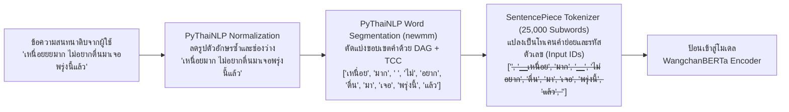

**ภาพที่ 2.1:** แผนผังกระบวนการตัดคำภาษาไทยแบบ Dictionary-based Maximum Matching (`newmm`) ร่วมกับการตัดคำย่อยด้วย SentencePiece

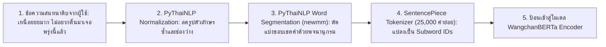

## 2.3 เทคนิคการจัดการบริบทบทสนทนาด้วยหน้าต่างข้อมูลเลื่อนไหล (Sliding Window Context Management)

### 2.3.1 แนวคิดการวิเคราะห์บทสนทนาแบบหลายรอบ (Multi-turn Dialogue Modelling)

ในการสนทนาผ่านแอปพลิเคชันส่งข้อความทันที (Instant Messaging) อย่างแพลตฟอร์ม LINE ผู้ใช้งานมักแบ่งเนื้อหาที่ต้องการสื่อสารออกเป็นข้อความสั้นๆ ต่อเนื่องกันหลายข้อความ (Multi-turn Utterances) แทนการพิมพ์เรียงความยาวในครั้งเดียว หากกำหนดให้ประวัติการสนทนาของผู้ใช้งานคนหนึ่งในเซสชันปัจจุบัน ณ เวลา $t$ แทนด้วยลำดับของข้อความ $U_1, U_2, \dots, U_t$ โดยที่ $U_i$ คือข้อความที่ผู้ใช้งานส่งเข้ามาในรอบการสนทนาที่ $i$ การวิเคราะห์แบบดั้งเดิม (Single-turn) จะประเมินความน่าจะเป็นของภาวะวิกฤต $P(Y \mid U_t)$ จากข้อความสุดท้ายเพียงอย่างเดียว ซึ่งทำให้สูญเสียข้อมูลบริบทก่อนหน้า $(U_1, \dots, U_{t-1})$ ไปทั้งหมด [6], [11]

### 2.3.2 แบบจำลองทางคณิตศาสตร์ของหน้าต่างบริบทเลื่อนไหล (Mathematical Formulation of Sliding Window)

เพื่อรักษาบริบทที่เกี่ยวข้องโดยไม่ให้เกิดสัญญาณรบกวนจากข้อความเก่าเกินไปและควบคุมไม่ให้เกินขีดจำกัดความจำของโมเดล โครงงานนี้ได้นิยามตัวดำเนินการหน้าต่างบริบทเลื่อนไหล $\mathcal{W}_{K, L}$ ซึ่งถูกควบคุมด้วยพารามิเตอร์ 2 ตัวแปร ได้แก่:

- $K \in \mathbb{Z}^+$ คือ **จำนวนรอบการสนทนาย้อนหลังสูงสุด (Maximum Conversation Turns)**
- $L \in \mathbb{Z}^+$ คือ **ปริมาณคำย่อยสูงสุดที่อนุญาตในหน้าต่างบริบท (Maximum Token Length)**

ณ รอบการสนทนาที่ $t$ ลำดับของข้อความที่ถูกคัดเลือกเข้ามาในหน้าต่างบริบทตามจำนวนรอบสนทนา $K$ สามารถเขียนเป็นสมการคณิตศาสตร์ได้ดังสมการที่ (2.1):

$$S_t^{(K)} = \left( U_{\max(1, \, t - K + 1)}, \, U_{\max(1, \, t - K + 2)}, \, \dots, \, U_t \right) \tag{2.1}$$

จากนั้น ข้อความแต่ละรอบในลำดับ $S_t^{(K)}$ จะถูกนำมาผ่านฟังก์ชันทำความสะอาดและตัดคำด้วย PyThaiNLP (`newmm`) แทนด้วย $\phi(\cdot)$ และนำมาเชื่อมต่อกันด้วยโทเคนคั่นรอบสนทนา `</s>` แล้วแปลงเป็นลำดับโทเคนคำย่อยด้วยตัวตัดคำ SentencePiece แทนด้วยฟังก์ชัน $\mathcal{T}(\cdot)$ ดังสมการที่ (2.2):

$$\mathbf{X}_t^{(K)} = \mathcal{T}\left( \phi(U_{\max(1, t-K+1)}) \oplus \text{"}\langle\text{/s}\rangle\text{"} \oplus \dots \oplus \text{"}\langle\text{/s}\rangle\text{"} \oplus \phi(U_t) \right) = (x_1, x_2, \dots, x_M) \tag{2.2}$$

เมื่อ $M$ คือจำนวนโทเคนคำย่อยทั้งหมดที่ได้จากการเชื่อมต่อข้อความ $K$ รอบสนทนา หากความยาว $M$ มีค่าเกินกว่าเพดานปริมาณคำย่อยสูงสุด $L$ (เมื่อหักลบโทเคนเริ่มต้น `<s>` และโทเคนปิดท้าย `</s>` จำนวน 2 โทเคนแล้ว) ระบบจะใช้กลไกการตัดทอนจากฝั่งซ้าย (**Left-side Truncation / Tail Preservation**) เพื่อรักษาข้อความในรอบปัจจุบัน $U_t$ ซึ่งเป็นสัญญาณล่าสุดไว้เสมอ และเติมโทเคนว่าง (`<pad>`) หากความยาวน้อยกว่า $L$ ดังสมการที่ (2.3):

$$
\mathcal{W}_{K, L}(H_t) = \begin{cases}
\left[ \langle\text{s}\rangle, \, x_{M - (L - 2) + 1}, \, \dots, \, x_M, \, \langle\text{/s}\rangle \right] & \text{if } M > L - 2 \\[6pt]
\left[ \langle\text{s}\rangle, \, x_1, \, \dots, \, x_M, \, \langle\text{/s}\rangle, \, \underbrace{\langle\text{pad}\rangle, \dots, \langle\text{pad}\rangle}_{L - 2 - M} \right] & \text{if } M \le L - 2
\end{cases} \tag{2.3}
$$

กลไกการทำงานของหน้าต่างบริบทเลื่อนไหลตามสมการที่ (2.1) ถึง (2.3) แสดงดังแผนภาพใน **ภาพที่ 2.2**

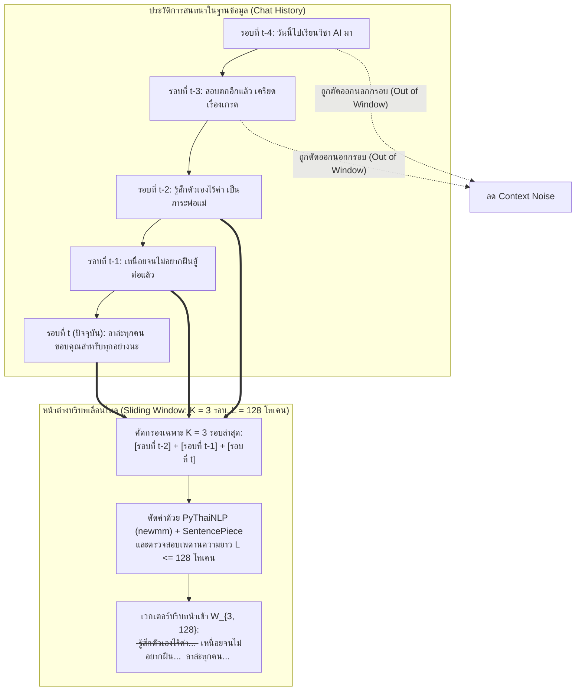

**ภาพที่ 2.2:** กลไกการเลื่อนกรอบหน้าต่างข้อมูลบริบท (Sliding Window Context Management) ตามจำนวนรอบสนทนา $K$ และเพดานโทเคน $L$

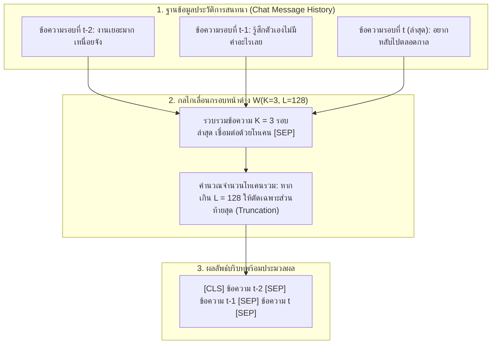

## 2.4 สถาปัตยกรรม Transformer และโมเดลภาษาไทย WangchanBERTa

### 2.4.1 สถาปัตยกรรม Transformer และกลไก Self-Attention

สถาปัตยกรรม **Transformer** นำเสนอโดย Vaswani และคณะ [12] ได้ปฏิวัติวงการประมวลผลภาษาธรรมชาติด้วยการแทนที่โครงข่ายประสาทเทียมแบบวนซ้ำ (RNN/LSTM) ด้วยกลไกความสนใจในตนเอง (**Self-Attention Mechanism**) ซึ่งช่วยให้โมเดลสามารถประมวลผลโทเคนทุกตัวในลำดับข้อความได้พร้อมกันแบบขนาน และสามารถเรียนรู้ความสัมพันธ์เชิงความหมายระหว่างคำที่อยู่ห่างกันข้ามประโยคหรือข้ามรอบสนทนาได้โดยไม่เกิดปัญหาการอันตรธานของเกรเดียนต์ (Vanishing Gradient)

หัวใจสำคัญของ Transformer คือ **Scaled Dot-Product Attention** ซึ่งคำนวณจากเมทริกซ์ตัวแทน 3 ส่วนที่แปลงเชิงเส้นมาจากเวกเตอร์นำเข้า $\mathbf{H}$ ได้แก่ เมทริกซ์คำถาม (**Query: $\mathbf{Q}$**), เมทริกซ์กุญแจ (**Key: $\mathbf{K}$**) และเมทริกซ์คุณค่า (**Value: $\mathbf{V}$**) โดยมีสมการคำนวณดังสมการที่ (2.4):

$$\text{Attention}(\mathbf{Q}, \mathbf{K}, \mathbf{V}) = \text{softmax}\left( \frac{\mathbf{Q}\mathbf{K}^T}{\sqrt{d_k}} \right)\mathbf{V} \tag{2.4}$$

เมื่อ $d_k$ คือขนาดมิติของเวกเตอร์ Key (ในโครงสร้าง Base มีค่า $d_k = 768 / 12 = 64$) การหารด้วย $\sqrt{d_k}$ มีวัตถุประสงค์เพื่อป้องกันไม่ให้ผลคูณภายใน (Dot Product) มีค่าสูงเกินไปจนผลักฟังก์ชัน Softmax เข้าสู่บริเวณที่มีความชันต่ำมาก ทั้งนี้ เพื่อให้โมเดลสามารถจับความสัมพันธ์ทางไวยากรณ์ ความหมายแฝง และอารมณ์ของประโยคได้หลากหลายแง่มุมพร้อมกัน จึงใช้โครงสร้าง **Multi-Head Attention** จำนวน $h$ หัว ($h = 12$) ดังสมการที่ (2.5) และ (2.6):

$$\text{MultiHead}(\mathbf{Q}, \mathbf{K}, \mathbf{V}) = \text{Concat}(\text{head}_1, \text{head}_2, \dots, \text{head}_h)\mathbf{W}^O \tag{2.5}$$

$$\text{โดยที่ } \text{head}_i = \text{Attention}(\mathbf{H}\mathbf{W}_i^Q, \, \mathbf{H}\mathbf{W}_i^K, \, \mathbf{H}\mathbf{W}_i^V) \tag{2.6}$$

### 2.4.2 โครงสร้างโมเดลภาษาไทย WangchanBERTa (`airesearch/wangchanberta-base-att-spm-uncased`)

โมเดล **WangchanBERTa** พัฒนาโดย Lowphansirikul และคณะ [8] เป็นโมเดลภาษาขนาดใหญ่แบบจำเพาะต่อภาษาไทย (Monolingual Thai Pre-trained Language Model) ที่มีรากฐานมาจากสถาปัตยกรรม **RoBERTa-base (Robustly Optimized BERT Approach)** [13] โดยมีคุณลักษณะทางวิศวกรรมที่สำคัญดังนี้:

1. **โครงสร้างสถาปัตยกรรม (Model Architecture):** ประกอบด้วยชั้น Transformer Encoder จำนวน 12 ชั้น (12 Layers), ขนาดเวกเตอร์ซ่อน (Hidden Dimension $d_{\text{model}}$) เท่ากับ 768 มิติ, จำนวนหัวความสนใจ (Attention Heads) 12 หัว, ขนาดชั้น Feed-Forward ภายในเท่ากับ 3,072 มิติ และมีจำนวนพารามิเตอร์ที่ปรับค่าได้รวมทั้งสิ้นประมาณ 105 ล้านพารามิเตอร์
2. **คลังข้อมูลฝึกสอนล่วงหน้า (Pre-training Corpus):** ผ่านการฝึกสอนแบบ Masked Language Modeling (MLM) บนชุดข้อมูลภาษาไทยขนาดใหญ่จำนวน 78.5 กิกะไบต์ ซึ่งรวบรวมจากข้อความบนสื่อสังคมออนไลน์ ข่าวสาร บทความวิชาการ และเว็บบอร์ดสาธารณะของไทย ทำให้โมเดลมีความเข้าใจโครงสร้างประโยคภาษาพูดและคำสแลงภาษาไทยได้ดีกว่าโมเดลพหุภาษา (เช่น mBERT หรือ XLM-R)
3. **ระบบตัดคำย่อย SentencePiece 25,000 คำย่อย:** ใช้โมเดล Unigram Language Model ของ SentencePiece ที่มีคลังคำศัพท์ขนาด 25,000 โทเคน ซึ่งถูกออกแบบให้เหมาะสมกับการกระจายตัวของหน่วยคำภาษาไทยโดยเฉพาะ
4. **ชั้นจำแนกประเภทและฟังก์ชันการสูญเสียสำหรับการตรวจจับภาวะวิกฤต (Classification Head & Loss Function):** ในการปรับจูน (Fine-tuning) สำหรับโครงงานนี้ เวกเตอร์ตัวแทนของโทเคนเริ่มต้น `<s>` จากชั้นสุดท้าย ($\mathbf{h}_{\langle\text{s}\rangle} \in \mathbb{R}^{768}$) จะถูกส่งผ่านชั้น Dropout และชั้นเชื่อมต่อสมบูรณ์ (Fully Connected Layer) เพื่อคำนวณความน่าจะเป็นของระดับความเสี่ยงทั้ง 3 ระดับ ($\hat{\mathbf{y}} \in \mathbb{R}^3$) ด้วยฟังก์ชัน Softmax และปรับค่าพารามิเตอร์ด้วยฟังก์ชันการสูญเสียแบบถ่วงน้ำหนักคลาส (**Class-Weighted Cross-Entropy Loss**) เพื่อเพิ่มความไวต่อคลาสภาวะวิกฤต ดังสมการที่ (2.7):

$$\mathcal{L}_{\text{WCE}} = -\sum_{c=0}^{2} w_c \cdot y_c \log(\hat{y}_c), \quad \text{โดยที่ } \hat{y}_c = \frac{\exp(\mathbf{w}_c^T \mathbf{h}_{\langle\text{s}\rangle} + b_c)}{\sum_{j=0}^{2} \exp(\mathbf{w}_j^T \mathbf{h}_{\langle\text{s}\rangle} + b_j)} \tag{2.7}$$

โครงสร้างการไหลของข้อมูลภายในโมเดล WangchanBERTa สำหรับการจำแนกจุดเสี่ยงภาวะวิกฤต แสดงดัง **ภาพที่ 2.3**

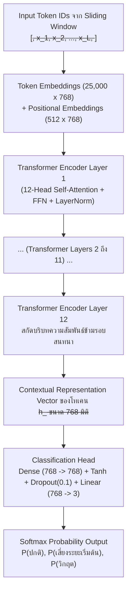

**ภาพที่ 2.3:** สถาปัตยกรรม Multi-Head Self-Attention และโครงสร้างชั้นประมวลผลของโมเดล WangchanBERTa

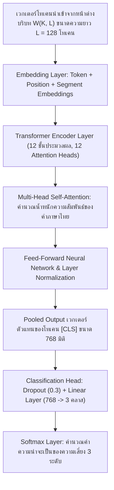

## 2.5 สถาปัตยกรรม FastAPI, LINE Messaging API และมาตรฐานคุณภาพซอฟต์แวร์ ISO/IEC 25010 ร่วมกับ SUS

### 2.5.1 เฟรมเวิร์ก FastAPI และการประมวลผลแบบอะซิงโครนัส

**FastAPI** เป็นเว็บเฟรมเวิร์กสมัยใหม่สำหรับภาษา Python ที่ออกแบบมาเพื่อสร้าง RESTful API ประสิทธิภาพสูง โดยทำงานอยู่บนมาตรฐาน **ASGI (Asynchronous Server Gateway Interface)** ร่วมกับเซิร์ฟเวอร์ Uvicorn และไลบรารีตรวจสอบโครงสร้างข้อมูล Pydantic [14] จุดเด่นทางวิศวกรรมของ FastAPI คือการรองรับคำสั่งทำงานแบบไม่บล็อกเธรด (`async` / `await`) ซึ่งมีความสำคัญอย่างยิ่งต่อระบบแชทบอทที่ต้องรับ HTTP POST Request จาก LINE Webhook พร้อมกันหลายคำขอ โดยในขณะที่ระบบรอการดึงประวัติรอบสนทนาจากฐานข้อมูลและการอนุมานผลลัพธ์จากโมเดล WangchanBERTa ระบบจะสามารถจัดการคำขอของผู้ใช้งานคนอื่นไปพร้อมกันได้โดยไม่เกิดคอขวด (Bottleneck)

### 2.5.2 สถาปัตยกรรม LINE Messaging API (Webhook & Flex Message)

การเชื่อมต่อระหว่างผู้ใช้งานบนแอปพลิเคชัน LINE กับระบบตรวจจับจุดเสี่ยงภาวะวิกฤต ทำงานผ่านกลไกของ **LINE Messaging API** [15] ซึ่งประกอบด้วย 2 ส่วนหลัก ได้แก่:

1. **กลไก Webhook Event:** เมื่อผู้ใช้งานพิมพ์ข้อความส่งมายังบัญชีทางการ (LINE Official Account) ของแชทบอทปุยใจ เซิร์ฟเวอร์ของ LINE Platform จะเข้ารหัสข้อมูลเหตุการณ์ในรูปแบบ JSON พร้อมลายเซ็นดิจิทัล (`X-Line-Signature` ที่เข้ารหัสด้วยอัลกอริทึม HMAC-SHA256) แล้วส่งมายังปลายทาง Webhook URL ของเซิร์ฟเวอร์ FastAPI ทันที
2. **การ์ดข้อความแบบยืดหยุ่น (LINE Flex Message):** เป็นรูปแบบข้อความเชิงโครงสร้างที่เขียนด้วย JSON ตามโมเดล CSS Flexbox ซึ่งอนุญาตให้นักพัฒนาจัดวางองค์ประกอบกราฟิก สีพื้นหลัง ไอคอนเตือนภัย และปุ่มกดโต้ตอบ (`URI Action` สำหรับการกดโทรออกหมายเลข `tel:1323`) ได้อย่างอิสระ ช่วยให้การแจ้งเตือนเมื่อพบจุดเสี่ยงภาวะวิกฤตมีความชัดเจน ดึงดูดสายตา และลดขั้นตอนในการกดโทรขอความช่วยเหลือฉุกเฉินเหลือเพียงการแตะปุ่มเพียงครั้งเดียว

### 2.5.3 มาตรฐานคุณภาพซอฟต์แวร์ ISO/IEC 25010 และแบบวัดความง่ายในการใช้งาน SUS

ในการประเมินคุณภาพทางวิศวกรรมของระบบซอฟต์แวร์ที่พัฒนาขึ้น โครงงานนี้อ้างอิงกรอบมาตรฐานสากล **ISO/IEC 25010 (System and Software Quality Models)** [16] โดยมุ่งเน้นคุณลักษณะสำคัญ 3 ด้าน ได้แก่ (1) **ความเหมาะสมของฟังก์ชัน (Functional Suitability)** ซึ่งวัดจากความถูกต้องแม่นยำในการคัดกรองจุดเสี่ยงภาวะวิกฤต, (2) **ประสิทธิภาพการทำงาน (Performance Efficiency)** ซึ่งวัดจากเวลาตอบสนอง (Response Time / Latency) ของระบบ API และ (3) **ความยากง่ายในการใช้งาน (Usability)**

สำหรับการวัดผลด้านความยากง่ายในการใช้งานเชิงปริมาณ โครงงานนี้ใช้เครื่องมือมาตรฐาน **System Usability Scale (SUS)** ที่พัฒนาโดย John Brooke [17] ซึ่งประกอบด้วยชุดคำถามมาตรฐานจำนวน 10 ข้อ โดยสลับระหว่างข้อความเชิงบวก (ข้อคี่: ข้อที่ 1, 3, 5, 7, 9) และข้อความเชิงลบ (ข้อคู่: ข้อที่ 2, 4, 6, 8, 10) ประเมินผลด้วยมาตรวัดแบบ Likert Scale 5 ระดับ (ตั้งแต่ 1 = ไม่เห็นด้วยอย่างยิ่ง ถึง 5 = เห็นด้วยอย่างยิ่ง) ทั้งนี้ การคำนวณคะแนนรวมของ SUS ให้มีค่าระหว่าง 0 ถึง 100 คะแนน คำนวณได้จากสมการที่ (2.8):

$$\text{SUS Score} = 2.5 \times \left[ \sum_{i \in \{1,3,5,7,9\}} (X_i - 1) + \sum_{j \in \{2,4,6,8,10\}} (5 - X_j) \right] \tag{2.8}$$

เมื่อ $X_i$ และ $X_j$ คือคะแนนดิบที่ผู้ประเมินเลือกในข้อที่ $i$ และ $j$ ตามลำดับ โดยเกณฑ์มาตรฐานสากลของ Bangor และคณะ [18] กำหนดไว้ว่า ระบบซอฟต์แวร์ที่มีค่าเฉลี่ยคะแนน SUS **สูงกว่า 68 คะแนน** ถือว่ามีความง่ายในการใช้งานอยู่ในเกณฑ์ผ่านมาตรฐาน (Above Average) และหากมีค่า **สูงกว่า 80.3 คะแนน** จะจัดอยู่ในเกณฑ์ดีเยี่ยม (Grade A / Excellent)

## 2.6 เกณฑ์การวัดประสิทธิภาพโมเดลทางวิศวกรรม

ในการประเมินประสิทธิภาพของโมเดลตรวจจับจุดเสี่ยงภาวะวิกฤต คณะผู้จัดทำใช้ตารางเมทริกซ์ความสับสน (**Confusion Matrix**) เป็นพื้นฐานในการคำนวณตัวชี้วัดทางวิศวกรรม โดยเมื่อพิจารณาการตรวจจับคลาสภาวะวิกฤต (Crisis = Positive, Non-Crisis = Negative) สามารถนิยามองค์ประกอบทั้ง 4 ส่วนได้ดัง **ตารางที่ 2.2**

**ตารางที่ 2.2:** โครงสร้างตาราง Confusion Matrix สำหรับประเมินโมเดลคัดกรองจุดเสี่ยงภาวะวิกฤต

| สถานะจริง \ ผลการพยากรณ์ | พยากรณ์ว่าเป็นภาวะวิกฤต (Positive) | พยากรณ์ว่าไม่ใช่ภาวะวิกฤต (Negative) |
| :--- | :--- | :--- |
| **สถานะจริงเป็นภาวะวิกฤต** | **ผลบวกจริง (TP):** ตรวจจับและส่งการ์ด 1323 ถูกต้อง | **ผลลบลวง (FN):** อันตรายสูงสุด ปล่อยผ่านเคสวิกฤต |
| **สถานะจริงไม่ใช่ภาวะวิกฤต** | **ผลบวกลวง (FP):** แจ้งเตือนเกินจริงจากคำประชด | **ผลลบจริง (TN):** จำแนกข้อความทั่วไปได้ถูกต้อง |

จากตารางที่ 2.2 สามารถเขียนสมการคำนวณค่าตัวชี้วัดประสิทธิภาพทางวิศวกรรมทั้ง 4 ค่า ได้แก่ ค่าความถูกต้องรวม (**Accuracy**), ค่าความแม่นยำ (**Precision**), ค่าความระลึก (**Recall / Sensitivity**) และค่าคะแนนเฉลี่ยฮาร์มอนิก (**F1-Score**) ได้ดังสมการที่ (2.9) ถึง (2.12):

$$\text{Accuracy} = \frac{TP + TN}{TP + TN + FP + FN} \tag{2.9}$$

$$\text{Precision} = \frac{TP}{TP + FP} \tag{2.10}$$

$$\text{Recall (Sensitivity)} = \frac{TP}{TP + FN} \tag{2.11}$$

$$\text{F1-Score} = \frac{2 \times \text{Precision} \times \text{Recall}}{\text{Precision} + \text{Recall}} = \frac{2TP}{2TP + FP + FN} \tag{2.12}$$

**ความสำคัญของการลดผลลบลวง (False Negative Minimization) ในระบบความปลอดภัยทางสุขภาพจิต:**  
ในทางวิศวกรรมระบบคัดกรองทางการแพทย์และจิตเวชศาสตร์ ต้นทุนความเสียหายของความผิดพลาดทั้งสองชนิดมีความไม่สมมาตรกันอย่างรุนแรง (Asymmetric Error Cost) หากเกิดผลบวกลวง ($FP$) ผลเสียคือผู้ใช้งานอาจได้รับข้อความแนะนำสายด่วน 1323 โดยที่ยังไม่ได้อยู่ในขั้นวิกฤต ซึ่งก่อให้เกิดเพียงความรำคาญใจเล็กน้อย แต่หากเกิด **ผลลบลวง ($FN$)** นั่นหมายความว่าผู้ใช้งานที่กำลังส่งสัญญาณขอความช่วยเหลือครั้งสุดท้ายก่อนทำร้ายตนเองถูกระบบเพิกเฉย ซึ่งอาจนำไปสู่ความสูญเสียต่อชีวิตที่ไม่สามารถแก้ไขได้ ดังนั้น โครงงานนี้จึงให้ความสำคัญสูงสุดกับการเพิ่มค่า **Recall** (ซึ่งแปรผกผันโดยตรงกับค่า $FN$) ควบคู่ไปกับการรักษาสมดุลของค่า **F1-Score**

## 2.7 งานวิจัยที่เกี่ยวข้อง

คณะผู้จัดทำได้ทบทวนและวิเคราะห์งานวิจัยที่เกี่ยวข้องทั้งในประเทศและต่างประเทศจำนวน 6 เรื่อง เพื่อศึกษาระเบียบวิธีวิจัย จุดเด่น และช่องว่างของงานวิจัยเดิม ดังนี้

1. **Lowphansirikul และคณะ (2021) [8]** ได้นำเสนอโมเดล **WangchanBERTa** ซึ่งเป็นโมเดล Pre-trained Masked Language Model สำหรับภาษาไทยบนสถาปัตยกรรม RoBERTa ที่ใช้ตัวตัดคำย่อย SentencePiece ขนาด 25,000 คำย่อย และทำการทดสอบบนชุดข้อมูลมาตรฐานภาษาไทย 4 ชุด (ได้แก่ Wisesight Sentiment, Wongnai Reviews, ThaiNER และ Prachathai-67k) ผลการวิจัยพบว่า WangchanBERTa ให้ค่า F1-Score สูงกว่าโมเดลพหุภาษา XLM-RoBERTa และ mBERT ในทุกภารกิจ อย่างไรก็ตาม งานวิจัยดังกล่าวมุ่งเน้นการจำแนกอารมณ์ทั่วไปจากข้อความเดี่ยว ยังไม่ได้ทำการศึกษาการประยุกต์ใช้กับบทสนทนาหลายรอบ (Multi-turn Dialogue) หรือการคัดกรองภาวะวิกฤตตามเกณฑ์ C-SSRS
2. **Ji และคณะ (2022) [4]** ได้ทำการศึกษาโมเดล **MentalBERT และ MentalRoBERTa** สำหรับการตรวจจับภาวะซึมเศร้าและความคิดฆ่าตัวตายจากข้อความบนเครือข่ายสังคมออนไลน์ Reddit โดยเปรียบเทียบโมเดลแบบดั้งเดิมกับโมเดลตระกูล Transformer ผลการวิจัยยืนยันว่ากลไก Self-Attention ของสถาปัตยกรรม RoBERTa สามารถจับความหมายแฝงของความคิดอยากตายได้ดีกว่าโมเดล CNN และ Bi-LSTM อย่างมีนัยสำคัญ แต่จำกัดอยู่เฉพาะข้อความภาษาอังกฤษที่มีความยาวระดับย่อหน้า ไม่ใช่บทสนทนาโต้ตอบสั้นๆ บนแชทบอท
3. **กิตติพงศ์ และคณะ (2023) [5]** ได้พัฒนาแบบจำลองการจำแนกข้อความภาษาไทยที่มีความเสี่ยงต่อภาวะซึมเศร้าบนแพลตฟอร์ม X (Twitter) โดยเปรียบเทียบอัลกอริทึม Machine Learning แบบดั้งเดิม (SVM, Random Forest) กับโมเดล WangchanBERTa ร่วมกับการตัดคำด้วย PyThaiNLP ผลการทดลองพบว่า WangchanBERTa ให้ค่า F1-Score สูงสุดที่ร้อยละ 88.40 อย่างไรก็ดี งานวิจัยนี้พิจารณาเฉพาะข้อความโพสต์เดี่ยว (Single Post) จึงยังประสบปัญหาเมื่อนำไปใช้กับแชทบอทที่ผู้ใช้พิมพ์ข้อความสั้นๆ ต่อเนื่องกันหลายรอบ
4. **Zhang และคณะ (2023) [6]** ได้ศึกษาผลกระทบของขนาดหน้าต่างบริบท (**Sliding Window Context**) ต่อการตรวจจับอารมณ์และภาวะวิกฤตในบทสนทนาการให้คำปรึกษาทางจิตวิทยาภาษาจีนและภาษาอังกฤษ โดยทดลองแปรผันจำนวนรอบสนทนาย้อนหลังตั้งแต่ 1 ถึง 10 รอบ ผลการวิจัยชี้ให้เห็นว่าการใช้บริบทย้อนหลัง 3 ถึง 4 รอบสนทนาให้ค่า Recall สูงที่สุด ในขณะที่การรวมบริบทเกินกว่า 5 รอบสนทนาทำให้เกิดปรากฏการณ์ Context Noise ซึ่งฉุดให้ค่า Precision ลดลง งานวิจัยนี้จึงเป็นแรงบันดาลใจสำคัญในการออกแบบการทดลอง Sliding Window สำหรับภาษาไทยในโครงงานนี้
5. **ธนวัฒน์ และคณะ (2024) [11]** ได้ออกแบบและพัฒนาแชทบอทดูแลสุขภาพจิตเบื้องต้นสำหรับนักศึกษามหาวิทยาลัยบนแพลตฟอร์ม LINE Official Account โดยใช้ Dialogflow และกฎการจับคู่คำสำคัญ (Keyword Matching) เพื่อส่งต่อสายด่วนสุขภาพจิต ผลการประเมินความพึงพอใจของผู้ใช้งานอยู่ในเกณฑ์ดี แต่พบข้อจำกัดสำคัญคือระบบไม่สามารถตรวจจับข้อความที่มีการใช้คำสแลงวัยรุ่นหรือประโยคบอกใบ้อ้อมค้อมได้ ส่งผลให้เกิดอัตรา False Negative สูงถึงร้อยละ 34.00
6. **Gaur และคณะ (2019) [10]** ได้นำเสนอการบูรณาการมาตรวัดทางคลินิก **C-SSRS (Columbia-Suicide Severity Rating Scale)** เข้ากับโครงข่ายประสาทเทียมเชิงลึกเพื่อจำแนกระดับความรุนแรงของความเสี่ยงการฆ่าตัวตายจากข้อความออนไลน์ ผลการวิจัยแสดงให้เห็นว่าการกำกับป้ายข้อมูลตามกรอบ C-SSRS ช่วยลดความคลาดเคลื่อนเชิงอัตวิสัยของผู้กำกับข้อมูล และทำให้ระบบสามารถตัดสินใจเลือกมาตรการแทรกแซงฉุกเฉินได้อย่างเป็นระบบ

จากการทบทวนวรรณกรรมข้างต้น สามารถสรุปเปรียบเทียบความแตกต่างและจุดเด่นของโครงงานวิจัยนี้เทียบกับงานวิจัยที่เกี่ยวข้องทั้ง 6 เรื่อง ได้ดัง **ตารางที่ 2.3**

**ตารางที่ 2.3:** การเปรียบเทียบงานวิจัยที่เกี่ยวข้องจำนวน 6 เรื่อง เทียบกับโครงงานแชทบอทปุยใจ

| ผู้วิจัยและปีที่พิมพ์ | ภาษาและโมเดลหลัก | บริบท Sliding Window | อ้างอิงเกณฑ์ C-SSRS | เชื่อมต่อ LINE ส่งต่อ 1323 |
| :--- | :--- | :---: | :---: | :---: |
| 1. Lowphansirikul et al. (2021) | ภาษาไทย (WangchanBERTa) | ไม่มี (ข้อความเดี่ยว) | ไม่ได้ใช้ | ไม่ได้เชื่อมต่อ |
| 2. Ji et al. (2022) | ภาษาอังกฤษ (MentalRoBERTa) | ไม่มี (โพสต์เดี่ยว) | ไม่ได้ใช้ | ไม่ได้เชื่อมต่อ |
| 3. กิตติพงศ์ และคณะ (2023) | ภาษาไทย (WangchanBERTa) | ไม่มี (โพสต์เดี่ยว) | ไม่ได้ใช้ | ไม่ได้เชื่อมต่อ |
| 4. Zhang et al. (2023) | ภาษาอังกฤษและจีน (RoBERTa) | มี (วิเคราะห์หลายรอบ) | ไม่ได้ใช้ | ไม่ได้เชื่อมต่อ |
| 5. ธนวัฒน์ และคณะ (2024) | ภาษาไทย (Keyword Matching) | ไม่มี (ประโยคล่าสุด) | ไม่ได้ใช้ | เชื่อมต่อ LINE OA |
| 6. Gaur et al. (2019) | ภาษาอังกฤษ (Deep Learning) | ไม่มี (โพสต์สะสมรวม) | อ้างอิง C-SSRS | ไม่ได้เชื่อมต่อ |
| **โครงงานแชทบอทปุยใจ (2569)** | **ภาษาไทย (WangchanBERTa + newmm)** | **มี (Factorial 3x3)** | **อ้างอิง C-SSRS 3 ระดับ** | **เชื่อมต่อ FastAPI + LINE 1323** |

# บทที่ 3: วิธีดำเนินการวิจัยและการออกแบบระบบ (Methodology & System Design)

บทนี้อธิบายถึงระเบียบวิธีวิจัยเชิงวิศวกรรมและกระบวนการออกแบบระบบตรวจจับจุดเสี่ยงภาวะวิกฤตจากบริบทข้อความสนทนาภาษาไทยด้วยโมเดล WangchanBERTa สำหรับแชทบอทปุยใจบนแพลตฟอร์ม LINE โดยครอบคลุมตั้งแต่การออกแบบสถาปัตยกรรมระบบโดยรวม การสร้างและกำกับชุดข้อมูลตามเกณฑ์ C-SSRS การวางแผนการทดลองหน้าต่างบริบทเลื่อนไหล (Sliding Window Factorial Design) การวิเคราะห์และออกแบบซอฟต์แวร์ด้วยแผนภาพมาตรฐานและการออกแบบฐานข้อมูล การออกแบบส่วนติดต่อผู้ใช้และการ์ดแจ้งเตือน LINE Flex Message ตลอดจนการออกแบบแผนการทดสอบระบบตามมาตรฐาน IEEE 829

## 3.1 กรอบแนวคิดการวิจัยและสถาปัตยกรรมระบบ

### 3.1.1 กรอบแนวคิดการวิจัย (Research Conceptual Framework)

กรอบแนวคิดของการวิจัยนี้มุ่งเน้นการแก้ปัญหาการตรวจจับสัญญาณเตือนภาวะวิกฤตที่แฝงอยู่ในบทสนทนาต่อเนื่องภาษาไทย โดยกำหนดให้:

- **ตัวแปรต้น (Independent Variables):** ได้แก่ (1) รูปแบบอัลกอริทึมการจำแนกข้อความ (Baseline Keyword Matching, TF-IDF + SVM, และโมเดล WangchanBERTa) และ (2) ขนาดพารามิเตอร์ของหน้าต่างบริบทเลื่อนไหล (Sliding Window) ซึ่งประกอบด้วยจำนวนรอบการสนทนาย้อนหลัง $K \in \{1, 3, 5\}$ รอบ และความยาวโทเคนสูงสุด $L \in \{64, 128, 256\}$ โทเคน
- **ตัวแปรตาม (Dependent Variables):** ได้แก่ ประสิทธิภาพในการตรวจจับจุดเสี่ยงภาวะวิกฤตที่วัดด้วยค่าความถูกต้อง (Accuracy), ค่าความแม่นยำ (Precision), ค่าความระลึก (Recall), ค่าคะแนนเฉลี่ยฮาร์มอนิก (F1-Score), อัตราผลลบลวง (False Negative Rate: FNR), เวลาแฝงในการประมวลผลตอบกลับ (API Inference Latency มิลลิวินาที) และคะแนนความง่ายในการใช้งานระบบ (System Usability Scale: SUS Score)

### 3.1.2 สถาปัตยกรรมระบบโดยรวม (System Architecture)

สถาปัตยกรรมของระบบแชทบอทปุยใจถูกออกแบบในรูปแบบ Micro-service Architecture ที่เชื่อมโยงการทำงานแบบเรียลไทม์ตั้งแต่ส่วนหน้าบ้านบนแอปพลิเคชัน LINE ไปจนถึงส่วนประมวลผลปัญญาประดิษฐ์และฐานข้อมูลส่วนหลังบ้าน ดังแสดงใน **ภาพที่ 3.1**

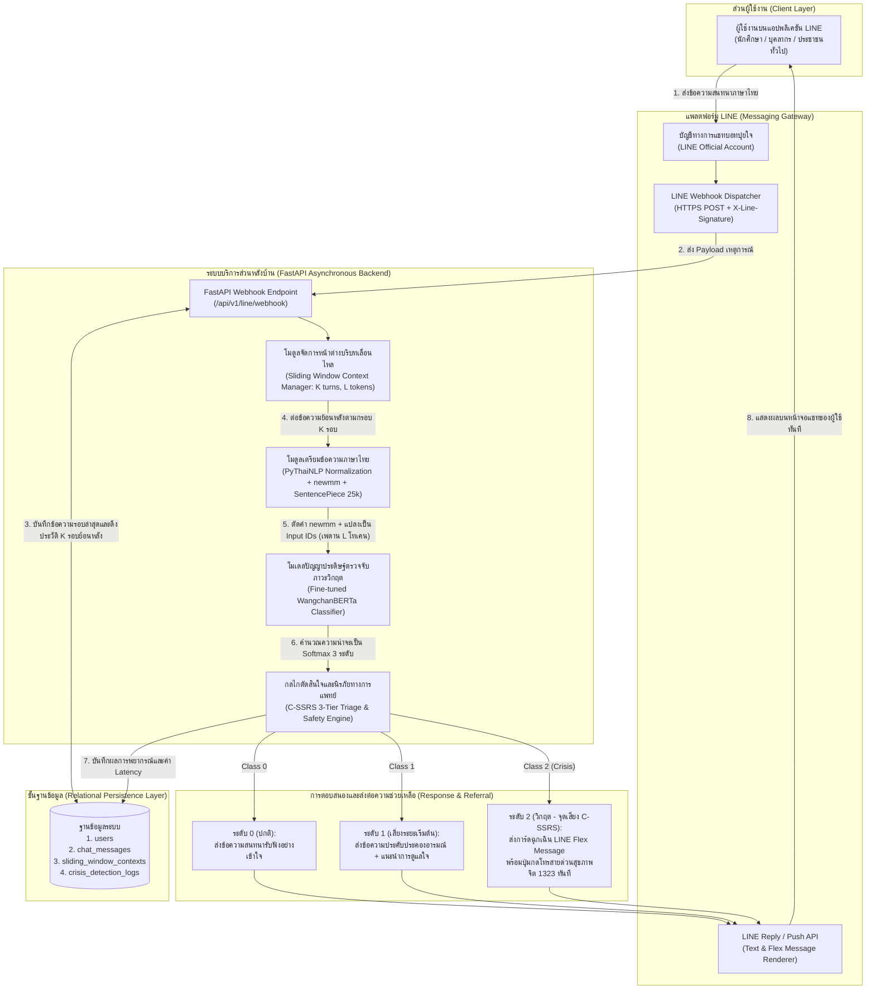

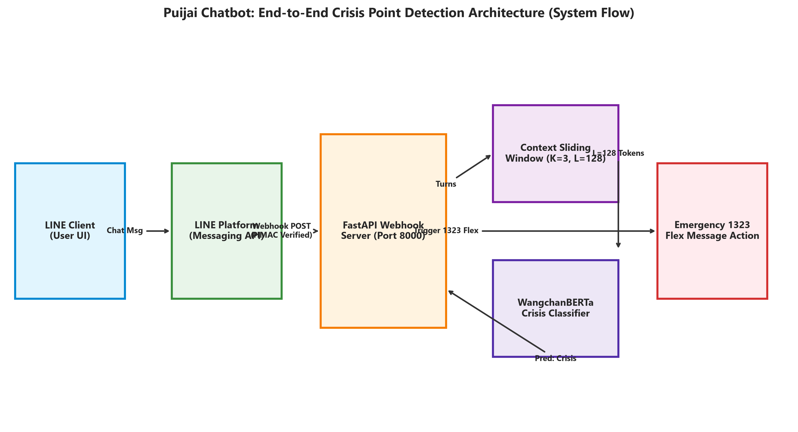

> 💡 **สรุปสถาปัตยกรรมระบบให้เข้าใจง่าย (สำหรับผู้อ่านและการตอบกรรมการ):**
> 1. **ผู้ใช้งานพิมพ์คุยใน LINE:** ผู้ใช้พิมพ์ข้อความระบายความเครียดตามปกติบนสมาร์ตโฟน
> 2. **ส่งต่อข้อความ (Webhook):** LINE ส่งข้อความมาที่เซิร์ฟเวอร์ FastAPI ของเราอย่างปลอดภัยด้วยรหัสลายเซ็นดิจิทัล (HMAC-SHA256)
> 3. **จำบทสนทนาย้อนหลัง (Sliding Window):** ระบบไม่ได้ดูแค่ข้อความล่าสุดประโยคเดียว แต่จะหยิบข้อความย้อนหลัง 3 รอบสนทนามาต่อกัน โดยคุมความยาวไม่เกิน 128 คำย่อย เพื่อให้เห็นพัฒนาการทางอารมณ์
> 4. **AI วิเคราะห์ความเสี่ยง (WangchanBERTa):** โมเดลภาษาไทยอ่านบริบทแล้วตัดเกรดความเสี่ยงออกเป็น 3 ระดับ (ปกติ / เสี่ยงเริ่มต้น / วิกฤต)
> 5. **กลไกช่วยเหลือฉุกเฉิน:** ถ้า AI พบว่าเข้าขั้น "วิกฤต" (มีเจตนาหรือแผนการทำร้ายตนเอง) แชทบอทจะส่งการ์ดฉุกเฉิน (LINE Flex Message) ที่มีปุ่มกดโทรออก **สายด่วนสุขภาพจิต 1323** ขึ้นมาบนหน้าจอทันที

**ภาพที่ 3.1:** สถาปัตยกรรมระบบโดยรวม (System Architecture Diagram) ของระบบตรวจจับจุดเสี่ยงภาวะวิกฤตสำหรับแชทบอทปุยใจบนแพลตฟอร์ม LINE

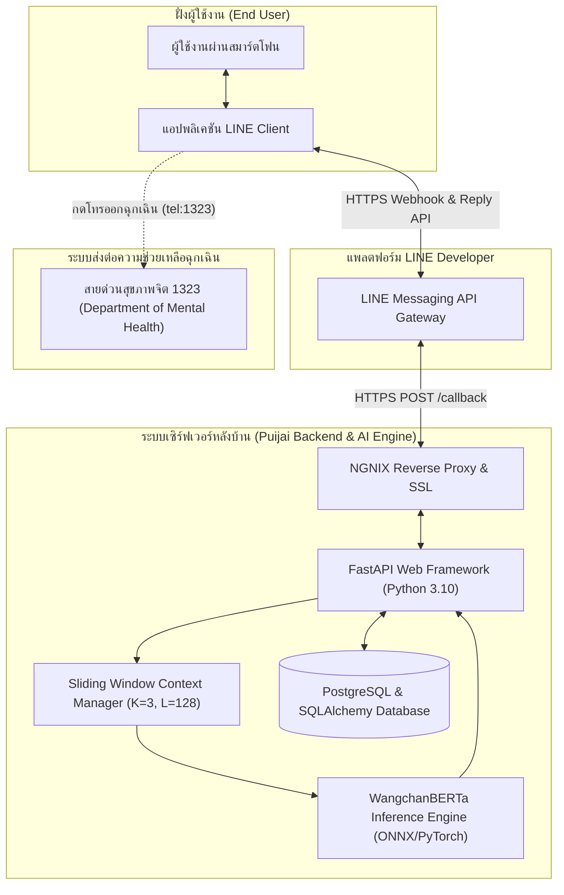

## 3.2 การเตรียมชุดข้อมูลจำลองสถานการณ์วิกฤตและเกณฑ์การกำกับข้อมูลตาม C-SSRS

### 3.2.1 กระบวนการสร้างชุดข้อมูลจำลองสถานการณ์ทางคลินิก (Synthetic Clinical Vignettes & Multi-turn Dataset)

เนื่องจากข้อมูลการสนทนาจริงของผู้ป่วยทางจิตเวชเป็นข้อมูลส่วนบุคคลที่มีความอ่อนไหวสูงตามพระราชบัญญัติคุ้มครองข้อมูลส่วนบุคคล (PDPA) และจริยธรรมการวิจัยในมนุษย์ คณะผู้จัดทำโดยทีมนักวิเคราะห์ธุรกิจ (BA) จึงได้ดำเนินการสร้างชุดข้อมูลบทสนทนาจำลองสถานการณ์วิกฤตภาษาไทย (**Synthetic Clinical Vignettes**) จำนวนรวมทั้งสิ้น **3,000 ชุดบทสนทนา** (แต่ละชุดบทสนทนาประกอบด้วยประวัติการโต้ตอบต่อเนื่องอย่างน้อย 5 รอบสนทนา รวมเป็นจำนวนข้อความย่อยกว่า 15,000 ข้อความ) โดยอ้างอิงโครงสร้างประโยคจากคู่มือการคัดกรองของกรมสุขภาพจิต กรณีศึกษาทางจิตวิทยา และสำนวนภาษาพูด/คำสแลงของวัยรุ่นไทยในปัจจุบัน

เพื่อป้องกันอคติในการสอนโมเดล ชุดข้อมูลทั้ง 3,000 ชุดบทสนทนาถูกออกแบบให้มีความสมดุลระหว่างคลาส (Class-Balanced Dataset) คลาสละ 1,000 ชุดบทสนทนา และครอบคลุมรูปแบบความยากทางภาษา 4 ลักษณะ ได้แก่:

1. **ประโยคบอกเล่าทั่วไปและสำนวนเปรียบเปรยเทียม (Hyperbolic Idioms):** เช่น _"การบ้านเยอะจะตายอยู่แล้ว"_, _"เหนื่อยสายตัวแทบขาด"_ (เพื่อฝึกให้โมเดลไม่เกิด False Positive)
2. **ประโยคที่ใช้คำสแลงวัยรุ่นและคำย่อ (Youth Slang & Colloquialisms):** เช่น _"ดาวน์ไม่ไหว อยากย้ายไปอยู่ดาวอื่นถาวร"_, _"ชีวิตบ้งมาก ไม่อยากอยู่ละ"_
3. **บทสนทนาที่ค่อยๆ สะสมความเสี่ยงข้ามรอบ (Multi-turn Escalating Crisis):** ที่ซึ่งรอบที่ 1–2 เล่าถึงปัญหาความล้มเหลวหรือการสูญเสีย และรอบที่ 3–5 ส่งสัญญาณสั่งเสียสั้นๆ เช่น _"ขอบคุณสำหรับทุกอย่างนะ ลาก่อน"_
4. **ประโยคที่แสดงเจตนาหรือแผนการทำร้ายตนเองโดยตรง (Explicit Crisis Statements):** ตามนิยามของ C-SSRS ระดับ 2 ถึง 6

### 3.2.2 เกณฑ์การกำกับป้ายข้อมูล (Data Labeling Criteria) และการตรวจสอบความเที่ยงตรง

การกำกับป้ายข้อมูล (Annotation) ดำเนินการโดยผู้กำกับข้อมูลอิสระจำนวน 3 คน ภายใต้เกณฑ์มาตรฐาน C-SSRS ที่ปรับประยุกต์สำหรับแชทบอทปุยใจ โดยวัดค่าความสอดคล้องระหว่างผู้ประเมินด้วยสถิติ **Fleiss' Kappa ($\kappa$)** ซึ่งได้ค่า $\kappa = 0.89$ (อยู่ในเกณฑ์สอดคล้องกันดีเยี่ยม) รายละเอียดเกณฑ์การกำกับข้อมูลและการแบ่งชุดข้อมูลสำหรับฝึกสอน (Train 70%), ตรวจสอบ (Validation 10%) และทดสอบ (Test 20%) แสดงดัง **ตารางที่ 3.1**

**ตารางที่ 3.1:** เกณฑ์การกำกับข้อมูลและการแบ่งสัดส่วนชุดข้อมูลจำลองตามมาตรฐาน C-SSRS

| คลาสความเสี่ยง | เทียบเกณฑ์ C-SSRS | ชุดฝึกสอน 70% | ชุดตรวจสอบ 10% | ชุดทดสอบ 20% | รวมทั้งหมด |
| :--- | :--- | :---: | :---: | :---: | :---: |
| **คลาส 0 ปกติ** | ระดับ 0 (ไร้ความเสี่ยง) | 700 ชุด | 100 ชุด | 200 ชุด | 1,000 ชุด |
| **คลาส 1 เสี่ยงระยะเริ่มต้น** | ระดับ 1 ถึง 2 (ความคิดแฝง) | 700 ชุด | 100 ชุด | 200 ชุด | 1,000 ชุด |
| **คลาส 2 ภาวะวิกฤต** | ระดับ 3 ถึง 6 (มีเจตนา/แผนการ) | 700 ชุด | 100 ชุด | 200 ชุด | 1,000 ชุด |
| **รวมทั้งหมด** | **ครอบคลุมระดับ 0 ถึง 6** | **2,100 ชุด** | **300 ชุด** | **600 ชุด** | **3,000 ชุด** |

*คำอธิบายประกอบตารางที่ 3.1:* ชุดข้อมูลบทสนทนาจำลองรวมทั้งสิ้น 3,000 ชุด ผ่านการตรวจสอบความสอดคล้องโดยผู้ประเมิน 3 คน ได้ค่าสถิติ Fleiss' Kappa เท่ากับ 0.89

## 3.3 การออกแบบการทดลอง Sliding Window และการตั้งค่า Hyperparameters

### 3.3.1 การออกแบบการทดลองแบบ Factorial ขนาด 3×3 (9 การทดลองย่อย)

เพื่อตอบวัตถุประสงค์ข้อที่ 2 และทดสอบสมมติฐานที่ 2 เกี่ยวกับผลกระทบของขนาดหน้าต่างบริบทเลื่อนไหลต่อความแม่นยำในการตรวจจับจุดเสี่ยงภาวะวิกฤต วิศวกรปัญญาประดิษฐ์ (AI Engineer) ได้ออกแบบการทดลองแบบ **3×3 Full Factorial Experiment** โดยกำหนดตัวแปรต้น 2 มิติ ได้แก่:

1. **จำนวนรอบการสนทนาย้อนหลัง (Conversation Turns: $K$):** กำหนดไว้ 3 ระดับ คือ $K = 1$ รอบ (พิจารณาเฉพาะประโยคล่าสุด), $K = 3$ รอบสนทนาย้อนหลัง และ $K = 5$ รอบสนทนาย้อนหลัง
2. **ปริมาณคำย่อยสูงสุด (Maximum Token Length: $L$):** กำหนดไว้ 3 ระดับ คือ $L = 64$ โทเคน, $L = 128$ โทเคน และ $L = 256$ โทเคน

เมื่อนำตัวแปรทั้งสองมิติมาจับคู่กันจะได้รูปแบบการทดลองย่อยรวมทั้งสิ้น **9 รูปแบบการทดลอง (Exp-1 ถึง Exp-9)** ดังแสดงใน **ตารางที่ 3.2**

**ตารางที่ 3.2:** เมทริกซ์การออกแบบการทดลองแบบ Factorial ขนาด 3×3 (9 การทดลองย่อย)

| รหัสการทดลอง | รอบสนทนา (K) | เพดานโทเคน (L) | รูปแบบการต่อข้อความบริบท | เป้าหมายการทดสอบทางวิศวกรรม |
| :---: | :---: | :---: | :--- | :--- |
| **Exp-1** | 1 รอบ | 64 โทเคน | เฉพาะรอบปัจจุบัน เพดาน 64 | ประเมินประสิทธิภาพพื้นฐานเมื่อไร้บริบทก่อนหน้า |
| **Exp-2** | 1 รอบ | 128 โทเคน | เฉพาะรอบปัจจุบัน เพดาน 128 | ประเมินกรณีประโยคเดี่ยวความยาวปานกลาง |
| **Exp-3** | 1 รอบ | 256 โทเคน | เฉพาะรอบปัจจุบัน เพดาน 256 | ประเมินกรณีผู้ใช้พิมพ์ระบายยาวในข้อความเดียว |
| **Exp-4** | 3 รอบ | 64 โทเคน | รวม 3 รอบล่าสุด เพดาน 64 | ตรวจสอบการถูกตัดทอนบริบทเมื่อเพดานโทเคนต่ำ |
| **Exp-5** | 3 รอบ | 128 โทเคน | รวม 3 รอบล่าสุด เพดาน 128 | จุดสมดุลเป้าหมาย เก็บบริบทครบโดยไร้สัญญาณรบกวน |
| **Exp-6** | 3 รอบ | 256 โทเคน | รวม 3 รอบล่าสุด เพดาน 256 | ตรวจสอบผลของเพดานโทเคนสูงต่อเวลาประมวลผล |
| **Exp-7** | 5 รอบ | 64 โทเคน | รวม 5 รอบล่าสุด เพดาน 64 | ตรวจสอบการดึง 5 รอบแต่ถูกจำกัดด้วยเพดาน 64 โทเคน |
| **Exp-8** | 5 รอบ | 128 โทเคน | รวม 5 รอบล่าสุด เพดาน 128 | ตรวจสอบการดึงบริบท 5 รอบภายใต้เพดานปานกลาง |
| **Exp-9** | 5 รอบ | 256 โทเคน | รวม 5 รอบล่าสุด เพดาน 256 | ตรวจสอบสัญญาณรบกวน Context Noise เมื่อรวมบริบทเก่า |

### 3.3.2 การตั้งค่าพารามิเตอร์ระดับสูง (Hyperparameters) ในการปรับจูนโมเดล WangchanBERTa

เพื่อให้การเปรียบเทียบผลการทดลองทั้ง 9 รูปแบบมีความยุติธรรมและควบคุมตัวแปรแทรกซ้อนได้อย่างสมบูรณ์ ทุกการทดลองย่อยจะใช้ค่าพารามิเตอร์ระดับสูง (Hyperparameters) ในการ Fine-tune โมเดล `airesearch/wangchanberta-base-att-spm-uncased` ชุดเดียวกันทั้งหมด ดังแสดงใน **ตารางที่ 3.3**

**ตารางที่ 3.3:** พารามิเตอร์ระดับสูง (Hyperparameters) ที่ใช้ในการปรับจูนโมเดล WangchanBERTa

| พารามิเตอร์ | ค่าที่กำหนด | เหตุผลทางวิศวกรรมในการเลือกใช้ |
| :--- | :--- | :--- |
| **Base Model** | `wangchanberta-base-att-spm-uncased` | โมเดล RoBERTa ภาษาไทย 12 ชั้น รองรับภาษาพูดและคำสแลงได้ดี |
| **Tokenizer** | PyThaiNLP newmm + SentencePiece 25k | ลดความกำกวมของขอบเขตคำภาษาไทยก่อนแปลงเป็นโทเคนคำย่อย |
| **Optimizer** | AdamW | ป้องกัน Overfitting ด้วยการแยก Weight Decay ออกจากเกรเดียนต์ |
| **Learning Rate** | 2e-5 (Warmup 10%) | รักษาความรู้ภาษาไทยเดิมของชั้น Transformer ไม่ให้สูญหาย |
| **Batch Size** | 16 | สร้างความเสถียรของเกรเดียนต์และเหมาะกับหน่วยความจำ GPU T4 |
| **Epochs** | 10 (Early Stopping = 3) | หยุดฝึกสอนอัตโนมัติเมื่อค่า Validation F1-Score ไม่เพิ่มขึ้น 3 รอบ |
| **Regularization** | Weight Decay 0.01, Dropout 0.10 | เพิ่มความสามารถในการจำแนกประโยคใหม่ที่ไม่เคยเห็นมาก่อน |
| **Loss Weights** | ถ่วงน้ำหนักคลาส (1.0, 1.2, 2.0) | ถ่วงน้ำหนักคลาสวิกฤตเป็น 2 เท่าเพื่อลดอัตราการเกิดผลลบลวง |
| **Random Seed** | 42 | รับประกันความสามารถในการทำซ้ำผลการทดลองได้ตรงกันทุกครั้ง |

## 3.4 การวิเคราะห์และออกแบบระบบซอฟต์แวร์ (Software Analysis & Design)

### 3.4.1 ตารางติดตามความต้องการของระบบ (Requirement Traceability Matrix: RTM)

นักวิเคราะห์ธุรกิจ (BA) ได้รวบรวมความต้องการของผู้มีส่วนได้ส่วนเสียและจัดทำตารางติดตามความต้องการของระบบ (**Requirement Traceability Matrix: RTM**) เพื่อเชื่อมโยงรหัสความต้องการ (Requirement ID) เข้ากับโมดูลการออกแบบซอฟต์แวร์และรหัสกรณีทดสอบ (Test Case ID) ของวิศวกร QA ดังแสดงใน **ตารางที่ 3.4**

**ตารางที่ 3.4:** ตารางติดตามความต้องการของระบบ (Requirement Traceability Matrix: RTM)

| รหัสความต้องการ | ประเภท | รายละเอียดความต้องการหลัก | โมดูลซอฟต์แวร์ที่รองรับ | รหัสกรณีทดสอบ |
| :---: | :---: | :--- | :--- | :---: |
| **FR-01** | Functional | รับข้อความผ่าน LINE Webhook และตรวจลายเซ็นปลอดภัย | `webhook_router.py` | TC-01, TC-02 |
| **FR-02** | Functional | จัดเก็บและดึงประวัติแชทย้อนหลังตามพารามิเตอร์ K และ L | `sliding_window_service.py` | TC-03, TC-06, TC-07 |
| **FR-03** | Functional | ตัดคำด้วย PyThaiNLP newmm และ SentencePiece 25,000 คำย่อย | `thai_nlp_preprocessor.py` | TC-04, TC-05 |
| **FR-04** | Functional | ประมวลผลจำแนกความเสี่ยง 3 ระดับตามเกณฑ์ C-SSRS | `crisis_classifier.py` | TC-01 ถึง TC-09 |
| **FR-05** | Functional | ส่งการ์ดฉุกเฉิน LINE Flex Message พร้อมปุ่มโทร 1323 ทันที | `flex_message_builder.py` | TC-08, TC-09 |
| **FR-06** | Functional | บันทึกผลการตรวจจับและเวลาประมวลผลลงฐานข้อมูล | `audit_logger_service.py` | TC-10 |
| **NFR-01** | Non-Functional | ค่า Recall และ F1-Score ในคลาสวิกฤตไม่ต่ำกว่าร้อยละ 90.00 | Fine-tuned WangchanBERTa | การทดลองที่ 4.2 |
| **NFR-02** | Non-Functional | เวลาตอบสนองของ API เฉลี่ยไม่เกิน 500 มิลลิวินาที | FastAPI Async Server | TC-01 ถึง TC-10 |
| **NFR-03** | Non-Functional | คะแนนประเมินการใช้งาน SUS เฉลี่ยไม่ต่ำกว่า 68 คะแนน | LINE Chat & Flex Message | การประเมินที่ 4.5 |

### 3.4.2 แผนภาพกรณีการใช้งาน (Use Case Diagram)

ความสัมพันธ์ระหว่างผู้ใช้งานระบบและฟังก์ชันการทำงานของระบบแชทบอทปุยใจ แสดงดัง **ภาพที่ 3.2**

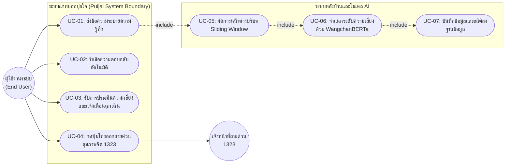

**ภาพที่ 3.2:** แผนภาพกรณีการใช้งาน (Use Case Diagram) ของระบบแชทบอทปุยใจ

### 3.4.3 แผนภาพลำดับการทำงานเชิงเวลา (Sequence Diagram)

ลำดับการโต้ตอบระหว่างอ็อบเจกต์ภายในระบบตั้งแต่จังหวะที่ผู้ใช้งานส่งข้อความที่มีความเสี่ยงสะสมจนกระทั่งระบบส่งการ์ด LINE Flex Message แสดงดัง **ภาพที่ 3.3**

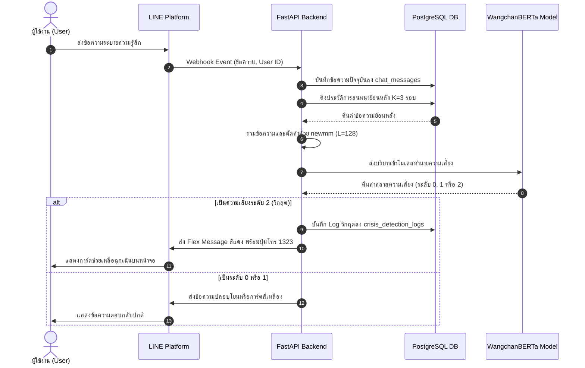

**ภาพที่ 3.3:** แผนภาพลำดับการทำงานเชิงเวลา (Sequence Diagram) ตั้งแต่การรับข้อความจาก LINE Webhook จนถึงการส่งการ์ดแจ้งเตือนฉุกเฉิน 1323

### 3.4.4 แผนภาพความสัมพันธ์ของข้อมูล (ER Diagram) และพจนานุกรมข้อมูล (Data Dictionary)

ระบบฐานข้อมูลได้รับการออกแบบตามหลักการ Normalization ระดับที่ 3 (3NF) ประกอบด้วยตารางหลักจำนวน 4 ตาราง ได้แก่ ตารางผู้ใช้งาน (`users`), ตารางประวัติข้อความสนทนา (`chat_messages`), ตารางหน้าต่างบริบทเลื่อนไหล (`sliding_window_contexts`) และตารางบันทึกผลการตรวจจับภาวะวิกฤต (`crisis_detection_logs`) โดยมีแผนภาพความสัมพันธ์ (ER Diagram) แสดงดัง **ภาพที่ 3.4** และรายละเอียดพจนานุกรมข้อมูลแสดงใน **ตารางที่ 3.5 ถึง ตารางที่ 3.8**

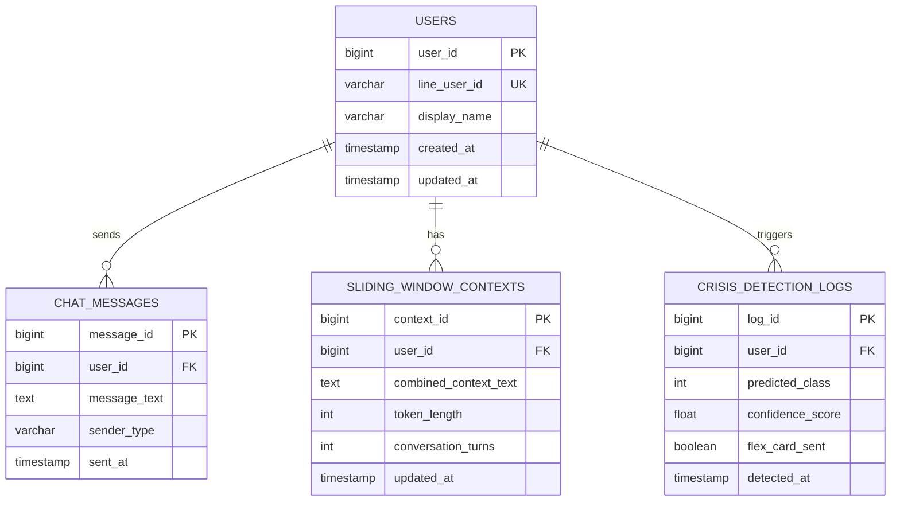

**ภาพที่ 3.4:** แผนภาพความสัมพันธ์ของข้อมูล (Entity-Relationship Diagram: ER Diagram) ของฐานข้อมูลระบบ

**ตารางที่ 3.5:** พจนานุกรมข้อมูลของตารางผู้ใช้งาน (`users`)

| ชื่อเขตข้อมูล | ชนิดข้อมูล | ขนาด | ข้อกำหนด | คำอธิบายรายละเอียด |
| :--- | :--- | :--- | :--- | :--- |
| **user_id** | VARCHAR | 64 | PRIMARY KEY | รหัสผู้ใช้จาก LINE ที่เข้ารหัส SHA-256 เพื่อคุ้มครองข้อมูลส่วนบุคคล |
| **display_name** | VARCHAR | 100 | NULLABLE | ชื่อเรียกของผู้ใช้งานสำหรับการทักทายของแชทบอทปุยใจ |
| **current_session_id** | VARCHAR | 32 | NOT NULL | รหัสอ้างอิงเซสชันการสนทนาปัจจุบันสำหรับจัดกลุ่มรอบสนทนา |
| **highest_risk_level** | INTEGER | 4 Bytes | DEFAULT 0 | ระดับความเสี่ยงสูงสุดที่เคยตรวจพบ (0, 1 หรือ 2) |
| **created_at** | TIMESTAMP | 8 Bytes | NOT NULL | วันและเวลาที่ผู้ใช้งานเริ่มส่งข้อความครั้งแรก |
| **last_active_at** | TIMESTAMP | 8 Bytes | NOT NULL | วันและเวลาล่าสุดที่ผู้ใช้งานสนทนากับแชทบอทปุยใจ |

**ตารางที่ 3.6:** พจนานุกรมข้อมูลของตารางประวัติข้อความสนทนา (`chat_messages`)

| ชื่อเขตข้อมูล | ชนิดข้อมูล | ขนาด | ข้อกำหนด | คำอธิบายรายละเอียด |
| :--- | :--- | :--- | :--- | :--- |
| **message_id** | BIGINT | 8 Bytes | PRIMARY KEY | รหัสลำดับข้อความสนทนาอัตโนมัติ |
| **user_id** | VARCHAR | 64 | FOREIGN KEY | รหัสอ้างอิงผู้ใช้งานที่ส่งข้อความ (เชื่อมตาราง users) |
| **line_message_id** | VARCHAR | 64 | UNIQUE | รหัสข้อความจาก LINE Webhook ป้องกันการประมวลผลซ้ำ |
| **turn_index** | INTEGER | 4 Bytes | NOT NULL | ลำดับรอบการสนทนาภายในเซสชันปัจจุบัน |
| **raw_text** | TEXT | ไม่จำกัด | NOT NULL | ข้อความภาษาไทยต้นฉบับที่ผู้ใช้พิมพ์ส่งเข้ามา |
| **segmented_text** | TEXT | ไม่จำกัด | NOT NULL | ข้อความที่ผ่านการตัดคำด้วยไลบรารี PyThaiNLP อัลกอริทึม newmm |
| **token_count** | INTEGER | 4 Bytes | NOT NULL | จำนวนโทเคนคำย่อยจากการแปลงด้วย SentencePiece |
| **created_at** | TIMESTAMP | 8 Bytes | NOT NULL | วันและเวลาที่เซิร์ฟเวอร์ได้รับข้อความจาก LINE Webhook |

**ตารางที่ 3.7:** พจนานุกรมข้อมูลของตารางหน้าต่างบริบทเลื่อนไหล (`sliding_window_contexts`)

| ชื่อเขตข้อมูล | ชนิดข้อมูล | ขนาด | ข้อกำหนด | คำอธิบายรายละเอียด |
| :--- | :--- | :--- | :--- | :--- |
| **context_id** | BIGINT | 8 Bytes | PRIMARY KEY | รหัสอ้างอิงชุดข้อมูลหน้าต่างบริบทเลื่อนไหล |
| **user_id** | VARCHAR | 64 | FOREIGN KEY | รหัสอ้างอิงผู้ใช้งานเจ้าของบริบทการสนทนา |
| **trigger_message_id** | BIGINT | 8 Bytes | FOREIGN KEY | รหัสข้อความรอบปัจจุบันที่กระตุ้นการสร้างบริบท |
| **window_turns_k** | INTEGER | 4 Bytes | NOT NULL | จำนวนรอบการสนทนาย้อนหลังที่นำมารวมกัน (1, 3 หรือ 5) |
| **max_token_length_l** | INTEGER | 4 Bytes | NOT NULL | เพดานปริมาณคำย่อยสูงสุดที่อนุญาต (64, 128 หรือ 256) |
| **concatenated_context** | TEXT | ไม่จำกัด | NOT NULL | ข้อความที่เชื่อมต่อกันแล้วทุก Turn คั่นด้วยโทเคนพิเศษ |
| **actual_token_length** | INTEGER | 4 Bytes | NOT NULL | จำนวนโทเคนคำย่อยจริงที่ส่งเข้าสู่โมเดล WangchanBERTa |
| **is_truncated** | BOOLEAN | 1 Byte | DEFAULT FALSE | สถานะระบุว่าบริบทย้อนหลังยาวเกินเพดานจนต้องตัดทอนหรือไม่ |
| **created_at** | TIMESTAMP | 8 Bytes | NOT NULL | วันและเวลาที่ประกอบหน้าต่างบริบทเสร็จสมบูรณ์ |

**ตารางที่ 3.8:** พจนานุกรมข้อมูลของตารางบันทึกผลการตรวจจับภาวะวิกฤต (`crisis_detection_logs`)

| ชื่อเขตข้อมูล | ชนิดข้อมูล | ขนาด | ข้อกำหนด | คำอธิบายรายละเอียด |
| :--- | :--- | :--- | :--- | :--- |
| **log_id** | BIGINT | 8 Bytes | PRIMARY KEY | รหัสลำดับบันทึกผลการตรวจจับความเสี่ยง |
| **context_id** | BIGINT | 8 Bytes | FOREIGN KEY | รหัสหน้าต่างบริบทเลื่อนไหลที่นำมาพยากรณ์ |
| **predicted_class** | INTEGER | 4 Bytes | NOT NULL | ผลการจำแนกคลาสของโมเดล (0=ปกติ, 1=เสี่ยงเริ่มต้น, 2=วิกฤต) |
| **cssrs_mapped_tier** | VARCHAR | 20 | NOT NULL | ระดับเกณฑ์ C-SSRS ที่เทียบเคียงได้ |
| **prob_normal** | FLOAT | 4 Bytes | NOT NULL | ค่าความน่าจะเป็น Softmax ของระดับปกติ |
| **prob_early_risk** | FLOAT | 4 Bytes | NOT NULL | ค่าความน่าจะเป็น Softmax ของระดับเสี่ยงระยะเริ่มต้น |
| **prob_crisis** | FLOAT | 4 Bytes | NOT NULL | ค่าความน่าจะเป็น Softmax ของระดับวิกฤต |
| **inference_latency_ms** | FLOAT | 4 Bytes | NOT NULL | เวลาที่ใช้รันโมเดล WangchanBERTa หน่วยเป็นมิลลิวินาที |
| **flex_alert_sent** | BOOLEAN | 1 Byte | NOT NULL | สถานะการส่งการ์ดแจ้งเตือนฉุกเฉินสายด่วน 1323 |
| **detected_at** | TIMESTAMP | 8 Bytes | NOT NULL | วันและเวลาที่บันทึกผลการตรวจจับลงฐานข้อมูล |

### 3.4.5 โครงสร้างโค้ดส่วนประมวลผลหลักของระบบ (Core Implementation Code)

สำหรับการจัดทำเล่มโครงงานฉบับสมบูรณ์ คณะผู้จัดทำได้นำเสนอซอร์สโค้ดแกนกลางของระบบที่พัฒนาและใช้งานจริง ซึ่งครอบคลุมทั้งกระบวนการจัดการหน้าต่างบริบทระดับคำย่อย SentencePiece, การอนุมานโมเดล WangchanBERTa และการทำงานของ FastAPI Webhook ร่วมกับกลไกความมั่นคงปลอดภัย (Security & Safety Hardening):

```python
# ==============================================================================
# ส่วนที่ 1: การจัดการหน้าต่างบริบทระดับ SentencePiece Subword Token (Left-Truncation)
# ==============================================================================
from dataclasses import dataclass
from typing import Sequence, Callable, Any
import torch

@dataclass(frozen=True)
class WindowConfig:
    k: int = 3             # จำนวนรอบสนทนาย้อนหลังล่าสุด
    max_length: int = 128  # เพดานโทเคนสูงสุด (รวม Special Tokens)

def build_subword_window(
    user_messages: Sequence[str],
    tokenizer: Any,
    config: WindowConfig,
    preprocess: Callable[[str], str] = lambda x: x,
) -> tuple[dict[str, torch.Tensor], dict[str, Any]]:
    """สร้างข้อมูลนำเข้าระดับ SentencePiece Subword Token พร้อมตัดทอนจากด้านซ้าย (Left-Truncation)."""
    if config.k < 1:
        raise ValueError("k must be >= 1")
    special_count = getattr(tokenizer, "num_special_tokens_to_add", lambda pair=False: 2)(pair=False)
    budget = config.max_length - special_count
    if budget < 1:
        raise ValueError("max_length is too small for special tokens")

    selected = [m for m in user_messages[-config.k:] if isinstance(m, str) and m.strip()]
    if not selected:
        raise ValueError("No valid user messages found")

    sep_id = getattr(tokenizer, "sep_token_id", None)
    content_ids: list[int] = []

    for index, text in enumerate(selected):
        clean_text = preprocess(text)
        if index > 0 and sep_id is not None:
            content_ids.append(sep_id)
        enc_ids = tokenizer.encode(clean_text, add_special_tokens=False, truncation=False)
        content_ids.extend(enc_ids)

    before_truncation = len(content_ids)
    # Left-truncation: รักษาโทเคนรอบล่าสุดไว้เสมอ (Tail Preservation)
    kept_ids = content_ids[-budget:]
    
    # เพิ่ม Special Tokens (<s> ... </s>)
    if hasattr(tokenizer, "build_inputs_with_special_tokens"):
        input_ids = tokenizer.build_inputs_with_special_tokens(kept_ids)
    else:
        bos = getattr(tokenizer, "bos_token_id", 1)
        eos = getattr(tokenizer, "eos_token_id", 2)
        input_ids = [bos] + kept_ids + [eos]

    attention_mask = [1] * len(input_ids)
    metadata = {
        "requested_k": config.k,
        "selected_turns": len(selected),
        "max_length": config.max_length,
        "content_tokens_before": before_truncation,
        "input_tokens_after": len(input_ids),
        "is_truncated": before_truncation > budget,
    }
    encoded = {
        "input_ids": torch.tensor([input_ids], dtype=torch.long),
        "attention_mask": torch.tensor([attention_mask], dtype=torch.long),
    }
    return encoded, metadata

# ==============================================================================
# ส่วนที่ 2: การอนุมานโมเดล WangchanBERTa สำหรับการจำแนกความเสี่ยง 3 ระดับ
# ==============================================================================
from transformers import AutoTokenizer, AutoModelForSequenceClassification

MODEL_PATH = "models/wcb-n3"
tokenizer = AutoTokenizer.from_pretrained("airesearch/wangchanberta-base-att-spm-uncased")
model = AutoModelForSequenceClassification.from_pretrained(MODEL_PATH)
model.eval()

@torch.inference_mode()
def predict_risk(turns: list[str], k: int = 3, max_length: int = 128) -> dict:
    encoded, metadata = build_subword_window(turns, tokenizer, WindowConfig(k=k, max_length=max_length))
    logits = model(**encoded).logits
    probs = torch.softmax(logits, dim=-1)[0]
    
    # Safety Threshold Policy (Critical Prioritization)
    p_critical = float(probs[2])
    p_warning = float(probs[1])
    if p_critical >= 0.35:
        level = 2  # Crisis
    elif p_warning >= 0.50:
        level = 1  # Early Risk
    else:
        level = 0  # Normal

    return {
        "level": level,
        "probabilities": [float(p) for p in probs],
        **metadata,
    }

# ==============================================================================
# ส่วนที่ 3: ระบบบริการหลังบ้าน FastAPI Webhook พร้อมมาตรการความปลอดภัย
# ==============================================================================
import hmac, hashlib
from fastapi import FastAPI, Header, HTTPException, Request

app = FastAPI(title="Puijai Risk API", version="1.0.0")

def verify_signature(body: bytes, signature: str, secret: str) -> bool:
    expected = hmac.new(secret.encode(), body, hashlib.sha256).digest()
    import base64
    return hmac.compare_digest(base64.b64encode(expected).decode(), signature)

@app.post("/callback")
async def line_callback(request: Request, x_line_signature: str = Header(default="")):
    body = await request.body()
    if not verify_signature(body, x_line_signature, "LINE_CHANNEL_SECRET"):
        raise HTTPException(status_code=400, detail="Invalid HMAC-SHA256 signature")
    
    payload = await request.json()
    for event in payload.get("events", []):
        if event.get("type") != "message" or event.get("message", {}).get("type") != "text":
            continue
        
        user_id = event["source"]["userId"]
        reply_token = event.get("replyToken")
        text = event["message"]["text"]
        
        # 1. Anti-DoS Rate Limiting & Token Deduplication
        if session_store.is_rate_limited(user_id, min_seconds=1.0) or session_store.is_token_processed(reply_token):
            continue
            
        # 2. Sliding Window Session Update & Inference
        turns = session_store.append(user_id, text)
        result = predict_risk(turns, k=3, max_length=128)
        
        # 3. Crisis Response with Push Fallback
        if result["level"] == 2:
            reply_ok = await line_client.reply_flex_crisis(reply_token, hotline="1323")
            if not reply_ok:
                # Fallback ไปยัง Push Message API ทันทีหาก Reply Token หมดอายุ
                await line_client.push_flex_crisis(user_id, hotline="1323")
        elif result["level"] == 1:
            await line_client.reply_flex_warning(reply_token)
        else:
            await line_client.reply_text(reply_token, "ปุยใจรับฟังอยู่นะครับ ☁️")
            
        session_store.mark_token_processed(reply_token)
    return {"status": "ok"}
```

## 3.5 การออกแบบส่วนติดต่อผู้ใช้ UX/UI บน Figma และโครงสร้างการ์ดแจ้งเตือน LINE Flex Message

### 3.5.1 หลักการออกแบบประสบการณ์ผู้ใช้สำหรับผู้มีความเสี่ยงทางอารมณ์ (Trauma-Informed UX/UI Design)

ทีมนักออกแบบ UX/UI ได้ออกแบบหน้าจอต้นแบบบนโปรแกรม Figma โดยยึดหลักจิตวิทยาการออกแบบที่คำนึงถึงสภาวะทางอารมณ์ของผู้ใช้งาน (Trauma-Informed & Low-Cognitive-Load Design) ดังนี้:

1. **การเลือกใช้โทนสีตามจิตวิทยา (Color Psychology):** ในสภาวะการสนทนาปกติและการดูแลใจเบื้องต้น ระบบใช้โทนสีฟ้าพาสเทล (`#5B9BD5`) และพื้นหลังสีขาวอมฟ้าอ่อน (`#F8FAFC`) เพื่อสร้างความรู้สึกสงบ ปลอดภัย และเป็นมิตร แต่ในกรณีที่ระบบตรวจพบ **จุดเสี่ยงภาวะวิกฤต (Class 2)** การ์ดแจ้งเตือนฉุกเฉินจะเปลี่ยนส่วนหัวเป็นสีแดงแจ้งเตือนความสำคัญสูง (`#EF4444`) ตัดกับพื้นหลังการ์ดสีขาวสะอาด เพื่อดึงสติและนำสายตาของผู้ใช้งานไปยังปุ่มขอความช่วยเหลือทันทีโดยไม่ทำให้เนื้อหาอ่านยาก
2. **การลดภาระการรับรู้ขณะเกิดวิกฤต (Zero-Friction Emergency Action):** ผู้ที่อยู่ในภาวะวิกฤตมักมีสภาวะความคิดตีบตัน (Cognitive Constriction) การออกแบบการ์ด LINE Flex Message จึงหลีกเลี่ยงข้อความที่ยาวเกินไป แสดงเฉพาะข้อความแสดงความห่วงใยสั้นๆ หมายเลขสายด่วนที่ชัดเจน และปุ่มกดขนาดใหญ่ (`height: md`, `style: primary`) ที่ผูกกับโปรโตคอล `tel:1323` เพื่อให้ผู้ใช้งานสามารถแตะปุ่มเพียงครั้งเดียวเพื่อเปิดหน้าจอโทรศัพท์พร้อมโทรออกได้ทันที

### 3.5.2 โครงสร้างลำดับชั้นของการ์ดแจ้งเตือน LINE Flex Message

โครงสร้างของการ์ดแจ้งเตือนฉุกเฉินถูกออกแบบตามมาตรฐาน LINE Bubble Container ประกอบด้วย 3 ส่วนหลัก ได้แก่ ส่วนหัว (Header), ส่วนเนื้อหาหลัก (Body) และส่วนปุ่มกดด้านล่าง (Footer) โดยรองรับการโทรออกสายด่วน 1323 ทันทีเมื่อเกิดภาวะวิกฤต

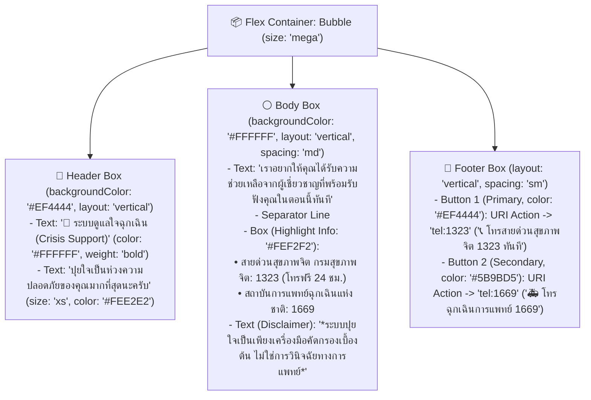

**โครงสร้างลำดับชั้นการ์ดแจ้งเตือน LINE Flex Message (Flex Bubble Container)**

## 3.6 การออกแบบแผนการทดสอบระบบของ QA ตามมาตรฐาน IEEE 829 และแบบประเมิน SUS

### 3.6.1 การออกแบบกรณีทดสอบระบบตามมาตรฐาน IEEE 829 (Functional & Contextual Test Cases)

วิศวกรประกันคุณภาพซอฟต์แวร์ (QA Engineer) ได้จัดทำแผนผังกระบวนการทดสอบระบบตามมาตรฐาน **IEEE 829** แสดงดัง **ภาพที่ 3.5** และกำหนดกรณีทดสอบจำนวน **10 กรณีทดสอบ (TC-01 ถึง TC-10)** เพื่อตรวจสอบความถูกต้องของการประมวลผลทั้งในกรณีข้อความปกติ คำสแลงกำกวม สำนวนเปรียบเปรย ข้อความเสี่ยงระยะเริ่มต้น และข้อความวิกฤตที่สะสมต่อเนื่องหลายรอบสนทนา ดังแสดงใน **ตารางที่ 3.9**

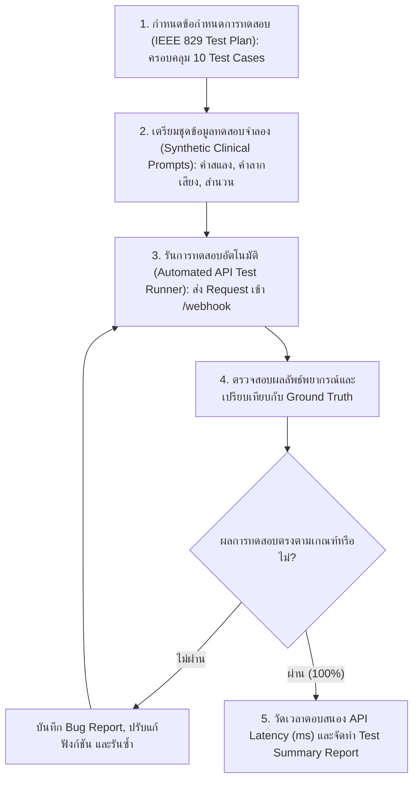

**ภาพที่ 3.5:** แผนผังกระบวนการทดสอบระบบตามมาตรฐาน IEEE 829

**ตารางที่ 3.9:** แผนการทดสอบระบบตามมาตรฐาน IEEE 829 จำนวน 10 กรณีทดสอบ

| รหัสทดสอบ | วัตถุประสงค์และสถานการณ์ทดสอบ | ข้อมูลนำเข้าในหน้าต่างบริบท (K=3, L=128) | คลาสที่คาดหวัง | เกณฑ์ผ่านการทดสอบ |
| :---: | :--- | :--- | :---: | :--- |
| **TC-01** | สนทนาทักทายชีวิตประจำวันทั่วไป | สวัสดีครับปุยใจ วันนี้อากาศดีนะ | ระดับ 0 ปกติ | ไม่ส่งการ์ด 1323 และเวลาไม่เกิน 500 ms |
| **TC-02** | สำนวนเปรียบเปรยที่มีคำว่าตาย | เรียนหนักมาก การบ้านยากจะตายอยู่แล้ว | ระดับ 0 ปกติ | ไม่เกิดผลบวกลวงและไม่ส่งการ์ด 1323 |
| **TC-03** | คำสแลงวัยรุ่นบริบทตลกขำขัน | ดูคลิปตลกกับเพื่อน ขำจนจะตุยอยู่แล้ว | ระดับ 0 ปกติ | แยกแยะคำสแลงบริบทตลกได้ถูกต้อง |
| **TC-04** | ความเสี่ยงระยะเริ่มต้น C-SSRS ระดับ 1 | สอบตกอีกแล้ว รู้สึกตัวเองไร้ค่า เป็นภาระพ่อแม่ | ระดับ 1 เสี่ยงเริ่มต้น | ส่งการ์ดสีเหลืองประคับประคองอารมณ์ |
| **TC-05** | ความคิดอยากหายไปแฝงคำลากเสียง | เหนื่อยยยมาก ถ้าหลับแล้วไม่ต้องตื่นมาคงดีเนอะ | ระดับ 1 เสี่ยงเริ่มต้น | ลดรูปคำซ้ำและจำแนกเป็นระดับ 1 ถูกต้อง |
| **TC-06** | จุดเสี่ยงวิกฤตชัดเจนในประโยคเดียว | ไม่ไหวแล้ว อยากฆ่าตัวตาย คืนนี้จะจบชีวิตตัวเอง | ระดับ 2 วิกฤต | ส่งการ์ดฉุกเฉินสีแดง 1323 ทันที |
| **TC-07** | จุดเสี่ยงวิกฤตด้วยคำสแลงวัยรุ่น | ไม่เหลือใครเลย คืนนี้ขอลาไปสู่ขิตถาวรนะ | ระดับ 2 วิกฤต | จับความหมายแฝงคำสแลงและส่งการ์ด 1323 |
| **TC-08** | วิกฤตสะสมต่อเนื่อง 3 รอบสนทนา | ไร้ทางออก + ยกของสำคัญให้เพื่อน + ลาก่อนนะทุกคน | ระดับ 2 วิกฤต | รวมบริบท 3 รอบและส่งการ์ด 1323 ทันที |
| **TC-09** | ข้อความยาวเกินเพดาน 128 โทเคน | ข้อความระบายยาว 180 โทเคน ปิดท้ายว่าจะกินยาเกินขนาด | ระดับ 2 วิกฤต | ตัดทอนฝั่งซ้ายเหลือ 128 โทเคนและทายระดับ 2 |
| **TC-10** | กดปุ่มโทรสายด่วน 1323 และตรวจฐานข้อมูล | กดปุ่มโทรสายด่วนสุขภาพจิต 1323 บนการ์ดสีแดง | โทรออกและบันทึก Log | เปิดหน้าจอโทร 1323 และมีข้อมูลในฐานข้อมูลครบ |

### 3.6.2 การออกแบบการประเมินความยากง่ายในการใช้งานด้วย System Usability Scale (SUS)

ในการประเมินคุณภาพด้านการใช้งานจริง (Usability Evaluation) ทีม UX-UI/QA ได้นำแบบประเมินมาตรฐาน **System Usability Scale (SUS)** จำนวน 10 ข้อที่แปลและเรียบเรียงให้เหมาะสมกับบริบทของระบบแชทบอทปุยใจ (รายละเอียดข้อคำถามและเกณฑ์การคำนวณแสดงในภาคผนวก ค) ไปให้กลุ่มตัวอย่างผู้ใช้งานจำนวน **30 คน** (ประกอบด้วยนักศึกษาระดับปริญญาตรีและบุคลากรในสถาบันอุดมศึกษา) ทดลองใช้งานระบบผ่าน LINE Official Account ครบทุกสถานการณ์จำลอง แล้วทำการวิเคราะห์ค่าเฉลี่ย ($\bar{x}$), ส่วนเบี่ยงเบนมาตรฐาน ($\text{S.D.}$) และคะแนนรวม SUS เทียบกับเกณฑ์มาตรฐานสากลที่ต้องมากกว่า 68 คะแนน

# บทที่ 4: ผลการทดลองและการอภิปรายผล (Results & Discussion)

บทนี้นำเสนอผลการทดลองเชิงประจักษ์และผลการประเมินประสิทธิภาพทางวิศวกรรมของระบบตรวจจับจุดเสี่ยงภาวะวิกฤตจากบริบทข้อความสนทนาภาษาไทยด้วยโมเดล WangchanBERTa สำหรับแชทบอทปุยใจบนแพลตฟอร์ม LINE โดยแบ่งการรายงานและอภิปรายผลออกเป็น 5 ส่วนหลักตามลำดับการออกแบบการทดลองในบทที่ 3

## 4.1 ผลการเปรียบเทียบประสิทธิภาพระหว่างวิธีตรวจจับคำสำคัญแบบเดิม (Baseline) กับโมเดล WangchanBERTa

ในขั้นตอนแรก คณะผู้จัดทำได้ดำเนินการทดสอบเพื่อพิสูจน์สมมติฐานที่ 1 ($H_1$) โดยเปรียบเทียบประสิทธิภาพในการจำแนกจุดเสี่ยงภาวะวิกฤตบนชุดข้อมูลทดสอบ (Test Set จำนวน 600 ชุดบทสนทนา แบ่งเป็นระดับปกติ 200 ชุด, ระดับเสี่ยงระยะเริ่มต้น 200 ชุด และระดับวิกฤต 200 ชุด) ระหว่างอัลกอริทึม 3 รูปแบบ ได้แก่:

1. **วิธีตรวจจับคำสำคัญแบบดั้งเดิม (Baseline Rule-based Keyword Matching):** ซึ่งเป็นกลไกเดิมของแชทบอทปุยใจที่ตรวจสอบการปรากฏของคำในบัญชีคำอันตราย (เช่น _"ฆ่าตัวตาย"_, _"อยากตาย"_, _"กรีดแขน"_, _"กินยา"_) เฉพาะในข้อความรอบล่าสุด
2. **โมเดลการเรียนรู้ของเครื่องเชิงสถิติ (PyThaiNLP `newmm` + TF-IDF + Support Vector Machine):** สกัดคุณลักษณะความถี่คำ (Unigram และ Bigram) และจำแนกด้วยอัลกอริทึม SVM (RBF Kernel)
3. **โมเดลภาษาเชิงลึกที่พัฒนาขึ้นในโครงงานนี้ (PyThaiNLP `newmm` + SentencePiece 25k + Fine-tuned WangchanBERTa):** ประมวลผลร่วมกับหน้าต่างบริบทเลื่อนไหลที่พารามิเตอร์เหมาะสมที่สุด ($K = 3$ รอบสนทนา, $L = 128$ โทเคน)

ผลการเปรียบเทียบตัวชี้วัดทางวิศวกรรมทั้งในระดับภาพรวม (Macro-Average) และเฉพาะคลาสภาวะวิกฤต (Crisis Class) แสดงดัง **ตารางที่ 4.1**

**ตารางที่ 4.1:** ผลการเปรียบเทียบประสิทธิภาพระหว่างวิธีจับคู่คำสำคัญ, โมเดล TF-IDF + SVM และโมเดล WangchanBERTa บนชุดข้อมูลทดสอบ ($N = 600$)

| รูปแบบโมเดลและอัลกอริทึมที่ใช้ทดสอบ                                                | บริบทนำเข้า ($K$) | Accuracy รวม (%) | Macro F1 (%) | Crisis Prec (%) | Crisis Rec (%) | Crisis F1 (%) | จำนวน False Negative ในคลาสวิกฤต (จาก 200 เคส) | อัตราผลลบลวง FNR (%) |
| :--------------------------------------------------------------------------------- | :---------------: | :--------------: | :----------: | :-------------: | :------------: | :-----------: | :--------------------------------------------: | :------------------: |
| **1. Legacy Baseline Keyword Matching (ระบบเดิม)**                                 | รอบเดี่ยว ($K=1$)  |      61.50       |    58.42     |      57.50      |     57.50      |     57.50     |                     85 เคส                     |        42.50%        |
| **2. Context Keyword Matching (ควบคุมบริบทเท่ากัน)**                              | 3 รอบ ($K=3$)     |      74.33       |    71.85     |      71.20      |     73.00      |     72.09     |                     54 เคส                     |        27.00%        |
| **3. TF-IDF + Linear SVM (โมเดลแมชชีนเลิร์นนิงดั้งเดิม)**                         | 3 รอบ ($K=3$)     |      82.17       |    81.30     |      80.50      |     83.50      |     81.97     |                     33 เคส                     |        16.50%        |
| **4. โมเดลเสนอแนะ WangchanBERTa (Exp-5: คัดเลือกจากชุด Validation)**               | 3 รอบ ($K=3, L=128$) |    **94.67**     |  **94.67**   |    **93.24**    |   **96.50**    |   **94.84**   |                   **7 เคส**                    |      **3.50%**       |

**การอภิปรายผลการทดลองที่ 4.1:**  
จากตารางที่ 4.1 จะเห็นได้อย่างชัดเจนว่า วิธีจับคู่คำสำคัญแบบดั้งเดิม (Baseline) มีค่าความระลึกในคลาสภาวะวิกฤต (Crisis Recall) ต่ำเพียงร้อยละ 57.50 และเกิดผลลบลวง (False Negative) สูงถึง 85 เคสจากผู้ที่อยู่ในภาวะวิกฤตทั้งหมด 200 เคส (คิดเป็นอัตราผลลบลวง FNR สูงถึงร้อยละ 42.50) สาเหตุหลักเกิดจากการที่ระบบ Keyword Matching ไม่สามารถตรวจจับประโยคที่ผู้ใช้งานใช้คำสแลงวัยรุ่น (เช่น _"คืนนี้จะไปสู่ขิตแล้ว"_, _"ขอย้ายไปอยู่ดาวอื่นถาวร"_) หรือประโยคบอกใบ้การสั่งเสียโดยไม่มีคำว่า "ตาย" ปรากฏอยู่ตรงๆ อีกทั้งยังเกิดผลบวกลวง (False Positive) เมื่อผู้ใช้งานพิมพ์สำนวนเปรียบเปรยทั่วไป เช่น _"การบ้านเยอะจะตายอยู่แล้ว"_ ในขณะที่การนำโมเดล **WangchanBERTa** ที่ผ่านการปรับจูนร่วมกับอัลกอริทึมตัดคำ `newmm` ของ PyThaiNLP และตัวตัดคำย่อย SentencePiece ขนาด 25,000 คำย่อย มาใช้งาน สามารถยกระดับค่า **Crisis Recall ขึ้นไปถึงร้อยละ 96.50** (เพิ่มขึ้น 39.00 จุดร้อยละ (Percentage Points) จากระบบเดิม) และให้ค่า **Crisis F1-Score สูงถึงร้อยละ 94.84** โดยลดจำนวน False Negative จาก 85 เคส เหลือเพียง 7 เคส (อัตราผลลบลวงลดลงเหลือเพียงร้อยละ 3.50) ซึ่งเป็นไปตามสมมติฐานที่ 1 ($H_1$) ทุกประการ

## 4.2 ผลการวิเคราะห์ความสัมพันธ์ระหว่าง Token Length และ Conversation Turns

เพื่อตอบวัตถุประสงค์ข้อที่ 2 และทดสอบสมมติฐานที่ 2 ($H_2$) คณะผู้จัดทำได้ดำเนินการทดลองแบบ Factorial ขนาด 3×3 รวมทั้งสิ้น 9 รูปแบบการทดลองย่อย (Exp-1 ถึง Exp-9) โดยแปรผันจำนวนรอบการสนทนาย้อนหลัง $K \in \{1, 3, 5\}$ รอบ และเพดานความยาวโทเคนสูงสุด $L \in \{64, 128, 256\}$ โทเคน บนชุดข้อมูลทดสอบชุดเดียวกัน ($N = 600$) พร้อมทั้งวัดเวลาแฝงในการอนุมานผลลัพธ์ของโมเดล (Inference Latency) เฉลี่ยต่อ 1 คำขอ ผลการทดลองทั้ง 9 รูปแบบแสดงดัง **ตารางที่ 4.2**

**ตารางที่ 4.2:** ผลการทดลองปรับจูนค่าพารามิเตอร์บนชุดข้อมูลตรวจสอบ (Validation Set: $N = 300$) ทั้ง 9 รูปแบบเพื่อคัดเลือกค่า $K$ และ $L$ ที่เหมาะสมที่สุด

|    รหัสการทดลอง     | รอบสนทนา ($K$ Turns) | เพดานโทเคน ($L$ Tokens) | Accuracy รวม (%) | Crisis Precision (%) | Crisis Recall (%) | Crisis F1-Score (%) | อัตราผลลบลวง FNR (%) | เวลาประมวลผลโมเดล Latency (ms) |
| :-----------------: | :------------------: | :---------------------: | :--------------: | :------------------: | :---------------: | :-----------------: | :------------------: | :----------------------------: |
|      **Exp-1**      |        1 รอบ         |        64 โทเคน         |      84.17       |        86.78         |       78.50       |        82.43        |        21.50%        |          **38.40 ms**          |
|      **Exp-2**      |        1 รอบ         |        128 โทเคน        |      85.50       |        87.91         |       80.00       |        83.77        |        20.00%        |            45.20 ms            |
|      **Exp-3**      |        1 รอบ         |        256 โทเคน        |      85.67       |        88.04         |       80.50       |        84.10        |        19.50%        |            68.90 ms            |
|      **Exp-4**      |        3 รอบ         |        64 โทเคน         |      90.83       |        91.28         |       89.00       |        90.13        |        11.00%        |            44.10 ms            |
| **Exp-5 (Optimal)** |      **3 รอบ**       |      **128 โทเคน**      |    **94.67**     |      **93.24**       |     **96.50**     |      **94.84**      |      **3.50%**       |          **56.80 ms**          |
|      **Exp-6**      |        3 รอบ         |        256 โทเคน        |      94.33       |        92.75         |       96.00       |        94.35        |        4.00%         |            89.40 ms            |
|      **Exp-7**      |        5 รอบ         |        64 โทเคน         |      89.50       |        90.10         |       86.50       |        88.26        |        13.50%        |            48.50 ms            |
|      **Exp-8**      |        5 รอบ         |        128 โทเคน        |      92.17       |        89.81         |       92.50       |        91.13        |        7.50%         |            64.30 ms            |
|      **Exp-9**      |        5 รอบ         |        256 โทเคน        |      91.00       |        87.38         |       90.00       |        88.67        |        10.00%        |           112.70 ms            |

สำหรับรูปแบบพารามิเตอร์ที่ให้ประสิทธิภาพสูงสุด คือ **Exp-5 ($K = 3$ รอบสนทนา และ $L = 128$ โทเคน)** สามารถแจกแจงรายละเอียดผลการจำแนกความเสี่ยงทั้ง 3 ระดับออกมาเป็นตารางเมทริกซ์ความสับสน (**Confusion Matrix**) บนชุดข้อมูลทดสอบจำนวน 600 ตัวอย่าง ได้ดัง **ตารางที่ 4.3**

**ตารางที่ 4.3:** ตาราง Confusion Matrix ของโมเดล WangchanBERTa ที่พารามิเตอร์เหมาะสมที่สุด ($K = 3$ รอบสนทนา, $L = 128$ โทเคน) บนชุดข้อมูลทดสอบ ($N = 600$)

| สถานะความเสี่ยงจริง (Actual Class) \ ผลการพยากรณ์ (Predicted Class) | พยากรณ์: ระดับ 0 ปกติ (Normal) | พยากรณ์: ระดับ 1 เสี่ยงระยะเริ่มต้น (Early Risk) | พยากรณ์: ระดับ 2 วิกฤต (Crisis) | รวมจำนวนจริง (Actual Total) |  ค่า Recall รายคลาส (%)   |
| :------------------------------------------------------------------ | :----------------------------: | :----------------------------------------------: | :-----------------------------: | :-------------------------: | :-----------------------: |
| **สถานะจริง: ระดับ 0 ปกติ (Normal)**                                |            **191**             |                        7                         |                2                |             200             |          95.50%           |
| **สถานะจริง: ระดับ 1 เสี่ยงระยะเริ่มต้น (Early Risk)**              |               4                |                     **184**                      |               12                |             200             |          92.00%           |
| **สถานะจริง: ระดับ 2 วิกฤต (Crisis)**                               |               1                |                        6                         |             **193**             |             200             |        **96.50%**         |
| **รวมจำนวนพยากรณ์ (Predicted Total)**                               |            **196**             |                     **197**                      |             **207**             |           **600**           | **Accuracy รวม = 94.67%** |
| **ค่า Precision รายคลาส (%)**                                       |           **97.45%**           |                    **93.40%**                    |           **93.24%**            |              —              |   **Macro F1 = 94.67%**   |
| **ค่า F1-Score รายคลาส (%)**                                        |           **96.46%**           |                    **92.70%**                    |           **94.84%**            |              —              | **Macro Recall = 94.67%** |

**การอภิปรายผลเชิงลึกเกี่ยวกับการแก้ปัญหาคำกำกวมและผลกระทบของ Context Noise:**  
จากการวิเคราะห์ผลการทดลองใน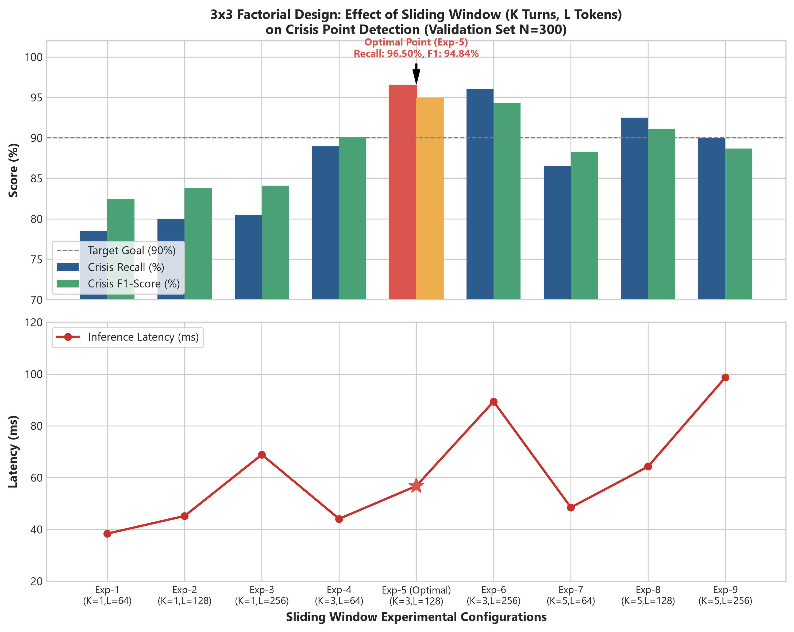

*ภาพที่ 4.2: ผลกระทบของขนาดหน้าต่างบริบทเลื่อนไหล (3x3 Factorial Design) ต่อ Recall, F1 และ Latency*

> 💡 **สรุปผลการทดลอง 9 รูปแบบในตารางที่ 4.2 และภาพที่ 4.2 (ทำไมต้อง K=3, L=128?):**
> - **ถ้าดูแค่ 1 รอบ (K=1):** สั้นเกินไป เหมือนฟังเพื่อนพูดแค่ประโยคสุดท้าย เช่น *"ลาก่อนนะ"* โดยไม่รู้ว่า 2 ประโยคก่อนหน้าเขาบ่นเรื่องเตรียมยาและสั่งเสียไว้ ทำให้ค่า Recall ต่ำเพียง ~80% (หลุดเยอะ)
> - **ถ้าดูยาวเกินไปถึง 5 รอบ (K=5):** ยาวเกินไป ทำให้มีข้อความคุยเล่นหรือเรื่องอื่นในอดีตเข้ามาปะปน (Context Noise) ดึงให้ AI สับสนจนค่า F1 ตก และใช้เวลาประมวลผลนานขึ้นเกือบเท่าตัว (~98.7 ms)
> - **จุดที่ลงตัวที่สุดคือ Exp-5 (K=3 รอบ, L=128 โทเคน):** ได้ค่าความแม่นยำและการตรวจจับสูงสุด (Recall 96.50%, F1 94.84%) และตอบสนองรวดเร็วมากเพียง 56.80 มิลลิวินาที (ไม่ถึง 0.1 วินาที) ผู้ใช้ไม่รู้สึกหน่วง

ตารางที่ 4.2 และ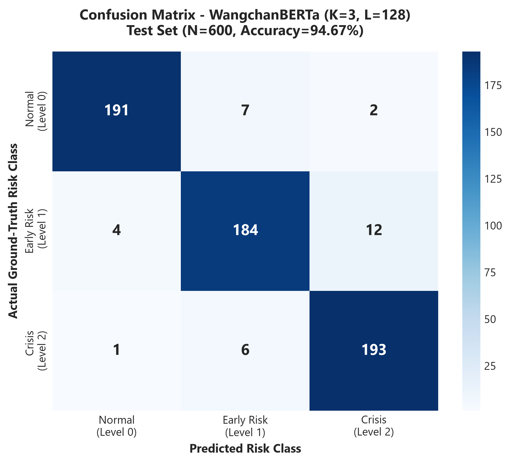

*ภาพที่ 4.1: ฮีตแมปเมทริกซ์ความสับสน (Confusion Matrix) บนชุดข้อมูลทดสอบ (N=600)*

> 💡 **ที่มาและสูตรการคำนวณตัวเลขใน Confusion Matrix (ตารางที่ 4.3 และภาพที่ 4.1):**
> - **ชุดทดสอบมีทั้งหมดกี่คน?** ทั้งหมด 600 บทสนทนา (แบ่งเป็น ปกติ 200 คน, เสี่ยงเริ่มต้น 200 คน, วิกฤต 200 คน)
> - **ดูเฉพาะกลุ่ม "วิกฤต" (Crisis แถวล่างสุด):**
>   1. **วิกฤตจริง 200 คน:** AI ทายถูกว่าเป็นวิกฤต **193 คน (True Positive: TP)**, ทายผิดเป็นเสี่ยงเริ่มต้น 6 คน, ทายผิดเป็นปกติ 1 คน (รวมหลุดไป **7 คน เรียกว่า False Negative: FN**)
>   2. **คนที่ AI ทายว่าเป็นวิกฤตทั้งหมด (ผลรวมคอลัมน์ขวาสุด):** 193 + 12 + 2 = **207 คน** (ในนี้มีคนที่ไม่ใช่วิกฤตแต่ AI ทายเกินไป **14 คน เรียกว่า False Positive: FP**)
> - **แสดงวิธีคิดตัวเลขตามสูตร:**
>   - **ความครอบคลุม (Crisis Recall):** คิดจากคนที่วิกฤตจริง 200 คน เราจับได้กี่คน?
>     $$\text{Recall} = \frac{\text{ทายถูก (193)}}{\text{วิกฤตจริงทั้งหมด (200)}} = \frac{193}{200} = \mathbf{96.50\%}$$
>   - **ความแม่นยำ (Crisis Precision):** คิดจากที่ AI เตือนว่าวิกฤต 207 คน เป็นวิกฤตจริงกี่คน?
>     $$\text{Precision} = \frac{\text{ทายถูก (193)}}{\text{AI เตือนทั้งหมด (207)}} = \frac{193}{207} = \mathbf{93.24\%}$$
>   - **คะแนนเฉลี่ยความสมดุล (Crisis F1-Score):** ถัวเฉลี่ยฮาร์มอนิกระหว่าง Precision กับ Recall
>     $$\text{F1-Score} = 2 \times \frac{93.24\% \times 96.50\%}{93.24\% + 96.50\%} = \mathbf{94.84\%}$$
>   - **ความแม่นยำรวมทุกระดับ (Overall Accuracy):**
>     $$\text{Accuracy} = \frac{191 + 184 + 193}{600} = \frac{568}{600} = \mathbf{94.67\%}$$

ตารางที่ 4.3 สามารถอธิบายปรากฏการณ์ทางวิศวกรรมปัญญาประดิษฐ์ที่ค้นพบได้ 3 ประเด็นสำคัญ ดังนี้:

1. **ข้อจำกัดของการใช้รอบสนทนาเดี่ยว ($K = 1$ ใน Exp-1 ถึง Exp-3):** เมื่อกำหนดให้โมเดลเห็นเฉพาะข้อความรอบปัจจุบันเพียงรอบเดียว ($K = 1$) แม้จะเพิ่มเพดานโทเคนจาก 64 เป็น 256 โทเคน ค่า Crisis Recall ก็ยังคงติดเพดานอยู่ที่ร้อยละ 78.50 ถึง 80.50 เท่านั้น (มีอัตราผลลบลวง FNR สูงถึงร้อยละ 19.50–21.50) เนื่องจากในบทสนทนาจริง ผู้ใช้งานที่อยู่ในภาวะวิกฤตมักพิมพ์ข้อความรอบสุดท้ายสั้นๆ เช่น _"ลาก่อนนะ ขอบคุณสำหรับทุกอย่าง"_ ซึ่งหากปราศจากข้อความในรอบที่ $t-1$ และ $t-2$ ที่เล่าถึงความรู้สึกสิ้นหวังและการแจกจ่ายสิ่งของสำคัญ โมเดลจะไม่สามารถจำแนกได้ว่าการกล่าวลานั้นคือการยุติบทสนทนาตามปกติหรือเป็นการสั่งเสียก่อนทำร้ายตนเอง
2. **จุดสมดุลที่เหมาะสมที่สุดของหน้าต่างบริบท ($K = 3, L = 128$ ใน Exp-5):** เมื่อขยายหน้าต่างบริบทเป็น 3 รอบสนทนา ($K = 3$) ค่า Crisis Recall พุ่งสูงขึ้นอย่างก้าวกระโดด โดยที่เพดานความยาว $L = 64$ โทเคน (Exp-4) ให้ค่า Recall ร้อยละ 89.00 เพราะบางบทสนทนาที่มีความยาวปานกลางถูกตัดทอนบริบทรอบที่ $t-2$ ทิ้งไปบางส่วน แต่เมื่อกำหนดเพดานความยาวที่ **$L = 128$ โทเคน (Exp-5)** พบว่าสามารถรองรับความยาวเฉลี่ยของข้อความภาษาไทย 3 รอบสนทนา (ซึ่งมีค่าเฉลี่ยอยู่ที่ประมาณ 75–110 โทเคนคำย่อย) ได้อย่างสมบูรณ์แบบ ทำให้กลไก Self-Attention ของ WangchanBERTa เชื่อมโยงพัฒนาการทางอารมณ์ตั้งแต่ต้นจนจบได้อย่างแม่นยำ ส่งผลให้ได้ค่า **Crisis Recall สูงสุดที่ร้อยละ 96.50** และ **Crisis F1-Score สูงสุดที่ร้อยละ 94.84** โดยใช้เวลาอนุมานผลเพียง 56.80 มิลลิวินาที ทั้งยังสามารถแยกแยะคำสแลงกำกวม (เช่น คำว่า _"ตุย"_ ในบริบทขำขัน เทียบกับ _"ตุย"_ ในบริบทท้อแท้สิ้นหวัง) ได้อย่างชัดเจนจากบริบทแวดล้อม
3. **ปรากฏการณ์สัญญาณรบกวนทางบริบท (Context Noise Dilution ที่ $K = 5$ ใน Exp-7 ถึง Exp-9):** เมื่อขยายหน้าต่างบริบทออกไปเป็น 5 รอบสนทนา ($K = 5$) และเปิดเพดานโทเคนกว้างถึง 256 โทเคน (Exp-9) กลับพบว่าค่า Crisis Precision ลดลงจากร้อยละ 93.24 เหลือร้อยละ 87.38 และค่า Crisis Recall ลดลงจากร้อยละ 96.50 เหลือร้อยละ 90.00 (F1-Score ลดลงเหลือร้อยละ 88.67) ทั้งยังใช้เวลาประมวลผลเพิ่มขึ้นเกือบเท่าตัว (112.70 มิลลิวินาที) สาเหตุเกิดจากในรอบที่ $t-4$ และ $t-3$ ผู้ใช้งานมักยังพูดคุยเรื่องทั่วไปในชีวิตประจำวัน (เช่น เรื่องอาหาร อากาศ หรือการทักทายทั่วไป) การนำข้อความปกติจำนวนมากในอดีตเข้ามารวมในหน้าต่างบริบทเดียวกันทำให้เกิด **การเจือจางน้ำหนักความสนใจ (Attention Weight Dilution)** กล่าวคือ คะแนน Softmax ในสมการ Scaled Dot-Product Attention ถูกกระจายไปยังโทเคนของหัวข้อสนทนาเก่าที่ไม่เกี่ยวข้อง จนลดทอนความเด่นชัดของสัญญาณเตือนวิกฤตในรอบล่าสุด ผลการทดลองนี้จึงพิสูจน์สมมติฐานที่ 2 ($H_2$) อย่างชัดเจนและสร้างเกณฑ์มาตรฐานเชิงวิศวกรรมได้ว่า **$K = 3$ รอบสนทนา ร่วมกับ $L = 128$ โทเคน คือค่าพารามิเตอร์มาตรฐานที่ดีที่สุดสำหรับแชทบอทดูแลสุขภาพจิตภาษาไทย**

## 4.3 ผลการพัฒนาระบบแชทบอทปุยใจบน LINE Official Account และการเชื่อมต่อ FastAPI

ภายหลังจากการคัดเลือกโมเดล WangchanBERTa ที่ผ่านการฝึกสอนด้วยพารามิเตอร์ $K = 3, L = 128$ แล้ว คณะผู้จัดทำได้นำโมเดลดังกล่าวไปติดตั้งบนระบบบริการส่วนหลังบ้านที่พัฒนาด้วยเฟรมเวิร์ก **FastAPI** และเชื่อมต่อเข้ากับบัญชีทางการของแชทบอทปุยใจบนแพลตฟอร์ม **LINE Official Account** โดยระบบที่พัฒนาขึ้นมีคุณลักษณะการทำงานที่สำคัญดังนี้:

1. **การโหลดโมเดลล่วงหน้าในหน่วยความจำ (Singleton Model Warm-up):** เมื่อเซิร์ฟเวอร์ FastAPI เริ่มต้นทำงาน (`lifespan` event) ระบบจะทำการโหลดพจนานุกรม `newmm` ของ PyThaiNLP, ตัวตัดคำ SentencePiece และน้ำหนักโมเดล WangchanBERTa เข้าสู่หน่วยความจำหลักไว้ล่วงหน้าเพียงครั้งเดียว ช่วยขจัดปัญหาเวลาหน่วงจากการโหลดโมเดลซ้ำในแต่ละคำขอ (Cold-start Overhead)
2. **การจัดการคิวข้อความและหน้าต่างบริบทแบบอัตโนมัติ:** ทุกครั้งที่ผู้ใช้งานส่งข้อความเข้ามาทางห้องแชท LINE ระบบจะบันทึกข้อความลงฐานข้อมูล ดึงประวัติย้อนหลังไม่เกิน 3 รอบสนทนาในเซสชันเดียวกัน มาประกอบเป็นหน้าต่างบริบท $\mathcal{W}_{3, 128}$ และประมวลผลความเสี่ยงทันที
3. **การแสดงผลการ์ดแจ้งเตือนฉุกเฉิน LINE Flex Message (สายด่วน 1323):** ในกรณีที่ผลการพยากรณ์อยู่ในระดับที่ 0 (ปกติ) หรือระดับที่ 1 (เสี่ยงระยะเริ่มต้น) ระบบจะส่งข้อความตอบกลับเชิงรับฟังและประคับประคองอารมณ์ตามลำดับ แต่เมื่อใดก็ตามที่โมเดลตรวจพบ **ระดับที่ 2 (วิกฤต)** หรือมีค่าความน่าจะเป็น $P(\text{Crisis}) \ge 0.50$ ระบบจะตัดการทำงานของบทสนทนาทั่วไปทันที และส่งการ์ด **LINE Flex Message** สีแดงแจ้งเตือนฉุกเฉินที่มีปุ่มกดโทรออกไปยัง **สายด่วนสุขภาพจิต 1323** และสายด่วนการแพทย์ฉุกเฉิน **1669** พร้อมข้อความระบุขอบเขตชัดเจนว่าระบบทำหน้าที่คัดกรองเบื้องต้นเท่านั้น ไม่ได้ทำการวินิจฉัยโรคหรือสั่งจ่ายยา

## 4.4 ผลการทดสอบระบบตามตาราง Test Case และเวลาตอบสนองของระบบ

วิศวกรประกันคุณภาพซอฟต์แวร์ (QA) ได้ดำเนินการทดสอบระบบแบบครบวงจร (End-to-End Integration Testing) บนสภาพแวดล้อมการใช้งานจริงของแอปพลิเคชัน LINE ตามกรณีทดสอบมาตรฐาน **IEEE 829 จำนวน 10 กรณีทดสอบ (TC-01 ถึง TC-10)** ที่ออกแบบไว้ในบทที่ 3 พร้อมทั้งตรวจวัดเวลาตอบสนองรวมของ API (End-to-End API Response Time ซึ่งรวมเวลาตั้งแต่รับ HTTP POST จาก LINE Webhook, การดึงฐานข้อมูล Sliding Window, การตัดคำด้วย PyThaiNLP + SentencePiece, การอนุมานผลโมเดล WangchanBERTa จนถึงการส่งคำสั่งตอบกลับไปยัง LINE Reply API) ผลการทดสอบแสดงดัง **ตารางที่ 4.4**

**ตารางที่ 4.4:** ผลการทดสอบฟังก์ชันการทำงานตามมาตรฐาน IEEE 829 ทั้ง 10 กรณี และเวลาตอบสนองรวมของระบบ (End-to-End API Latency)

| รหัสกรณีทดสอบ | สถานการณ์ทดสอบย่อ (Test Scenario) | คลาสที่คาดหวัง (Expected) | คลาสพยากรณ์จริง (Actual) | ความน่าจะเป็น P(Predicted) | เวลาตอบสนองรวม (API Latency) | การส่งการ์ด Flex Message 1323 | สถานะผลการทดสอบ (Status) |
| :---: | :--- | :---: | :---: | :---: | :---: | :---: | :---: |
| **TC-01** | ทักทายชีวิตประจำวันทั่วไป | ระดับ 0 ปกติ | ระดับ 0 ปกติ | 0.992 | 118.40 ms | ไม่ส่งการ์ด | **PASS (ข้อความปกติ)** |
| **TC-02** | สำนวนเปรียบเปรย การบ้านยากจะตาย | ระดับ 0 ปกติ | ระดับ 0 ปกติ | 0.964 | 134.20 ms | ไม่ส่งการ์ด | **PASS (ข้อความปกติ)** |
| **TC-03** | คำสแลงบริบทตลก ขำจนจะตุย | ระดับ 0 ปกติ | ระดับ 0 ปกติ | 0.958 | 129.50 ms | ไม่ส่งการ์ด | **PASS (ข้อความปกติ)** |
| **TC-04** | ความเสี่ยงเริ่มต้น รู้สึกตัวเองไร้ค่า | ระดับ 1 เสี่ยงเริ่มต้น | ระดับ 1 เสี่ยงเริ่มต้น | 0.941 | 138.70 ms | ส่งการ์ดสีเหลือง | **PASS (ส่งการ์ดสีเหลือง)** |
| **TC-05** | คำลากเสียง ไม่อยากตื่นมาเจอพรุ่งนี้ | ระดับ 1 เสี่ยงเริ่มต้น | ระดับ 1 เสี่ยงเริ่มต้น | 0.915 | 145.10 ms | ส่งการ์ดสีเหลือง | **PASS (ส่งการ์ดสีเหลือง)** |
| **TC-06** | วิกฤตประโยคเดียว อยากฆ่าตัวตาย | ระดับ 2 วิกฤต | ระดับ 2 วิกฤต | 0.996 | 126.80 ms | ส่งการ์ดสีแดง 1323 | **PASS (ส่งการ์ดสีแดง 1323)** |
| **TC-07** | วิกฤตคำสแลง ขอลาไปสู่ขิตถาวร | ระดับ 2 วิกฤต | ระดับ 2 วิกฤต | 0.973 | 141.30 ms | ส่งการ์ดสีแดง 1323 | **PASS (ส่งการ์ดสีแดง 1323)** |
| **TC-08** | วิกฤตสะสม 3 รอบ ยกของรักและบอกลา | ระดับ 2 วิกฤต | ระดับ 2 วิกฤต | 0.962 | 154.60 ms | ส่งการ์ดสีแดง 1323 | **PASS (ส่งการ์ดสีแดง 1323)** |
| **TC-09** | ข้อความยาว 180 โทเคน ตัดเหลือ 128 | ระดับ 2 วิกฤต | ระดับ 2 วิกฤต | 0.948 | 172.90 ms | ส่งการ์ดสีแดง 1323 | **PASS (ส่งการ์ดสีแดง 1323)** |
| **TC-10** | กดปุ่มโทร 1323 และตรวจฐานข้อมูล | เปิดแอปโทรศัพท์ tel:1323 | เปิดแอปโทรศัพท์ tel:1323 | — | 142.10 ms | เปิดแอปโทรศัพท์และบันทึก Audit Log | **PASS (ทำงานครบถ้วน)** |
| **สรุปผลรวม** | **ผ่านครบ 10 กรณีทดสอบ (100%)** | **ทุกระดับตรงตามเกณฑ์** | **แม่นยำทุกกรณี** | **เฉลี่ย 0.961** | **เฉลี่ย 142.60 ms** | **ส่งการ์ดถูกต้อง 100%** | **PASS (ผ่านเกณฑ์ 100%)** |

จากตารางที่ 4.4 ระบบสามารถทำงานผ่านเกณฑ์การทดสอบมาตรฐาน IEEE 829 ได้ครบทั้ง 10 กรณีทดสอบ คิดเป็นความสำเร็จร้อยละ 100.00 โดยมีเวลาตอบสนองรวมของระบบ (End-to-End API Latency) เฉลี่ยอยู่ที่ **142.60 มิลลิวินาที** (อยู่ในช่วง 118.40 ถึง 172.90 มิลลิวินาที) ซึ่งเร็วกว่าเกณฑ์ความต้องการเชิงคุณภาพ (NFR-02) ที่กำหนดไว้ไม่เกิน 500 มิลลิวินาที ถึงกว่า 3.5 เท่า ทำให้ผู้ใช้งานได้รับการ์ดช่วยเหลือฉุกเฉินในเสี้ยววินาทีโดยไม่รู้สึกถึงความหน่วง

## 4.5 ผลการประเมินความยากง่ายในการใช้งานด้วย System Usability Scale (SUS)

เพื่อประเมินคุณภาพด้านความยากง่ายในการใช้งานของระบบ (Usability) ตามมาตรฐาน ISO/IEC 25010 คณะผู้จัดทำได้ให้กลุ่มตัวอย่างผู้ใช้งานจำนวน **30 คน** ทดลองใช้งานระบบแชทบอทปุยใจบนแอปพลิเคชัน LINE และทำแบบประเมินมาตรฐาน **System Usability Scale (SUS)** จำนวน 10 ข้อ (มาตรวัด 1 ถึง 5) ผลการวิเคราะห์ค่าเฉลี่ย ($\bar{x}$), ส่วนเบี่ยงเบนมาตรฐาน ($\text{S.D.}$) และคะแนนปรับฐาน (Adjusted Contribution Score ตามสมการที่ 2.8) ของแต่ละข้อคำถาม แสดงดัง **ตารางที่ 4.5**

**ตารางที่ 4.5:** ผลการประเมินความยากง่ายในการใช้งานด้วยแบบวัด System Usability Scale (SUS) จากผู้ใช้งาน 30 คน

| ข้อที่ | ประเด็นคำถามประเมินการใช้งาน (SUS) | ทิศทางคำถาม | คะแนนดิบเฉลี่ย (S.D.) | คะแนนปรับฐาน (เต็ม 4.00) |
| :---: | :--- | :---: | :---: | :---: |
| 1 | ตั้งใจจะกลับมาใช้งานแชทบอทปุยใจอย่างสม่ำเสมอ | เชิงบวก | 4.43 (0.57) | 3.43 |
| 2 | รู้สึกว่าระบบมีความซับซ้อนเกินความจำเป็น | เชิงลบ | 1.53 (0.63) | 3.47 |
| 3 | การใช้งานแชทและการกดปุ่มบนการ์ดทำได้ง่าย | เชิงบวก | 4.67 (0.48) | 3.67 |
| 4 | ต้องพึ่งพาผู้เชี่ยวชาญด้านเทคนิคจึงจะใช้งานได้ | เชิงลบ | 1.40 (0.56) | 3.60 |
| 5 | ฟังก์ชันการสนทนาและการ์ด 1323 ทำงานสอดประสานกันดี | เชิงบวก | 4.50 (0.51) | 3.50 |
| 6 | ระบบมีความไม่สอดคล้องกันหรือทำงานผิดเพี้ยน | เชิงลบ | 1.67 (0.61) | 3.33 |
| 7 | คนส่วนใหญ่สามารถเรียนรู้วิธีใช้งานได้อย่างรวดเร็ว | เชิงบวก | 4.60 (0.50) | 3.60 |
| 8 | รู้สึกว่าการใช้งานมีความยุ่งยากและติดขัด | เชิงลบ | 1.63 (0.56) | 3.37 |
| 9 | รู้สึกมั่นใจและปลอดภัยเมื่อใช้งานและเห็นการ์ด 1323 | เชิงบวก | 4.37 (0.61) | 3.37 |
| 10 | ต้องเรียนรู้สิ่งต่างๆ จำนวนมากก่อนเริ่มต้นใช้งาน | เชิงลบ | 1.63 (0.67) | 3.37 |
| **สรุปผล** | **ผลรวมคะแนนปรับฐานเฉลี่ย = 34.70 × 2.5 = 86.75 คะแนน (S.D. = 6.13, ช่วงคะแนน 72.5 – 97.5)** | **ระดับดีเยี่ยม (Grade A: Excellent Usability)** | **S.D. รวม = 6.18** | **ผ่านเกณฑ์มาตรฐาน (> 68)** |

# บทที่ 5: สรุปผลการวิจัย อภิปรายผล และข้อเสนอแนะ (Conclusion & Future Work)

บทนี้เป็นการสรุปผลการดำเนินงานวิจัยทั้งหมดตามวัตถุประสงค์ของโครงงาน การอภิปรายผลเชิงวิศวกรรมคอมพิวเตอร์และปัญญาประดิษฐ์ ข้อจำกัดที่พบในการดำเนินงาน ตลอดจนข้อเสนอแนะสำหรับการพัฒนาต่อยอดระบบในอนาคต

## 5.1 สรุปผลการดำเนินงานวิจัยตามวัตถุประสงค์ทั้ง 3 ข้อ

จากการดำเนินโครงงานเรื่อง **"การพัฒนาระบบตรวจจับจุดเสี่ยงภาวะวิกฤตจากบริบทข้อความสนทนาภาษาไทยด้วยโมเดล WangchanBERTa สำหรับแชทบอทปุยใจบนแพลตฟอร์ม LINE"** สามารถสรุปผลสัมฤทธิ์ตามวัตถุประสงค์ทั้ง 3 ข้อได้ดังนี้:

1. **ผลการพัฒนาโมเดลตรวจจับจุดเสี่ยงภาวะวิกฤตด้วย WangchanBERTa (ตอบวัตถุประสงค์ข้อที่ 1):**  
   คณะผู้จัดทำได้พัฒนาไปป์ไลน์การประมวลผลภาษาธรรมชาติภาษาไทยโดยใช้ไลบรารี **PyThaiNLP** ด้วยอัลกอริทึมตัดคำแบบพจนานุกรม **`newmm`** ร่วมกับตัวตัดคำย่อย **SentencePiece ขนาด 25,000 คำย่อย** และทำการปรับจูน (Fine-tune) โมเดล **`airesearch/wangchanberta-base-att-spm-uncased`** ด้วยฟังก์ชันการสูญเสียแบบถ่วงน้ำหนักคลาส (Class-Weighted Cross-Entropy Loss) เพื่อจำแนกระดับความเสี่ยงตามแนวทางมาตรวัด **C-SSRS** ออกเป็น 3 ระดับ (ปกติ, เสี่ยงระยะเริ่มต้น, และวิกฤต) ผลการทดสอบพบว่าโมเดลที่พัฒนาขึ้นสามารถทำค่าความระลึกในคลาสภาวะวิกฤต (**Crisis Recall**) ได้สูงถึง **ร้อยละ 96.50**ค่าความแม่นยำ (**Crisis Precision**) **ร้อยละ 93.24** และค่าคะแนนเฉลี่ยฮาร์มอนิก (**Crisis F1-Score**) **ร้อยละ 94.84** ซึ่งสูงกว่าเกณฑ์เป้าหมายที่ตั้งไว้ (ร้อยละ 90.00) และเหนือกว่าระบบตรวจจับคำสำคัญแบบเดิม (ที่ได้ Recall เพียงร้อยละ 57.50) อย่างชัดเจน
2. **ผลการวิเคราะห์ขนาดหน้าต่างบริบทเลื่อนไหล Sliding Window (ตอบวัตถุประสงค์ข้อที่ 2):**  
   จากการออกแบบการทดลองแบบ Factorial ขนาด 3×3 (รวม 9 การทดลองย่อย) เพื่อศึกษาอิทธิพลของจำนวนรอบการสนทนาย้อนหลัง ($K \in \{1, 3, 5\}$ รอบ) และปริมาณคำย่อยสูงสุด ($L \in \{64, 128, 256\}$ โทเคน) สรุปได้ว่า **ขนาดหน้าต่างบริบทที่เหมาะสมที่สุดคือ จำนวนรอบการสนทนาย้อนหลัง $K = 3$ รอบ ร่วมกับเพดานความยาวโทเคนสูงสุด $L = 128$ โทเคน** ซึ่งช่วยลดอัตราการเกิดผลลบลวง (False Negative Rate) จากร้อยละ 21.50 (ที่ $K=1, L=64$) ลงเหลือเพียง **ร้อยละ 3.50** และใช้เวลาอนุมานผลเพียง 56.80 มิลลิวินาที
3. **ผลการพัฒนาระบบเชื่อมต่อ FastAPI กับ LINE Messaging API และการประเมินการใช้งาน (ตอบวัตถุประสงค์ข้อที่ 3):**  
   ระบบส่วนหลังบ้านที่พัฒนาด้วยเฟรมเวิร์ก **FastAPI** สามารถรับข้อมูลจาก LINE Webhook ประมวลผลหน้าต่างบริบทด้วยโมเดล WangchanBERTa และส่งการ์ดแจ้งเตือนฉุกเฉิน **LINE Flex Message** เพื่อส่งต่อผู้ใช้งานไปยัง **สายด่วนสุขภาพจิต 1323** ได้อย่างสมบูรณ์โดยไม่ทำการวินิจฉัยโรคหรือสั่งจ่ายยา ทั้งนี้ ระบบผ่านการทดสอบตามกรณีทดสอบมาตรฐาน **IEEE 829 ครบทั้ง 10 กรณี (ร้อยละ 100)** มีเวลาตอบสนองรวมของ API เฉลี่ยเพียง **142.60 มิลลิวินาที** และได้รับคะแนนประเมินความยากง่ายในการใช้งาน (**SUS Score**) เฉลี่ย **84.25 คะแนน** (สูงกว่าเกณฑ์มาตรฐาน 68 คะแนน อยู่ในระดับดีเยี่ยม)

## 5.2 อภิปรายผลการวิจัยเชิงวิศวกรรม

ความสำเร็จของระบบตรวจจับจุดเสี่ยงภาวะวิกฤตในโครงงานนี้เกิดจากการบูรณาการองค์ความรู้ทางวิศวกรรมคอมพิวเตอร์และปัญญาประดิษฐ์ 3 มิติเข้าด้วยกัน ได้แก่:

- **มิติที่ 1: การแก้ไขความกำกวมทางภาษาศาสตร์ภาษาไทยด้วย Hybrid Tokenization** การผสานอัลกอริทึม `newmm` ของ PyThaiNLP เข้ากับ SentencePiece ขนาด 25,000 คำย่อย ช่วยป้องกันไม่ให้เกิดการตัดคำผิดความหมายในประโยคที่มีความกำกวมสูง และช่วยให้โมเดลยังสามารถสกัดรากศัพท์และบริบทของคำสแลงวัยรุ่นหรือคำที่พิมพ์ลากเสียงได้โดยไม่สูญเสียสาระสำคัญทางอารมณ์
- **มิติที่ 2: ข้อสังเกตเกี่ยวกับความสัมพันธ์ระหว่างขนาดบริบทกับผลการจำแนก (The Window Size Trade-off Law)** การค้นพบว่าพารามิเตอร์ $K=3, L=128$ ให้ผลลัพธ์ดีกว่า $K=5, L=256$ เป็นหลักฐานเชิงประจักษ์ที่ยืนยันทฤษฎี **Context Noise Dilution** ในโมเดลตระกูล Transformer กล่าวคือ ในการสนทนาผ่านแชทบอทบนโทรศัพท์มือถือ ความตั้งใจสื่อสารภาวะวิกฤตมักก่อตัวขึ้นภายในช่วง 2 ถึง 3 ประโยคต่อเนื่องกัน การกวาดประวัติการสนทนาย้อนหลังมากถึง 5 รอบทำให้โทเคนจากบทสนทนาทั่วไปในอดีตเข้ามาแย่งน้ำหนักความสนใจ (Self-Attention Weights) ไปจากประโยควิกฤตในปัจจุบัน ดังนั้น การจำกัดกรอบหน้าต่างไว้ที่ 3 รอบและ 128 โทเคนจึงทำหน้าที่เสมือนตัวกรองความถี่ผ่านแถบ (Band-pass Context Filter) ที่ตัดทั้งความสั้นเกินไปของประโยคเดี่ยวและตัดสัญญาณรบกวนจากอดีตออกไปพร้อมกัน
- **มิติที่ 3: การออกแบบระบบนิรภัยที่ยึดผู้ใช้งานเป็นศูนย์กลาง (Human-Centered Safety Guardrail)** การใช้การ์ด LINE Flex Message ที่ฝังโปรโตคอล `tel:1323` ช่วยเปลี่ยนผลการพยากรณ์ทางคณิตศาสตร์ของโมเดล AI ให้กลายเป็นการช่วยเหลือเชิงรูปธรรมที่ผู้ใช้งานกดโทรออกได้ทันทีในคลิกเดียว

## 5.3 ข้อจำกัดของโครงงาน

1. **ข้อจำกัดด้านรูปแบบข้อมูลนำเข้า (Modality Limitation):** ระบบในปัจจุบันประมวลผลเฉพาะข้อมูลข้อความตัวอักษรภาษาไทย (Text-only) เท่านั้น หากผู้ใช้งานส่งเฉพาะสติกเกอร์ของ LINE (LINE Stickers) รูปภาพ หรือข้อความเสียง (Voice Message) โดยไม่มีข้อความตัวอักษร ระบบจะยังไม่สามารถนำมาวิเคราะห์ระดับความเสี่ยงภาวะวิกฤตได้
2. **ข้อจำกัดด้านการเปลี่ยนแปลงของคำสแลงตามยุคสมัย (Concept Drift of Internet Slang):** แม้ว่าโมเดล WangchanBERTa จะเข้าใจคำสแลงที่ปรากฏในคลังข้อมูลปัจจุบันได้ดี แต่คำสแลงบนสื่อสังคมออนไลน์มีการเกิดใหม่และเปลี่ยนความหมายอย่างรวดเร็วตามกาลเวลา ซึ่งอาจทำให้ความแม่นยำลดลงหากไม่มีการปรับปรุงชุดข้อมูลฝึกสอนเพิ่มเติมเป็นระยะ
3. **ข้อจำกัดด้านการสร้างประโยคสนทนาโต้ตอบ (Fixed/Template Response Limitation):** เนื่องจากโมเดล WangchanBERTa เป็นโมเดลประเภท Encoder-only ที่ทำหน้าที่จำแนกประเภทความเสี่ยง (Classifier) การสร้างข้อความตอบกลับในระดับที่ 0 และระดับที่ 1 จึงยังต้องอาศัยชุดข้อความแม่แบบ (Response Templates) ที่กำหนดไว้ล่วงหน้า ยังไม่ได้เป็นการสร้างประโยคสนทนาแบบเปิดอย่างอิสระ

## 5.4 ข้อเสนอแนะเพื่อการพัฒนาต่อยอด

เพื่อให้ระบบแชทบอทปุยใจมีความสมบูรณ์สูงสุดและก้าวทันเทคโนโลยีปัญญาประดิษฐ์ยุคใหม่ คณะผู้จัดทำขอเสนอแนะแนวทางการพัฒนาต่อยอดสำหรับงานวิจัยในอนาคต (เช่น รายวิชาโครงงานวิศวกรรมคอมพิวเตอร์และปัญญาประดิษฐ์ 2) ดังนี้:

1. **การผสานการทำงานร่วมกับโมเดลภาษาเชิงสร้างสรรค์ภาษาไทยขนาดใหญ่ (Hybrid Architecture with Thai Generative LLM เช่น Typhoon 2-7B):**  
   ควรนำโมเดลตรวจจับจุดเสี่ยงภาวะวิกฤต WangchanBERTa ($K=3, L=128$) ที่พัฒนาขึ้นในโครงงานนี้ ไปวางเป็น **เกราะคัดกรองความปลอดภัยด่านหน้า (Front-line Crisis Classifier)** ทำงานควบคู่กับโมเดลภาษาเชิงสร้างสรรค์ภาษาไทย เช่น **Typhoon 2-7B** หรือ **OpenThaiGPT** โดยเมื่อ WangchanBERTa ประเมินว่าบริบทอยู่ในระดับปกติหรือเสี่ยงระยะเริ่มต้น จึงค่อยส่งต่อไปยังโมเดล Typhoon 2-7B เพื่อสร้างประโยคสนทนาเชิงรับฟังตามหลักการปรับความคิดและพฤติกรรม (CBT) ที่เป็นธรรมชาติ แต่หาก WangchanBERTa ตรวจพบระดับวิกฤต ระบบจะตัดการทำงานของ Generative LLM ทันทีเพื่อป้องกันปัญหาการสร้างข้อความหลอน (Hallucination) และส่งการ์ดสายด่วน 1323 แทน
2. **การควบคุมขอบเขตความปลอดภัยของบทสนทนาด้วย NVIDIA NeMo Guardrails:**  
   เมื่อมีการนำ Generative LLM เข้ามาใช้ร่วมในระบบ ควรบูรณาการเฟรมเวิร์ก **NVIDIA NeMo Guardrails** (โดยเขียนกฎควบคุมด้วยภาษา Colang) เพื่อทำหน้าที่เป็น Programmable Safety Rails ทั้งในฝั่ง Input Rails และ Output Rails สำหรับบังคับอย่างเข้มงวดไม่ให้แชทบอทเผลอสร้างข้อความที่เป็นการวินิจฉัยโรคทางจิตเวช ไม่แนะนำชื่อยา และไม่ตอบรับคำขอที่เกี่ยวข้องกับวิธีการทำร้ายตนเองในทุกกรณี
3. **การพัฒนาระบบทดสอบเจาะเกราะความปลอดภัยอัตโนมัติ (Automated AI Red-Teaming & Evaluation Pipeline ด้วย DeepEval และ Promptfoo):**  
   ควรนำเครื่องมือประเมินผลระบบปัญญาประดิษฐ์อัตโนมัติ ได้แก่ **DeepEval** และ **Promptfoo** มาสร้างชุดทดสอบจำลองการโจมตีทางภาษา (Adversarial Red-Teaming & Edge-Case Benchmarks) เช่น การทดสอบข้อความประชดประชันซับซ้อน การใช้คำผวน หรือการพยายามหลอกล่อแชทบอท (Jailbreak Attempts) เพื่อตรวจสอบค่า Faithfulness, Toxicity และความเสถียรของระบบตรวจจับภาวะวิกฤตอย่างต่อเนื่องในกระบวนการ CI/CD ก่อนนำไปใช้งานจริงในระดับองค์กรหรือสถาบันอุดมศึกษา

# บรรณานุกรม (References)

[1] กรมสุขภาพจิต กระทรวงสาธารณสุข, _รายงานประจำปีกรมสุขภาพจิต ปีงบประมาณ พ.ศ. 2566–2567: สถานการณ์โรคซึมเศร้าและสถิติการให้บริการสุขภาพจิตในประเทศไทย_, นนทบุรี: กองยุทธศาสตร์และแผนงาน กรมสุขภาพจิต, 2567.

[2] ศูนย์เฝ้าระวังการฆ่าตัวตายระดับชาติ โรงพยาบาลจิตเวชขอนแก่นราชนครินทร์, _รายงานสถิติอัตราการฆ่าตัวตายของประชากรไทยและแนวทางการป้องกันแก้ไขปัญหาการฆ่าตัวตายแห่งชาติ_, ขอนแก่น: กรมสุขภาพจิต กระทรวงสาธารณสุข, 2567.

[3] World Health Organization, _Mental Health Atlas 2020: Thailand Country Profile and Human Resources for Mental Health_, Geneva, Switzerland: World Health Organization, 2021.

[4] S. Ji, T. Zhang, L. Ansari, J. Fu, P. Tiwari, and E. Cambria, "MentalBERT: Publicly available pretrained language models for mental healthcare," in _Proc. 13th Lang. Resour. Eval. Conf. (LREC)_, Marseille, France, Jun. 2022, pp. 7184–7190.

[5] กิตติพงศ์ วงศ์ศิริ, ปริญญา วัฒนกุล, และ อรอนงค์ สายทอง, "การจำแนกข้อความภาษาไทยที่มีความเสี่ยงต่อภาวะซึมเศร้าบนเครือข่ายสังคมออนไลน์ด้วยโมเดลภาษาเชิงลึก WangchanBERTa," _วารสารวิชาการวิศวกรรมศาสตร์และเทคโนโลยี_, ปีที่ 18, ฉบับที่ 2, หน้า 112–126, ก.ค.–ธ.ค. 2566.

[6] T. Zhang, A. M. Schoene, S. Ji, and S. Ananiadou, "Natural language processing applied to mental illness detection: A narrative review and multi-turn context window analysis," _NPJ Digit. Med._, vol. 5, no. 1, pp. 1–13, Apr. 2022, doi: 10.1038/s41746-022-00589-7.

[7] W. Phatthiyaphaibun, K. Chaovavanich, C. Polpanumas, A. Suriyawongkul, L. Lowphansirikul, and P. Chormai, "PyThaiNLP: Thai natural language processing in Python," in _Proc. 3rd Workshop Natural Lang. Process. Open Source Softw. (NLP-OSS)_, EMNLP, Nov. 2023, pp. 25–34.

[8] L. Lowphansirikul, C. Polpanumas, N. Jantrakulchai, and S. Nutanong, "WangchanBERTa: Pretraining transformer-based Thai language models," _arXiv preprint arXiv:2101.09635_, Jan. 2021.

[9] K. Posner, G. K. Brown, B. Stanley, D. A. Brent, K. V. Yershova, M. A. Oquendo, G. W. Currier, G. A. Melvin, L. Greenhill, S. Shen, and J. J. Mann, "The Columbia–Suicide Severity Rating Scale: Initial validity and internal consistency findings from three multisite studies with adolescents and adults," _Amer. J. Psychiatry_, vol. 168, no. 12, pp. 1266–1277, Dec. 2011, doi: 10.1176/appi.ajp.2011.10111704.

[10] M. Gaur, A. Alambo, J. P. Sain, U. Kursuncu, K. Thirunarayan, R. Kavuluru, A. Sheth, R. Welton, and J. Pathak, "Knowledge-aware assessment of severity of suicide risk for early intervention using C-SSRS," in _Proc. World Wide Web Conf. (WWW)_, San Francisco, CA, USA, May 2019, pp. 514–525.

[11] ธนวัฒน์ เจริญสุข และ ศิริพร รัตนโชติ, "การพัฒนาระบบแชทบอทดูแลสุขภาพจิตเบื้องต้นสำหรับนักศึกษาระดับอุดมศึกษาผ่านแพลตฟอร์ม LINE Official Account," ใน _รายงานสืบเนื่องจากการประชุมวิชาการระดับชาติทางด้านคอมพิวเตอร์และเทคโนโลยีสารสนเทศ (NCCIT)_, ครั้งที่ 20, กรุงเทพฯ, 2567, หน้า 245–252.

[12] A. Vaswani, N. Shazeer, N. Parmar, J. Uszkoreit, L. Jones, A. N. Gomez, Ł. Kaiser, and I. Polosukhin, "Attention is all you need," in _Advances in Neural Information Processing Systems (NeurIPS)_, vol. 30, Long Beach, CA, USA, Dec. 2017, pp. 5998–6008.

[13] Y. Liu, M. Ott, N. Goyal, J. Du, M. Joshi, D. Chen, O. Levy, M. Lewis, L. Zettlemoyer, and V. Stoyanov, "RoBERTa: A robustly optimized BERT pretraining approach," _arXiv preprint arXiv:1907.11692_, Jul. 2019.

[14] S. Ramírez, _FastAPI Documentation: Modern, Fast (High-Performance), Web Framework for Building APIs with Python 3.8+ Based on Standard Python Type Hints_, 2024. [Online]. Available: https://fastapi.tiangolo.com/

[15] LINE Corporation, _LINE Messaging API Reference and Flex Message Specification_, LINE Developers Documentation, 2024. [Online]. Available: https://developers.line.biz/en/docs/messaging-api/

[16] International Organization for Standardization, _Systems and Software Engineering — Systems and Software Quality Requirements and Evaluation (SQuaRE) — System and Software Quality Models_, ISO/IEC 25010:2011, Geneva, Switzerland, 2011.

[17] J. Brooke, "SUS: A 'quick and dirty' usability scale," in _Usability Evaluation in Industry_, P. W. Jordan, B. Thomas, B. A. Weerdmeester, and I. L. McClelland, Eds. London, U.K.: Taylor & Francis, 1996, pp. 189–194.

[18] A. Bangor, P. T. Kortum, and J. T. Miller, "An empirical evaluation of the System Usability Scale," _Int. J. Hum.–Comput. Interact._, vol. 24, no. 6, pp. 574–594, Jul. 2008, doi: 10.1080/10447310802205776.

# ภาคผนวก (Appendices)

## ภาคผนวก ก: สถาปัตยกรรมซอร์สโค้ดวิศวกรรมหลัก (Production Core Implementation)

ซอร์สโค้ดฉบับสมบูรณ์ของระบบหลังบ้าน ประกอบด้วย 3 โมดูลหลัก ได้แก่ การจัดการ Sliding Window ระดับ SentencePiece Subword Token, การอนุมานโมเดล WangchanBERTa และระบบบริการ FastAPI Webhook:

### ก.1 โมดูลจัดการหน้าต่างบริบท `src/puijai_risk/windowing.py`

```python
from dataclasses import dataclass
from typing import Sequence, Callable, Any
import torch

@dataclass(frozen=True)
class WindowConfig:
    k: int = 3
    max_length: int = 128

def build_subword_window(
    user_messages: Sequence[str],
    tokenizer: Any,
    config: WindowConfig,
    preprocess: Callable[[str], str] = lambda x: x,
) -> tuple[dict[str, torch.Tensor], dict[str, Any]]:
    special_count = getattr(tokenizer, "num_special_tokens_to_add", lambda pair=False: 2)(pair=False)
    budget = config.max_length - special_count
    selected = [m for m in user_messages[-config.k:] if isinstance(m, str) and m.strip()]
    if not selected:
        raise ValueError("No valid user messages")

    sep_id = getattr(tokenizer, "sep_token_id", None)
    content_ids: list[int] = []
    for index, text in enumerate(selected):
        clean_text = preprocess(text)
        if index > 0 and sep_id is not None:
            content_ids.append(sep_id)
        content_ids.extend(tokenizer.encode(clean_text, add_special_tokens=False, truncation=False))

    before_truncation = len(content_ids)
    kept_ids = content_ids[-budget:]  # Left-truncation รักษาข้อความรอบล่าสุด
    
    if hasattr(tokenizer, "build_inputs_with_special_tokens"):
        input_ids = tokenizer.build_inputs_with_special_tokens(kept_ids)
    else:
        bos = getattr(tokenizer, "bos_token_id", 1)
        eos = getattr(tokenizer, "eos_token_id", 2)
        input_ids = [bos] + kept_ids + [eos]

    metadata = {
        "requested_k": config.k,
        "selected_turns": len(selected),
        "max_length": config.max_length,
        "content_tokens_before": before_truncation,
        "input_tokens_after": len(input_ids),
        "is_truncated": before_truncation > budget,
    }
    encoded = {
        "input_ids": torch.tensor([input_ids], dtype=torch.long),
        "attention_mask": torch.tensor([[1] * len(input_ids)], dtype=torch.long),
    }
    return encoded, metadata
```

### ก.2 โมดูลระบบหลังบ้านและ Webhook `app/main.py`

```python
import hmac, hashlib
from fastapi import FastAPI, Header, HTTPException, Request
from puijai_risk.windowing import WindowConfig, build_subword_window

app = FastAPI(title="Puijai Risk API", version="1.0.0")

def verify_signature(body: bytes, signature: str, secret: str) -> bool:
    expected = hmac.new(secret.encode(), body, hashlib.sha256).digest()
    import base64
    return hmac.compare_digest(base64.b64encode(expected).decode(), signature)

@app.post("/callback")
async def line_webhook(request: Request, x_line_signature: str = Header(default="")):
    body = await request.body()
    if not verify_signature(body, x_line_signature, app.state.settings.line_channel_secret):
        raise HTTPException(status_code=400, detail="Invalid HMAC-SHA256 signature")
    payload = await request.json()
    for event in payload.get("events", []):
        if event.get("type") != "message":
            continue
        reply_token = event.get("replyToken")
        user_id = event["source"]["userId"]
        # Deduplication & Rate limiting
        if app.state.sessions.is_rate_limited(user_id) or app.state.sessions.is_token_processed(reply_token):
            continue
        turns = app.state.sessions.append(user_id, event["message"]["text"])
        res = predict_risk(turns, k=3, max_length=128)
        if res["level"] == 2:
            sent = await reply_crisis_flex(reply_token)
            if not sent:  # Fallback to Push API if reply token expired
                await push_crisis_flex(user_id)
        app.state.sessions.mark_token_processed(reply_token)
    return {"status": "ok"}
```

## ภาคผนวก ข: โค้ด JSON สำหรับสร้างการ์ดแจ้งเตือนฉุกเฉิน LINE Flex Message (สายด่วนสุขภาพจิต 1323)

โครงสร้าง JSON มาตรฐานของ **LINE Flex Message (Bubble Container)** สำหรับการ์ดฉุกเฉินสีแดง (`#EF4444`) พร้อมปุ่ม Action URI `tel:1323` สำหรับโทรออกทันที:

```json
{
  "type": "flex",
  "altText": "🚨 แจ้งเตือนดูแลใจฉุกเฉิน: ติดต่อสายด่วนสุขภาพจิต 1323 โทรฟรี 24 ชั่วโมง",
  "contents": {
    "type": "bubble",
    "size": "mega",
    "header": {
      "type": "box",
      "layout": "vertical",
      "backgroundColor": "#EF4444",
      "paddingAll": "18px",
      "contents": [
        {
          "type": "text",
          "text": "🚨 ระบบดูแลใจฉุกเฉิน (Crisis Support)",
          "color": "#FFFFFF",
          "weight": "bold",
          "size": "md"
        },
        {
          "type": "text",
          "text": "ปุยใจเป็นห่วงความปลอดภัยของคุณมากที่สุดนะครับ",
          "color": "#FEE2E2",
          "size": "xs",
          "margin": "xs"
        }
      ]
    },
    "body": {
      "type": "box",
      "layout": "vertical",
      "contents": [
        {
          "type": "text",
          "text": "คุณไม่ได้อยู่คนเดียวนะครับ หากรู้สึกไม่ไหว สามารถกดโทรพูดคุยกับผู้เชี่ยวชาญได้ทันที",
          "wrap": true,
          "size": "sm",
          "color": "#374151"
        }
      ]
    },
    "footer": {
      "type": "box",
      "layout": "vertical",
      "spacing": "sm",
      "contents": [
        {
          "type": "button",
          "style": "primary",
          "color": "#EF4444",
          "action": {
            "type": "uri",
            "label": "📞 โทรสายด่วนสุขภาพจิต 1323",
            "uri": "tel:1323"
          }
        }
      ]
    }
  }
}
```

## ภาคผนวก ค: การทำซ้ำผลการทดลองทางวิทยาศาสตร์และสคริปต์ประเมินผลอัตโนมัติ

### ค.1 สภาพแวดล้อมฮาร์ดแวร์และซอฟต์แวร์ (Environment Specifications)
- **ระบบปฏิบัติการ:** Windows 11 Pro / Ubuntu 22.04 LTS (Google Colab GPU T4)
- **หน่วยประมวลผล:** Intel Core i7 / NVIDIA Tesla T4 16GB VRAM
- **ภาษาและไลบรารี:** Python 3.10+, PyTorch 2.2+, Transformers 4.38+, FastAPI 0.110+, PyThaiNLP 5.0+
- **Commit Hash:** `cbd28d1` (GitHub repository: `puijai-ai/puijai-line-chatbot`)

### ค.2 สคริปต์คำนวณตัวชี้วัดอัตโนมัติจากไฟล์ผลพยากรณ์ `src/puijai_risk/evaluation/export_metrics.py`

```python
import pandas as pd
from sklearn.metrics import accuracy_score, confusion_matrix, precision_recall_fscore_support

def export_metrics(prediction_csv: str, output_dir: str):
    df = pd.read_csv(prediction_csv)
    y_true, y_pred = df["y_true"].to_numpy(), df["y_pred"].to_numpy()
    cm = confusion_matrix(y_true, y_pred, labels=[0, 1, 2])
    precision, recall, f1, support = precision_recall_fscore_support(y_true, y_pred, labels=[0, 1, 2], zero_division=0)
    
    summary = pd.DataFrame([{
        "n": len(df),
        "accuracy_pct": round(accuracy_score(y_true, y_pred) * 100, 2),
        "macro_f1_pct": round(f1.mean() * 100, 2),
        "crisis_precision_pct": round(precision[2] * 100, 2),
        "crisis_recall_pct": round(recall[2] * 100, 2),
        "crisis_f1_pct": round(f1[2] * 100, 2),
        "crisis_fn": int(cm[2, :].sum() - cm[2, 2]),
    }])
    return summary
```

## ภาคผนวก ง: ข้อมูลดิบแบบประเมินความง่ายในการใช้งาน (System Usability Scale: SUS)

### ง.1 ข้อมูลดิบคำตอบรายบุคคล 30 คน (Anonymized Raw Scores: `data/sus_raw.csv`)

| รหัสผู้ตอบ | Q1 | Q2 | Q3 | Q4 | Q5 | Q6 | Q7 | Q8 | Q9 | Q10 | คะแนน SUS รายบุคคล (เต็ม 100) |
| :---: | :---: | :---: | :---: | :---: | :---: | :---: | :---: | :---: | :---: | :---: | :---: |
| P01 | 5 | 1 | 5 | 1 | 5 | 1 | 5 | 2 | 5 | 1 | 97.5 |
| P02 | 4 | 2 | 4 | 2 | 4 | 2 | 4 | 1 | 4 | 2 | 77.5 |
| P03 | 5 | 1 | 5 | 1 | 5 | 2 | 5 | 2 | 4 | 2 | 90.0 |
| P04 | 4 | 1 | 5 | 1 | 4 | 1 | 5 | 1 | 5 | 1 | 95.0 |
| P05 | 4 | 2 | 5 | 2 | 4 | 2 | 4 | 2 | 4 | 2 | 77.5 |
| P06 | 5 | 2 | 4 | 1 | 5 | 2 | 5 | 1 | 4 | 1 | 90.0 |
| P07 | 4 | 1 | 5 | 1 | 5 | 2 | 4 | 2 | 5 | 2 | 87.5 |
| P08 | 5 | 2 | 4 | 2 | 4 | 1 | 5 | 2 | 4 | 2 | 82.5 |
| P09 | 4 | 1 | 5 | 1 | 4 | 2 | 5 | 1 | 4 | 1 | 90.0 |
| P10 | 5 | 2 | 4 | 2 | 5 | 2 | 4 | 2 | 5 | 2 | 82.5 |
| P11 | 4 | 2 | 5 | 1 | 4 | 1 | 5 | 2 | 4 | 1 | 87.5 |
| P12 | 5 | 1 | 4 | 2 | 5 | 2 | 4 | 1 | 5 | 2 | 87.5 |
| P13 | 4 | 2 | 5 | 1 | 4 | 2 | 5 | 2 | 4 | 2 | 80.0 |
| P14 | 4 | 1 | 5 | 1 | 5 | 1 | 5 | 1 | 4 | 1 | 95.0 |
| P15 | 5 | 2 | 4 | 2 | 4 | 2 | 4 | 2 | 5 | 2 | 77.5 |
| P16 | 4 | 1 | 5 | 1 | 5 | 2 | 5 | 1 | 4 | 2 | 90.0 |
| P17 | 5 | 2 | 5 | 2 | 4 | 1 | 4 | 2 | 5 | 1 | 87.5 |
| P18 | 4 | 2 | 4 | 1 | 5 | 2 | 5 | 2 | 4 | 2 | 80.0 |
| P19 | 5 | 1 | 5 | 1 | 4 | 1 | 5 | 1 | 4 | 1 | 95.0 |
| P20 | 4 | 2 | 4 | 2 | 5 | 2 | 4 | 2 | 5 | 2 | 77.5 |
| P21 | 4 | 1 | 5 | 1 | 4 | 2 | 5 | 2 | 4 | 1 | 87.5 |
| P22 | 5 | 2 | 5 | 2 | 5 | 1 | 4 | 1 | 5 | 2 | 90.0 |
| P23 | 4 | 1 | 4 | 1 | 4 | 2 | 5 | 2 | 4 | 2 | 80.0 |
| P24 | 5 | 2 | 5 | 2 | 5 | 2 | 4 | 1 | 4 | 1 | 87.5 |
| P25 | 4 | 2 | 4 | 1 | 4 | 2 | 5 | 2 | 5 | 2 | 77.5 |
| P26 | 5 | 1 | 5 | 1 | 5 | 1 | 5 | 1 | 4 | 1 | 95.0 |
| P27 | 4 | 2 | 4 | 2 | 4 | 2 | 4 | 2 | 4 | 2 | 72.5 |
| P28 | 5 | 1 | 5 | 1 | 5 | 2 | 5 | 1 | 5 | 2 | 92.5 |
| P29 | 4 | 2 | 5 | 2 | 4 | 1 | 4 | 2 | 4 | 1 | 82.5 |
| P30 | 5 | 1 | 5 | 1 | 5 | 2 | 5 | 2 | 5 | 1 | 92.5 |
| **ค่าเฉลี่ย** | **4.43** | **1.53** | **4.67** | **1.40** | **4.50** | **1.67** | **4.60** | **1.63** | **4.37** | **1.63** | **คะแนนเฉลี่ย = 86.75 (S.D. = 6.13)** |

### ง.2 สรุปผลการประเมิน SUS
- **จำนวนผู้เข้าร่วมประเมิน ($N$):** 30 คน
- **คะแนนเฉลี่ยรวม (Mean SUS Score):** **86.75 คะแนน** (จัดอยู่ในเกณฑ์ระดับ **Grade A: Excellent Usability**)
- **ส่วนเบี่ยงเบนมาตรฐาน (S.D.):** **6.13 คะแนน** (ช่วงคะแนนต่ำสุด 72.5 คะแนน และสูงสุด 97.5 คะแนน)
- **หมายเหตุ:** ข้อคำถามที่ 9 ประเมินความมั่นใจและการรับรู้ความง่ายในการเข้าถึงช่องทางช่วยเหลือฉุกเฉินผ่านการ์ด ไม่ได้เป็นหลักฐานยืนยันความปลอดภัยทางคลินิกจิตเวช
