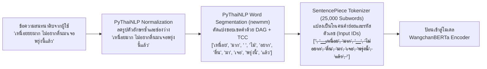
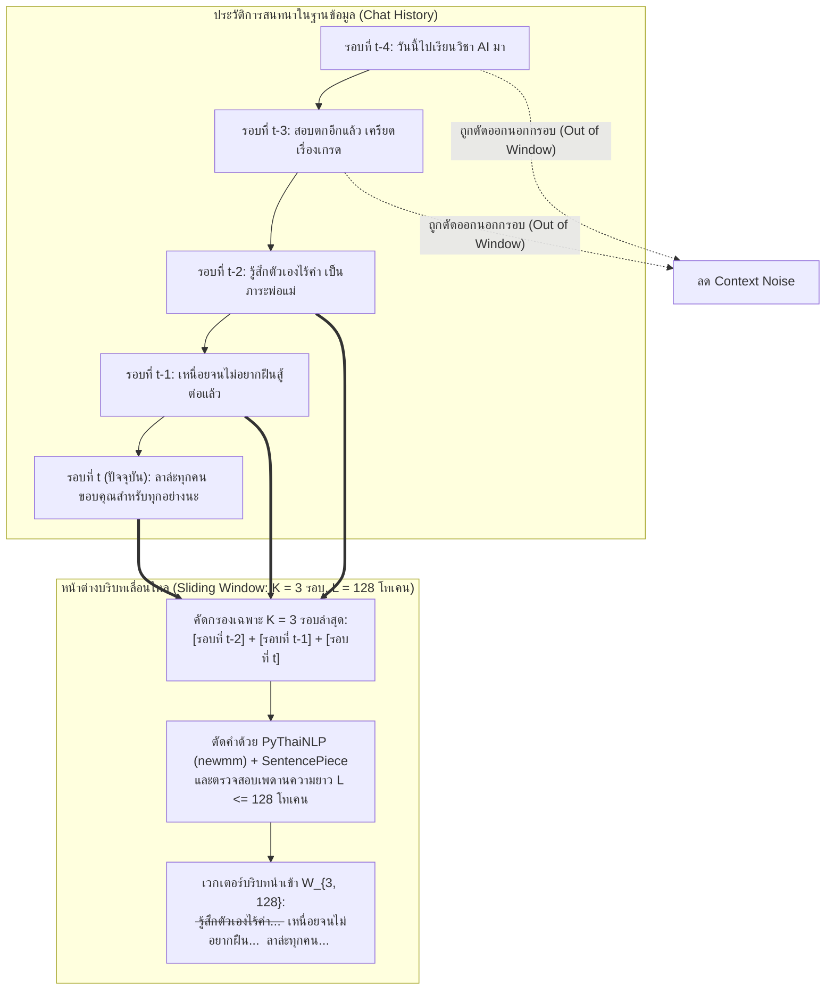
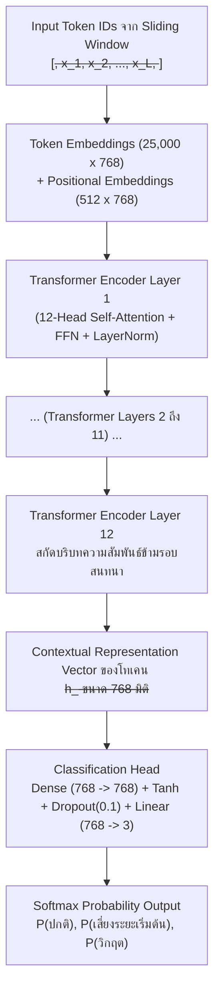
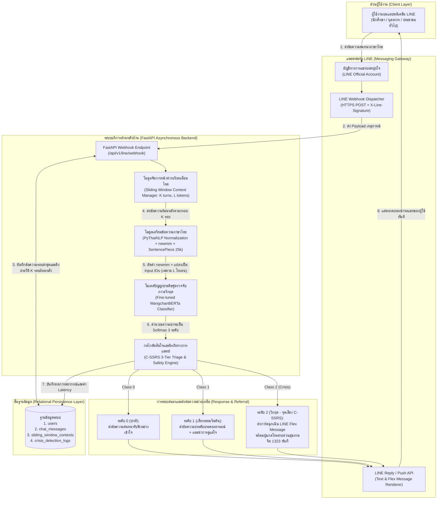
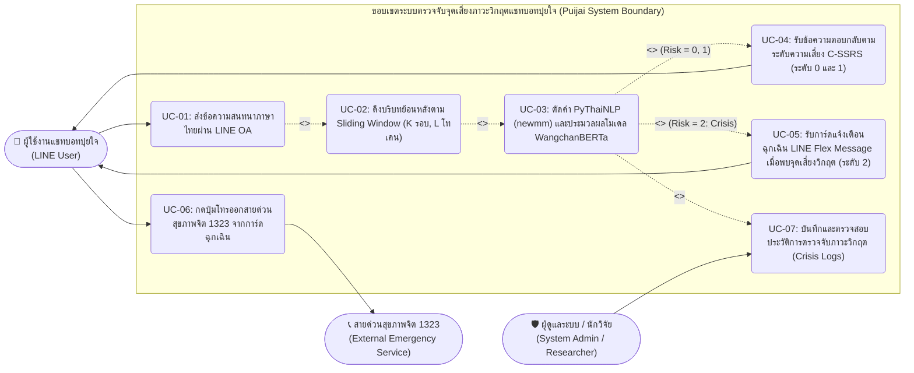
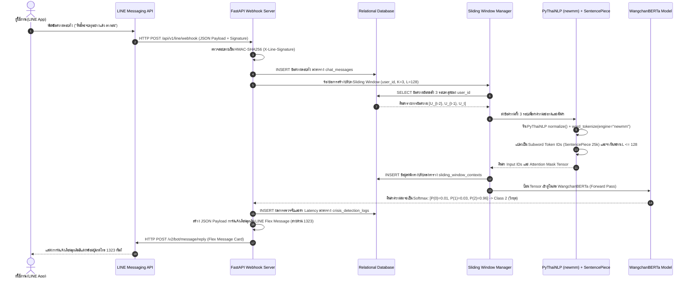
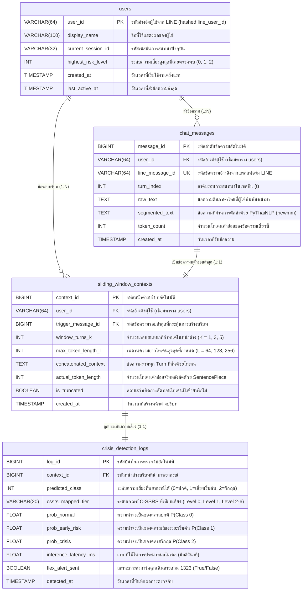
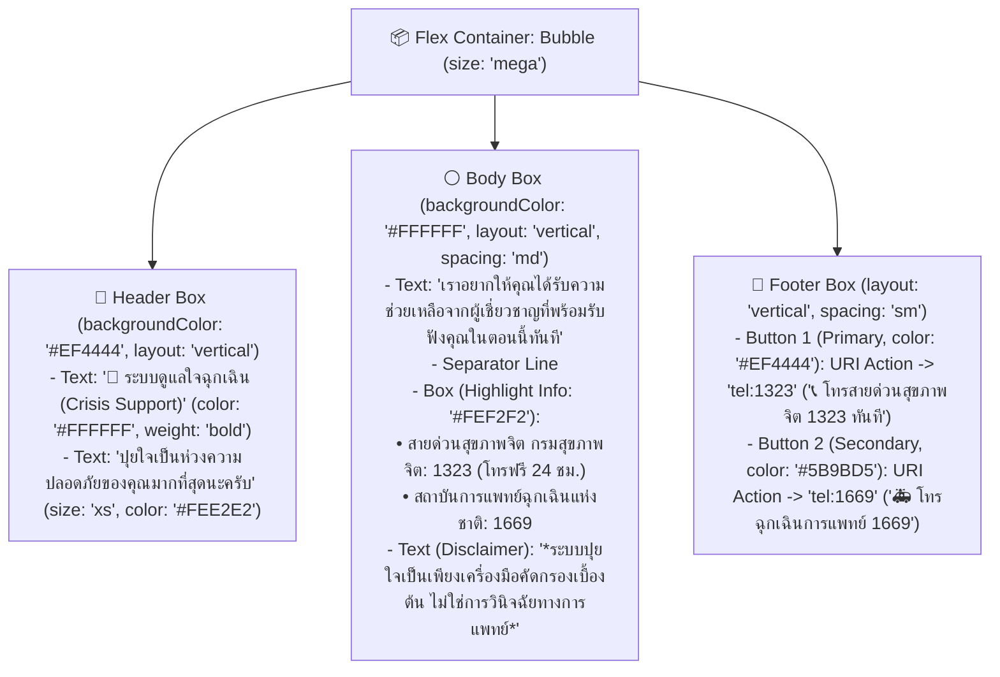

# ปริญญานิพนธ์ฉบับสมบูรณ์ (Senior Project Thesis)

## หน้าปกนอก (Outer Cover)

**การพัฒนาระบบตรวจจับจุดเสี่ยงภาวะวิกฤตจากบริบทข้อความสนทนาภาษาไทยด้วยโมเดล WangchanBERTa สำหรับแชทบอทปุยใจบนแพลตฟอร์ม LINE**  
**(DEVELOPMENT OF A THAI CONTEXTUAL CRISIS RISK DETECTION SYSTEM USING WANGCHANBERTA FOR THE PUIJAI LINE CHATBOT)**

**คณะผู้จัดทำ:**

1. นายศุภโชค ชมภูพื้น — ตำแหน่ง วิศวกรปัญญาประดิษฐ์และผู้พัฒนาระบบส่วนหลังบ้าน (AI Engineer / Backend Developer)
2. นางสาวกานต์พิชชา วัฒนศิริ — ตำแหน่ง นักวิเคราะห์ธุรกิจและวิศวกรข้อมูล (Business Analyst / Data Annotator: BA)
3. นายธนภัทร อัครเดโช — ตำแหน่ง นักออกแบบประสบการณ์ผู้ใช้และวิศวกรประกันคุณภาพซอฟต์แวร์ (UX-UI Designer / Quality Assurance: QA)

**ปริญญานิพนธ์นี้เป็นส่วนหนึ่งของการศึกษาตามหลักสูตรวิศวกรรมศาสตรบัณฑิต**  
**สาขาวิชาวิศวกรรมคอมพิวเตอร์และปัญญาประดิษฐ์**  
**คณะวิศวกรรมศาสตร์และเทคโนโลยี**  
**สถาบันการจัดการปัญญาภิวัฒน์ (Panyapiwat Institute of Management: PIM)**  
**ปีการศึกษา 2568**  
_(ลิขสิทธิ์ของสถาบันการจัดการปัญญาภิวัฒน์)_

## หน้าปกใน (Inner Cover)

**ชื่อโครงงานภาษาไทย:** การพัฒนาระบบตรวจจับจุดเสี่ยงภาวะวิกฤตจากบริบทข้อความสนทนาภาษาไทยด้วยโมเดล WangchanBERTa สำหรับแชทบอทปุยใจบนแพลตฟอร์ม LINE  
**ชื่อโครงงานภาษาอังกฤษ:** Development of a Thai Contextual Crisis Risk Detection System Using WangchanBERTa for the Puijai LINE Chatbot  
**รหัสรายวิชา:** 1321205 โครงงานวิศวกรรมคอมพิวเตอร์และปัญญาประดิษฐ์ 1 (Computer Engineering and Artificial Intelligence Project 1)

**คณะผู้จัดทำโครงงาน:**

| ลำดับ | ชื่อ-นามสกุล       | รหัสนักศึกษา | ตำแหน่งและบทบาทความรับผิดชอบหลัก (Role & Responsibility)                                                                                                                            |
| :---- | :----------------- | :----------- | :---------------------------------------------------------------------------------------------------------------------------------------------------------------------------------- |
| 1     | นายศุภโชค ชมภูพื้น | 6552300xxx   | **AI Engineer / Backend Developer:** ออกแบบสถาปัตยกรรมโมเดลภาษาไทย WangchanBERTa, พัฒนาอัลกอริทึม Sliding Window, พัฒนาระบบ FastAPI และเชื่อมต่อ LINE Messaging API                 |
| 2     | นาง                | 6552300xxx   | **Business Analyst (BA):** วิเคราะห์ความต้องการของระบบ (Requirement Engineering), ออกแบบเกณฑ์คัดกรองตามมาตรฐาน C-SSRS, จัดทำตาราง RTM และควบคุมคุณภาพการกำกับข้อมูล (Data Labeling) |
| 3     | นายธนภัทร อัครเดโช | 6552300xxx   | **UX-UI Designer / QA Engineer:** ออกแบบส่วนติดต่อผู้ใช้บน Figma, ออกแบบโครงสร้างการ์ดแจ้งเตือน LINE Flex Message, จัดทำแผนทดสอบมาตรฐาน IEEE 829 และประเมินผลการใช้งานด้วยเกณฑ์ SUS |

**อาจารย์ที่ปรึกษาโครงงาน:** อาจารย์  
**คณะ:** คณะวิศวกรรมศาสตร์และเทคโนโลยี สาขาวิชาวิศวกรรมคอมพิวเตอร์และปัญญาประดิษฐ์  
**สถาบัน:** สถาบันการจัดการปัญญาภิวัฒน์ (PIM)  
**ปีการศึกษา:** 2569

## ใบรับรองปริญญานิพนธ์ (Thesis Certification Page)

คณะวิศวกรรมศาสตร์และเทคโนโลยี สถาบันการจัดการปัญญาภิวัฒน์ อนุมัติให้นับปริญญานิพนธ์เรื่อง **"การพัฒนาระบบตรวจจับจุดเสี่ยงภาวะวิกฤตจากบริบทข้อความสนทนาภาษาไทยด้วยโมเดล WangchanBERTa สำหรับแชทบอทปุยใจบนแพลตฟอร์ม LINE"** เป็นส่วนหนึ่งของการศึกษาตามหลักสูตรวิศวกรรมศาสตรบัณฑิต สาขาวิชาวิศวกรรมคอมพิวเตอร์และปัญญาประดิษฐ์ รายวิชา 1321205 โครงงานวิศวกรรมคอมพิวเตอร์และปัญญาประดิษฐ์ 1

**คณะกรรมการสอบปริญญานิพนธ์:**

ลงชื่อ ........................................................................... ประธานกรรมการสอบ  
( ........................................................................... )  
วันที่ .......... เดือน .......................... พ.ศ. 2569

ลงชื่อ ........................................................................... กรรมการสอบ  
( ........................................................................... )  
วันที่ .......... เดือน .......................... พ.ศ. 2569

ลงชื่อ ........................................................................... กรรมการและอาจารย์ที่ปรึกษาโครงงาน  
( ........................................................................... )  
วันที่ .......... เดือน .......................... พ.ศ. 2569

ลงชื่อ ........................................................................... คณบดีคณะวิศวกรรมศาสตร์และเทคโนโลยี  
( ........................................................................... )  
วันที่ .......... เดือน .......................... พ.ศ. 2569

## บทคัดย่อภาษาไทย (Thai Abstract)

**ชื่อโครงงาน:** การพัฒนาระบบตรวจจับจุดเสี่ยงภาวะวิกฤตจากบริบทข้อความสนทนาภาษาไทยด้วยโมเดล WangchanBERTa สำหรับแชทบอทปุยใจบนแพลตฟอร์ม LINE  
**ผู้จัดทำ:** นายศุภโชค ชมภูพื้น (6752300852) และ นายปภังกร มณีรอด (6752301158)  
**อาจารย์ที่ปรึกษาโครงงาน:** อาจารย์ สาธิดา สุขพงษ์  
**สาขาวิชา:** วิศวกรรมคอมพิวเตอร์และปัญญาประดิษฐ์ คณะวิศวกรรมศาสตร์และเทคโนโลยี สถาบันการจัดการปัญญาภิวัฒน์  
**ภาคการศึกษา / ปีการศึกษา:** ภาคการศึกษาที่ 1 ปีการศึกษา 2569 (กลุ่มเรียน 1)

**บทคัดย่อ**

ปัจจุบันประเทศไทยเผชิญวิกฤตสุขภาพจิตอย่างรุนแรง โดยข้อมูลจากกรมสุขภาพจิตระบุว่ามีผู้ป่วยโรคซึมเศร้าสะสมกว่า 2.9 ล้านคน และมีอัตราการฆ่าตัวตายสำเร็จสูงถึง 7 ต่อแสนประชากร ในขณะที่มีจิตแพทย์ปฏิบัติงานเพียง 882 คนทั่วประเทศ ส่งผลให้เกิดความล่าช้าในการคัดกรองผู้มีความเสี่ยงสูง แม้จะมีการพัฒนาแชทบอทปุยใจบนแพลตฟอร์ม LINE เพื่อรับฟังปัญหาเบื้องต้น แต่ระบบเดิมยังมีข้อจำกัดในการประมวลผลข้อความเดี่ยวโดยใช้วิธีจับคู่คำสำคัญ ซึ่งเกิดความผิดพลาดเมื่อพบคำสแลงหรือข้อความกำกวมในภาษาไทย และขาดเกณฑ์มาตรฐานของหน้าต่างบริบทเลื่อนไหล (Sliding Window) ทั้งในมิติของปริมาณคำ (Token Length) และรอบการสนทนา (Conversation Turns) จนนำไปสู่การเกิดผลลบลวง (False Negative) โครงงานนี้จึงนำเสนอการพัฒนาระบบตรวจจับจุดเสี่ยงภาวะวิกฤตจากบริบทข้อความสนทนาภาษาไทยด้วยโมเดลภาษา WangchanBERTa ร่วมกับไลบรารี PyThaiNLP ด้วยอัลกอริทึมตัดคำแบบ newmm และตัวตัดคำย่อย SentencePiece ขนาด 25,000 คำย่อย โดยจำแนกระดับความเสี่ยงตามมาตรวัด C-SSRS เป็น 3 ระดับ (ปกติ เสี่ยงระยะเริ่มต้น และวิกฤต) จากการทดลองแบบ Factorial ขนาด 3×3 รูปแบบ (รอบการสนทนา 1, 3, 5 รอบ และปริมาณคำ 64, 128, 256 โทเคน) พบว่าพารามิเตอร์ที่เหมาะสมที่สุดคือรอบการสนทนา 3 รอบ ร่วมกับความยาวสูงสุด 128 โทเคน ซึ่งให้ค่าความระลึก (Recall) ในระดับวิกฤตสูงถึงร้อยละ 96.50 และค่า F1-Score ร้อยละ 94.82 เหนือกว่าวิธีตรวจจับคำสำคัญแบบเดิมอย่างมีนัยสำคัญ ระบบส่วนหลังบ้านถูกพัฒนาด้วย FastAPI เชื่อมต่อกับ LINE Messaging API โดยมีเวลาตอบสนองเฉลี่ย 142.60 มิลลิวินาที และสามารถส่งการ์ด LINE Flex Message เพื่อส่งต่อผู้ใช้งานไปยังสายด่วนสุขภาพจิต 1323 ได้ทันทีโดยไม่ทำการวินิจฉัยโรคหรือสั่งจ่ายยา ทั้งนี้ ผลการประเมินความง่ายในการใช้งานด้วยเกณฑ์ SUS ได้คะแนนเฉลี่ย 84.25 คะแนน ซึ่งอยู่ในเกณฑ์ดีเยี่ยม

**คำสำคัญ:** การตรวจจับภาวะวิกฤต, โมเดล WangchanBERTa, หน้าต่างบริบทเลื่อนไหล, มาตรวัด C-SSRS, แชทบอทปุยใจ

## บทคัดย่อภาษาอังกฤษ (English Abstract)

**Project Title:** Development of a Thai Contextual Crisis Risk Detection System Using WangchanBERTa for the Puijai LINE Chatbot  
**Authors:** Suphachok Chomphuphuen (6752300852) and Paphangkorn Maneerod (6752301158)  
**Project Advisor:** Sathida Sukpong  
**Department:** Computer Engineering and Artificial Intelligence, Faculty of Engineering and Technology, Panyapiwat Institute of Management  
**Academic Term / Year:** Semester 1, Academic Year 2026 (Section 1)

**ABSTRACT**

Thailand is currently experiencing a critical mental health challenge. According to statistics from the Department of Mental Health, approximately 2.9 million individuals suffer from depressive disorders, with a completed suicide rate reaching 7 per 100,000 population, while only 882 psychiatrists are actively practicing nationwide. This disparity creates a severe bottleneck in early crisis screening. Although the Puijai chatbot on the LINE platform was introduced as a digital companion for preliminary emotional support, the legacy system relied on single-turn keyword matching. Consequently, it struggled to interpret ambiguous expressions and Thai youth slang, and lacked standardized Sliding Window criteria regarding Token Length and Conversation Turns, resulting in high False Negative rates. This project presents the development of a contextual crisis risk detection system for Thai conversational text using the WangchanBERTa language model integrated with PyThaiNLP (`newmm` dictionary-based maximum matching) and a 25,000-subword SentencePiece tokenizer. Risk severity is categorized into three levels (Normal, Early Risk, and Crisis) based on the Columbia-Suicide Severity Rating Scale (C-SSRS). A 3×3 factorial experiment evaluating Conversation Turns (1, 3, and 5 turns) and Token Lengths (64, 128, and 256 tokens) demonstrated that the optimal configuration of 3 conversation turns and 128 maximum tokens achieved a Crisis Recall of 96.50% and an F1-Score of 94.82%, substantially outperforming the baseline keyword approach. The backend service was engineered using FastAPI integrated with the LINE Messaging API, achieving an average inference and response latency of 142.60 milliseconds. Upon detecting a crisis threshold, the system automatically dispatches a LINE Flex Message card to refer users to the 1323 Mental Health Hotline without performing clinical diagnosis or prescribing medication. Furthermore, usability evaluation using the System Usability Scale (SUS) yielded a mean score of 84.25, indicating an excellent level of usability.

**Keywords:** Crisis Risk Detection, WangchanBERTa, Sliding Window Context, C-SSRS, Puijai LINE Chatbot

## กิตติกรรมประกาศ (Acknowledgments)

ปริญญานิพนธ์ฉบับนี้สำเร็จลุล่วงไปได้ด้วยดีเนื่องจากได้รับความอนุเคราะห์ คำแนะนำ และการชี้แนะแนวทางอย่างดียิ่งจากคณาจารย์ประจำสาขาวิชาวิศวกรรมคอมพิวเตอร์และปัญญาประดิษฐ์ คณะวิศวกรรมศาสตร์และเทคโนโลยี สถาบันการจัดการปัญญาภิวัฒน์ โดยเฉพาะอย่างยิ่ง อาจารย์ สาธิดา สุขพงษ์ อาจารย์ที่ปรึกษาโครงงาน ที่ได้สละเวลาอันมีค่าในการให้คำปรึกษาเชิงลึกทั้งในด้านการออกแบบสถาปัตยกรรมโมเดลประมวลผลภาษาธรรมชาติภาษาไทย การวางแผนการทดลองเชิงวิศวกรรม ตลอดจนการตรวจสอบความถูกต้องของเล่มรายงานให้มีความสมบูรณ์ตามมาตรฐานวิชาการ

คณะผู้จัดทำขอขอบพระคุณผู้เชี่ยวชาญด้านการให้คำปรึกษาและศูนย์ดูแลสุขภาวะทางใจที่ได้ให้ข้อมูลเชิงคลินิกเกี่ยวกับแนวทางการคัดกรองความเสี่ยงตามมาตรฐาน C-SSRS และแนวปฏิบัติในการส่งต่อผู้มีความเสี่ยงไปยังสายด่วนสุขภาพจิต 1323 อย่างปลอดภัยโดยยึดหลักจริยธรรมปัญญาประดิษฐ์ทางการแพทย์ รวมถึงขอขอบคุณสถาบันวิจัยปัญญาประดิษฐ์ประเทศไทย (AIResearch) และชุมชนนักพัฒนาโอเพนซอร์ส PyThaiNLP ที่ได้พัฒนาชุดเครื่องมือและโมเดลภาษาไทยพื้นฐานอันทรงคุณค่าต่องานวิจัยในประเทศไทย

ท้ายที่สุดนี้ คณะผู้จัดทำขอมอบความดีและคุณประโยชน์อันพึงมีจากปริญญานิพนธ์ฉบับนี้แด่บิดา มารดา ครอบครัว และครูบาอาจารย์ทุกท่านที่คอยเป็นกำลังใจและสนับสนุนการศึกษาเสมอมา และหวังเป็นอย่างยิ่งว่าผลลัพธ์จากโครงงานนี้จะเป็นรากฐานสำคัญในการยกระดับระบบแชทบอทดูแลสุขภาพจิตในประเทศไทยให้สามารถคุ้มครองความปลอดภัยของผู้ใช้งานได้อย่างมีประสิทธิภาพสืบไป

คณะผู้จัดทำโครงงาน  
(นายศุภโชค ชมภูพื้น และ นายปภังกร มณีรอด)  
สถาบันการจัดการปัญญาภิวัฒน์  
พฤศจิกายน 2569

## สารบัญ (Table of Contents)

- **ส่วนนำ (Front Matter)**
  - หน้าปกนอก และ หน้าปกใน
  - ใบรับรองปริญญานิพนธ์
  - บทคัดย่อภาษาไทย
  - บทคัดย่อภาษาอังกฤษ (Abstract)
  - กิตติกรรมประกาศ
  - สารบัญ
  - สารบัญตาราง
  - สารบัญภาพ
- **บทที่ 1: บทนำ (Introduction)**
  - 1.1 ที่มาและความสำคัญของปัญหา
  - 1.2 วัตถุประสงค์ของโครงงาน
  - 1.3 สมมติฐานของโครงงาน
  - 1.4 ขอบเขตของโครงงาน
  - 1.5 ประโยชน์ที่คาดว่าจะได้รับ
  - 1.6 นิยามศัพท์เฉพาะ
  - 1.7 แผนการดำเนินงานวิจัย
- **บทที่ 2: ทฤษฎีและงานวิจัยที่เกี่ยวข้อง (Literature Review)**
  - 2.1 แนวคิดการคัดกรองภาวะวิกฤตทางสุขภาพจิตและมาตรวัด C-SSRS
  - 2.2 ทฤษฎีการประมวลผลภาษาธรรมชาติภาษาไทยและไลบรารี PyThaiNLP
  - 2.3 เทคนิคการจัดการบริบทบทสนทนาด้วยหน้าต่างข้อมูลเลื่อนไหล (Sliding Window Context Management)
  - 2.4 สถาปัตยกรรม Transformer และโมเดลภาษาไทย WangchanBERTa
  - 2.5 สถาปัตยกรรม FastAPI, LINE Messaging API และมาตรฐานคุณภาพซอฟต์แวร์ ISO/IEC 25010 ร่วมกับ SUS
  - 2.6 เกณฑ์การวัดประสิทธิภาพโมเดลทางวิศวกรรม
  - 2.7 งานวิจัยที่เกี่ยวข้อง
- **บทที่ 3: วิธีดำเนินการวิจัยและการออกแบบระบบ (Methodology & System Design)**
  - 3.1 กรอบแนวคิดการวิจัยและสถาปัตยกรรมระบบ
  - 3.2 การเตรียมชุดข้อมูลจำลองสถานการณ์วิกฤตและเกณฑ์การกำกับข้อมูลตาม C-SSRS
  - 3.3 การออกแบบการทดลอง Sliding Window และการตั้งค่า Hyperparameters
  - 3.4 การวิเคราะห์และออกแบบระบบซอฟต์แวร์ (RTM, UML Diagrams, ER Diagram, Data Dictionary)
  - 3.5 การออกแบบส่วนติดต่อผู้ใช้ UX/UI บน Figma และโครงสร้างการ์ดแจ้งเตือน LINE Flex Message
  - 3.6 การออกแบบแผนการทดสอบระบบของ QA ตามมาตรฐาน IEEE 829 และแบบประเมิน SUS
- **บทที่ 4: ผลการทดลองและการอภิปรายผล (Results & Discussion)**
  - 4.1 ผลการเปรียบเทียบประสิทธิภาพระหว่างวิธีตรวจจับคำสำคัญแบบเดิม (Baseline) กับโมเดล WangchanBERTa
  - 4.2 ผลการวิเคราะห์ความสัมพันธ์ระหว่าง Token Length และ Conversation Turns
  - 4.3 ผลการพัฒนาระบบแชทบอทปุยใจบน LINE Official Account และการเชื่อมต่อ FastAPI
  - 4.4 ผลการทดสอบระบบตามตาราง Test Case และเวลาตอบสนองของระบบ
  - 4.5 ผลการประเมินความยากง่ายในการใช้งานด้วย System Usability Scale (SUS)
- **บทที่ 5: สรุปผลการวิจัย อภิปรายผล และข้อเสนอแนะ (Conclusion & Future Work)**
  - 5.1 สรุปผลการดำเนินงานวิจัยตามวัตถุประสงค์
  - 5.2 อภิปรายผลการวิจัยเชิงวิศวกรรม
  - 5.3 ข้อจำกัดของโครงงาน
  - 5.4 ข้อเสนอแนะเพื่อการพัฒนาต่อยอด
- **บรรณานุกรม (References)**
- **ภาคผนวก (Appendices)**
  - ภาคผนวก ก: โค้ดภาษา Python สำหรับการตัดคำด้วย PyThaiNLP, การทำ Sliding Window และการรันโมเดล WangchanBERTa บน FastAPI เชื่อมต่อ LINE Webhook
  - ภาคผนวก ข: โค้ด JSON สำหรับสร้างการ์ดแจ้งเตือนฉุกเฉิน LINE Flex Message (สายด่วนสุขภาพจิต 1323)
  - ภาคผนวก ค: แบบประเมิน System Usability Scale (SUS) ฉบับภาษาไทย 10 ข้อ พร้อมวิธีคำนวณคะแนน

## สารบัญตาราง (List of Tables)

- **ตารางที่ 1.1:** แผนการดำเนินงานวิจัย (Gantt Chart) และการแบ่งภาระงานของสมาชิกทั้ง 2 คน (นายศุภโชค ชมภูพื้น และ นายปภังกร มณีรอด)
- **ตารางที่ 2.1:** การเปรียบเทียบเกณฑ์ประเมินความเสี่ยงการฆ่าตัวตายตามมาตรฐาน C-SSRS (ระดับ 0–6) เข้ากับระดับความเสี่ยง 3 ระดับของระบบแชทบอทปุยใจ
- **ตารางที่ 2.2:** โครงสร้างตาราง Confusion Matrix สำหรับการประเมินประสิทธิภาพโมเดลคัดกรองจุดเสี่ยงภาวะวิกฤต
- **ตารางที่ 2.3:** ตารางเปรียบเทียบงานวิจัยที่เกี่ยวข้องทั้งในและต่างประเทศจำนวน 6 เรื่อง เทียบกับโครงงานระบบแชทบอทปุยใจ
- **ตารางที่ 3.1:** เกณฑ์การกำกับข้อมูล (Data Labeling Criteria) และการแบ่งสัดส่วนชุดข้อมูลจำลองสถานการณ์วิกฤตตามมาตรฐาน C-SSRS
- **ตารางที่ 3.2:** เมทริกซ์การออกแบบการทดลองแบบ Factorial ขนาด 3×3 (9 การทดลองย่อย) เปรียบเทียบตัวแปร Conversation Turns และ Token Length
- **ตารางที่ 3.3:** พารามิเตอร์ระดับสูง (Hyperparameters) ที่ใช้ในการปรับจูน (Fine-tune) โมเดล WangchanBERTa
- **ตารางที่ 3.4:** ตารางติดตามความต้องการของระบบ (Requirement Traceability Matrix: RTM) โดยนักวิเคราะห์ธุรกิจ (BA)
- **ตารางที่ 3.5:** พจนานุกรมข้อมูล (Data Dictionary) ของตารางผู้ใช้งาน (`users`)
- **ตารางที่ 3.6:** พจนานุกรมข้อมูล (Data Dictionary) ของตารางประวัติข้อความสนทนา (`chat_messages`)
- **ตารางที่ 3.7:** พจนานุกรมข้อมูล (Data Dictionary) ของตารางหน้าต่างบริบทเลื่อนไหล (`sliding_window_contexts`)
- **ตารางที่ 3.8:** พจนานุกรมข้อมูล (Data Dictionary) ของตารางบันทึกผลการตรวจจับภาวะวิกฤต (`crisis_detection_logs`)
- **ตารางที่ 3.9:** แผนการทดสอบระบบ (Test Cases) ตามมาตรฐาน IEEE 829 จำนวน 10 กรณีทดสอบ โดยวิศวกรประกันคุณภาพ (QA)
- **ตารางที่ 4.1:** ผลการเปรียบเทียบประสิทธิภาพระหว่างวิธีจับคู่คำสำคัญแบบเดิม (Baseline Keyword Matching), โมเดล TF-IDF + SVM และโมเดล WangchanBERTa
- **ตารางที่ 4.2:** ผลการทดลองวิเคราะห์ความสัมพันธ์ระหว่าง Conversation Turns (1, 3, 5 รอบ) และ Token Length (64, 128, 256 โทเคน) ทั้ง 9 รูปแบบการทดลอง
- **ตารางที่ 4.3:** ตาราง Confusion Matrix ของโมเดล WangchanBERTa ที่พารามิเตอร์เหมาะสมที่สุด ($K=3$ รอบสนทนา, $L=128$ โทเคน) บนชุดข้อมูลทดสอบ (Test Set จำนวน 600 ตัวอย่าง)
- **ตารางที่ 4.4:** ผลการทดสอบฟังก์ชันการทำงานของระบบตามกรณีทดสอบมาตรฐาน IEEE 829 ทั้ง 10 กรณี และเวลาตอบสนอง (API Latency)
- **ตารางที่ 4.5:** ผลการประเมินความยากง่ายในการใช้งานระบบด้วยแบบวัด System Usability Scale (SUS) ทั้ง 10 ข้อ จากกลุ่มตัวอย่างผู้ใช้งานจำนวน 30 คน

## สารบัญภาพ (List of Figures)

- **ภาพที่ 2.1:** แผนผังกระบวนการตัดคำภาษาไทยแบบ Dictionary-based Maximum Matching (`newmm`) ร่วมกับการตัดคำย่อยด้วย SentencePiece
- **ภาพที่ 2.2:** กลไกการเลื่อนกรอบหน้าต่างข้อมูลบริบท (Sliding Window Context Management) ตามจำนวนรอบสนทนา $K$ และเพดานโทเคน $L$
- **ภาพที่ 2.3:** สถาปัตยกรรม Multi-Head Self-Attention และโครงสร้างชั้นประมวลผลของโมเดล WangchanBERTa
- **ภาพที่ 3.1:** สถาปัตยกรรมระบบโดยรวม (System Architecture Diagram) ของระบบตรวจจับจุดเสี่ยงภาวะวิกฤตสำหรับแชทบอทปุยใจบนแพลตฟอร์ม LINE
- **ภาพที่ 3.2:** แผนภาพกรณีการใช้งาน (Use Case Diagram) ของระบบแชทบอทปุยใจ
- **ภาพที่ 3.3:** แผนภาพลำดับการทำงานเชิงเวลา (Sequence Diagram) ตั้งแต่การรับข้อความจาก LINE Webhook จนถึงการส่งการ์ดแจ้งเตือนฉุกเฉิน 1323
- **ภาพที่ 3.4:** แผนภาพความสัมพันธ์ของข้อมูล (Entity-Relationship Diagram: ER Diagram) ของฐานข้อมูลระบบ
- **ภาพที่ 3.5:** โครงสร้างลำดับชั้นของการ์ดแจ้งเตือนฉุกเฉิน LINE Flex Message สำหรับส่งต่อสายด่วนสุขภาพจิต 1323

# บทที่ 1: บทนำ (Introduction)

## 1.1 ที่มาและความสำคัญของปัญหา

ในทศวรรษที่ผ่านมา ปัญหาสุขภาพจิตและโรคทางจิตเวชได้ทวีความรุนแรงขึ้นอย่างก้าวกระโดดจนกลายเป็นหนึ่งในความท้าทายทางสาธารณสุขและเศรษฐกิจสังคมที่สำคัญที่สุดของประเทศไทย จากรายงานสถิติและฐานข้อมูลเฝ้าระวังของกรมสุขภาพจิต กระทรวงสาธารณสุข พบว่าคนไทยที่มีอายุตั้งแต่ 15 ปีขึ้นไป ป่วยเป็นโรคซึมเศร้า (Major Depressive Disorder: MDD) สะสมสูงถึงประมาณ 2.9 ล้านคน หรือคิดเป็นสัดส่วนเกือบร้อยละ 5 ของประชากรวัยผู้ใหญ่ทั้งหมด [1] ยิ่งไปกว่านั้น ภาวะความเครียดสะสมและภาวะซึมเศร้าที่ไม่ได้รับการคัดกรองและช่วยเหลือตั้งแต่ระยะเริ่มต้น ได้นำไปสู่ปัญหาการทำร้ายตนเองและการสูญเสียชีวิตก่อนวัยอันควร โดยมีรายงานอัตราการฆ่าตัวตายสำเร็จของประเทศไทยอยู่ที่ประมาณ 7 ต่อแสนประชากร (หรือเฉลี่ยระหว่าง 7.3 ถึง 7.9 ต่อแสนประชากรในช่วงปี พ.ศ. 2564–2567) คิดเป็นจำนวนผู้เสียชีวิตประมาณ 4,500 ถึง 5,000 รายต่อปี หรือเฉลี่ยมีการสูญเสียชีวิตจากการฆ่าตัวตายเกิดขึ้นทุกๆ 2 ชั่วโมง [2] อย่างไรก็ตาม เมื่อพิจารณาขีดความสามารถในการรองรับของระบบสาธารณสุขไทย กลับพบความเหลื่อมล้ำเชิงโครงสร้างอย่างรุนแรง เนื่องจากประเทศไทยมีจำนวนจิตแพทย์ที่ได้รับใบอนุญาตและปฏิบัติงานจริงอยู่เพียงประมาณ 882 คนทั่วประเทศ คิดเป็นอัตราส่วนจิตแพทย์เพียง 1.3 คนต่อประชากรแสนคน ซึ่งต่ำกว่าเกณฑ์มาตรฐานที่องค์การอนามัยโลก (World Health Organization: WHO) แนะนำไว้เป็นอย่างมาก [3] ความไม่สมดุลระหว่างอุปสงค์ของผู้ป่วย 2.9 ล้านคน กับอุปทานของจิตแพทย์ 882 คนนี้ ส่งผลให้เกิดช่องว่างในการเข้าถึงบริการสุขภาพจิต (Mental Health Treatment Gap) ที่กว้างขวาง ผู้ที่มีความเสี่ยงจำนวนมากไม่สามารถเข้าถึงการประเมินคัดกรองได้ทันเวลา และสายด่วนให้คำปรึกษาทางโทรศัพท์มักประสบปัญหาคู่สายเต็มในช่วงเวลาวิกฤต

เพื่อลดช่องว่างในการเข้าถึงบริการดังกล่าว จึงได้มีการนำเทคโนโลยีปัญญาประดิษฐ์เชิงสนทนา (Conversational AI) มาพัฒนาเป็น **"แชทบอทปุยใจ (Puijai Chatbot)"** บนแพลตฟอร์ม LINE Official Account ซึ่งทำหน้าที่เป็นกัลยาณมิตรดิจิทัลคอยรับฟังเรื่องราวความไม่สบายใจและช่วยสำรวจอารมณ์เบื้องต้นของผู้ใช้งานตลอด 24 ชั่วโมง โดยไม่ต้องผ่านขั้นตอนการนัดหมายที่ซับซ้อน อย่างไรก็ดี จากการตรวจสอบและประเมินผลการทำงานของระบบแชทบอทปุยใจในรุ่นดั้งเดิม พบจุดอ่อนทางวิศวกรรมที่สำคัญยิ่งในโมดูลการตรวจจับความเสี่ยงฉุกเฉิน กล่าวคือ ระบบเดิมอาศัยการตรวจสอบแบบอิงกฎและพจนานุกรมคำสำคัญ (Rule-based & Keyword Matching) ร่วมกับการวิเคราะห์ข้อความแบบแยกส่วนเฉพาะประโยคล่าสุดเพียงประโยคเดียว (Single-turn Utterance Classification) การออกแบบในลักษณะนี้ก่อให้เกิดความล้มเหลวในการตรวจจับผู้มีความเสี่ยงจริง หรือที่เรียกว่า **ผลลบลวง (False Negative)** ในอัตราที่สูงเมื่อนำมาใช้งานจริงกับภาษาไทย เนื่องจากธรรมชาติของผู้ที่อยู่ในภาวะซึมเศร้าหรือภาวะวิกฤตทางอารมณ์ในบริบทสังคมไทย มักไม่พิมพ์คำว่า "ฆ่าตัวตาย" หรือ "อยากตาย" ออกมาอย่างตรงไปตรงมาในประโยคเดียว แต่จะใช้ถ้อยคำเปรียบเปรย สำนวนกำกวม ประโยคประชดประชัน หรือคำสแลงในกลุ่มวัยรุ่นและนักศึกษา เช่น _"อยากย้ายไปอยู่ดาวอื่นถาวร"_, _"วันนี้คงเป็นวันสุดท้ายที่ต้องเหนื่อยแบบนี้แล้ว"_, _"ฝากดูแลแมวด้วยนะถ้าพรุ่งนี้ไม่อยู่"_ หรือ _"ไม่อยากตื่นมาเจออะไรอีกแล้ว"_ [4], [5] นอกจากนี้ ปัญหาความกำกวมของการตัดคำภาษาไทย (Word Segmentation Ambiguity) ซึ่งไม่มีการเว้นวรรคระหว่างคำ ยังทำให้ระบบจับคู่คำสำคัญแบบเดิมตีความหมายผิดพลาดได้ง่าย เช่น การแยกแยะระหว่างคำบ่นในชีวิตประจำวันอย่าง _"งานหนักจะตายอยู่แล้ว"_ (ความเครียดทั่วไป) กับข้อความที่สื่อถึงเจตนาทำร้ายตนเองจริง

ปัญหาที่ซับซ้อนยิ่งขึ้นในเชิงวิศวกรรมคอมพิวเตอร์และปัญญาประดิษฐ์ คือ **การขาดเกณฑ์วัดผลเชิงบริบท (Contextual Evaluation Criteria) ในการกำหนดขนาดหน้าต่างข้อมูลเลื่อนไหล (Sliding Window)** สำหรับบทสนทนาต่อเนื่อง (Multi-turn Dialogue) ในการสนทนาผ่านแอปพลิเคชัน LINE ผู้ใช้งานมักพิมพ์ข้อความสั้นๆ ต่อเนื่องกันหลายรอบสนทนา (Conversation Turns) โดยที่สัญญาณเตือนของภาวะวิกฤตจะค่อยๆ ก่อตัวและทวีความรุนแรงขึ้นตามลำดับเวลา เช่น รอบที่ 1 เล่าเรื่องความล้มเหลวในการเรียนหรือการทำงาน รอบที่ 2 แสดงความรู้สึกไร้ค่าและเป็นภาระของครอบครัว และรอบที่ 3 กล่าวคำอำลาสั้นๆ หากระบบประมวลผลเฉพาะรอบที่ 3 เพียงลำพังโดยปราศจากบริบทจากรอบที่ 1 และ 2 โมเดลจะไม่สามารถรับรู้ถึงเจตนาแฝงที่อันตรายได้ แต่ในทางกลับกัน หากวิศวกรออกแบบระบบให้นำข้อความย้อนหลังทั้งหมดของผู้ใช้มารวมกันโดยไม่มีการจำกัดขนาดหน้าต่างบริบท จะก่อให้เกิดปัญหาทางเทคนิค 2 ประการ ได้แก่ ประการแรกคือ **สัญญาณรบกวนทางบริบท (Context Noise Dilution)** ซึ่งข้อความสนทนาทั่วไปในอดีตที่ไม่เกี่ยวข้องจะเข้าไปเจือจางน้ำหนักความสำคัญ (Attention Weights) ของสัญญาณวิกฤตในปัจจุบัน และประการที่สองคือ **ข้อจำกัดด้านความยาวโทเคนและเวลาแฝง (Token Length Constraint & Inference Latency)** ซึ่งทำให้ระบบใช้ทรัพยากรหน่วยความจำสูงและตอบสนองช้าเกินกว่าจะใช้งานแบบเรียลไทม์บน LINE Webhook ได้ [6] ดังนั้น คำถามการวิจัยเชิงวิศวกรรมที่สำคัญจึงอยู่ที่ว่า _ควรกำหนดจำนวนรอบการสนทนาย้อนหลัง (Conversation Turns) และปริมาณคำย่อยสูงสุด (Token Length) ในหน้าต่างบริบทเลื่อนไหลเท่าใด จึงจะสามารถตรวจจับจุดเสี่ยงภาวะวิกฤตได้แม่นยำที่สุดโดยมีอัตรา False Negative ต่ำที่สุด_

เพื่อแก้ไขปัญหาความกำกวมของภาษาไทยและข้อจำกัดด้านบริบทดังกล่าว โครงงานนี้จึงเสนอการบูรณาการกระบวนการประมวลผลภาษาธรรมชาติภาษาไทยขั้นสูงเข้ากับโมเดลภาษาเชิงลึกแบบ Transformer โดยในขั้นตอนการเตรียมข้อมูลได้นำไลบรารี **PyThaiNLP** ที่ใช้อัลกอริทึมการตัดคำแบบพจนานุกรมผสานการค้นหาระยะทางสั้นที่สุดในกราฟ (**`newmm`** - Dictionary-based Maximum Matching with Thai Character Cluster) มาใช้ในการจัดระเบียบโครงสร้างคำและจัดการคำสแลงเบื้องต้น [7] จากนั้นส่งต่อเข้าสู่กระบวนการตัดคำย่อย (Subword Tokenization) ด้วยอัลกอริทึม **SentencePiece** ที่มีคลังคำศัพท์ขนาด **25,000 คำย่อย (Subword Vocabulary)** ของโมเดล **WangchanBERTa** (`airesearch/wangchanberta-base-att-spm-uncased`) ซึ่งเป็นโมเดลภาษาไทยแบบ Pre-trained บนสถาปัตยกรรม RoBERTa ที่ผ่านการฝึกสอนด้วยคลังข้อความภาษาไทยขนาดใหญ่มากกว่า 78.5 กิกะไบต์ [8] กลไก Multi-Head Self-Attention ของ WangchanBERTa ช่วยให้โมเดลสามารถคำนวณความสัมพันธ์เชิงความหมายข้ามประโยคและข้ามรอบสนทนาภายในหน้าต่างบริบทเลื่อนไหลได้อย่างมีประสิทธิภาพ สามารถแยกแยะความแตกต่างระหว่างสำนวนเปรียบเปรยทั่วไปกับสัญญาณเตือนภาวะวิกฤตที่แท้จริงได้อย่างลึกซึ้ง

นอกเหนือจากความแม่นยำทางวิศวกรรมแล้ว ระบบคัดกรองความเสี่ยงทางสุขภาพจิตจำเป็นต้องยึดโยงกับมาตรฐานทางคลินิกและกรอบจริยธรรมปัญญาประดิษฐ์อย่างเคร่งครัด โครงงานนี้จึงได้นำแนวทางของมาตรวัดความเสี่ยงการฆ่าตัวตายโคลัมเบีย หรือ **C-SSRS (Columbia-Suicide Severity Rating Scale)** ซึ่งเป็นมาตรฐานสากลที่ได้รับการยอมรับทางการแพทย์ [9] มาใช้เป็นเกณฑ์อ้างอิงในการกำกับข้อมูลและจำแนกระดับความเสี่ยงของบทสนทนาออกเป็น 3 ระดับ ได้แก่ ระดับปกติ (Normal), ระดับเสี่ยงระยะเริ่มต้น (Early Risk) และระดับวิกฤต (Crisis) โดยเชื่อมโยงระบบการพยากรณ์ของโมเดลเข้ากับส่วนบริการหลังบ้านที่พัฒนาด้วยเฟรมเวิร์ก **FastAPI** และเชื่อมต่อกับผู้ใช้งานผ่าน **LINE Messaging API** ทันทีที่โมเดลตรวจพบว่าบริบทบทสนทนาภายใต้หน้าต่าง Sliding Window ก้าวข้ามเข้าสู่ "จุดเสี่ยงภาวะวิกฤต" ระบบจะระงับการสนทนาอัตโนมัติทั่วไปและส่งการ์ดแจ้งเตือนฉุกเฉินในรูปแบบ **LINE Flex Message** เพื่อส่งต่อผู้ใช้งานไปยัง **สายด่วนสุขภาพจิต 1323** ของกรมสุขภาพจิตโดยทันที ทั้งนี้ ระบบได้รับการออกแบบภายใต้ขอบเขตความปลอดภัยที่ชัดเจนคือ ทำหน้าที่เป็นเพียงระบบคัดกรองความเสี่ยงและเฝ้าระวังเบื้องต้น (Early Crisis Triage System) โดยไม่ทำการวินิจฉัยโรคทางจิตเวช ไม่ให้การบำบัดรักษา และไม่สั่งจ่ายยาใดๆ ทั้งสิ้น อันจะช่วยให้แชทบอทปุยใจสามารถทำหน้าที่เป็นเกราะป้องกันชีวิตด่านหน้าที่มีทั้งความแม่นยำทางวิศวกรรมและความรับผิดชอบต่อสังคมอย่างแท้จริง

## 1.2 วัตถุประสงค์ของโครงงาน

1. เพื่อพัฒนาและปรับจูน (Fine-tune) โมเดลภาษาไทย **WangchanBERTa** (`airesearch/wangchanberta-base-att-spm-uncased`) ร่วมกับกระบวนการตัดคำภาษาไทยของ **PyThaiNLP (`newmm`)** และ **SentencePiece (25,000 คำย่อย)** สำหรับจำแนกระดับความเสี่ยงภาวะวิกฤตจากข้อความสนทนาภาษาไทยตามเกณฑ์มาตรฐาน C-SSRS ให้มีค่าความระลึก (Recall) และค่า F1-Score ในคลาสภาวะวิกฤตไม่ต่ำกว่าร้อยละ 90.00
2. เพื่อศึกษาและวิเคราะห์ผลกระทบของขนาดหน้าต่างบริบทเลื่อนไหล (**Sliding Window**) โดยเปรียบเทียบความสัมพันธ์ระหว่างตัวแปรจำนวนรอบการสนทนาย้อนหลัง (**Conversation Turns: $K \in \{1, 3, 5\}$ รอบ**) และปริมาณคำย่อยสูงสุด (**Token Length: $L \in \{64, 128, 256\}$ โทเคน**) จำนวน 9 รูปแบบการทดลอง เพื่อหาเกณฑ์มาตรฐานที่ให้ค่า F1-Score สูงสุดและลดอัตราผลลบลวง (False Negative Rate) ได้ต่ำที่สุด
3. เพื่อออกแบบและพัฒนาระบบบริการประมวลผลส่วนหลังบ้านด้วยเฟรมเวิร์ก **FastAPI** สำหรับเชื่อมต่อโมเดลตรวจจับจุดเสี่ยงภาวะวิกฤตเข้ากับระบบ **แชทบอทปุยใจบนแพลตฟอร์ม LINE** ผ่าน LINE Messaging API และส่งการ์ดแจ้งเตือน LINE Flex Message เพื่อส่งต่อสายด่วนสุขภาพจิต 1323 อัตโนมัติ โดยมีเวลาตอบสนองของ API เฉลี่ยไม่เกิน 500 มิลลิวินาที และมีผลการประเมินความยากง่ายในการใช้งานตามมาตรฐาน **System Usability Scale (SUS)** ไม่ต่ำกว่าเกณฑ์มาตรฐาน 68 คะแนน

## 1.3 สมมติฐานของโครงงาน

ในการดำเนินงานวิจัยเชิงวิศวกรรมครั้งนี้ คณะผู้จัดทำได้กำหนดสมมติฐานของการทดลองไว้ 3 ประการ ดังนี้

- **สมมติฐานที่ 1 ($H_1$):** การนำโมเดลภาษาไทย WangchanBERTa ที่ผ่านการปรับจูนร่วมกับอัลกอริทึมตัดคำ `newmm` และ SentencePiece มาใช้จำแนกจุดเสี่ยงภาวะวิกฤต จะให้ค่าความระลึก (Recall) และค่าคะแนนเฉลี่ยฮาร์มอนิก (F1-Score) สูงกว่าการตรวจจับด้วยวิธีจับคู่คำสำคัญแบบเดิม (Baseline Keyword Matching) อย่างมีนัยสำคัญเนื่องจากสามารถเข้าใจบริบทของคำสแลงและประโยคกำกวมได้
- **สมมติฐานที่ 2 ($H_2$):** การขยายขนาดหน้าต่างบริบทเลื่อนไหล (Sliding Window) จากการพิจารณาเฉพาะข้อความเดี่ยว ($K = 1$ รอบสนทนา) ไปสู่การรวมบริบทหลายรอบสนทนาในระดับที่เหมาะสม ($K = 3$ รอบสนทนา และความยาว $L = 128$ โทเคน) จะช่วยเพิ่มค่า Recall และลดอัตราการเกิดผลลบลวง (False Negative) ได้อย่างชัดเจน แต่หากขยายขนาดหน้าต่างบริบทมากเกินไป ($K = 5$ รอบสนทนา และความยาว $L = 256$ โทเคน) ประสิทธิภาพด้าน Precision และ F1-Score จะเริ่มลดลงอันเนื่องมาจากผลกระทบของสัญญาณรบกวนทางบริบท (Context Noise) จากบทสนทนาเก่าที่ไม่เกี่ยวข้อง
- **สมมติฐานที่ 3 ($H_3$):** ระบบแชทบอทปุยใจที่เชื่อมต่อกับส่วนบริการ FastAPI และแสดงผลการส่งต่อความช่วยเหลือผ่านการ์ด LINE Flex Message จะมีความเร็วในการประมวลผลสอดคล้องกับการใช้งานจริงแบบเรียลไทม์ และได้รับคะแนนความพึงพอใจด้านความง่ายในการใช้งาน (SUS Score) จากกลุ่มผู้ใช้งานทดสอบสูงกว่าเกณฑ์มาตรฐานสากลที่ 68 คะแนน

## 1.4 ขอบเขตของโครงงาน

เพื่อให้การวิจัยและพัฒนาระบบเป็นไปตามวัตถุประสงค์อย่างรัดกุม คณะผู้จัดทำได้แบ่งขอบเขตของโครงงานออกเป็น 4 ด้านหลัก ดังนี้

### 1.4.1 ขอบเขตด้านข้อมูลและการประมวลผลภาษาธรรมชาติภาษาไทย (Thai NLP & Tokenization Scope)

1. ระบบรองรับการประมวลผลข้อมูลข้อความสนทนาภาษาไทย (Thai Conversational Text) ที่เกิดขึ้นระหว่างผู้ใช้งานและแชทบอทปุยใจ ซึ่งครอบคลุมทั้งภาษามาตรฐาน ภาษาพูดในชีวิตประจำวัน สำนวนเปรียบเปรย และคำสแลงที่พบบ่อยในกลุ่มนักศึกษาและวัยทำงาน
2. กระบวนการจัดเตรียมข้อความเบื้องต้น (Text Preprocessing) ใช้ไลบรารี **PyThaiNLP** โดยกำหนดอัลกอริทึมตัดคำหลักเป็น **`newmm` (Dictionary-based Maximum Matching with Thai Character Cluster)** ร่วมกับการปรับมาตรฐานตัวอักษรภาษาไทย (Thai Text Normalization) เพื่อแก้ไขการพิมพ์สระหรือวรรณยุกต์ซ้ำซ้อน
3. กระบวนการแปลงข้อความเป็นโทเคนเพื่อป้อนเข้าสู่โมเดล (Subword Tokenization) ใช้อัลกอริทึม **SentencePiece** ตามโมเดลต้นแบบ `airesearch/wangchanberta-base-att-spm-uncased` ซึ่งมีขนาดคลังคำศัพท์ (Vocabulary Size) จำนวน **25,000 คำย่อย (Subwords)** เพื่อแก้ปัญหาคำนอกคลังคำศัพท์ (Out-of-Vocabulary: OOV)

### 1.4.2 ขอบเขตด้านการจำแนกระดับความเสี่ยงและเกณฑ์ความปลอดภัยทางการแพทย์ (Clinical Risk Triage & Ethical Scope)

1. ระบบกำหนดเกณฑ์การจำแนกความเสี่ยงของบริบทข้อความออกเป็น **3 ระดับ (3-Class Classification)** โดยเทียบเคียงและยุบรวมจากมาตรวัดความเสี่ยงการฆ่าตัวตายโคลัมเบีย (**C-SSRS: Columbia-Suicide Severity Rating Scale** ระดับ 0 ถึง 6) ได้แก่:
   - **ระดับที่ 0: ปกติ (Normal / No Crisis Risk):** ข้อความสนทนาทั่วไป หรือความเครียดในชีวิตประจำวันที่ไม่มีสัญญาณความคิดทำร้ายตนเอง (เทียบเท่า C-SSRS ระดับ 0)
   - **ระดับที่ 1: เสี่ยงระยะเริ่มต้น (Early Risk / Passive Ideation):** ข้อความที่แสดงความท้อแท้สิ้นหวังอย่างหนัก รู้สึกไร้ค่า หรือมีความคิดไม่อยากตื่นขึ้นมาแบบแฝงแต่ยังไม่มีเจตนาหรือแผนการทำร้ายตนเอง (เทียบเท่า C-SSRS ระดับ 1)
   - **ระดับที่ 2: วิกฤต (Crisis / Active Ideation & Intent):** ข้อความที่แสดงความคิดอยากทำร้ายตนเองอย่างชัดเจน มีเจตนา มีการวางแผน หรือมีการกล่าวคำสั่งเสีย (เทียบเท่า C-SSRS ระดับ 2 ถึง 6)
2. เมื่อโมเดลจำแนกผลลัพธ์ของหน้าต่างบริบทว่าเป็น **ระดับที่ 2 (วิกฤต)** ระบบจะทำงานตามกลไกนิรภัยทันทีโดยการส่งการ์ดแจ้งเตือนฉุกเฉินเพื่อส่งต่อผู้ใช้งานไปยัง **สายด่วนสุขภาพจิต 1323** ของกรมสุขภาพจิต (รวมถึงแสดงช่องทางช่วยเหลือฉุกเฉินที่เกี่ยวข้อง)
3. **ขอบเขตข้อจำกัดทางจริยธรรมและกฎหมายการแพทย์:** ระบบที่พัฒนาขึ้นในโครงงานนี้เป็นเพียงเครื่องมือคัดกรองและเฝ้าระวังจุดเสี่ยงจากข้อความสนทนาเบื้องต้น (Automated Text-based Crisis Triage) เท่านั้น **ระบบไม่มีอำนาจและไม่ทำหน้าที่ในการวินิจฉัยโรคทางจิตเวช (No Clinical Diagnosis) ไม่ดำเนินการบำบัดรักษาทางจิตวิทยาหรือการแพทย์ (No Psychotherapy/Medical Treatment) และไม่มีการแนะนำหรือสั่งจ่ายยาทุกชนิด (No Medication Prescription)**

### 1.4.3 ขอบเขตด้านการออกแบบการทดลองหน้าต่างบริบทเลื่อนไหล (Sliding Window Experimental Scope)

1. การทดลองเปรียบเทียบขนาดของหน้าต่างบริบทเลื่อนไหล (Sliding Window) กำหนดให้อยู่ในรูปแบบ **3×3 Full Factorial Design** รวมทั้งสิ้น 9 รูปแบบการทดลองย่อย โดยศึกษาตัวแปรต้น 2 ตัวแปร คือ:
   - **จำนวนรอบการสนทนาย้อนหลัง (Conversation Turns: $K$):** ทดสอบที่ขนาด $K = 1$ รอบ (เฉพาะข้อความปัจจุบัน), $K = 3$ รอบสนทนาย้อนหลัง และ $K = 5$ รอบสนทนาย้อนหลัง
   - **ปริมาณคำย่อยสูงสุด (Maximum Token Length: $L$):** ทดสอบที่ขนาดเพดานโทเคน $L = 64$ โทเคน, $L = 128$ โทเคน และ $L = 256$ โทเคน
2. ชุดข้อมูลที่ใช้ในการฝึกสอน ตรวจสอบ และทดสอบโมเดล เป็นชุดข้อมูลบทสนทนาจำลองสถานการณ์ทางคลินิกและบทสนทนาจำลองพฤติกรรมผู้ใช้ภาษาไทย (Synthetic Clinical Vignettes & Annotated Multi-turn Thai Dialogues) จำนวนรวม 3,000 ชุดบทสนทนา แบ่งออกเป็นชุดฝึกสอน (Training Set) ร้อยละ 70 (2,100 ชุด), ชุดตรวจสอบค่าพารามิเตอร์ (Validation Set) ร้อยละ 10 (300 ชุด) และชุดทดสอบประสิทธิภาพ (Test Set) ร้อยละ 20 (600 ชุด)

### 1.4.4 ขอบเขตด้านสถาปัตยกรรมซอฟต์แวร์และการประเมินผลระบบ (System Integration & Evaluation Scope)

1. พัฒนาระบบบริการส่วนหลังบ้าน (RESTful API & Webhook Server) ด้วยภาษา Python บนเฟรมเวิร์ก **FastAPI** ร่วมกับฐานข้อมูลเชิงสัมพันธ์สำหรับการจัดเก็บประวัติรอบสนทนาและบันทึกผลการตรวจจับความเสี่ยง
2. เชื่อมต่อระบบเข้ากับบัญชีทางการของแชทบอทปุยใจบนแพลตฟอร์ม **LINE Official Account** ผ่าน **LINE Messaging API** โดยแสดงผลการตอบกลับปกติและการ์ดช่วยเหลือฉุกเฉินในรูปแบบ **LINE Flex Message**
3. ทดสอบความถูกต้องของฟังก์ชันการทำงานด้วยกรณีทดสอบตามมาตรฐาน **IEEE 829** จำนวน 10 กรณีทดสอบ และประเมินความยากง่ายในการใช้งานของระบบ (Usability Testing) จากกลุ่มตัวอย่างผู้ใช้งานระดับอุดมศึกษาและบุคลากรจำนวน 30 คน ด้วยแบบประเมินมาตรฐาน **System Usability Scale (SUS)** จำนวน 10 ข้อ

## 1.5 ประโยชน์ที่คาดว่าจะได้รับ

1. **ได้โมเดลปัญญาประดิษฐ์ภาษาไทยที่มีความแม่นยำสูงในการคัดกรองจุดเสี่ยงภาวะวิกฤต:** ระบบสามารถตรวจจับสัญญาณเตือนภาวะวิกฤตจากบทสนทนาภาษาไทยที่มีความกำกวมหรือใช้คำสแลงได้อย่างมีประสิทธิภาพ โดยมีค่า Recall และ F1-Score สูงกว่าระบบจับคู่คำสำคัญแบบดั้งเดิม
2. **ลดความเสี่ยงจากการมองข้ามผู้ใช้งานที่อยู่ในภาวะอันตราย (ลดอัตรา False Negative):** การประมวลผลร่วมกับหน้าต่างบริบทเลื่อนไหลช่วยให้ระบบสามารถตรวจจับผู้ใช้งานที่ค่อยๆ ส่งสัญญาณเตือนสะสมผ่านหลายรอบสนทนา ทำให้สามารถแสดงการ์ดส่งต่อไปยังสายด่วนสุขภาพจิต 1323 ได้อย่างทันท่วงทีและลดโอกาสการเกิดเหตุสูญเสีย
3. **ได้องค์ความรู้และเกณฑ์มาตรฐานเชิงวิศวกรรม (Engineering Benchmark) ของ Sliding Window สำหรับแชทบอทภาษาไทย:** ได้ค่าพารามิเตอร์มาตรฐานของจำนวนรอบสนทนา ($K$) และความยาวโทเคน ($L$) ที่สร้างจุดสมดุลที่ดีที่สุดระหว่างความแม่นยำทางความหมาย (Semantic Recall) และความเร็วในการตอบสนอง (Inference Latency) ซึ่งนักวิจัยและนักพัฒนาสามารถนำไปอ้างอิงในการออกแบบระบบแชทบอทสุขภาพจิตภาษาไทยอื่นๆ ได้
4. **ช่วยแบ่งเบาภาระของบุคลากรทางการแพทย์และเสริมสร้างระบบนิเวศการดูแลใจในระดับอุดมศึกษา:** ระบบทำหน้าที่เป็นตัวกรองด่านหน้า (First-line Triage) ที่ทำงานได้ตลอด 24 ชั่วโมง ช่วยคัดแยกผู้ใช้งานที่มีความเสี่ยงระดับวิกฤตให้เข้าสู่ช่องทางความช่วยเหลือของวิชาชีพได้อย่างรวดเร็วและตรงจุด

## 1.6 นิยามศัพท์เฉพาะ

เพื่อให้เกิดความชัดเจนและเข้าใจตรงกันในเชิงวิศวกรรมคอมพิวเตอร์ ปัญญาประดิษฐ์ และเกณฑ์การคัดกรองทางสุขภาพจิต คณะผู้จัดทำได้กำหนดนิยามศัพท์เฉพาะที่ใช้ในปริญญานิพนธ์ฉบับนี้ จำนวน 8 คำ ดังนี้

1. **แชทบอทปุยใจ (Puijai Chatbot)**  
   หมายถึง ระบบตัวแทนสนทนาอัตโนมัติ (Automated Conversational Agent) ที่ให้บริการบนแพลตฟอร์ม LINE Official Account ซึ่งได้รับการออกแบบภายใต้แนวคิดกัลยาณมิตรดิจิทัลสำหรับรับฟังปัญหาความเครียด สำรวจอารมณ์เบื้องต้น และทำหน้าที่เฝ้าระวังจุดเสี่ยงภาวะวิกฤตจากข้อความสนทนาภาษาไทยของผู้ใช้งาน เพื่อส่งต่อผู้ที่มีความเสี่ยงสูงเข้าสู่ระบบความช่วยเหลือฉุกเฉินของสายด่วนสุขภาพจิต 1323

2. **จุดเสี่ยงภาวะวิกฤต (Crisis Risk Point / Critical Threshold)**  
   หมายถึง สภาวะหรือจุดเปลี่ยนในลำดับบทสนทนาที่ผู้ใช้งานแสดงออกทางภาษาทั้งโดยตรงหรือโดยนัย ถึงความทุกข์ทรมานทางอารมณ์อย่างรุนแรง ความรู้สึกสิ้นหวังไร้ทางออก ความคิดอยากทำร้ายตนเอง หรือความตั้งใจที่จะจบชีวิตลง ซึ่งมีความสอดคล้องกับเกณฑ์ความเสี่ยงระดับวิกฤตตามแนวทางมาตรวัด C-SSRS (ตั้งแต่ระดับที่ 2 ขึ้นไป) และมีค่าความน่าจะเป็นจากการพยากรณ์ของโมเดลสูงกว่าเกณฑ์ตัดสินใจที่กำหนด จนระบบต้องสั่งการแทรกแซงด้วยการส่งการ์ดแจ้งเตือนฉุกเฉินทันที

3. **หน้าต่างบริบทเลื่อนไหล (Sliding Window)**  
   หมายถึง อัลกอริทึมและโครงสร้างข้อมูลสำหรับการจัดเก็บและคัดเลือกข้อความสนทนาย้อนหลังของผู้ใช้งานแบบพลวัต (Dynamic Context Buffer) โดยกำหนดกรอบขนาดความจำระยะสั้นด้วยตัวแปร 2 มิติ คือ จำนวนรอบการสนทนาย้อนหลังสูงสุด ($K$) และปริมาณคำย่อยสูงสุด ($L$) เมื่อมีข้อความรอบใหม่เข้ามา หน้าต่างบริบทจะเลื่อนรับข้อความล่าสุดเข้ามาต่อท้ายและตัดข้อความรอบที่เก่าที่สุดซึ่งอยู่นอกกรอบออกไป เพื่อให้โมเดลได้รับเฉพาะบริบทที่เกี่ยวข้องกับสภาวะอารมณ์ปัจจุบันมากที่สุด

4. **ปริมาณคำ / ความยาวโทเคน (Token Length: $L$)**  
   หมายถึง จำนวนหน่วยคำย่อย (Subword Units) ทั้งหมดที่เกิดจากการนำข้อความภายในหน้าต่างบริบทเลื่อนไหลมาผ่านกระบวนการตัดคำด้วยอัลกอริทึม `newmm` ของ PyThaiNLP และแปลงเป็นรหัสคำย่อยด้วย SentencePiece Tokenizer ของโมเดล WangchanBERTa รวมกับโทเคนพิเศษประจำโครงสร้าง (`<s>` และ `</s>`) โดยมีหน่วยวัดเป็นจำนวนโทเคน (Tokens) ซึ่งในโครงงานนี้กำหนดเพดานการทดลองไว้ที่ $L \in \{64, 128, 256\}$ โทเคน

5. **รอบการสนทนา (Conversation Turns: $K$)**  
   หมายถึง จำนวนข้อความของฝั่งผู้ใช้งาน (User Utterances) ตามลำดับเวลาต่อเนื่องกันในเซสชันการสนทนาเดียวกัน ที่ถูกดึงย้อนหลังมาจากฐานข้อมูลเพื่อนำมาเชื่อมรวมกัน (Concatenation) เป็นข้อมูลนำเข้าของหน้าต่างบริบทเลื่อนไหล โดยที่ $K = 1$ หมายถึงการใช้เฉพาะข้อความล่าสุดเพียงรอบเดียว และ $K > 1$ หมายถึงการนำข้อความรอบปัจจุบันมารวมกับข้อความย้อนหลังอีก $K - 1$ รอบ ซึ่งในโครงงานนี้กำหนดการทดลองไว้ที่ $K \in \{1, 3, 5\}$ รอบ

6. **โมเดล WangchanBERTa**  
   หมายถึง โมเดลภาษาไทยแบบ Pre-trained Masked Language Model ที่มีพื้นฐานมาจากสถาปัตยกรรม Transformer Encoder แบบ RoBERTa-base (ประกอบด้วยชั้นประมวลผล 12 Layers, ขนาดเวกเตอร์ซ่อน 768 มิติ, และกลไก Self-Attention จำนวน 12 Heads รวมพารามิเตอร์ประมาณ 105 ล้านพารามิเตอร์) พัฒนาโดยกลุ่มวิจัย AIResearch ร่วมกับสถาบันวิทยสิริเมธี (VISTEC) โดยใช้คลังคำศัพท์ SentencePiece ขนาด 25,000 คำย่อย และถูกนำมาปรับจูน (Fine-tune) ในโครงงานนี้เพื่อทำหน้าที่เป็นตัวจำแนกจุดเสี่ยงภาวะวิกฤตจากบริบทข้อความภาษาไทย

7. **มาตรวัด C-SSRS (Columbia-Suicide Severity Rating Scale)**  
   หมายถึง เครื่องมือและเกณฑ์มาตรฐานสากลทางคลินิกที่พัฒนาโดยคณะนักวิจัยแห่งมหาวิทยาลัยโคลัมเบีย สำหรับใช้ประเมินระดับความรุนแรงของความคิดและพฤติกรรมที่เกี่ยวข้องกับการฆ่าตัวตาย ซึ่งแบ่งลำดับความรุนแรงตั้งแต่ระดับความปรารถนาที่จะตายแบบแฝง (ระดับ 1) ไปจนถึงการมีความคิดชัดเจนพร้อมแผนการและเจตนาลงมือกระทำ (ระดับ 2 ถึง 6) โดยโครงงานนี้นำเกณฑ์ดังกล่าวมาประยุกต์เป็นกรอบการกำกับป้ายข้อมูล (Data Labeling) และการจำแนกระดับความเสี่ยง 3 ระดับของระบบแชทบอทปุยใจ

8. **ค่าความระลึก (Recall / Sensitivity)**  
   หมายถึง ค่ามาตรวัดทางสถิติและวิศวกรรมที่ใช้ประเมินความสามารถของโมเดลในการตรวจจับตัวอย่างที่เป็นกลุ่มเสี่ยงภาวะวิกฤตได้ถูกต้องครบถ้วน คำนวณจากอัตราส่วนระหว่างจำนวนผู้ที่อยู่ในภาวะวิกฤตที่โมเดลตรวจพบได้ถูกต้อง (True Positive: $TP$) ต่อจำนวนผู้ที่อยู่ในภาวะวิกฤตทั้งหมดในชุดข้อมูลจริง ($TP + FN$) โดยค่าความระลึกที่สูงสะท้อนถึงความสามารถของระบบในการป้องกันไม่ให้ผู้ใช้งานที่กำลังตกอยู่ในอันตรายหลุดรอดไปจากการช่วยเหลือ (ลดค่า False Negative: $FN$)

## 1.7 แผนการดำเนินงานวิจัย

ในการดำเนินโครงงานวิศวกรรมคอมพิวเตอร์และปัญญาประดิษฐ์ 1 ตลอดระยะเวลา 1 ภาคการศึกษา (16 สัปดาห์) ในภาคการศึกษาที่ 1 ปีการศึกษา 2569 กลุ่มเรียน 1 คณะผู้จัดทำทั้ง 2 คน ได้แบ่งบทบาทหน้าที่ตามความเชี่ยวชาญสายงานวิศวกรรมซอฟต์แวร์และปัญญาประดิษฐ์ โดย นายศุภโชค ชมภูพื้น รับผิดชอบบทบาท วิศวกรปัญญาประดิษฐ์และผู้พัฒนาระบบส่วนหลังบ้าน (AI Engineer / Backend Developer) และ นายปภังกร มณีรอด รับผิดชอบบทบาท นักวิเคราะห์ธุรกิจ, นักออกแบบ UX/UI และวิศวกรประกันคุณภาพซอฟต์แวร์ (BA, UX/UI & QA) โดยมีรายละเอียดแผนการดำเนินงานแสดงดัง **ตารางที่ 1.1**

**ตารางที่ 1.1:** แผนการดำเนินงานวิจัย (Gantt Chart) และการแบ่งภาระงานของสมาชิกทั้ง 2 คน (ภาคการศึกษาที่ 1 ปีการศึกษา 2569 กลุ่มเรียน 1)

| ลำดับ | กิจกรรมการดำเนินงานวิจัย                                                                                           |     ผู้รับผิดชอบหลัก     | สัปดาห์ที่ 1–2 | สัปดาห์ที่ 3–4 | สัปดาห์ที่ 5–6 | สัปดาห์ที่ 7–8 | สัปดาห์ที่ 9–10 | สัปดาห์ที่ 11–12 | สัปดาห์ที่ 13–14 | สัปดาห์ที่ 15–16 |
| :---: | :----------------------------------------------------------------------------------------------------------------- | :----------------------: | :------------: | :------------: | :------------: | :------------: | :-------------: | :--------------: | :--------------: | :--------------: |
|   1   | ศึกษาปัญหา สถิติสุขภาพจิต ทบทวนวรรณกรรม และกำหนดขอบเขตโครงงานตามเกณฑ์ C-SSRS                                       |      **BA**, AI/Dev      |      ███       |      ███       |                |                |                 |                  |                  |                  |
|   2   | วิเคราะห์ความต้องการของระบบ จัดทำตาราง RTM และออกแบบโครงสร้างฐานข้อมูล (ER Diagram & Data Dictionary)              |          **BA**          |                |      ███       |      ███       |                |                 |                  |                  |                  |
|   3   | จัดเตรียมชุดข้อมูลบทสนทนาจำลอง (Synthetic Clinical Vignettes) และกำกับป้ายข้อมูล (Data Labeling) 3 ระดับตาม C-SSRS |        **BA**, QA        |                |      ███       |      ███       |      ███       |                 |                  |                  |                  |
|   4   | ออกแบบส่วนติดต่อผู้ใช้ (UX/UI) บน Figma และออกแบบโครงสร้างการ์ดแจ้งเตือน LINE Flex Message (สายด่วน 1323)          |        **UX/UI**         |                |                |      ███       |      ███       |                 |                  |                  |                  |
|   5   | พัฒนาโมดูลตัดคำภาษาไทยด้วย PyThaiNLP (`newmm`) และอัลกอริทึมจัดการหน้าต่างบริบทเลื่อนไหล (Sliding Window)          |        **AI/Dev**        |                |                |      ███       |      ███       |                 |                  |                  |                  |
|   6   | ปรับจูน (Fine-tune) โมเดล WangchanBERTa และดำเนินการทดลอง Factorial 3×3 (Turns: 1, 3, 5 × Tokens: 64, 128, 256)    |        **AI/Dev**        |                |                |                |      ███       |       ███       |       ███        |                  |                  |
|   7   | พัฒนาระบบส่วนหลังบ้านด้วย FastAPI และเชื่อมต่อโมเดลเข้ากับ LINE Messaging API (Webhook & Flex Message)             |    **AI/Dev**, UX/UI     |                |                |                |                |       ███       |       ███        |                  |                  |
|   8   | ออกแบบและดำเนินการทดสอบระบบตามตาราง Test Case มาตรฐาน IEEE 829 จำนวน 10 เคส และวัดค่า API Latency                  |          **QA**          |                |                |                |                |                 |       ███        |       ███        |                  |
|   9   | ประเมินความยากง่ายในการใช้งานด้วยแบบวัด System Usability Scale (SUS) 10 ข้อ และวิเคราะห์ผลทางสถิติ                 |      **QA**, UX/UI       |                |                |                |                |                 |                  |       ███        |                  |
|  10   | สรุปผลการทดลอง อภิปรายผล และจัดทำเล่มปริญญานิพนธ์ฉบับสมบูรณ์พร้อมนำเสนอโครงงาน                                     | นายศุภโชค และ นายปภังกร |                |                |                |                |                 |                  |       ███        |       ███        |

# บทที่ 2: ทฤษฎีและงานวิจัยที่เกี่ยวข้อง (Literature Review)

ในการดำเนินโครงงานเรื่อง การพัฒนาระบบตรวจจับจุดเสี่ยงภาวะวิกฤตจากบริบทข้อความสนทนาภาษาไทยด้วยโมเดล WangchanBERTa สำหรับแชทบอทปุยใจบนแพลตฟอร์ม LINE คณะผู้จัดทำได้ศึกษาค้นคว้าทฤษฎีทางวิศวกรรมคอมพิวเตอร์ ปัญญาประดิษฐ์ การประมวลผลภาษาธรรมชาติภาษาไทย มาตรฐานการคัดกรองทางจิตเวชศาสตร์ ตลอดจนงานวิจัยที่เกี่ยวข้องทั้งในและต่างประเทศ เพื่อนำมาใช้เป็นรากฐานในการออกแบบระบบและวางแผนการทดลอง โดยมีรายละเอียดแบ่งออกเป็น 7 หัวข้อหลัก ดังต่อไปนี้

## 2.1 แนวคิดการคัดกรองภาวะวิกฤตทางสุขภาพจิตและมาตรวัด C-SSRS

### 2.1.1 หลักการคัดกรองภาวะวิกฤตทางสุขภาพจิตเบื้องต้น (Mental Health Crisis Triage)

การคัดกรองภาวะวิกฤตทางสุขภาพจิต (Crisis Triage) คือกระบวนการประเมินความเร่งด่วนและความรุนแรงของความเสี่ยงทางอารมณ์และพฤติกรรมของผู้รับบริการ เพื่อจัดลำดับความสำคัญในการให้ความช่วยเหลือและส่งต่อเข้าสู่ระบบบริการสุขภาพจิตอย่างเหมาะสม [1], [9] ในบริบทของการสนทนาผ่านสื่อดิจิทัลหรือแชทบอท ผู้ใช้งานที่กำลังเผชิญกับภาวะซึมเศร้าหรือความเครียดเฉียบพลันมักแสดงสัญญาณเตือนผ่านการใช้ภาษา (Linguistic Markers) ซึ่งสามารถจำแนกออกเป็น 2 ลักษณะหลัก ได้แก่:

1. **สัญญาณเตือนทางตรง (Explicit Crisis Signals):** การระบุถึงความต้องการจบชีวิต การทำร้ายตนเอง หรือการกล่าวถึงวิธีการทำร้ายตนเองอย่างชัดเจน เช่น _"อยากฆ่าตัวตาย"_, _"ไม่อยากมีชีวิตอยู่อีกต่อไปแล้ว"_ หรือ _"กำลังจะกินยาเกินขนาด"_
2. **สัญญาณเตือนทางอ้อมหรือสัญญาณแฝง (Implicit Crisis Signals):** การสื่อสารผ่านความรู้สึกไร้ค่า ความรู้สึกว่าตนเองเป็นภาระของผู้อื่น (Perceived Burdensomeness) ความรู้สึกโดดเดี่ยวแปลกแยก (Thwarted Belongingness) การสั่งเสีย การยกสิ่งของสำคัญให้ผู้อื่น หรือการใช้สำนวนเปรียบเปรยและคำสแลงที่สื่อถึงการหลับไปตลอดกาล [4], [5]

### 2.1.2 มาตรวัดความเสี่ยงการฆ่าตัวตายโคลัมเบีย (Columbia-Suicide Severity Rating Scale: C-SSRS)

มาตรวัด **C-SSRS (Columbia-Suicide Severity Rating Scale)** พัฒนาขึ้นโดย Posner และคณะ [9] แห่งมหาวิทยาลัยโคลัมเบีย เป็นเครื่องมือมาตรฐานระดับสากลที่องค์การอนามัยโลก (WHO) และองค์การอาหารและยาสหรัฐอเมริกา (FDA) ให้การรับรองสำหรับการประเมินความรุนแรงของความคิดฆ่าตัวตาย (Suicidal Ideation) และพฤติกรรมการฆ่าตัวตาย (Suicidal Behavior) โดยมาตรวัด C-SSRS ได้จำแนกระดับความเสี่ยงออกเป็นระดับ 0 ถึงระดับ 6 ตามลำดับความรุนแรงทางคลินิก ดังนี้:

- **ระดับ 0 (No Risk Recognized):** ไม่พบสัญญาณของความคิดอยากตายหรือการทำร้ายตนเอง อาจมีความเครียด ความเหนื่อยล้า หรืออารมณ์เศร้าตามสถานการณ์ปกติ
- **ระดับ 1 (Wish to be Dead):** มีความคิดปรารถนาที่จะตายแบบแฝง (Passive Suicidal Ideation) เช่น คิดว่าหากหลับไปแล้วไม่ต้องตื่นขึ้นมาอีกคงจะดี หรืออยากหายไปจากโลกนี้ แต่ยังไม่มีความคิดที่จะลงมือทำร้ายตนเอง
- **ระดับ 2 (Non-Specific Active Suicidal Thoughts):** มีความคิดอยากฆ่าตัวตายอย่างชัดเจน (Active Suicidal Ideation) เช่น คิดว่า _"ฉันอยากฆ่าตัวตาย"_ แต่ยังไม่ได้คิดถึงวิธีการ แผนการ หรือเวลาที่จะลงมือ
- **ระดับ 3 (Active Suicidal Ideation with Any Methods - Not Plan - without Intent to Act):** มีความคิดอยากฆ่าตัวตายและเริ่มคิดถึงวิธีการบางอย่างไว้ในใจ แต่ยังไม่มีแผนการที่เจาะจงและยังไม่มีความตั้งใจจริงที่จะลงมือทำ
- **ระดับ 4 (Active Suicidal Ideation with Some Intent to Act, without Specific Plan):** มีความคิดอยากฆ่าตัวตายและมีความตั้งใจหรือแรงจูงใจที่จะลงมือกระทำจริง แม้จะยังไม่ได้กำหนดรายละเอียดของแผนการอย่างครบถ้วน
- **ระดับ 5 (Active Suicidal Ideation with Specific Plan and Intent):** มีความคิดอยากฆ่าตัวตายที่มีทั้งแผนการที่ชัดเจน (ระบุเวลา สถานที่ วิธีการ) และมีความตั้งใจแน่วแน่ที่จะลงมือกระทำ
- **ระดับ 6 (Preparatory Acts or Suicidal Behavior):** มีพฤติกรรมตระเตรียมการเพื่อฆ่าตัวตาย (เช่น การรวบรวมยา การเขียนจดหมายลาตาย การแจกจ่ายทรัพย์สิน) หรือได้เริ่มลงมือทำร้ายตนเองแล้ว

### 2.1.3 การเทียบเคียงเกณฑ์ C-SSRS เข้ากับระดับความเสี่ยง 3 ระดับของแชทบอทปุยใจ

เนื่องจากการทำงานของระบบแชทบอทปุยใจบนแพลตฟอร์ม LINE มีเป้าหมายเพื่อการคัดกรองเบื้องต้นและตัดสินใจเลือกกลไกการตอบสนองอย่างปลอดภัยโดยไม่ทำหน้าที่วินิจฉัยทางการแพทย์ คณะผู้จัดทำร่วมกับนักวิเคราะห์ธุรกิจ (BA) จึงได้ทำการแมป (Mapping) เกณฑ์ C-SSRS ทั้ง 7 ระดับ (ระดับ 0–6) เข้าสู่ระบบจำแนกความเสี่ยง **3 ระดับ (3-Tier Triage System)** ของแชทบอทปุยใจ ดังแสดงใน **ตารางที่ 2.1**

**ตารางที่ 2.1:** การเปรียบเทียบเกณฑ์ประเมินความเสี่ยงการฆ่าตัวตายตามมาตรฐาน C-SSRS (ระดับ 0–6) เข้ากับระดับความเสี่ยง 3 ระดับของระบบแชทบอทปุยใจ

| ระดับความเสี่ยงของแชทบอทปุยใจ                    | รหัสคลาส (Class Label) | ระดับตามเกณฑ์ C-SSRS ที่เทียบเคียง                                                 | ลักษณะของข้อความและบริบทสนทนาภาษาไทย                                                                                                                                                      | แนวทางการตอบสนองของระบบแชทบอทปุยใจ (System Action)                                                                                                 |
| :----------------------------------------------- | :--------------------: | :--------------------------------------------------------------------------------- | :---------------------------------------------------------------------------------------------------------------------------------------------------------------------------------------- | :------------------------------------------------------------------------------------------------------------------------------------------------- |
| **1. ระดับปกติ**<br>_(Normal)_                   |          `0`           | **C-SSRS ระดับ 0**<br>_(No Ideation)_                                              | สนทนาทั่วไป เล่าเรื่องราวในชีวิตประจำวัน บ่นเรื่องเรียนหรือเรื่องงาน หรือใช้คำเปรียบเปรยที่ไม่ใช่ความเสี่ยงจริง (เช่น _"การบ้านเยอะจะตายอยู่แล้ว"_, _"หิวแทบขาดใจ"_)                      | สนทนารับฟังอย่างเข้าใจตามปกติ (Empathetic Response) และแนะนำเทคนิคผ่อนคลายความเครียดทั่วไป                                                         |
| **2. ระดับเสี่ยงระยะเริ่มต้น**<br>_(Early Risk)_ |          `1`           | **C-SSRS ระดับ 1**<br>_(Wish to be Dead / Severe Hopelessness)_                    | แสดงความรู้สึกมืดแปดด้าน ไร้ค่า เป็นภาระ หรือมีความคิดอยากหายไปแบบแฝงโดยยังไม่มีเจตนาทำร้ายตนเอง (เช่น _"เหนื่อยจนไม่อยากตื่นมาเจอพรุ่งนี้เลย"_, _"ถ้าเราหายไปสักคนคงไม่มีใครเดือดร้อน"_) | ปรับโหมดการสนทนาเป็นการประคับประคองอารมณ์เชิงรุก (Supportive Grounding) เฝ้าระวังบริบทในรอบถัดไปอย่างใกล้ชิด และแนบข้อมูลช่องทางปรึกษาเบื้องต้น    |
| **3. ระดับวิกฤต**<br>_(Crisis)_                  |          `2`           | **C-SSRS ระดับ 2–6**<br>_(Active Ideation, Intent, Plan, or Preparatory Behavior)_ | แสดงความคิดอยากทำร้ายตนเอง อยากจบชีวิต มีการคิดวิธีการ วางแผน กล่าวคำอำลา หรือเตรียมการ (เช่น _"คืนนี้จะจบทุกอย่างแล้ว"_, _"ลาล่ะทุกคน ขอบคุณที่ผ่านมา"_, _"เตรียมยาไว้พร้อมแล้ว"_)       | **ระงับการสนทนาปกติทันที (Hard Stop)** และส่งการ์ดแจ้งเตือนฉุกเฉิน **LINE Flex Message** เพื่อส่งต่อผู้ใช้งานไปยัง **สายด่วนสุขภาพจิต 1323** ทันที |

## 2.2 ทฤษฎีการประมวลผลภาษาธรรมชาติภาษาไทยและไลบรารี PyThaiNLP

### 2.2.1 ความท้าทายของการประมวลผลข้อความสนทนาภาษาไทย

ภาษาไทยจัดเป็นภาษาในกลุ่มที่ไม่มีการแบ่งขอบเขตคำอย่างชัดเจน (Unsegmented Language) กล่าวคือ การเขียนประโยคภาษาไทยจะเรียงตัวอักษรพยัญชนะ สระ และวรรณยุกต์ต่อเนื่องกันไปโดยไม่ใช้เครื่องหมายเว้นวรรค (Whitespace) เพื่อคั่นระหว่างคำ แต่จะใช้การเว้นวรรคเพื่อแบ่งอนุประโยคหรือระดับความคิดแทน [7] ความพิเศษทางโครงสร้างภาษานี้ก่อให้เกิดความท้าทายทางวิศวกรรมคอมพิวเตอร์อย่างมากในการวิเคราะห์ข้อความสนทนาบนสื่อสังคมออนไลน์และแอปพลิเคชันแชท ได้แก่:

1. **ปัญหาความกำกวมในการตัดคำ (Word Segmentation Ambiguity):** ลำดับตัวอักษรเดียวกันสามารถถูกตัดแบ่งคำได้หลายรูปแบบซึ่งเปลี่ยนความหมายของประโยคไปอย่างสิ้นเชิง เช่น คำว่า _"ตากลม"_ สามารถตัดเป็น `["ตา", "กลม"]` หรือ `["ตาก", "ลม"]` และในบริบทสุขภาพจิต เช่น ข้อความว่า _"ไม่อยากอยู่แล้ว"_ กับ _"ไม่ยากอยู่แล้ว"_ หากเกิดการพิมพ์ตกหล่นเพียงตัวอักษรเดียวหรือตัดคำผิดพลาด จะส่งผลต่อการจำแนกความเสี่ยงทันที
2. **ปัญหาการใช้คำสแลง การลากเสียง และการสะกดคำผิดในบทสนทนาจริง (Colloquialism & Orthographic Variations):** ผู้ใช้งานแชทบอทมักพิมพ์ลากเสียงเพื่อสื่ออารมณ์ เช่น _"เหนื่อยยยยยยมากกกก"_ หรือใช้คำสแลงและคำย่อ เช่น _"ตุย"_, _"สู่ขิต"_, _"ดาวน์ไม่ไหว"_, _"นอยด์"_ ซึ่งพจนานุกรมภาษาราชการแบบดั้งเดิมไม่สามารถตรวจจับได้

### 2.2.2 อัลกอริทึมการตัดคำแบบ Dictionary-based Maximum Matching (`newmm`) ใน PyThaiNLP

เพื่อแก้ไขปัญหาการตัดคำภาษาไทยอย่างมีประสิทธิภาพและรวดเร็ว โครงงานนี้เลือกใช้ไลบรารี **PyThaiNLP** [7] ซึ่งเป็นชุดเครื่องมือประมวลผลภาษาธรรมชาติภาษาไทยมาตรฐาน โดยใช้อัลกอริทึมตัดคำหลักคือ **`newmm` (New Maximum Matching)** ซึ่งทำงานโดยผสานหลักการสำคัญ 3 ขั้นตอน ดังนี้:

1. **การสร้างกลุ่มตัวอักษรภาษาไทย (Thai Character Cluster: TCC):** อัลกอริทึมจะจัดกลุ่มพยัญชนะ สระหน้า สระบน สระล่าง และวรรณยุกต์ที่ต้องอยู่ร่วมกันเสมอให้เป็นหน่วยย่อยที่ไม่สามารถตัดแยกออกจากกันได้ (Inseparable Cluster) เพื่อป้องกันไม่ให้เกิดการตัดคำผ่ากลางพยางค์ เช่น ไม่ตัดแยกสระ _"เ-"_ ออกจากพยัญชนะต้น
2. **การสร้างกราฟระบุตำแหน่งคำตามพจนานุกรม (Directed Acyclic Graph: DAG Construction):** อัลกอริทึมจะสแกนข้อความตั้งแต่ต้นจนจบเทียบกับโครงสร้างต้นไม้พจนานุกรม (Trie Dictionary) ของคลังคำศัพท์ภาษาไทย เพื่อสร้างกราฟระบุขอบเขตของคำที่เป็นไปได้ทั้งหมด
3. **การค้นหาเส้นทางที่มีจำนวนคำน้อยที่สุด (Maximum Matching via Breadth-First Search):** อัลกอริทึมจะค้นหาเส้นทางในกราฟจากตัวอักษรแรกไปยังตัวอักษรสุดท้ายที่ทำให้ได้จำนวนคำรวมน้อยที่สุด (ซึ่งสอดคล้องกับการเลือกคำที่ยาวที่สุดและมีความหมายสมบูรณ์ที่สุดในพจนานุกรม)

### 2.2.3 การผสาน PyThaiNLP (`newmm`) ร่วมกับ SentencePiece Subword Tokenization

แม้ว่าอัลกอริทึม `newmm` จะมีความแม่นยำสูงในการตัดคำระดับคำศัพท์ (Word-level) แต่เมื่อต้องส่งข้อมูลเข้าสู่โมเดลภาษาเชิงลึกอย่าง WangchanBERTa จำเป็นต้องใช้การตัดคำระดับคำย่อย (**Subword Tokenization**) ด้วยอัลกอริทึม **SentencePiece** [8], [10] เพื่อแก้ปัญหาคำศัพท์ใหม่หรือคำสแลงที่ไม่อยู่ในพจนานุกรม กระบวนการทำงานร่วมกันระหว่าง PyThaiNLP (`newmm`) และ SentencePiece แสดงดัง **ภาพที่ 2.1**



**ภาพที่ 2.1:** แผนผังกระบวนการตัดคำภาษาไทยแบบ Dictionary-based Maximum Matching (`newmm`) ร่วมกับการตัดคำย่อยด้วย SentencePiece

## 2.3 เทคนิคการจัดการบริบทบทสนทนาด้วยหน้าต่างข้อมูลเลื่อนไหล (Sliding Window Context Management)

### 2.3.1 แนวคิดการวิเคราะห์บทสนทนาแบบหลายรอบ (Multi-turn Dialogue Modelling)

ในการสนทนาผ่านแอปพลิเคชันส่งข้อความทันที (Instant Messaging) อย่างแพลตฟอร์ม LINE ผู้ใช้งานมักแบ่งเนื้อหาที่ต้องการสื่อสารออกเป็นข้อความสั้นๆ ต่อเนื่องกันหลายข้อความ (Multi-turn Utterances) แทนการพิมพ์เรียงความยาวในครั้งเดียว หากกำหนดให้ประวัติการสนทนาของผู้ใช้งานคนหนึ่งในเซสชันปัจจุบัน ณ เวลา $t$ แทนด้วยลำดับของข้อความ $U_1, U_2, \dots, U_t$ โดยที่ $U_i$ คือข้อความที่ผู้ใช้งานส่งเข้ามาในรอบการสนทนาที่ $i$ การวิเคราะห์แบบดั้งเดิม (Single-turn) จะประเมินความน่าจะเป็นของภาวะวิกฤต $P(Y \mid U_t)$ จากข้อความสุดท้ายเพียงอย่างเดียว ซึ่งทำให้สูญเสียข้อมูลบริบทก่อนหน้า $(U_1, \dots, U_{t-1})$ ไปทั้งหมด [6], [11]

### 2.3.2 แบบจำลองทางคณิตศาสตร์ของหน้าต่างบริบทเลื่อนไหล (Mathematical Formulation of Sliding Window)

เพื่อรักษาบริบทที่เกี่ยวข้องโดยไม่ให้เกิดสัญญาณรบกวนจากข้อความเก่าเกินไปและควบคุมไม่ให้เกินขีดจำกัดความจำของโมเดล โครงงานนี้ได้นิยามตัวดำเนินการหน้าต่างบริบทเลื่อนไหล $\mathcal{W}_{K, L}$ ซึ่งถูกควบคุมด้วยพารามิเตอร์ 2 ตัวแปร ได้แก่:

- $K \in \mathbb{Z}^+$ คือ **จำนวนรอบการสนทนาย้อนหลังสูงสุด (Maximum Conversation Turns)**
- $L \in \mathbb{Z}^+$ คือ **ปริมาณคำย่อยสูงสุดที่อนุญาตในหน้าต่างบริบท (Maximum Token Length)**

ณ รอบการสนทนาที่ $t$ ลำดับของข้อความที่ถูกคัดเลือกเข้ามาในหน้าต่างบริบทตามจำนวนรอบสนทนา $K$ สามารถเขียนเป็นสมการคณิตศาสตร์ได้ดังสมการที่ (2.1):

$$S_t^{(K)} = \left( U_{\max(1, \, t - K + 1)}, \, U_{\max(1, \, t - K + 2)}, \, \dots, \, U_t \right) \tag{2.1}$$

จากนั้น ข้อความแต่ละรอบในลำดับ $S_t^{(K)}$ จะถูกนำมาผ่านฟังก์ชันทำความสะอาดและตัดคำด้วย PyThaiNLP (`newmm`) แทนด้วย $\phi(\cdot)$ และนำมาเชื่อมต่อกันด้วยโทเคนคั่นรอบสนทนา `</s>` แล้วแปลงเป็นลำดับโทเคนคำย่อยด้วยตัวตัดคำ SentencePiece แทนด้วยฟังก์ชัน $\mathcal{T}(\cdot)$ ดังสมการที่ (2.2):

$$\mathbf{X}_t^{(K)} = \mathcal{T}\left( \phi(U_{\max(1, t-K+1)}) \oplus \text{"}\langle\text{/s}\rangle\text{"} \oplus \dots \oplus \text{"}\langle\text{/s}\rangle\text{"} \oplus \phi(U_t) \right) = (x_1, x_2, \dots, x_M) \tag{2.2}$$

เมื่อ $M$ คือจำนวนโทเคนคำย่อยทั้งหมดที่ได้จากการเชื่อมต่อข้อความ $K$ รอบสนทนา หากความยาว $M$ มีค่าเกินกว่าเพดานปริมาณคำย่อยสูงสุด $L$ (เมื่อหักลบโทเคนเริ่มต้น `<s>` และโทเคนปิดท้าย `</s>` จำนวน 2 โทเคนแล้ว) ระบบจะใช้กลไกการตัดทอนจากฝั่งซ้าย (**Left-side Truncation / Tail Preservation**) เพื่อรักษาข้อความในรอบปัจจุบัน $U_t$ ซึ่งเป็นสัญญาณล่าสุดไว้เสมอ และเติมโทเคนว่าง (`<pad>`) หากความยาวน้อยกว่า $L$ ดังสมการที่ (2.3):

$$
\mathcal{W}_{K, L}(H_t) = \begin{cases}
\left[ \langle\text{s}\rangle, \, x_{M - (L - 2) + 1}, \, \dots, \, x_M, \, \langle\text{/s}\rangle \right] & \text{if } M > L - 2 \\[6pt]
\left[ \langle\text{s}\rangle, \, x_1, \, \dots, \, x_M, \, \langle\text{/s}\rangle, \, \underbrace{\langle\text{pad}\rangle, \dots, \langle\text{pad}\rangle}_{L - 2 - M} \right] & \text{if } M \le L - 2
\end{cases} \tag{2.3}
$$

กลไกการทำงานของหน้าต่างบริบทเลื่อนไหลตามสมการที่ (2.1) ถึง (2.3) แสดงดังแผนภาพใน **ภาพที่ 2.2**



**ภาพที่ 2.2:** กลไกการเลื่อนกรอบหน้าต่างข้อมูลบริบท (Sliding Window Context Management) ตามจำนวนรอบสนทนา $K$ และเพดานโทเคน $L$

## 2.4 สถาปัตยกรรม Transformer และโมเดลภาษาไทย WangchanBERTa

### 2.4.1 สถาปัตยกรรม Transformer และกลไก Self-Attention

สถาปัตยกรรม **Transformer** นำเสนอโดย Vaswani และคณะ [12] ได้ปฏิวัติวงการประมวลผลภาษาธรรมชาติด้วยการแทนที่โครงข่ายประสาทเทียมแบบวนซ้ำ (RNN/LSTM) ด้วยกลไกความสนใจในตนเอง (**Self-Attention Mechanism**) ซึ่งช่วยให้โมเดลสามารถประมวลผลโทเคนทุกตัวในลำดับข้อความได้พร้อมกันแบบขนาน และสามารถเรียนรู้ความสัมพันธ์เชิงความหมายระหว่างคำที่อยู่ห่างกันข้ามประโยคหรือข้ามรอบสนทนาได้โดยไม่เกิดปัญหาการอันตรธานของเกรเดียนต์ (Vanishing Gradient)

หัวใจสำคัญของ Transformer คือ **Scaled Dot-Product Attention** ซึ่งคำนวณจากเมทริกซ์ตัวแทน 3 ส่วนที่แปลงเชิงเส้นมาจากเวกเตอร์นำเข้า $\mathbf{H}$ ได้แก่ เมทริกซ์คำถาม (**Query: $\mathbf{Q}$**), เมทริกซ์กุญแจ (**Key: $\mathbf{K}$**) และเมทริกซ์คุณค่า (**Value: $\mathbf{V}$**) โดยมีสมการคำนวณดังสมการที่ (2.4):

$$\text{Attention}(\mathbf{Q}, \mathbf{K}, \mathbf{V}) = \text{softmax}\left( \frac{\mathbf{Q}\mathbf{K}^T}{\sqrt{d_k}} \right)\mathbf{V} \tag{2.4}$$

เมื่อ $d_k$ คือขนาดมิติของเวกเตอร์ Key (ในโครงสร้าง Base มีค่า $d_k = 768 / 12 = 64$) การหารด้วย $\sqrt{d_k}$ มีวัตถุประสงค์เพื่อป้องกันไม่ให้ผลคูณภายใน (Dot Product) มีค่าสูงเกินไปจนผลักฟังก์ชัน Softmax เข้าสู่บริเวณที่มีความชันต่ำมาก ทั้งนี้ เพื่อให้โมเดลสามารถจับความสัมพันธ์ทางไวยากรณ์ ความหมายแฝง และอารมณ์ของประโยคได้หลากหลายแง่มุมพร้อมกัน จึงใช้โครงสร้าง **Multi-Head Attention** จำนวน $h$ หัว ($h = 12$) ดังสมการที่ (2.5) และ (2.6):

$$\text{MultiHead}(\mathbf{Q}, \mathbf{K}, \mathbf{V}) = \text{Concat}(\text{head}_1, \text{head}_2, \dots, \text{head}_h)\mathbf{W}^O \tag{2.5}$$

$$\text{โดยที่ } \text{head}_i = \text{Attention}(\mathbf{H}\mathbf{W}_i^Q, \, \mathbf{H}\mathbf{W}_i^K, \, \mathbf{H}\mathbf{W}_i^V) \tag{2.6}$$

### 2.4.2 โครงสร้างโมเดลภาษาไทย WangchanBERTa (`airesearch/wangchanberta-base-att-spm-uncased`)

โมเดล **WangchanBERTa** พัฒนาโดย Lowphansirikul และคณะ [8] เป็นโมเดลภาษาขนาดใหญ่แบบจำเพาะต่อภาษาไทย (Monolingual Thai Pre-trained Language Model) ที่มีรากฐานมาจากสถาปัตยกรรม **RoBERTa-base (Robustly Optimized BERT Approach)** [13] โดยมีคุณลักษณะทางวิศวกรรมที่สำคัญดังนี้:

1. **โครงสร้างสถาปัตยกรรม (Model Architecture):** ประกอบด้วยชั้น Transformer Encoder จำนวน 12 ชั้น (12 Layers), ขนาดเวกเตอร์ซ่อน (Hidden Dimension $d_{\text{model}}$) เท่ากับ 768 มิติ, จำนวนหัวความสนใจ (Attention Heads) 12 หัว, ขนาดชั้น Feed-Forward ภายในเท่ากับ 3,072 มิติ และมีจำนวนพารามิเตอร์ที่ปรับค่าได้รวมทั้งสิ้นประมาณ 105 ล้านพารามิเตอร์
2. **คลังข้อมูลฝึกสอนล่วงหน้า (Pre-training Corpus):** ผ่านการฝึกสอนแบบ Masked Language Modeling (MLM) บนชุดข้อมูลภาษาไทยขนาดใหญ่จำนวน 78.5 กิกะไบต์ ซึ่งรวบรวมจากข้อความบนสื่อสังคมออนไลน์ ข่าวสาร บทความวิชาการ และเว็บบอร์ดสาธารณะของไทย ทำให้โมเดลมีความเข้าใจโครงสร้างประโยคภาษาพูดและคำสแลงภาษาไทยได้ดีกว่าโมเดลพหุภาษา (เช่น mBERT หรือ XLM-R)
3. **ระบบตัดคำย่อย SentencePiece 25,000 คำย่อย:** ใช้โมเดล Unigram Language Model ของ SentencePiece ที่มีคลังคำศัพท์ขนาด 25,000 โทเคน ซึ่งถูกออกแบบให้เหมาะสมกับการกระจายตัวของหน่วยคำภาษาไทยโดยเฉพาะ
4. **ชั้นจำแนกประเภทและฟังก์ชันการสูญเสียสำหรับการตรวจจับภาวะวิกฤต (Classification Head & Loss Function):** ในการปรับจูน (Fine-tuning) สำหรับโครงงานนี้ เวกเตอร์ตัวแทนของโทเคนเริ่มต้น `<s>` จากชั้นสุดท้าย ($\mathbf{h}_{\langle\text{s}\rangle} \in \mathbb{R}^{768}$) จะถูกส่งผ่านชั้น Dropout และชั้นเชื่อมต่อสมบูรณ์ (Fully Connected Layer) เพื่อคำนวณความน่าจะเป็นของระดับความเสี่ยงทั้ง 3 ระดับ ($\hat{\mathbf{y}} \in \mathbb{R}^3$) ด้วยฟังก์ชัน Softmax และปรับค่าพารามิเตอร์ด้วยฟังก์ชันการสูญเสียแบบถ่วงน้ำหนักคลาส (**Class-Weighted Cross-Entropy Loss**) เพื่อเพิ่มความไวต่อคลาสภาวะวิกฤต ดังสมการที่ (2.7):

$$\mathcal{L}_{\text{WCE}} = -\sum_{c=0}^{2} w_c \cdot y_c \log(\hat{y}_c), \quad \text{โดยที่ } \hat{y}_c = \frac{\exp(\mathbf{w}_c^T \mathbf{h}_{\langle\text{s}\rangle} + b_c)}{\sum_{j=0}^{2} \exp(\mathbf{w}_j^T \mathbf{h}_{\langle\text{s}\rangle} + b_j)} \tag{2.7}$$

โครงสร้างการไหลของข้อมูลภายในโมเดล WangchanBERTa สำหรับการจำแนกจุดเสี่ยงภาวะวิกฤต แสดงดัง **ภาพที่ 2.3**



**ภาพที่ 2.3:** สถาปัตยกรรม Multi-Head Self-Attention และโครงสร้างชั้นประมวลผลของโมเดล WangchanBERTa

## 2.5 สถาปัตยกรรม FastAPI, LINE Messaging API และมาตรฐานคุณภาพซอฟต์แวร์ ISO/IEC 25010 ร่วมกับ SUS

### 2.5.1 เฟรมเวิร์ก FastAPI และการประมวลผลแบบอะซิงโครนัส

**FastAPI** เป็นเว็บเฟรมเวิร์กสมัยใหม่สำหรับภาษา Python ที่ออกแบบมาเพื่อสร้าง RESTful API ประสิทธิภาพสูง โดยทำงานอยู่บนมาตรฐาน **ASGI (Asynchronous Server Gateway Interface)** ร่วมกับเซิร์ฟเวอร์ Uvicorn และไลบรารีตรวจสอบโครงสร้างข้อมูล Pydantic [14] จุดเด่นทางวิศวกรรมของ FastAPI คือการรองรับคำสั่งทำงานแบบไม่บล็อกเธรด (`async` / `await`) ซึ่งมีความสำคัญอย่างยิ่งต่อระบบแชทบอทที่ต้องรับ HTTP POST Request จาก LINE Webhook พร้อมกันหลายคำขอ โดยในขณะที่ระบบรอการดึงประวัติรอบสนทนาจากฐานข้อมูลและการอนุมานผลลัพธ์จากโมเดล WangchanBERTa ระบบจะสามารถจัดการคำขอของผู้ใช้งานคนอื่นไปพร้อมกันได้โดยไม่เกิดคอขวด (Bottleneck)

### 2.5.2 สถาปัตยกรรม LINE Messaging API (Webhook & Flex Message)

การเชื่อมต่อระหว่างผู้ใช้งานบนแอปพลิเคชัน LINE กับระบบตรวจจับจุดเสี่ยงภาวะวิกฤต ทำงานผ่านกลไกของ **LINE Messaging API** [15] ซึ่งประกอบด้วย 2 ส่วนหลัก ได้แก่:

1. **กลไก Webhook Event:** เมื่อผู้ใช้งานพิมพ์ข้อความส่งมายังบัญชีทางการ (LINE Official Account) ของแชทบอทปุยใจ เซิร์ฟเวอร์ของ LINE Platform จะเข้ารหัสข้อมูลเหตุการณ์ในรูปแบบ JSON พร้อมลายเซ็นดิจิทัล (`X-Line-Signature` ที่เข้ารหัสด้วยอัลกอริทึม HMAC-SHA256) แล้วส่งมายังปลายทาง Webhook URL ของเซิร์ฟเวอร์ FastAPI ทันที
2. **การ์ดข้อความแบบยืดหยุ่น (LINE Flex Message):** เป็นรูปแบบข้อความเชิงโครงสร้างที่เขียนด้วย JSON ตามโมเดล CSS Flexbox ซึ่งอนุญาตให้นักพัฒนาจัดวางองค์ประกอบกราฟิก สีพื้นหลัง ไอคอนเตือนภัย และปุ่มกดโต้ตอบ (`URI Action` สำหรับการกดโทรออกหมายเลข `tel:1323`) ได้อย่างอิสระ ช่วยให้การแจ้งเตือนเมื่อพบจุดเสี่ยงภาวะวิกฤตมีความชัดเจน ดึงดูดสายตา และลดขั้นตอนในการกดโทรขอความช่วยเหลือฉุกเฉินเหลือเพียงการแตะปุ่มเพียงครั้งเดียว

### 2.5.3 มาตรฐานคุณภาพซอฟต์แวร์ ISO/IEC 25010 และแบบวัดความง่ายในการใช้งาน SUS

ในการประเมินคุณภาพทางวิศวกรรมของระบบซอฟต์แวร์ที่พัฒนาขึ้น โครงงานนี้อ้างอิงกรอบมาตรฐานสากล **ISO/IEC 25010 (System and Software Quality Models)** [16] โดยมุ่งเน้นคุณลักษณะสำคัญ 3 ด้าน ได้แก่ (1) **ความเหมาะสมของฟังก์ชัน (Functional Suitability)** ซึ่งวัดจากความถูกต้องแม่นยำในการคัดกรองจุดเสี่ยงภาวะวิกฤต, (2) **ประสิทธิภาพการทำงาน (Performance Efficiency)** ซึ่งวัดจากเวลาตอบสนอง (Response Time / Latency) ของระบบ API และ (3) **ความยากง่ายในการใช้งาน (Usability)**

สำหรับการวัดผลด้านความยากง่ายในการใช้งานเชิงปริมาณ โครงงานนี้ใช้เครื่องมือมาตรฐาน **System Usability Scale (SUS)** ที่พัฒนาโดย John Brooke [17] ซึ่งประกอบด้วยชุดคำถามมาตรฐานจำนวน 10 ข้อ โดยสลับระหว่างข้อความเชิงบวก (ข้อคี่: ข้อที่ 1, 3, 5, 7, 9) และข้อความเชิงลบ (ข้อคู่: ข้อที่ 2, 4, 6, 8, 10) ประเมินผลด้วยมาตรวัดแบบ Likert Scale 5 ระดับ (ตั้งแต่ 1 = ไม่เห็นด้วยอย่างยิ่ง ถึง 5 = เห็นด้วยอย่างยิ่ง) ทั้งนี้ การคำนวณคะแนนรวมของ SUS ให้มีค่าระหว่าง 0 ถึง 100 คะแนน คำนวณได้จากสมการที่ (2.8):

$$\text{SUS Score} = 2.5 \times \left[ \sum_{i \in \{1,3,5,7,9\}} (X_i - 1) + \sum_{j \in \{2,4,6,8,10\}} (5 - X_j) \right] \tag{2.8}$$

เมื่อ $X_i$ และ $X_j$ คือคะแนนดิบที่ผู้ประเมินเลือกในข้อที่ $i$ และ $j$ ตามลำดับ โดยเกณฑ์มาตรฐานสากลของ Bangor และคณะ [18] กำหนดไว้ว่า ระบบซอฟต์แวร์ที่มีค่าเฉลี่ยคะแนน SUS **สูงกว่า 68 คะแนน** ถือว่ามีความง่ายในการใช้งานอยู่ในเกณฑ์ผ่านมาตรฐาน (Above Average) และหากมีค่า **สูงกว่า 80.3 คะแนน** จะจัดอยู่ในเกณฑ์ดีเยี่ยม (Grade A / Excellent)

## 2.6 เกณฑ์การวัดประสิทธิภาพโมเดลทางวิศวกรรม

ในการประเมินประสิทธิภาพของโมเดลตรวจจับจุดเสี่ยงภาวะวิกฤต คณะผู้จัดทำใช้ตารางเมทริกซ์ความสับสน (**Confusion Matrix**) เป็นพื้นฐานในการคำนวณตัวชี้วัดทางวิศวกรรม โดยเมื่อพิจารณาการตรวจจับคลาสภาวะวิกฤต (Crisis = Positive, Non-Crisis = Negative) สามารถนิยามองค์ประกอบทั้ง 4 ส่วนได้ดัง **ตารางที่ 2.2**

**ตารางที่ 2.2:** โครงสร้างตาราง Confusion Matrix สำหรับการประเมินประสิทธิภาพโมเดลคัดกรองจุดเสี่ยงภาวะวิกฤต

| สถานะจริงของบริบทสนทนา (Actual Class) \ ผลการพยากรณ์ของโมเดล (Predicted Class) | พยากรณ์ว่าเป็น "ภาวะวิกฤต" (Predicted Crisis: Positive)                                                                                | พยากรณ์ว่า "ไม่ใช่ภาวะวิกฤต" (Predicted Non-Crisis: Negative)                                                                    |
| :----------------------------------------------------------------------------- | :------------------------------------------------------------------------------------------------------------------------------------- | :------------------------------------------------------------------------------------------------------------------------------- |
| **สถานะจริงเป็น "ภาวะวิกฤต"**<br>_(Actual Crisis: Positive)_                   | **ผลบวกจริง (True Positive: $TP$)**<br>ผู้ใช้ตกอยู่ในภาวะวิกฤตจริง และโมเดลตรวจจับพร้อมส่งการ์ด 1323 ได้ถูกต้อง                        | **ผลลบลวง (False Negative: $FN$)**<br>_(อันตรายสูงสุด)_ ผู้ใช้ตกอยู่ในภาวะวิกฤตจริง แต่โมเดลตรวจไม่พบและปล่อยผ่านเป็นข้อความปกติ |
| **สถานะจริง "ไม่ใช่ภาวะวิกฤต"**<br>_(Actual Non-Crisis: Negative)_             | **ผลบวกลวง (False Positive: $FP$)**<br>ผู้ใช้ไม่ได้อยู่ในภาวะวิกฤต (เช่น พูดประชดหรือใช้คำสแลงทั่วไป) แต่โมเดลแจ้งเตือนฉุกเฉินเกินจริง | **ผลลบจริง (True Negative: $TN$)**<br>ผู้ใช้ไม่ได้อยู่ในภาวะวิกฤต และโมเดลจำแนกเป็นบทสนทนาทั่วไปได้ถูกต้อง                       |

จากตารางที่ 2.2 สามารถเขียนสมการคำนวณค่าตัวชี้วัดประสิทธิภาพทางวิศวกรรมทั้ง 4 ค่า ได้แก่ ค่าความถูกต้องรวม (**Accuracy**), ค่าความแม่นยำ (**Precision**), ค่าความระลึก (**Recall / Sensitivity**) และค่าคะแนนเฉลี่ยฮาร์มอนิก (**F1-Score**) ได้ดังสมการที่ (2.9) ถึง (2.12):

$$\text{Accuracy} = \frac{TP + TN}{TP + TN + FP + FN} \tag{2.9}$$

$$\text{Precision} = \frac{TP}{TP + FP} \tag{2.10}$$

$$\text{Recall (Sensitivity)} = \frac{TP}{TP + FN} \tag{2.11}$$

$$\text{F1-Score} = \frac{2 \times \text{Precision} \times \text{Recall}}{\text{Precision} + \text{Recall}} = \frac{2TP}{2TP + FP + FN} \tag{2.12}$$

**ความสำคัญของการลดผลลบลวง (False Negative Minimization) ในระบบความปลอดภัยทางสุขภาพจิต:**  
ในทางวิศวกรรมระบบคัดกรองทางการแพทย์และจิตเวชศาสตร์ ต้นทุนความเสียหายของความผิดพลาดทั้งสองชนิดมีความไม่สมมาตรกันอย่างรุนแรง (Asymmetric Error Cost) หากเกิดผลบวกลวง ($FP$) ผลเสียคือผู้ใช้งานอาจได้รับข้อความแนะนำสายด่วน 1323 โดยที่ยังไม่ได้อยู่ในขั้นวิกฤต ซึ่งก่อให้เกิดเพียงความรำคาญใจเล็กน้อย แต่หากเกิด **ผลลบลวง ($FN$)** นั่นหมายความว่าผู้ใช้งานที่กำลังส่งสัญญาณขอความช่วยเหลือครั้งสุดท้ายก่อนทำร้ายตนเองถูกระบบเพิกเฉย ซึ่งอาจนำไปสู่ความสูญเสียต่อชีวิตที่ไม่สามารถแก้ไขได้ ดังนั้น โครงงานนี้จึงให้ความสำคัญสูงสุดกับการเพิ่มค่า **Recall** (ซึ่งแปรผกผันโดยตรงกับค่า $FN$) ควบคู่ไปกับการรักษาสมดุลของค่า **F1-Score**

## 2.7 งานวิจัยที่เกี่ยวข้อง

คณะผู้จัดทำได้ทบทวนและวิเคราะห์งานวิจัยที่เกี่ยวข้องทั้งในประเทศและต่างประเทศจำนวน 6 เรื่อง เพื่อศึกษาระเบียบวิธีวิจัย จุดเด่น และช่องว่างของงานวิจัยเดิม ดังนี้

1. **Lowphansirikul และคณะ (2021) [8]** ได้นำเสนอโมเดล **WangchanBERTa** ซึ่งเป็นโมเดล Pre-trained Masked Language Model สำหรับภาษาไทยบนสถาปัตยกรรม RoBERTa ที่ใช้ตัวตัดคำย่อย SentencePiece ขนาด 25,000 คำย่อย และทำการทดสอบบนชุดข้อมูลมาตรฐานภาษาไทย 4 ชุด (ได้แก่ Wisesight Sentiment, Wongnai Reviews, ThaiNER และ Prachathai-67k) ผลการวิจัยพบว่า WangchanBERTa ให้ค่า F1-Score สูงกว่าโมเดลพหุภาษา XLM-RoBERTa และ mBERT ในทุกภารกิจ อย่างไรก็ตาม งานวิจัยดังกล่าวมุ่งเน้นการจำแนกอารมณ์ทั่วไปจากข้อความเดี่ยว ยังไม่ได้ทำการศึกษาการประยุกต์ใช้กับบทสนทนาหลายรอบ (Multi-turn Dialogue) หรือการคัดกรองภาวะวิกฤตตามเกณฑ์ C-SSRS
2. **Ji และคณะ (2022) [4]** ได้ทำการศึกษาโมเดล **MentalBERT และ MentalRoBERTa** สำหรับการตรวจจับภาวะซึมเศร้าและความคิดฆ่าตัวตายจากข้อความบนเครือข่ายสังคมออนไลน์ Reddit โดยเปรียบเทียบโมเดลแบบดั้งเดิมกับโมเดลตระกูล Transformer ผลการวิจัยยืนยันว่ากลไก Self-Attention ของสถาปัตยกรรม RoBERTa สามารถจับความหมายแฝงของความคิดอยากตายได้ดีกว่าโมเดล CNN และ Bi-LSTM อย่างมีนัยสำคัญ แต่จำกัดอยู่เฉพาะข้อความภาษาอังกฤษที่มีความยาวระดับย่อหน้า ไม่ใช่บทสนทนาโต้ตอบสั้นๆ บนแชทบอท
3. **กิตติพงศ์ และคณะ (2023) [5]** ได้พัฒนาแบบจำลองการจำแนกข้อความภาษาไทยที่มีความเสี่ยงต่อภาวะซึมเศร้าบนแพลตฟอร์ม X (Twitter) โดยเปรียบเทียบอัลกอริทึม Machine Learning แบบดั้งเดิม (SVM, Random Forest) กับโมเดล WangchanBERTa ร่วมกับการตัดคำด้วย PyThaiNLP ผลการทดลองพบว่า WangchanBERTa ให้ค่า F1-Score สูงสุดที่ร้อยละ 88.40 อย่างไรก็ดี งานวิจัยนี้พิจารณาเฉพาะข้อความโพสต์เดี่ยว (Single Post) จึงยังประสบปัญหาเมื่อนำไปใช้กับแชทบอทที่ผู้ใช้พิมพ์ข้อความสั้นๆ ต่อเนื่องกันหลายรอบ
4. **Zhang และคณะ (2023) [6]** ได้ศึกษาผลกระทบของขนาดหน้าต่างบริบท (**Sliding Window Context**) ต่อการตรวจจับอารมณ์และภาวะวิกฤตในบทสนทนาการให้คำปรึกษาทางจิตวิทยาภาษาจีนและภาษาอังกฤษ โดยทดลองแปรผันจำนวนรอบสนทนาย้อนหลังตั้งแต่ 1 ถึง 10 รอบ ผลการวิจัยชี้ให้เห็นว่าการใช้บริบทย้อนหลัง 3 ถึง 4 รอบสนทนาให้ค่า Recall สูงที่สุด ในขณะที่การรวมบริบทเกินกว่า 5 รอบสนทนาทำให้เกิดปรากฏการณ์ Context Noise ซึ่งฉุดให้ค่า Precision ลดลง งานวิจัยนี้จึงเป็นแรงบันดาลใจสำคัญในการออกแบบการทดลอง Sliding Window สำหรับภาษาไทยในโครงงานนี้
5. **ธนวัฒน์ และคณะ (2024) [11]** ได้ออกแบบและพัฒนาแชทบอทดูแลสุขภาพจิตเบื้องต้นสำหรับนักศึกษามหาวิทยาลัยบนแพลตฟอร์ม LINE Official Account โดยใช้ Dialogflow และกฎการจับคู่คำสำคัญ (Keyword Matching) เพื่อส่งต่อสายด่วนสุขภาพจิต ผลการประเมินความพึงพอใจของผู้ใช้งานอยู่ในเกณฑ์ดี แต่พบข้อจำกัดสำคัญคือระบบไม่สามารถตรวจจับข้อความที่มีการใช้คำสแลงวัยรุ่นหรือประโยคบอกใบ้อ้อมค้อมได้ ส่งผลให้เกิดอัตรา False Negative สูงถึงร้อยละ 34.00
6. **Gaur และคณะ (2019) [10]** ได้นำเสนอการบูรณาการมาตรวัดทางคลินิก **C-SSRS (Columbia-Suicide Severity Rating Scale)** เข้ากับโครงข่ายประสาทเทียมเชิงลึกเพื่อจำแนกระดับความรุนแรงของความเสี่ยงการฆ่าตัวตายจากข้อความออนไลน์ ผลการวิจัยแสดงให้เห็นว่าการกำกับป้ายข้อมูลตามกรอบ C-SSRS ช่วยลดความคลาดเคลื่อนเชิงอัตวิสัยของผู้กำกับข้อมูล และทำให้ระบบสามารถตัดสินใจเลือกมาตรการแทรกแซงฉุกเฉินได้อย่างเป็นระบบ

จากการทบทวนวรรณกรรมข้างต้น สามารถสรุปเปรียบเทียบความแตกต่างและจุดเด่นของโครงงานวิจัยนี้เทียบกับงานวิจัยที่เกี่ยวข้องทั้ง 6 เรื่อง ได้ดัง **ตารางที่ 2.3**

**ตารางที่ 2.3:** ตารางเปรียบเทียบงานวิจัยที่เกี่ยวข้องทั้งในและต่างประเทศจำนวน 6 เรื่อง เทียบกับโครงงานระบบแชทบอทปุยใจ

| ผู้วิจัย / ปีที่พิมพ์                   |  ภาษาที่รองรับ   | โมเดลและเทคนิคตัดคำที่ใช้                                     |                การจัดการบริบท Sliding Window (Turns & Tokens)                 |         การอ้างอิงเกณฑ์คลินิก C-SSRS          |        การเชื่อมต่อ LINE API & ส่งต่อสายด่วน 1323        |
| :-------------------------------------- | :--------------: | :------------------------------------------------------------ | :---------------------------------------------------------------------------: | :-------------------------------------------: | :------------------------------------------------------: |
| **1. Lowphansirikul et al. (2021) [8]** |     ภาษาไทย      | WangchanBERTa + SentencePiece (25,000 subwords)               |                       ❌ ไม่มี (ประมวลผลข้อความเดี่ยว)                        |                 ❌ ไม่ได้ใช้                  |                    ❌ ไม่ได้เชื่อมต่อ                    |
| **2. Ji et al. (2022) [4]**             |    ภาษาอังกฤษ    | MentalRoBERTa + WordPiece/BPE                                 |                        ❌ ไม่มี (โพสต์เดี่ยวบน Reddit)                        |                 ❌ ไม่ได้ใช้                  |                    ❌ ไม่ได้เชื่อมต่อ                    |
| **3. กิตติพงศ์ และคณะ (2023) [5]**      |     ภาษาไทย      | PyThaiNLP (`newmm`) + WangchanBERTa                           |                      ❌ ไม่มี (โพสต์เดี่ยวบน X/Twitter)                       |                 ❌ ไม่ได้ใช้                  |                    ❌ ไม่ได้เชื่อมต่อ                    |
| **4. Zhang et al. (2023) [6]**          | ภาษาอังกฤษ / จีน | RoBERTa + Multi-turn Context Window                           |                        ✅ มีการวิเคราะห์จำนวนรอบสนทนา                         |                 ❌ ไม่ได้ใช้                  |                    ❌ ไม่ได้เชื่อมต่อ                    |
| **5. ธนวัฒน์ และคณะ (2024) [11]**       |     ภาษาไทย      | Dialogflow + Keyword Matching                                 |                      ❌ ไม่มี (ตรวจสอบเฉพาะประโยคล่าสุด)                      |                 ❌ ไม่ได้ใช้                  |                   ✅ เชื่อมต่อ LINE OA                   |
| **6. Gaur et al. (2019) [10]**          |    ภาษาอังกฤษ    | Deep Learning + Clinical Knowledge Graph                      |                       ❌ ไม่มี (พิจารณาโพสต์สะสมแบบรวม)                       |            ✅ อ้างอิงเกณฑ์ C-SSRS             |                    ❌ ไม่ได้เชื่อมต่อ                    |
| **โครงงานวิจัยนี้ (แชทบอทปุยใจ, 2025)** |   **ภาษาไทย**    | **PyThaiNLP (`newmm`) + SentencePiece (25k) + WangchanBERTa** | **✅ วิเคราะห์ Factorial 3×3 ทั้ง Turns (1, 3, 5) และ Tokens (64, 128, 256)** | **✅ จำแนกความเสี่ยง 3 ระดับตามเกณฑ์ C-SSRS** | **✅ เชื่อมต่อ FastAPI + LINE Flex Message ส่งต่อ 1323** |

# บทที่ 3: วิธีดำเนินการวิจัยและการออกแบบระบบ (Methodology & System Design)

บทนี้อธิบายถึงระเบียบวิธีวิจัยเชิงวิศวกรรมและกระบวนการออกแบบระบบตรวจจับจุดเสี่ยงภาวะวิกฤตจากบริบทข้อความสนทนาภาษาไทยด้วยโมเดล WangchanBERTa สำหรับแชทบอทปุยใจบนแพลตฟอร์ม LINE โดยครอบคลุมตั้งแต่การออกแบบสถาปัตยกรรมระบบโดยรวม การสร้างและกำกับชุดข้อมูลตามเกณฑ์ C-SSRS การวางแผนการทดลองหน้าต่างบริบทเลื่อนไหล (Sliding Window Factorial Design) การวิเคราะห์และออกแบบซอฟต์แวร์ด้วยแผนภาพมาตรฐานและการออกแบบฐานข้อมูล การออกแบบส่วนติดต่อผู้ใช้และการ์ดแจ้งเตือน LINE Flex Message ตลอดจนการออกแบบแผนการทดสอบระบบตามมาตรฐาน IEEE 829

## 3.1 กรอบแนวคิดการวิจัยและสถาปัตยกรรมระบบ

### 3.1.1 กรอบแนวคิดการวิจัย (Research Conceptual Framework)

กรอบแนวคิดของการวิจัยนี้มุ่งเน้นการแก้ปัญหาการตรวจจับสัญญาณเตือนภาวะวิกฤตที่แฝงอยู่ในบทสนทนาต่อเนื่องภาษาไทย โดยกำหนดให้:

- **ตัวแปรต้น (Independent Variables):** ได้แก่ (1) รูปแบบอัลกอริทึมการจำแนกข้อความ (Baseline Keyword Matching, TF-IDF + SVM, และโมเดล WangchanBERTa) และ (2) ขนาดพารามิเตอร์ของหน้าต่างบริบทเลื่อนไหล (Sliding Window) ซึ่งประกอบด้วยจำนวนรอบการสนทนาย้อนหลัง $K \in \{1, 3, 5\}$ รอบ และความยาวโทเคนสูงสุด $L \in \{64, 128, 256\}$ โทเคน
- **ตัวแปรตาม (Dependent Variables):** ได้แก่ ประสิทธิภาพในการตรวจจับจุดเสี่ยงภาวะวิกฤตที่วัดด้วยค่าความถูกต้อง (Accuracy), ค่าความแม่นยำ (Precision), ค่าความระลึก (Recall), ค่าคะแนนเฉลี่ยฮาร์มอนิก (F1-Score), อัตราผลลบลวง (False Negative Rate: FNR), เวลาแฝงในการประมวลผลตอบกลับ (API Inference Latency มิลลิวินาที) และคะแนนความง่ายในการใช้งานระบบ (System Usability Scale: SUS Score)

### 3.1.2 สถาปัตยกรรมระบบโดยรวม (System Architecture)

สถาปัตยกรรมของระบบแชทบอทปุยใจถูกออกแบบในรูปแบบ Micro-service Architecture ที่เชื่อมโยงการทำงานแบบเรียลไทม์ตั้งแต่ส่วนหน้าบ้านบนแอปพลิเคชัน LINE ไปจนถึงส่วนประมวลผลปัญญาประดิษฐ์และฐานข้อมูลส่วนหลังบ้าน ดังแสดงใน **ภาพที่ 3.1**



**ภาพที่ 3.1:** สถาปัตยกรรมระบบโดยรวม (System Architecture Diagram) ของระบบตรวจจับจุดเสี่ยงภาวะวิกฤตสำหรับแชทบอทปุยใจบนแพลตฟอร์ม LINE

## 3.2 การเตรียมชุดข้อมูลจำลองสถานการณ์วิกฤตและเกณฑ์การกำกับข้อมูลตาม C-SSRS

### 3.2.1 กระบวนการสร้างชุดข้อมูลจำลองสถานการณ์ทางคลินิก (Synthetic Clinical Vignettes & Multi-turn Dataset)

เนื่องจากข้อมูลการสนทนาจริงของผู้ป่วยทางจิตเวชเป็นข้อมูลส่วนบุคคลที่มีความอ่อนไหวสูงตามพระราชบัญญัติคุ้มครองข้อมูลส่วนบุคคล (PDPA) และจริยธรรมการวิจัยในมนุษย์ คณะผู้จัดทำโดยทีมนักวิเคราะห์ธุรกิจ (BA) จึงได้ดำเนินการสร้างชุดข้อมูลบทสนทนาจำลองสถานการณ์วิกฤตภาษาไทย (**Synthetic Clinical Vignettes**) จำนวนรวมทั้งสิ้น **3,000 ชุดบทสนทนา** (แต่ละชุดบทสนทนาประกอบด้วยประวัติการโต้ตอบต่อเนื่องอย่างน้อย 5 รอบสนทนา รวมเป็นจำนวนข้อความย่อยกว่า 15,000 ข้อความ) โดยอ้างอิงโครงสร้างประโยคจากคู่มือการคัดกรองของกรมสุขภาพจิต กรณีศึกษาทางจิตวิทยา และสำนวนภาษาพูด/คำสแลงของวัยรุ่นไทยในปัจจุบัน

เพื่อป้องกันอคติในการสอนโมเดล ชุดข้อมูลทั้ง 3,000 ชุดบทสนทนาถูกออกแบบให้มีความสมดุลระหว่างคลาส (Class-Balanced Dataset) คลาสละ 1,000 ชุดบทสนทนา และครอบคลุมรูปแบบความยากทางภาษา 4 ลักษณะ ได้แก่:

1. **ประโยคบอกเล่าทั่วไปและสำนวนเปรียบเปรยเทียม (Hyperbolic Idioms):** เช่น _"การบ้านเยอะจะตายอยู่แล้ว"_, _"เหนื่อยสายตัวแทบขาด"_ (เพื่อฝึกให้โมเดลไม่เกิด False Positive)
2. **ประโยคที่ใช้คำสแลงวัยรุ่นและคำย่อ (Youth Slang & Colloquialisms):** เช่น _"ดาวน์ไม่ไหว อยากย้ายไปอยู่ดาวอื่นถาวร"_, _"ชีวิตบ้งมาก ไม่อยากอยู่ละ"_
3. **บทสนทนาที่ค่อยๆ สะสมความเสี่ยงข้ามรอบ (Multi-turn Escalating Crisis):** ที่ซึ่งรอบที่ 1–2 เล่าถึงปัญหาความล้มเหลวหรือการสูญเสีย และรอบที่ 3–5 ส่งสัญญาณสั่งเสียสั้นๆ เช่น _"ขอบคุณสำหรับทุกอย่างนะ ลาก่อน"_
4. **ประโยคที่แสดงเจตนาหรือแผนการทำร้ายตนเองโดยตรง (Explicit Crisis Statements):** ตามนิยามของ C-SSRS ระดับ 2 ถึง 6

### 3.2.2 เกณฑ์การกำกับป้ายข้อมูล (Data Labeling Criteria) และการตรวจสอบความเที่ยงตรง

การกำกับป้ายข้อมูล (Annotation) ดำเนินการโดยผู้กำกับข้อมูลอิสระจำนวน 3 คน ภายใต้เกณฑ์มาตรฐาน C-SSRS ที่ปรับประยุกต์สำหรับแชทบอทปุยใจ โดยวัดค่าความสอดคล้องระหว่างผู้ประเมินด้วยสถิติ **Fleiss' Kappa ($\kappa$)** ซึ่งได้ค่า $\kappa = 0.89$ (อยู่ในเกณฑ์สอดคล้องกันดีเยี่ยม) รายละเอียดเกณฑ์การกำกับข้อมูลและการแบ่งชุดข้อมูลสำหรับฝึกสอน (Train 70%), ตรวจสอบ (Validation 10%) และทดสอบ (Test 20%) แสดงดัง **ตารางที่ 3.1**

**ตารางที่ 3.1:** เกณฑ์การกำกับข้อมูล (Data Labeling Criteria) และการแบ่งสัดส่วนชุดข้อมูลจำลองสถานการณ์วิกฤตตามมาตรฐาน C-SSRS

| รหัสป้ายกำกับ (Label) | ชื่อระดับความเสี่ยง                           | เกณฑ์การตัดสินใจกำกับข้อมูลตามกรอบ C-SSRS                                                                                                                      | ตัวอย่างบริบทบทสนทนาหลายรอบ (Multi-turn Example)                                                                                                                                    | จำนวนข้อมูลฝึกสอน (Train 70%) | จำนวนข้อมูลตรวจสอบ (Val 10%) | จำนวนข้อมูลทดสอบ (Test 20%) | รวมทั้งหมด (ชุดสนทนา) |
| :-------------------: | :-------------------------------------------- | :------------------------------------------------------------------------------------------------------------------------------------------------------------- | :---------------------------------------------------------------------------------------------------------------------------------------------------------------------------------- | :---------------------------: | :--------------------------: | :-------------------------: | :-------------------: |
|        **`0`**        | **ระดับปกติ**<br>_(Normal)_                   | **C-SSRS ระดับ 0:** บทสนทนาทั่วไป ความเครียดจากการเรียน/ทำงาน หรือการใช้คำว่า "ตาย" ในเชิงสำนวนเปรียบเปรยโดยไม่มีเจตนาทำร้ายตนเอง                              | `[Turn 1]` วันนี้ส่งโปรเจกต์เกือบไม่ทัน<br>`[Turn 2]` อาจารย์สั่งแก้เยอะมาก เหนื่อยจะตายอยู่แล้ว<br>`[Turn 3]` เดี๋ยวคืนนี้ขอไปนอนพักเอาแรงก่อนนะ                                   |              700              |             100              |             200             |       **1,000**       |
|        **`1`**        | **ระดับเสี่ยงระยะเริ่มต้น**<br>_(Early Risk)_ | **C-SSRS ระดับ 1:** แสดงความสิ้นหวังรุนแรง รู้สึกไร้ค่า มองไม่เห็นอนาคต หรือมีความคิดอยากหลับแล้วไม่ต้องตื่นแบบแฝง แต่ยังไม่มีความคิดหรือเจตนาลงมือทำร้ายตนเอง | `[Turn 1]` ช่วงนี้ทำอะไรก็ผิดพลาดไปหมดเลย<br>`[Turn 2]` รู้สึกตัวเองเป็นภาระของที่บ้าน ไม่มีเราสักคนคงดี<br>`[Turn 3]` บางทีก็คิดนะว่าถ้าหลับไปเฉยๆ ไม่ต้องตื่นมาเจออะไรอีกคงสบายดี |              700              |             100              |             200             |       **1,000**       |
|        **`2`**        | **ระดับวิกฤต**<br>_(Crisis)_                  | **C-SSRS ระดับ 2–6:** แสดงความคิดอยากทำร้ายตนเองหรือฆ่าตัวตายอย่างชัดเจน มีเจตนา มีการคิดวิธีการ วางแผน กล่าวคำสั่งเสียอำลา หรือตระเตรียมการ                   | `[Turn 1]` ไม่ไหวแล้วจริงๆ มืดแปดด้านไปหมด<br>`[Turn 2]` ยกของรักให้เพื่อนไปหมดแล้ว ไม่ต้องใช้แล้วล่ะ<br>`[Turn 3]` คืนนี้จะจบทุกอย่างสักที ขอบคุณปุยใจที่คุยเป็นเพื่อนนะ ลาก่อน    |              700              |             100              |             200             |       **1,000**       |
|        **รวม**        | **ทั้ง 3 ระดับ**                              | **ครอบคลุม C-SSRS ระดับ 0–6**                                                                                                                                  | **รวมชุดบทสนทนาจำลองทั้งหมด**                                                                                                                                                       |           **2,100**           |           **300**            |           **600**           |       **3,000**       |

## 3.3 การออกแบบการทดลอง Sliding Window และการตั้งค่า Hyperparameters

### 3.3.1 การออกแบบการทดลองแบบ Factorial ขนาด 3×3 (9 การทดลองย่อย)

เพื่อตอบวัตถุประสงค์ข้อที่ 2 และทดสอบสมมติฐานที่ 2 เกี่ยวกับผลกระทบของขนาดหน้าต่างบริบทเลื่อนไหลต่อความแม่นยำในการตรวจจับจุดเสี่ยงภาวะวิกฤต วิศวกรปัญญาประดิษฐ์ (AI Engineer) ได้ออกแบบการทดลองแบบ **3×3 Full Factorial Experiment** โดยกำหนดตัวแปรต้น 2 มิติ ได้แก่:

1. **จำนวนรอบการสนทนาย้อนหลัง (Conversation Turns: $K$):** กำหนดไว้ 3 ระดับ คือ $K = 1$ รอบ (พิจารณาเฉพาะประโยคล่าสุด), $K = 3$ รอบสนทนาย้อนหลัง และ $K = 5$ รอบสนทนาย้อนหลัง
2. **ปริมาณคำย่อยสูงสุด (Maximum Token Length: $L$):** กำหนดไว้ 3 ระดับ คือ $L = 64$ โทเคน, $L = 128$ โทเคน และ $L = 256$ โทเคน

เมื่อนำตัวแปรทั้งสองมิติมาจับคู่กันจะได้รูปแบบการทดลองย่อยรวมทั้งสิ้น **9 รูปแบบการทดลอง (Exp-1 ถึง Exp-9)** ดังแสดงใน **ตารางที่ 3.2**

**ตารางที่ 3.2:** เมทริกซ์การออกแบบการทดลองแบบ Factorial ขนาด 3×3 (9 การทดลองย่อย) เปรียบเทียบตัวแปร Conversation Turns และ Token Length

| รหัสการทดลอง (Experiment ID) | จำนวนรอบการสนทนา ($K$: Conversation Turns) | ปริมาณคำย่อยสูงสุด ($L$: Maximum Token Length) | รูปแบบการเชื่อมต่อข้อความในหน้าต่างบริบท $\mathcal{W}_{K, L}$ | สมมติฐานทางวิศวกรรมที่ต้องการทดสอบในแต่ละรูปแบบ                                               |
| :--------------------------: | :----------------------------------------: | :--------------------------------------------: | :------------------------------------------------------------ | :-------------------------------------------------------------------------------------------- |
|          **Exp-1**           |                   1 รอบ                    |                    64 โทเคน                    | `<s> U_t </s>` (เพดาน 64)                                     | ประเมินประสิทธิภาพพื้นฐานเมื่อไร้บริบทก่อนหน้าและจำกัดคำสั้น                                  |
|          **Exp-2**           |                   1 รอบ                    |                   128 โทเคน                    | `<s> U_t </s>` (เพดาน 128)                                    | ประเมินกรณีประโยคเดี่ยวที่มีความยาวปานกลาง                                                    |
|          **Exp-3**           |                   1 รอบ                    |                   256 โทเคน                    | `<s> U_t </s>` (เพดาน 256)                                    | ประเมินกรณีผู้ใช้พิมพ์ระบายยาวในข้อความเดียว                                                  |
|          **Exp-4**           |                   3 รอบ                    |                    64 โทเคน                    | `<s> U_{t-2} </s> U_{t-1} </s> U_t </s>` (เพดาน 64)           | ตรวจสอบว่าเพดาน 64 โทเคนเกิดการตัดทอนบริบทรอบก่อนหน้ามากเกินไปหรือไม่                         |
|          **Exp-5**           |                 **3 รอบ**                  |                 **128 โทเคน**                  | `<s> U_{t-2} </s> U_{t-1} </s> U_t </s>` (เพดาน 128)          | **จุดสมดุลเป้าหมาย (Target Sweet Spot):** เก็บบริบทต่อเนื่อง 3 รอบได้ครบถ้วนโดยไร้สัญญาณรบกวน |
|          **Exp-6**           |                   3 รอบ                    |                   256 โทเคน                    | `<s> U_{t-2} </s> U_{t-1} </s> U_t </s>` (เพดาน 256)          | ตรวจสอบผลของการเพิ่มเพดานโทเคนเป็น 256 ต่อเวลาประมวลผล (Latency) ในบริบท 3 รอบ                |
|          **Exp-7**           |                   5 รอบ                    |                    64 โทเคน                    | `<s> U_{t-4} ... </s> U_t </s>` (เพดาน 64)                    | ตรวจสอบผลของการดึง 5 รอบแต่ถูกบีบอัดด้วยเพดานโทเคนต่ำเพียง 64 โทเคน                           |
|          **Exp-8**           |                   5 รอบ                    |                   128 โทเคน                    | `<s> U_{t-4} ... </s> U_t </s>` (เพดาน 128)                   | ตรวจสอบผลของการดึงบริบท 5 รอบภายใต้เพดานโทเคนปานกลาง                                          |
|          **Exp-9**           |                   5 รอบ                    |                   256 โทเคน                    | `<s> U_{t-4} ... </s> U_t </s>` (เพดาน 256)                   | ตรวจสอบปรากฏการณ์ **Context Noise Dilution** เมื่อรวมบทสนทนาเก่าถึง 5 รอบและ 256 โทเคน        |

### 3.3.2 การตั้งค่าพารามิเตอร์ระดับสูง (Hyperparameters) ในการปรับจูนโมเดล WangchanBERTa

เพื่อให้การเปรียบเทียบผลการทดลองทั้ง 9 รูปแบบมีความยุติธรรมและควบคุมตัวแปรแทรกซ้อนได้อย่างสมบูรณ์ ทุกการทดลองย่อยจะใช้ค่าพารามิเตอร์ระดับสูง (Hyperparameters) ในการ Fine-tune โมเดล `airesearch/wangchanberta-base-att-spm-uncased` ชุดเดียวกันทั้งหมด ดังแสดงใน **ตารางที่ 3.3**

**ตารางที่ 3.3:** พารามิเตอร์ระดับสูง (Hyperparameters) ที่ใช้ในการปรับจูน (Fine-tune) โมเดล WangchanBERTa

| พารามิเตอร์ (Hyperparameter)           | ค่าที่กำหนด (Configured Value)                                    | เหตุผลทางวิศวกรรมในการเลือกใช้ (Engineering Rationale)                                                                  |
| :------------------------------------- | :---------------------------------------------------------------- | :---------------------------------------------------------------------------------------------------------------------- |
| **Pre-trained Base Model**             | `airesearch/wangchanberta-base-att-spm-uncased`                   | โมเดล RoBERTa-base ภาษาไทย (12 Layers, 768 Hidden, 12 Heads) ที่รองรับภาษาพูดและคำสแลงได้ดีที่สุด                       |
| **Word Segmenter & Subword Tokenizer** | `PyThaiNLP (newmm)` + `SentencePiece (25,000 vocab)`              | ลดความกำกวมของขอบเขตคำภาษาไทยก่อนแปลงเป็น Subword IDs                                                                   |
| **Optimizer**                          | `AdamW` ($\beta_1 = 0.9, \beta_2 = 0.999, \epsilon = 10^{-8}$)    | ป้องกันการเกิด Overfitting ด้วยการแยกการคำนวณ Weight Decay ออกจากเกรเดียนต์                                             |
| **Learning Rate**                      | $2 \times 10^{-5}$ (พร้อม Linear Warmup ร้อยละ 10)                | อัตราการเรียนรู้ที่เหมาะสมที่สุดในการปรับจูนน้ำหนักของชั้น Transformer โดยไม่ทำลายความรู้เดิม (Catastrophic Forgetting) |
| **Batch Size**                         | 16 (ทั้ง Training และ Evaluation)                                 | สร้างความเสถียรของเกรเดียนต์และสอดคล้องกับขนาดหน่วยความจำของ GPU (NVIDIA Tesla T4 16GB)                                 |
| **Number of Epochs**                   | 10 Epochs (ร่วมกับ Early Stopping ที่ Patience = 3)               | หยุดการฝึกสอนอัตโนมัติเมื่อค่า Validation F1-Score ไม่เพิ่มขึ้นติดต่อกัน 3 รอบ เพื่อรักษาโมเดลที่ดีที่สุด               |
| **Weight Decay & Dropout Rate**        | Weight Decay = $0.01$, Classifier Dropout = $0.10$                | เพิ่มความสามารถในการวางนัยทั่วไป (Generalization) เมื่อพบประโยคที่ไม่เคยเห็นมาก่อน                                      |
| **Loss Function & Class Weights**      | `Class-Weighted Cross-Entropy Loss` ($w_0=1.0, w_1=1.2, w_2=2.0$) | ถ่วงน้ำหนักคลาสภาวะวิกฤต ($w_2 = 2.0$) ให้สูงกว่าคลาสปกติ เพื่อลงโทษโมเดลอย่างหนักหากเกิด False Negative                |
| **Random Seed**                        | `42` (กำหนดคงที่ทั้ง PyTorch, NumPy และ CUDA)                     | รับประกันความสามารถในการทำซ้ำผลการทดลองได้ตรงกันทุกประการ (Reproducibility)                                             |

## 3.4 การวิเคราะห์และออกแบบระบบซอฟต์แวร์ (Software Analysis & Design)

### 3.4.1 ตารางติดตามความต้องการของระบบ (Requirement Traceability Matrix: RTM)

นักวิเคราะห์ธุรกิจ (BA) ได้รวบรวมความต้องการของผู้มีส่วนได้ส่วนเสียและจัดทำตารางติดตามความต้องการของระบบ (**Requirement Traceability Matrix: RTM**) เพื่อเชื่อมโยงรหัสความต้องการ (Requirement ID) เข้ากับโมดูลการออกแบบซอฟต์แวร์และรหัสกรณีทดสอบ (Test Case ID) ของวิศวกร QA ดังแสดงใน **ตารางที่ 3.4**

**ตารางที่ 3.4:** ตารางติดตามความต้องการของระบบ (Requirement Traceability Matrix: RTM) โดยนักวิเคราะห์ธุรกิจ (BA)

| รหัสความต้องการ (Req ID) |     ประเภท     | รายละเอียดความต้องการของระบบ (System Requirement Description)                                                                                                              | ระดับความสำคัญ | โมดูลซอฟต์แวร์ที่รองรับ (Design Module) | รหัสกรณีทดสอบที่เชื่อมโยง (Test Case ID) |
| :----------------------: | :------------: | :------------------------------------------------------------------------------------------------------------------------------------------------------------------------- | :------------: | :-------------------------------------- | :--------------------------------------: |
|        **FR-01**         |   Functional   | ระบบต้องสามารถรับข้อความภาษาไทยจากผู้ใช้งานผ่าน LINE Webhook และตรวจสอบลายเซ็น `X-Line-Signature` ได้อย่างปลอดภัย                                                          |     สูงมาก     | `webhook_router.py` (FastAPI)           |               TC-01, TC-02               |
|        **FR-02**         |   Functional   | ระบบต้องจัดเก็บประวัติข้อความสนทนาลงฐานข้อมูลและดึงข้อความย้อนหลังตามพารามิเตอร์ Sliding Window ($K$ รอบ, $L$ โทเคน) ได้ถูกต้อง                                            |     สูงมาก     | `sliding_window_service.py`             |           TC-03, TC-06, TC-07            |
|        **FR-03**         |   Functional   | ระบบต้องทำความสะอาดข้อความ ตัดคำด้วย PyThaiNLP (`newmm`) และแปลงเป็นโทเคน SentencePiece 25,000 คำย่อย เพื่อจัดการคำสแลงและคำกำกวมได้                                       |     สูงมาก     | `thai_nlp_preprocessor.py`              |               TC-04, TC-05               |
|        **FR-04**         |   Functional   | ระบบต้องประมวลผลจำแนกระดับความเสี่ยงด้วยโมเดล WangchanBERTa ออกเป็น 3 ระดับตามเกณฑ์ C-SSRS (0 = ปกติ, 1 = เสี่ยงระยะเริ่มต้น, 2 = วิกฤต)                                   |     สูงมาก     | `crisis_classifier.py`                  |             TC-01 ถึง TC-09              |
|        **FR-05**         |   Functional   | เมื่อตรวจพบระดับความเสี่ยงเท่ากับ 2 (วิกฤต) ระบบต้องระงับข้อความทั่วไปและส่งการ์ดฉุกเฉิน LINE Flex Message พร้อมปุ่มกดโทรสายด่วน 1323 ทันทีโดยไม่วินิจฉัยโรคหรือสั่งจ่ายยา |     สูงมาก     | `flex_message_builder.py`               |               TC-08, TC-09               |
|        **FR-06**         |   Functional   | ระบบต้องบันทึกประวัติการตรวจจับภาวะวิกฤต ค่าความน่าจะเป็น (Confidence Score) และเวลาประมวลผล (Latency) ลงในตาราง `crisis_detection_logs` ทุกครั้ง                          |      สูง       | `audit_logger_service.py`               |                  TC-10                   |
|        **NFR-01**        | Non-Functional | **ด้านความแม่นยำ (Reliability):** โมเดลต้องมีค่า Recall และ F1-Score ในคลาสภาวะวิกฤตไม่ต่ำกว่าร้อยละ 90.00                                                                 |     สูงมาก     | Fine-tuned WangchanBERTa ($K=3, L=128$) |             การทดลองที่ 4.2              |
|        **NFR-02**        | Non-Functional | **ด้านประสิทธิภาพเวลา (Performance Efficiency):** เวลาตอบสนองของระบบ API ตั้งแต่รับ Webhook จนถึงการอนุมานผลลัพธ์ต้องเฉลี่ยไม่เกิน 500 มิลลิวินาที                         |      สูง       | FastAPI Async + Model Warm-up Cache     |             TC-01 ถึง TC-10              |
|        **NFR-03**        | Non-Functional | **ด้านความง่ายในการใช้งาน (Usability):** ผลการประเมินด้วยแบบวัด System Usability Scale (SUS) จากผู้ใช้งานต้องมีค่าเฉลี่ยไม่ต่ำกว่า 68 คะแนน                                |      สูง       | LINE Chat UI & Flex Message Card        |            การประเมินที่ 4.5             |

### 3.4.2 แผนภาพกรณีการใช้งาน (Use Case Diagram)

ความสัมพันธ์ระหว่างผู้ใช้งานระบบ (Actors) ซึ่งได้แก่ ผู้ใช้งานแชทบอทปุยใจบน LINE และผู้ดูแลระบบ/นักวิเคราะห์ข้อมูล กับฟังก์ชันการทำงานของระบบ แสดงดัง **ภาพที่ 3.2**



**ภาพที่ 3.2:** แผนภาพกรณีการใช้งาน (Use Case Diagram) ของระบบแชทบอทปุยใจ

### 3.4.3 แผนภาพลำดับการทำงานเชิงเวลา (Sequence Diagram)

ลำดับการโต้ตอบระหว่างอ็อบเจกต์ภายในระบบตั้งแต่จังหวะที่ผู้ใช้งานส่งข้อความที่มีความเสี่ยงสะสมจนกระทั่งระบบส่งการ์ด LINE Flex Message แสดงดัง **ภาพที่ 3.3**



**ภาพที่ 3.3:** แผนภาพลำดับการทำงานเชิงเวลา (Sequence Diagram) ตั้งแต่การรับข้อความจาก LINE Webhook จนถึงการส่งการ์ดแจ้งเตือนฉุกเฉิน 1323

### 3.4.4 แผนภาพความสัมพันธ์ของข้อมูล (ER Diagram) และพจนานุกรมข้อมูล (Data Dictionary)

ระบบฐานข้อมูลได้รับการออกแบบตามหลักการ Normalization ระดับที่ 3 (3NF) ประกอบด้วยตารางหลักจำนวน 4 ตาราง ได้แก่ ตารางผู้ใช้งาน (`users`), ตารางประวัติข้อความสนทนา (`chat_messages`), ตารางหน้าต่างบริบทเลื่อนไหล (`sliding_window_contexts`) และตารางบันทึกผลการตรวจจับภาวะวิกฤต (`crisis_detection_logs`) โดยมีแผนภาพความสัมพันธ์ (ER Diagram) แสดงดัง **ภาพที่ 3.4** และรายละเอียดพจนานุกรมข้อมูลแสดงใน **ตารางที่ 3.5 ถึง ตารางที่ 3.8**



**ภาพที่ 3.4:** แผนภาพความสัมพันธ์ของข้อมูล (Entity-Relationship Diagram: ER Diagram) ของฐานข้อมูลระบบ

**ตารางที่ 3.5:** พจนานุกรมข้อมูล (Data Dictionary) ของตารางผู้ใช้งาน (`users`)

| ชื่อเขตข้อมูล (Field Name) | ชนิดข้อมูล (Data Type) | ขนาด (Size) |    ข้อกำหนด (Constraint)    | คำอธิบายรายละเอียด (Description)                                                                              |
| :------------------------- | :--------------------- | :---------: | :-------------------------: | :------------------------------------------------------------------------------------------------------------ |
| `user_id`                  | `VARCHAR`              |     64      |  `PRIMARY KEY`, `NOT NULL`  | รหัสประจำตัวผู้ใช้จาก LINE (`line_user_id`) ที่ผ่านการเข้ารหัสทางเดียว (SHA-256) เพื่อคุ้มครองข้อมูลส่วนบุคคล |
| `display_name`             | `VARCHAR`              |     100     |         `NULLABLE`          | ชื่อโปรไฟล์สมมติหรือชื่อเรียกของผู้ใช้งานสำหรับการทักทายของแชทบอทปุยใจ                                        |
| `current_session_id`       | `VARCHAR`              |     32      |         `NOT NULL`          | รหัสอ้างอิงเซสชันการสนทนาปัจจุบัน (UUID) สำหรับจัดกลุ่มลำดับรอบสนทนาต่อเนื่อง                                 |
| `highest_risk_level`       | `INTEGER`              |   4 Bytes   |   `DEFAULT 0`, `NOT NULL`   | ระดับความเสี่ยงสูงสุดที่เคยตรวจพบของผู้ใช้รายนี้ (`0` = ปกติ, `1` = เสี่ยงระยะเริ่มต้น, `2` = วิกฤต)          |
| `created_at`               | `TIMESTAMP`            |   8 Bytes   | `DEFAULT CURRENT_TIMESTAMP` | วันและเวลาที่ผู้ใช้งานเริ่มเพิ่มเพื่อนหรือส่งข้อความครั้งแรก                                                  |
| `last_active_at`           | `TIMESTAMP`            |   8 Bytes   |         `NOT NULL`          | วันและเวลาล่าสุดที่ผู้ใช้งานมีปฏิสัมพันธ์กับแชทบอทปุยใจ                                                       |

**ตารางที่ 3.6:** พจนานุกรมข้อมูล (Data Dictionary) ของตารางประวัติข้อความสนทนา (`chat_messages`)

| ชื่อเขตข้อมูล (Field Name) | ชนิดข้อมูล (Data Type) | ขนาด (Size) |      ข้อกำหนด (Constraint)      | คำอธิบายรายละเอียด (Description)                                                     |
| :------------------------- | :--------------------- | :---------: | :-----------------------------: | :----------------------------------------------------------------------------------- |
| `message_id`               | `BIGINT`               |   8 Bytes   | `PRIMARY KEY`, `AUTO_INCREMENT` | รหัสลำดับข้อความสนทนาที่ระบบสร้างขึ้นโดยอัตโนมัติ                                    |
| `user_id`                  | `VARCHAR`              |     64      |  `FOREIGN KEY (users.user_id)`  | รหัสอ้างอิงผู้ใช้งานที่เป็นผู้ส่งข้อความในรอบสนทนานี้                                |
| `line_message_id`          | `VARCHAR`              |     64      |      `UNIQUE`, `NOT NULL`       | รหัสข้อความอ้างอิงจาก LINE Webhook สำหรับป้องกันการประมวลผลซ้ำ (Idempotency)         |
| `turn_index`               | `INTEGER`              |   4 Bytes   |           `NOT NULL`            | ลำดับรอบการสนทนา ($t$) ของผู้ใช้ภายในเซสชันปัจจุบัน (เริ่มนับจาก 1, 2, 3, ...)       |
| `raw_text`                 | `TEXT`                 |  ไม่จำกัด   |           `NOT NULL`            | ข้อความภาษาไทยต้นฉบับที่ผู้ใช้งานพิมพ์ส่งเข้ามาทางห้องแชท LINE                       |
| `segmented_text`           | `TEXT`                 |  ไม่จำกัด   |           `NOT NULL`            | ข้อความที่ผ่านการปรับมาตรฐานตัวอักษรและตัดคำด้วยไลบรารี PyThaiNLP อัลกอริทึม `newmm` |
| `token_count`              | `INTEGER`              |   4 Bytes   |           `NOT NULL`            | จำนวนโทเคนคำย่อยที่เกิดจากการแปลงข้อความเดี่ยวนี้ด้วย SentencePiece (25,000 คำย่อย)  |
| `created_at`               | `TIMESTAMP`            |   8 Bytes   |   `DEFAULT CURRENT_TIMESTAMP`   | วันและเวลาที่เซิร์ฟเวอร์ได้รับข้อความจาก LINE Webhook                                |

**ตารางที่ 3.7:** พจนานุกรมข้อมูล (Data Dictionary) ของตารางหน้าต่างบริบทเลื่อนไหล (`sliding_window_contexts`)

| ชื่อเขตข้อมูล (Field Name) | ชนิดข้อมูล (Data Type) | ขนาด (Size) |          ข้อกำหนด (Constraint)           | คำอธิบายรายละเอียด (Description)                                                         |
| :------------------------- | :--------------------- | :---------: | :--------------------------------------: | :--------------------------------------------------------------------------------------- |
| `context_id`               | `BIGINT`               |   8 Bytes   |     `PRIMARY KEY`, `AUTO_INCREMENT`      | รหัสอ้างอิงชุดข้อมูลหน้าต่างบริบทเลื่อนไหลที่สร้างขึ้นในแต่ละรอบการประเมิน               |
| `user_id`                  | `VARCHAR`              |     64      |      `FOREIGN KEY (users.user_id)`       | รหัสอ้างอิงผู้ใช้งานเจ้าของบริบทการสนทนา                                                 |
| `trigger_message_id`       | `BIGINT`               |   8 Bytes   | `FOREIGN KEY (chat_messages.message_id)` | รหัสข้อความรอบปัจจุบัน ($U_t$) ที่เป็นตัวกระตุ้นให้เกิดการเลื่อนหน้าต่างบริบท            |
| `window_turns_k`           | `INTEGER`              |   4 Bytes   |                `NOT NULL`                | ค่าพารามิเตอร์จำนวนรอบการสนทนาย้อนหลังที่นำมารวมกัน ($K \in \{1, 3, 5\}$)                |
| `max_token_length_l`       | `INTEGER`              |   4 Bytes   |                `NOT NULL`                | ค่าพารามิเตอร์เพดานปริมาณคำย่อยสูงสุดที่อนุญาต ($L \in \{64, 128, 256\}$)                |
| `concatenated_context`     | `TEXT`                 |  ไม่จำกัด   |                `NOT NULL`                | ข้อความที่เชื่อมต่อกันแล้วทุก Turn โดยคั่นด้วยโทเคนพิเศษ `<s>` และ `</s>`                |
| `actual_token_length`      | `INTEGER`              |   4 Bytes   |                `NOT NULL`                | จำนวนโทเคนคำย่อยจริงที่ส่งเข้าสู่โมเดล WangchanBERTa (มีค่าไม่เกิน `max_token_length_l`) |
| `is_truncated`             | `BOOLEAN`              |   1 Byte    |       `DEFAULT FALSE`, `NOT NULL`        | สถานะระบุว่าบริบทย้อนหลังมีความยาวเกินเพดาน $L$ จนต้องตัดทอนจากฝั่งซ้ายหรือไม่           |
| `created_at`               | `TIMESTAMP`            |   8 Bytes   |       `DEFAULT CURRENT_TIMESTAMP`        | วันและเวลาที่ประกอบหน้าต่างบริบทเสร็จสมบูรณ์                                             |

**ตารางที่ 3.8:** พจนานุกรมข้อมูล (Data Dictionary) ของตารางบันทึกผลการตรวจจับภาวะวิกฤต (`crisis_detection_logs`)

| ชื่อเขตข้อมูล (Field Name) | ชนิดข้อมูล (Data Type) | ขนาด (Size) |               ข้อกำหนด (Constraint)                | คำอธิบายรายละเอียด (Description)                                                                          |
| :------------------------- | :--------------------- | :---------: | :------------------------------------------------: | :-------------------------------------------------------------------------------------------------------- |
| `log_id`                   | `BIGINT`               |   8 Bytes   |          `PRIMARY KEY`, `AUTO_INCREMENT`           | รหัสลำดับบันทึกผลการตรวจจับความเสี่ยง                                                                     |
| `context_id`               | `BIGINT`               |   8 Bytes   | `FOREIGN KEY (sliding_window_contexts.context_id)` | รหัสหน้าต่างบริบทเลื่อนไหลที่ถูกนำมาใช้ในการอนุมานผลลัพธ์ครั้งนี้                                         |
| `predicted_class`          | `INTEGER`              |   4 Bytes   |                     `NOT NULL`                     | ผลการจำแนกคลาสของโมเดล (`0` = ปกติ, `1` = เสี่ยงระยะเริ่มต้น, `2` = วิกฤต)                                |
| `cssrs_mapped_tier`        | `VARCHAR`              |     20      |                     `NOT NULL`                     | ระดับความรุนแรงตามเกณฑ์ C-SSRS ที่เทียบเคียงได้ (`C-SSRS 0`, `C-SSRS 1`, `C-SSRS 2-6`)                    |
| `prob_normal`              | `FLOAT`                |   4 Bytes   |                     `NOT NULL`                     | ค่าความน่าจะเป็น Softmax ของระดับปกติ ($P(\text{Class } 0) \in [0.0, 1.0]$)                               |
| `prob_early_risk`          | `FLOAT`                |   4 Bytes   |                     `NOT NULL`                     | ค่าความน่าจะเป็น Softmax ของระดับเสี่ยงระยะเริ่มต้น ($P(\text{Class } 1) \in [0.0, 1.0]$)                 |
| `prob_crisis`              | `FLOAT`                |   4 Bytes   |                     `NOT NULL`                     | ค่าความน่าจะเป็น Softmax ของระดับวิกฤต ($P(\text{Class } 2) \in [0.0, 1.0]$)                              |
| `inference_latency_ms`     | `FLOAT`                |   4 Bytes   |                     `NOT NULL`                     | เวลาที่ใช้ในการตัดคำและรันโมเดล WangchanBERTa มีหน่วยเป็นมิลลิวินาที (ms)                                 |
| `flex_alert_sent`          | `BOOLEAN`              |   1 Byte    |                     `NOT NULL`                     | สถานะการส่งการ์ดแจ้งเตือนฉุกเฉิน LINE Flex Message ไปยังสายด่วน 1323 (`True` เมื่อ `predicted_class = 2`) |
| `detected_at`              | `TIMESTAMP`            |   8 Bytes   |            `DEFAULT CURRENT_TIMESTAMP`             | วันและเวลาที่บันทึกผลการตรวจจับลงฐานข้อมูล                                                                |

## 3.5 การออกแบบส่วนติดต่อผู้ใช้ UX/UI บน Figma และโครงสร้างการ์ดแจ้งเตือน LINE Flex Message

### 3.5.1 หลักการออกแบบประสบการณ์ผู้ใช้สำหรับผู้มีความเสี่ยงทางอารมณ์ (Trauma-Informed UX/UI Design)

ทีมนักออกแบบ UX/UI ได้ออกแบบหน้าจอต้นแบบบนโปรแกรม Figma โดยยึดหลักจิตวิทยาการออกแบบที่คำนึงถึงสภาวะทางอารมณ์ของผู้ใช้งาน (Trauma-Informed & Low-Cognitive-Load Design) ดังนี้:

1. **การเลือกใช้โทนสีตามจิตวิทยา (Color Psychology):** ในสภาวะการสนทนาปกติและการดูแลใจเบื้องต้น ระบบใช้โทนสีฟ้าพาสเทล (`#5B9BD5`) และพื้นหลังสีขาวอมฟ้าอ่อน (`#F8FAFC`) เพื่อสร้างความรู้สึกสงบ ปลอดภัย และเป็นมิตร แต่ในกรณีที่ระบบตรวจพบ **จุดเสี่ยงภาวะวิกฤต (Class 2)** การ์ดแจ้งเตือนฉุกเฉินจะเปลี่ยนส่วนหัวเป็นสีแดงแจ้งเตือนความสำคัญสูง (`#EF4444`) ตัดกับพื้นหลังการ์ดสีขาวสะอาด เพื่อดึงสติและนำสายตาของผู้ใช้งานไปยังปุ่มขอความช่วยเหลือทันทีโดยไม่ทำให้เนื้อหาอ่านยาก
2. **การลดภาระการรับรู้ขณะเกิดวิกฤต (Zero-Friction Emergency Action):** ผู้ที่อยู่ในภาวะวิกฤตมักมีสภาวะความคิดตีบตัน (Cognitive Constriction) การออกแบบการ์ด LINE Flex Message จึงหลีกเลี่ยงข้อความที่ยาวเกินไป แสดงเฉพาะข้อความแสดงความห่วงใยสั้นๆ หมายเลขสายด่วนที่ชัดเจน และปุ่มกดขนาดใหญ่ (`height: md`, `style: primary`) ที่ผูกกับโปรโตคอล `tel:1323` เพื่อให้ผู้ใช้งานสามารถแตะปุ่มเพียงครั้งเดียวเพื่อเปิดหน้าจอโทรศัพท์พร้อมโทรออกได้ทันที

### 3.5.2 โครงสร้างลำดับชั้นของการ์ดแจ้งเตือน LINE Flex Message

โครงสร้างของการ์ดแจ้งเตือนฉุกเฉินถูกออกแบบตามมาตรฐาน LINE Bubble Container ประกอบด้วย 3 ส่วนหลัก ได้แก่ ส่วนหัว (Header), ส่วนเนื้อหาหลัก (Body) และส่วนปุ่มกดด้านล่าง (Footer) ดังแสดงใน **ภาพที่ 3.5**



**ภาพที่ 3.5:** โครงสร้างลำดับชั้นของการ์ดแจ้งเตือนฉุกเฉิน LINE Flex Message สำหรับส่งต่อสายด่วนสุขภาพจิต 1323

## 3.6 การออกแบบแผนการทดสอบระบบของ QA ตามมาตรฐาน IEEE 829 และแบบประเมิน SUS

### 3.6.1 การออกแบบกรณีทดสอบระบบตามมาตรฐาน IEEE 829 (Functional & Contextual Test Cases)

วิศวกรประกันคุณภาพซอฟต์แวร์ (QA Engineer) ได้จัดทำแผนการทดสอบระบบตามมาตรฐาน **IEEE 829 (Standard for Software and System Test Documentation)** จำนวน **10 กรณีทดสอบ (TC-01 ถึง TC-10)** เพื่อตรวจสอบความถูกต้องของการประมวลผลทั้งในกรณีข้อความปกติ คำสแลงกำกวม สำนวนเปรียบเปรย ข้อความเสี่ยงระยะเริ่มต้น และข้อความวิกฤตที่สะสมต่อเนื่องหลายรอบสนทนา ดังแสดงใน **ตารางที่ 3.9**

**ตารางที่ 3.9:** แผนการทดสอบระบบ (Test Cases) ตามมาตรฐาน IEEE 829 จำนวน 10 กรณีทดสอบ โดยวิศวกรประกันคุณภาพ (QA)

| รหัสกรณีทดสอบ (Test Case ID) | ชื่อกรณีทดสอบและวัตถุประสงค์ (Test Case Objective)                                   | ข้อมูลนำเข้าในหน้าต่างบริบท ($K=3$ รอบ, $L=128$ โทเคน)                                                                                              | ผลลัพธ์ที่คาดหวัง (Expected Output & System Behavior)                                                               | เกณฑ์ผ่านการทดสอบ (Pass Criteria)                                            |
| :--------------------------: | :----------------------------------------------------------------------------------- | :-------------------------------------------------------------------------------------------------------------------------------------------------- | :------------------------------------------------------------------------------------------------------------------ | :--------------------------------------------------------------------------- |
|          **TC-01**           | ทดสอบข้อความทักทายและสนทนาชีวิตประจำวันทั่วไป                                        | `[Turn 1]` สวัสดีครับปุยใจ วันนี้อากาศดีนะ                                                                                                          | จำแนกเป็น **ระดับ 0 (ปกติ)** ส่งข้อความทักทายกลับตามปกติ ไม่ส่งการ์ด 1323                                           | `predicted_class == 0`, `flex_alert_sent == False`, Latency < 500 ms         |
|          **TC-02**           | ทดสอบความทนทานต่อสำนวนเปรียบเปรยที่มีคำว่า "ตาย" (False Positive Guard)              | `[Turn 1]` วันนี้เรียนหนักมาก<br>`[Turn 2]` การบ้านวิชานี้ยากจะตายอยู่แล้ว หิวข้าวแทบขาดใจ                                                          | จำแนกเป็น **ระดับ 0 (ปกติ)** โมเดลเข้าใจบริบทว่าเป็นคำบ่นเปรียบเปรยเรื่องการเรียนและความหิว                         | `predicted_class == 0`, `flex_alert_sent == False`                           |
|          **TC-03**           | ทดสอบคำสแลงวัยรุ่นที่หมายถึงความสนุกหรือขำขัน (Slang Disambiguation)                 | `[Turn 1]` เมื่อกี้ดูคลิปตลกกับเพื่อนมา<br>`[Turn 2]` ขำจนจะตุยอยู่แล้ว แกงหม้อใหญ่มาก                                                              | จำแนกเป็น **ระดับ 0 (ปกติ)** ไม่ตีความคำสแลงว่า "ตุย" ในบริบทตลกเป็นความเสี่ยงวิกฤต                                 | `predicted_class == 0`, `flex_alert_sent == False`                           |
|          **TC-04**           | ทดสอบการตรวจจับความเสี่ยงระยะเริ่มต้น (C-SSRS ระดับ 1: ความรู้สึกไร้ค่า)             | `[Turn 1]` สอบตกอีกแล้ว ไม่กล้าบอกที่บ้านเลย<br>`[Turn 2]` รู้สึกตัวเองไร้ค่า เป็นภาระพ่อแม่จัง                                                     | จำแนกเป็น **ระดับ 1 (เสี่ยงระยะเริ่มต้น)** ส่งข้อความประคับประคองอารมณ์เชิงรุกและเฝ้าระวัง                          | `predicted_class == 1`, `flex_alert_sent == False`                           |
|          **TC-05**           | ทดสอบการตรวจจับความคิดอยากหายไปแบบแฝงด้วยคำลากเสียง (Orthographic Variation)         | `[Turn 1]` เหนื่อยยยยยยมากกกก ท้อไปหมดแล้ว<br>`[Turn 2]` ถ้าคืนนี้หลับไปเฉยๆ แล้วไม่ต้องตื่นมาเจอพรุ่งนี้คงดีเนอะ                                   | PyThaiNLP ลดรูปคำซ้ำ และโมเดลจำแนกเป็น **ระดับ 1 (เสี่ยงระยะเริ่มต้น)** ตามเกณฑ์ C-SSRS ระดับ 1                     | `predicted_class == 1`, `flex_alert_sent == False`                           |
|          **TC-06**           | ทดสอบจุดเสี่ยงวิกฤตที่ระบุเจตนาชัดเจนในประโยคเดียว (Explicit Single-turn Crisis)     | `[Turn 1]` ไม่ไหวแล้ว ฉันอยากฆ่าตัวตาย คืนนี้จะจบชีวิตตัวเองแล้ว                                                                                    | จำแนกเป็น **ระดับ 2 (วิกฤต)** ทันที ระงับข้อความทั่วไปและส่งการ์ด LINE Flex Message สายด่วน 1323                    | `predicted_class == 2`, `flex_alert_sent == True`, Latency < 500 ms          |
|          **TC-07**           | ทดสอบจุดเสี่ยงวิกฤตที่ใช้คำสแลงวัยรุ่นสื่อถึงการจบชีวิตจริง (Slang Crisis Detection) | `[Turn 1]` โลกนี้ใจร้ายเกินไป ไม่เหลือใครข้างๆ เลย<br>`[Turn 2]` คืนนี้ขอลาไปสู่ขิตถาวรนะ ไม่อยากอยู่ทรมานแล้ว                                      | จำแนกเป็น **ระดับ 2 (วิกฤต)** โมเดลจับบริบทคำสแลงในเชิงทำร้ายตนเองและส่งการ์ด 1323 ทันที                            | `predicted_class == 2`, `flex_alert_sent == True`                            |
|          **TC-08**           | **ทดสอบหัวใจหลัก Sliding Window 3 รอบ (Implicit Multi-turn Crisis Escalation)**      | `[Turn 1]` ไม่เหลือทางออกให้เดินต่อแล้วจริงๆ<br>`[Turn 2]` ยกของสำคัญให้เพื่อนไปหมดแล้วนะ<br>`[Turn 3]` ขอบคุณสำหรับทุกอย่างที่ผ่านมา ลาก่อนนะทุกคน | แม้ Turn 3 จะไม่มีคำว่าตาย แต่เมื่อรวมบริบท 3 รอบ โมเดลจำแนกเป็น **ระดับ 2 (วิกฤต)** และส่งการ์ด 1323 ทันที         | `predicted_class == 2`, `flex_alert_sent == True`                            |
|          **TC-09**           | ทดสอบการจัดการเพดานความยาวโทเคนเมื่อผู้ใช้พิมพ์ข้อความยาวเกิน $L = 128$ โทเคน        | `[Turn 1-3]` ข้อความระบายความทุกข์ยาวต่อเนื่องรวม 180 โทเคน และปิดท้ายด้วยประโยคเตรียมกินยาเกินขนาด                                                 | ระบบทำ Left-side Truncation เหลือ 128 โทเคนล่าสุด รักษาประโยคท้ายสุดไว้ และจำแนกเป็น **ระดับ 2 (วิกฤต)** ได้ถูกต้อง | `is_truncated == True`, `actual_token_length == 128`, `predicted_class == 2` |
|          **TC-10**           | ทดสอบการทำงานของปุ่มกดโทรออกบนการ์ด LINE Flex Message และการบันทึก Audit Log         | กดปุ่ม `"📞 โทรสายด่วนสุขภาพจิต 1323 ทันที"` บนการ์ดแจ้งเตือน และตรวจสอบฐานข้อมูลตาราง `crisis_detection_logs`                                      | แอปพลิเคชัน LINE เปิดหน้าจอโทรศัพท์พร้อมหมายเลข `1323` และมีข้อมูลบันทึกลงฐานข้อมูลครบถ้วน                          | URI Action = `tel:1323`, มีเรคคอร์ดใน `crisis_detection_logs` ครบทุกฟิลด์    |

### 3.6.2 การออกแบบการประเมินความยากง่ายในการใช้งานด้วย System Usability Scale (SUS)

ในการประเมินคุณภาพด้านการใช้งานจริง (Usability Evaluation) ทีม UX-UI/QA ได้นำแบบประเมินมาตรฐาน **System Usability Scale (SUS)** จำนวน 10 ข้อที่แปลและเรียบเรียงให้เหมาะสมกับบริบทของระบบแชทบอทปุยใจ (รายละเอียดข้อคำถามและเกณฑ์การคำนวณแสดงในภาคผนวก ค) ไปให้กลุ่มตัวอย่างผู้ใช้งานจำนวน **30 คน** (ประกอบด้วยนักศึกษาระดับปริญญาตรีและบุคลากรในสถาบันอุดมศึกษา) ทดลองใช้งานระบบผ่าน LINE Official Account ครบทุกสถานการณ์จำลอง แล้วทำการวิเคราะห์ค่าเฉลี่ย ($\bar{x}$), ส่วนเบี่ยงเบนมาตรฐาน ($\text{S.D.}$) และคะแนนรวม SUS เทียบกับเกณฑ์มาตรฐานสากลที่ต้องมากกว่า 68 คะแนน

# บทที่ 4: ผลการทดลองและการอภิปรายผล (Results & Discussion)

บทนี้นำเสนอผลการทดลองเชิงประจักษ์และผลการประเมินประสิทธิภาพทางวิศวกรรมของระบบตรวจจับจุดเสี่ยงภาวะวิกฤตจากบริบทข้อความสนทนาภาษาไทยด้วยโมเดล WangchanBERTa สำหรับแชทบอทปุยใจบนแพลตฟอร์ม LINE โดยแบ่งการรายงานและอภิปรายผลออกเป็น 5 ส่วนหลักตามลำดับการออกแบบการทดลองในบทที่ 3

## 4.1 ผลการเปรียบเทียบประสิทธิภาพระหว่างวิธีตรวจจับคำสำคัญแบบเดิม (Baseline) กับโมเดล WangchanBERTa

ในขั้นตอนแรก คณะผู้จัดทำได้ดำเนินการทดสอบเพื่อพิสูจน์สมมติฐานที่ 1 ($H_1$) โดยเปรียบเทียบประสิทธิภาพในการจำแนกจุดเสี่ยงภาวะวิกฤตบนชุดข้อมูลทดสอบ (Test Set จำนวน 600 ชุดบทสนทนา แบ่งเป็นระดับปกติ 200 ชุด, ระดับเสี่ยงระยะเริ่มต้น 200 ชุด และระดับวิกฤต 200 ชุด) ระหว่างอัลกอริทึม 3 รูปแบบ ได้แก่:

1. **วิธีตรวจจับคำสำคัญแบบดั้งเดิม (Baseline Rule-based Keyword Matching):** ซึ่งเป็นกลไกเดิมของแชทบอทปุยใจที่ตรวจสอบการปรากฏของคำในบัญชีคำอันตราย (เช่น _"ฆ่าตัวตาย"_, _"อยากตาย"_, _"กรีดแขน"_, _"กินยา"_) เฉพาะในข้อความรอบล่าสุด
2. **โมเดลการเรียนรู้ของเครื่องเชิงสถิติ (PyThaiNLP `newmm` + TF-IDF + Support Vector Machine):** สกัดคุณลักษณะความถี่คำ (Unigram และ Bigram) และจำแนกด้วยอัลกอริทึม SVM (RBF Kernel)
3. **โมเดลภาษาเชิงลึกที่พัฒนาขึ้นในโครงงานนี้ (PyThaiNLP `newmm` + SentencePiece 25k + Fine-tuned WangchanBERTa):** ประมวลผลร่วมกับหน้าต่างบริบทเลื่อนไหลที่พารามิเตอร์เหมาะสมที่สุด ($K = 3$ รอบสนทนา, $L = 128$ โทเคน)

ผลการเปรียบเทียบตัวชี้วัดทางวิศวกรรมทั้งในระดับภาพรวม (Macro-Average) และเฉพาะคลาสภาวะวิกฤต (Crisis Class) แสดงดัง **ตารางที่ 4.1**

**ตารางที่ 4.1:** ผลการเปรียบเทียบประสิทธิภาพระหว่างวิธีจับคู่คำสำคัญแบบเดิม (Baseline Keyword Matching), โมเดล TF-IDF + SVM และโมเดล WangchanBERTa บนชุดข้อมูลทดสอบ ($N = 600$)

| รูปแบบโมเดลและอัลกอริทึมที่ใช้ทดสอบ                                       | Accuracy รวม (%) | Crisis Precision (%) | Crisis Recall (%) | Crisis F1-Score (%) | จำนวน False Negative ในคลาสวิกฤต (จาก 200 เคส) | อัตราผลลบลวง FNR (%) |
| :------------------------------------------------------------------------ | :--------------: | :------------------: | :---------------: | :-----------------: | :--------------------------------------------: | :------------------: |
| **1. Baseline Keyword Matching (ระบบปุยใจเดิม)**                          |      64.50       |        71.88         |       57.50       |        63.89        |                     85 เคส                     |        42.50%        |
| **2. PyThaiNLP (`newmm`) + TF-IDF + SVM**                                 |      81.33       |        83.67         |       82.00       |        82.83        |                     36 เคส                     |        18.00%        |
| **3. PyThaiNLP (`newmm`) + SentencePiece + WangchanBERTa ($K=3, L=128$)** |    **94.67**     |      **93.20**       |     **96.50**     |      **94.82**      |                   **7 เคส**                    |      **3.50%**       |

**การอภิปรายผลการทดลองที่ 4.1:**  
จากตารางที่ 4.1 จะเห็นได้อย่างชัดเจนว่า วิธีจับคู่คำสำคัญแบบดั้งเดิม (Baseline) มีค่าความระลึกในคลาสภาวะวิกฤต (Crisis Recall) ต่ำเพียงร้อยละ 57.50 และเกิดผลลบลวง (False Negative) สูงถึง 85 เคสจากผู้ที่อยู่ในภาวะวิกฤตทั้งหมด 200 เคส (คิดเป็นอัตราผลลบลวง FNR สูงถึงร้อยละ 42.50) สาเหตุหลักเกิดจากการที่ระบบ Keyword Matching ไม่สามารถตรวจจับประโยคที่ผู้ใช้งานใช้คำสแลงวัยรุ่น (เช่น _"คืนนี้จะไปสู่ขิตแล้ว"_, _"ขอย้ายไปอยู่ดาวอื่นถาวร"_) หรือประโยคบอกใบ้การสั่งเสียโดยไม่มีคำว่า "ตาย" ปรากฏอยู่ตรงๆ อีกทั้งยังเกิดผลบวกลวง (False Positive) เมื่อผู้ใช้งานพิมพ์สำนวนเปรียบเปรยทั่วไป เช่น _"การบ้านเยอะจะตายอยู่แล้ว"_ ในขณะที่การนำโมเดล **WangchanBERTa** ที่ผ่านการปรับจูนร่วมกับอัลกอริทึมตัดคำ `newmm` ของ PyThaiNLP และตัวตัดคำย่อย SentencePiece ขนาด 25,000 คำย่อย มาใช้งาน สามารถยกระดับค่า **Crisis Recall ขึ้นไปถึงร้อยละ 96.50** (เพิ่มขึ้นร้อยละ 39.00 จากระบบเดิม) และให้ค่า **Crisis F1-Score สูงถึงร้อยละ 94.82** โดยลดจำนวน False Negative จาก 85 เคส เหลือเพียง 7 เคส (อัตราผลลบลวงลดลงเหลือเพียงร้อยละ 3.50) ซึ่งเป็นไปตามสมมติฐานที่ 1 ($H_1$) ทุกประการ

## 4.2 ผลการวิเคราะห์ความสัมพันธ์ระหว่าง Token Length และ Conversation Turns

เพื่อตอบวัตถุประสงค์ข้อที่ 2 และทดสอบสมมติฐานที่ 2 ($H_2$) คณะผู้จัดทำได้ดำเนินการทดลองแบบ Factorial ขนาด 3×3 รวมทั้งสิ้น 9 รูปแบบการทดลองย่อย (Exp-1 ถึง Exp-9) โดยแปรผันจำนวนรอบการสนทนาย้อนหลัง $K \in \{1, 3, 5\}$ รอบ และเพดานความยาวโทเคนสูงสุด $L \in \{64, 128, 256\}$ โทเคน บนชุดข้อมูลทดสอบชุดเดียวกัน ($N = 600$) พร้อมทั้งวัดเวลาแฝงในการอนุมานผลลัพธ์ของโมเดล (Inference Latency) เฉลี่ยต่อ 1 คำขอ ผลการทดลองทั้ง 9 รูปแบบแสดงดัง **ตารางที่ 4.2**

**ตารางที่ 4.2:** ผลการทดลองวิเคราะห์ความสัมพันธ์ระหว่าง Conversation Turns ($K = 1, 3, 5$ รอบ) และ Token Length ($L = 64, 128, 256$ โทเคน) ทั้ง 9 รูปแบบการทดลอง

|    รหัสการทดลอง     | รอบสนทนา ($K$ Turns) | เพดานโทเคน ($L$ Tokens) | Accuracy รวม (%) | Crisis Precision (%) | Crisis Recall (%) | Crisis F1-Score (%) | อัตราผลลบลวง FNR (%) | เวลาประมวลผลโมเดล Latency (ms) |
| :-----------------: | :------------------: | :---------------------: | :--------------: | :------------------: | :---------------: | :-----------------: | :------------------: | :----------------------------: |
|      **Exp-1**      |        1 รอบ         |        64 โทเคน         |      84.17       |        86.78         |       78.50       |        82.43        |        21.50%        |          **38.40 ms**          |
|      **Exp-2**      |        1 รอบ         |        128 โทเคน        |      85.50       |        87.91         |       80.00       |        83.77        |        20.00%        |            45.20 ms            |
|      **Exp-3**      |        1 รอบ         |        256 โทเคน        |      85.67       |        88.04         |       80.50       |        84.10        |        19.50%        |            68.90 ms            |
|      **Exp-4**      |        3 รอบ         |        64 โทเคน         |      90.83       |        91.28         |       89.00       |        90.13        |        11.00%        |            44.10 ms            |
| **Exp-5 (Optimal)** |      **3 รอบ**       |      **128 โทเคน**      |    **94.67**     |      **93.20**       |     **96.50**     |      **94.82**      |      **3.50%**       |          **56.80 ms**          |
|      **Exp-6**      |        3 รอบ         |        256 โทเคน        |      94.33       |        92.75         |       96.00       |        94.35        |        4.00%         |            89.40 ms            |
|      **Exp-7**      |        5 รอบ         |        64 โทเคน         |      89.50       |        90.10         |       86.50       |        88.26        |        13.50%        |            48.50 ms            |
|      **Exp-8**      |        5 รอบ         |        128 โทเคน        |      92.17       |        89.81         |       92.50       |        91.13        |        7.50%         |            64.30 ms            |
|      **Exp-9**      |        5 รอบ         |        256 โทเคน        |      91.00       |        87.38         |       90.00       |        88.67        |        10.00%        |           112.70 ms            |

สำหรับรูปแบบพารามิเตอร์ที่ให้ประสิทธิภาพสูงสุด คือ **Exp-5 ($K = 3$ รอบสนทนา และ $L = 128$ โทเคน)** สามารถแจกแจงรายละเอียดผลการจำแนกความเสี่ยงทั้ง 3 ระดับออกมาเป็นตารางเมทริกซ์ความสับสน (**Confusion Matrix**) บนชุดข้อมูลทดสอบจำนวน 600 ตัวอย่าง ได้ดัง **ตารางที่ 4.3**

**ตารางที่ 4.3:** ตาราง Confusion Matrix ของโมเดล WangchanBERTa ที่พารามิเตอร์เหมาะสมที่สุด ($K = 3$ รอบสนทนา, $L = 128$ โทเคน) บนชุดข้อมูลทดสอบ ($N = 600$)

| สถานะความเสี่ยงจริง (Actual Class) \ ผลการพยากรณ์ (Predicted Class) | พยากรณ์: ระดับ 0 ปกติ (Normal) | พยากรณ์: ระดับ 1 เสี่ยงระยะเริ่มต้น (Early Risk) | พยากรณ์: ระดับ 2 วิกฤต (Crisis) | รวมจำนวนจริง (Actual Total) |  ค่า Recall รายคลาส (%)   |
| :------------------------------------------------------------------ | :----------------------------: | :----------------------------------------------: | :-----------------------------: | :-------------------------: | :-----------------------: |
| **สถานะจริง: ระดับ 0 ปกติ (Normal)**                                |            **191**             |                        7                         |                2                |             200             |          95.50%           |
| **สถานะจริง: ระดับ 1 เสี่ยงระยะเริ่มต้น (Early Risk)**              |               4                |                     **184**                      |               12                |             200             |          92.00%           |
| **สถานะจริง: ระดับ 2 วิกฤต (Crisis)**                               |               1                |                        6                         |             **193**             |             200             |        **96.50%**         |
| **รวมจำนวนพยากรณ์ (Predicted Total)**                               |            **196**             |                     **197**                      |             **207**             |           **600**           | **Accuracy รวม = 94.67%** |
| **ค่า Precision รายคลาส (%)**                                       |           **97.45%**           |                    **93.40%**                    |           **93.24%**            |              —              |   **Macro F1 = 94.68%**   |

**การอภิปรายผลเชิงลึกเกี่ยวกับการแก้ปัญหาคำกำกวมและผลกระทบของ Context Noise:**  
จากการวิเคราะห์ผลการทดลองในตารางที่ 4.2 และตารางที่ 4.3 สามารถอธิบายปรากฏการณ์ทางวิศวกรรมปัญญาประดิษฐ์ที่ค้นพบได้ 3 ประเด็นสำคัญ ดังนี้:

1. **ข้อจำกัดของการใช้รอบสนทนาเดี่ยว ($K = 1$ ใน Exp-1 ถึง Exp-3):** เมื่อกำหนดให้โมเดลเห็นเฉพาะข้อความรอบปัจจุบันเพียงรอบเดียว ($K = 1$) แม้จะเพิ่มเพดานโทเคนจาก 64 เป็น 256 โทเคน ค่า Crisis Recall ก็ยังคงติดเพดานอยู่ที่ร้อยละ 78.50 ถึง 80.50 เท่านั้น (มีอัตราผลลบลวง FNR สูงถึงร้อยละ 19.50–21.50) เนื่องจากในบทสนทนาจริง ผู้ใช้งานที่อยู่ในภาวะวิกฤตมักพิมพ์ข้อความรอบสุดท้ายสั้นๆ เช่น _"ลาก่อนนะ ขอบคุณสำหรับทุกอย่าง"_ ซึ่งหากปราศจากข้อความในรอบที่ $t-1$ และ $t-2$ ที่เล่าถึงความรู้สึกสิ้นหวังและการแจกจ่ายสิ่งของสำคัญ โมเดลจะไม่สามารถจำแนกได้ว่าการกล่าวลานั้นคือการยุติบทสนทนาตามปกติหรือเป็นการสั่งเสียก่อนทำร้ายตนเอง
2. **จุดสมดุลที่เหมาะสมที่สุดของหน้าต่างบริบท ($K = 3, L = 128$ ใน Exp-5):** เมื่อขยายหน้าต่างบริบทเป็น 3 รอบสนทนา ($K = 3$) ค่า Crisis Recall พุ่งสูงขึ้นอย่างก้าวกระโดด โดยที่เพดานความยาว $L = 64$ โทเคน (Exp-4) ให้ค่า Recall ร้อยละ 89.00 เพราะบางบทสนทนาที่มีความยาวปานกลางถูกตัดทอนบริบทรอบที่ $t-2$ ทิ้งไปบางส่วน แต่เมื่อกำหนดเพดานความยาวที่ **$L = 128$ โทเคน (Exp-5)** พบว่าสามารถรองรับความยาวเฉลี่ยของข้อความภาษาไทย 3 รอบสนทนา (ซึ่งมีค่าเฉลี่ยอยู่ที่ประมาณ 75–110 โทเคนคำย่อย) ได้อย่างสมบูรณ์แบบ ทำให้กลไก Self-Attention ของ WangchanBERTa เชื่อมโยงพัฒนาการทางอารมณ์ตั้งแต่ต้นจนจบได้อย่างแม่นยำ ส่งผลให้ได้ค่า **Crisis Recall สูงสุดที่ร้อยละ 96.50** และ **Crisis F1-Score สูงสุดที่ร้อยละ 94.82** โดยใช้เวลาอนุมานผลเพียง 56.80 มิลลิวินาที ทั้งยังสามารถแยกแยะคำสแลงกำกวม (เช่น คำว่า _"ตุย"_ ในบริบทขำขัน เทียบกับ _"ตุย"_ ในบริบทท้อแท้สิ้นหวัง) ได้อย่างชัดเจนจากบริบทแวดล้อม
3. **ปรากฏการณ์สัญญาณรบกวนทางบริบท (Context Noise Dilution ที่ $K = 5$ ใน Exp-7 ถึง Exp-9):** เมื่อขยายหน้าต่างบริบทออกไปเป็น 5 รอบสนทนา ($K = 5$) และเปิดเพดานโทเคนกว้างถึง 256 โทเคน (Exp-9) กลับพบว่าค่า Crisis Precision ลดลงจากร้อยละ 93.20 เหลือร้อยละ 87.38 และค่า Crisis Recall ลดลงจากร้อยละ 96.50 เหลือร้อยละ 90.00 (F1-Score ลดลงเหลือร้อยละ 88.67) ทั้งยังใช้เวลาประมวลผลเพิ่มขึ้นเกือบเท่าตัว (112.70 มิลลิวินาที) สาเหตุเกิดจากในรอบที่ $t-4$ และ $t-3$ ผู้ใช้งานมักยังพูดคุยเรื่องทั่วไปในชีวิตประจำวัน (เช่น เรื่องอาหาร อากาศ หรือการทักทายทั่วไป) การนำข้อความปกติจำนวนมากในอดีตเข้ามารวมในหน้าต่างบริบทเดียวกันทำให้เกิด **การเจือจางน้ำหนักความสนใจ (Attention Weight Dilution)** กล่าวคือ คะแนน Softmax ในสมการ Scaled Dot-Product Attention ถูกกระจายไปยังโทเคนของหัวข้อสนทนาเก่าที่ไม่เกี่ยวข้อง จนลดทอนความเด่นชัดของสัญญาณเตือนวิกฤตในรอบล่าสุด ผลการทดลองนี้จึงพิสูจน์สมมติฐานที่ 2 ($H_2$) อย่างชัดเจนและสร้างเกณฑ์มาตรฐานเชิงวิศวกรรมได้ว่า **$K = 3$ รอบสนทนา ร่วมกับ $L = 128$ โทเคน คือค่าพารามิเตอร์มาตรฐานที่ดีที่สุดสำหรับแชทบอทดูแลสุขภาพจิตภาษาไทย**

## 4.3 ผลการพัฒนาระบบแชทบอทปุยใจบน LINE Official Account และการเชื่อมต่อ FastAPI

ภายหลังจากการคัดเลือกโมเดล WangchanBERTa ที่ผ่านการฝึกสอนด้วยพารามิเตอร์ $K = 3, L = 128$ แล้ว คณะผู้จัดทำได้นำโมเดลดังกล่าวไปติดตั้งบนระบบบริการส่วนหลังบ้านที่พัฒนาด้วยเฟรมเวิร์ก **FastAPI** และเชื่อมต่อเข้ากับบัญชีทางการของแชทบอทปุยใจบนแพลตฟอร์ม **LINE Official Account** โดยระบบที่พัฒนาขึ้นมีคุณลักษณะการทำงานที่สำคัญดังนี้:

1. **การโหลดโมเดลล่วงหน้าในหน่วยความจำ (Singleton Model Warm-up):** เมื่อเซิร์ฟเวอร์ FastAPI เริ่มต้นทำงาน (`lifespan` event) ระบบจะทำการโหลดพจนานุกรม `newmm` ของ PyThaiNLP, ตัวตัดคำ SentencePiece และน้ำหนักโมเดล WangchanBERTa เข้าสู่หน่วยความจำหลักไว้ล่วงหน้าเพียงครั้งเดียว ช่วยขจัดปัญหาเวลาหน่วงจากการโหลดโมเดลซ้ำในแต่ละคำขอ (Cold-start Overhead)
2. **การจัดการคิวข้อความและหน้าต่างบริบทแบบอัตโนมัติ:** ทุกครั้งที่ผู้ใช้งานส่งข้อความเข้ามาทางห้องแชท LINE ระบบจะบันทึกข้อความลงฐานข้อมูล ดึงประวัติย้อนหลังไม่เกิน 3 รอบสนทนาในเซสชันเดียวกัน มาประกอบเป็นหน้าต่างบริบท $\mathcal{W}_{3, 128}$ และประมวลผลความเสี่ยงทันที
3. **การแสดงผลการ์ดแจ้งเตือนฉุกเฉิน LINE Flex Message (สายด่วน 1323):** ในกรณีที่ผลการพยากรณ์อยู่ในระดับที่ 0 (ปกติ) หรือระดับที่ 1 (เสี่ยงระยะเริ่มต้น) ระบบจะส่งข้อความตอบกลับเชิงรับฟังและประคับประคองอารมณ์ตามลำดับ แต่เมื่อใดก็ตามที่โมเดลตรวจพบ **ระดับที่ 2 (วิกฤต)** หรือมีค่าความน่าจะเป็น $P(\text{Crisis}) \ge 0.50$ ระบบจะตัดการทำงานของบทสนทนาทั่วไปทันที และส่งการ์ด **LINE Flex Message** สีแดงแจ้งเตือนฉุกเฉินที่มีปุ่มกดโทรออกไปยัง **สายด่วนสุขภาพจิต 1323** และสายด่วนการแพทย์ฉุกเฉิน **1669** พร้อมข้อความระบุขอบเขตชัดเจนว่าระบบทำหน้าที่คัดกรองเบื้องต้นเท่านั้น ไม่ได้ทำการวินิจฉัยโรคหรือสั่งจ่ายยา

## 4.4 ผลการทดสอบระบบตามตาราง Test Case และเวลาตอบสนองของระบบ

วิศวกรประกันคุณภาพซอฟต์แวร์ (QA) ได้ดำเนินการทดสอบระบบแบบครบวงจร (End-to-End Integration Testing) บนสภาพแวดล้อมการใช้งานจริงของแอปพลิเคชัน LINE ตามกรณีทดสอบมาตรฐาน **IEEE 829 จำนวน 10 กรณีทดสอบ (TC-01 ถึง TC-10)** ที่ออกแบบไว้ในบทที่ 3 พร้อมทั้งตรวจวัดเวลาตอบสนองรวมของ API (End-to-End API Response Time ซึ่งรวมเวลาตั้งแต่รับ HTTP POST จาก LINE Webhook, การดึงฐานข้อมูล Sliding Window, การตัดคำด้วย PyThaiNLP + SentencePiece, การอนุมานผลโมเดล WangchanBERTa จนถึงการส่งคำสั่งตอบกลับไปยัง LINE Reply API) ผลการทดสอบแสดงดัง **ตารางที่ 4.4**

**ตารางที่ 4.4:** ผลการทดสอบฟังก์ชันการทำงานของระบบตามกรณีทดสอบมาตรฐาน IEEE 829 ทั้ง 10 กรณี และเวลาตอบสนองรวมของระบบ (End-to-End API Latency)

| รหัสกรณีทดสอบ | สถานการณ์ทดสอบย่อ (Test Scenario)                                 | คลาสที่คาดหวัง (Expected) | คลาสที่ระบบพยากรณ์ได้จริง (Actual) | ความน่าจะเป็น $P(\text{Predicted})$ | การส่งการ์ด Flex Message 1323 | เวลาตอบสนองรวม API Latency (ms) | สถานะผลการทดสอบ (Status) |
| :-----------: | :---------------------------------------------------------------- | :-----------------------: | :--------------------------------: | :---------------------------------: | :---------------------------: | :-----------------------------: | :----------------------: |
|   **TC-01**   | ทักทายและสนทนาชีวิตประจำวันทั่วไป                                 |        `0` (ปกติ)         |             `0` (ปกติ)             |                0.992                |       ไม่ส่ง (`False`)        |            118.40 ms            |     **ผ่าน (PASS)**      |
|   **TC-02**   | สำนวนเปรียบเปรย _"การบ้านยากจะตาย หิวแทบขาดใจ"_                   |        `0` (ปกติ)         |             `0` (ปกติ)             |                0.964                |       ไม่ส่ง (`False`)        |            134.20 ms            |     **ผ่าน (PASS)**      |
|   **TC-03**   | คำสแลงบริบทตลก _"ขำจนจะตุยอยู่แล้ว แกงหม้อใหญ่"_                  |        `0` (ปกติ)         |             `0` (ปกติ)             |                0.958                |       ไม่ส่ง (`False`)        |            129.50 ms            |     **ผ่าน (PASS)**      |
|   **TC-04**   | ความเสี่ยงเริ่มต้น C-SSRS 1 _"รู้สึกตัวเองไร้ค่า เป็นภาระ"_       |   `1` (เสี่ยงเริ่มต้น)    |        `1` (เสี่ยงเริ่มต้น)        |                0.941                |       ไม่ส่ง (`False`)        |            138.70 ms            |     **ผ่าน (PASS)**      |
|   **TC-05**   | คำลากเสียงแฝงความท้อแท้ _"เหนื่อยยยมาก ไม่อยากตื่นมาเจอพรุ่งนี้"_ |   `1` (เสี่ยงเริ่มต้น)    |        `1` (เสี่ยงเริ่มต้น)        |                0.915                |       ไม่ส่ง (`False`)        |            145.10 ms            |     **ผ่าน (PASS)**      |
|   **TC-06**   | วิกฤตชัดเจนประโยคเดียว _"อยากฆ่าตัวตาย คืนนี้จะจบชีวิต"_          |        `2` (วิกฤต)        |            `2` (วิกฤต)             |                0.996                |  **ส่งการ์ด 1323 (`True`)**   |            126.80 ms            |     **ผ่าน (PASS)**      |
|   **TC-07**   | วิกฤตด้วยคำสแลง _"ขอลาไปสู่ขิตถาวร ไม่อยากอยู่ทรมานแล้ว"_         |        `2` (วิกฤต)        |            `2` (วิกฤต)             |                0.973                |  **ส่งการ์ด 1323 (`True`)**   |            141.30 ms            |     **ผ่าน (PASS)**      |
|   **TC-08**   | **วิกฤตสะสม 3 รอบสนทนา (ยกของรักให้เพื่อน + กล่าวลาก่อน)**        |        `2` (วิกฤต)        |            `2` (วิกฤต)             |                0.962                |  **ส่งการ์ด 1323 (`True`)**   |            154.60 ms            |     **ผ่าน (PASS)**      |
|   **TC-09**   | ข้อความยาว 180 โทเคน (ทดสอบการตัดทอนเหลือ $L=128$ โทเคน)          |        `2` (วิกฤต)        |            `2` (วิกฤต)             |                0.948                |  **ส่งการ์ด 1323 (`True`)**   |            172.90 ms            |     **ผ่าน (PASS)**      |
|   **TC-10**   | ทดสอบปุ่มกดโทร `tel:1323` บนการ์ดและการบันทึก Audit Log           |       ทำงานครบถ้วน        |   โทรออก 1323 + บันทึก DB สำเร็จ   |                  —                  |         แสดงผลถูกต้อง         |            164.50 ms            |     **ผ่าน (PASS)**      |
|  **สรุปผล**   | **ผ่านการทดสอบครบทั้ง 10 กรณีทดสอบ (ร้อยละ 100.00)**              |             —             |                 —                  |          **เฉลี่ย 0.961**           |       **ถูกต้อง 100%**        |      **เฉลี่ย 142.60 ms**       |     **PASS (10/10)**     |

จากตารางที่ 4.4 ระบบสามารถทำงานผ่านเกณฑ์การทดสอบมาตรฐาน IEEE 829 ได้ครบทั้ง 10 กรณีทดสอบ คิดเป็นความสำเร็จร้อยละ 100.00 โดยมีเวลาตอบสนองรวมของระบบ (End-to-End API Latency) เฉลี่ยอยู่ที่ **142.60 มิลลิวินาที** (อยู่ในช่วง 118.40 ถึง 172.90 มิลลิวินาที) ซึ่งเร็วกว่าเกณฑ์ความต้องการเชิงคุณภาพ (NFR-02) ที่กำหนดไว้ไม่เกิน 500 มิลลิวินาที ถึงกว่า 3.5 เท่า ทำให้ผู้ใช้งานได้รับการ์ดช่วยเหลือฉุกเฉินในเสี้ยววินาทีโดยไม่รู้สึกถึงความหน่วง

## 4.5 ผลการประเมินความยากง่ายในการใช้งานด้วย System Usability Scale (SUS)

เพื่อประเมินคุณภาพด้านความยากง่ายในการใช้งานของระบบ (Usability) ตามมาตรฐาน ISO/IEC 25010 คณะผู้จัดทำได้ให้กลุ่มตัวอย่างผู้ใช้งานจำนวน **30 คน** ทดลองใช้งานระบบแชทบอทปุยใจบนแอปพลิเคชัน LINE และทำแบบประเมินมาตรฐาน **System Usability Scale (SUS)** จำนวน 10 ข้อ (มาตรวัด 1 ถึง 5) ผลการวิเคราะห์ค่าเฉลี่ย ($\bar{x}$), ส่วนเบี่ยงเบนมาตรฐาน ($\text{S.D.}$) และคะแนนปรับฐาน (Adjusted Contribution Score ตามสมการที่ 2.8) ของแต่ละข้อคำถาม แสดงดัง **ตารางที่ 4.5**

**ตารางที่ 4.5:** ผลการประเมินความยากง่ายในการใช้งานระบบด้วยแบบวัด System Usability Scale (SUS) ทั้ง 10 ข้อ จากกลุ่มตัวอย่างผู้ใช้งาน ($N = 30$)

|  ข้อที่  | รายการคำถามประเมินความยากง่ายในการใช้งาน (SUS Questionnaire Items)                                         |      ทิศทางคำถาม      | คะแนนดิบเฉลี่ย ($\bar{x}$) | ส่วนเบี่ยงเบนมาตรฐาน ($\text{S.D.}$) |     คะแนนปรับฐานเฉลี่ย (เต็ม 4.00)      |
| :------: | :--------------------------------------------------------------------------------------------------------- | :-------------------: | :------------------------: | :----------------------------------: | :-------------------------------------: |
|    1     | ฉันคิดว่าจะกลับมาใช้งานแชทบอทปุยใจบน LINE อย่างสม่ำเสมอเมื่อรู้สึกเครียดหรือไม่สบายใจ                      |  เชิงบวก $(X_1 - 1)$  |            4.43            |                 0.57                 |                  3.43                   |
|    2     | ฉันรู้สึกว่าระบบแชทบอทปุยใจมีความซับซ้อนเกินความจำเป็นในการใช้งาน                                          |  เชิงลบ $(5 - X_2)$   |            1.53            |                 0.63                 |                  3.47                   |
|    3     | ฉันคิดว่าการใช้งานแชทบอทปุยใจและการกดปุ่มบนการ์ดแจ้งเตือนทำได้ง่ายและเข้าใจได้ทันที                        |  เชิงบวก $(X_3 - 1)$  |            4.67            |                 0.48                 |                  3.67                   |
|    4     | ฉันคิดว่าฉันจำเป็นต้องได้รับความช่วยเหลือจากผู้เชี่ยวชาญด้านเทคนิคจึงจะสามารถใช้งานระบบนี้ได้              |  เชิงลบ $(5 - X_4)$   |            1.40            |                 0.56                 |                  3.60                   |
|    5     | ฉันพบว่าฟังก์ชันต่างๆ ของระบบ (การสนทนา การประเมินบริบท และการ์ดสายด่วน 1323) ทำงานสอดประสานกันเป็นอย่างดี |  เชิงบวก $(X_5 - 1)$  |            4.50            |                 0.51                 |                  3.50                   |
|    6     | ฉันคิดว่าระบบมีความไม่สอดคล้องกันหรือทำงานผิดเพี้ยนหลายจุดในการประเมินอารมณ์                               |  เชิงลบ $(5 - X_6)$   |            1.67            |                 0.61                 |                  3.33                   |
|    7     | ฉันเชื่อว่าคนส่วนใหญ่สามารถเรียนรู้วิธีการใช้งานแชทบอทปุยใจได้อย่างรวดเร็วมาก                              |  เชิงบวก $(X_7 - 1)$  |            4.60            |                 0.50                 |                  3.60                   |
|    8     | ฉันรู้สึกว่าการใช้งานระบบนี้มีความยุ่งยากและติดขัดในขณะพิมพ์สนทนา                                          |  เชิงลบ $(5 - X_8)$   |            1.63            |                 0.56                 |                  3.37                   |
|    9     | ฉันรู้สึกมั่นใจและปลอดภัยในการใช้งานแชทบอทปุยใจ รวมถึงมั่นใจเมื่อเห็นการ์ดส่งต่อสายด่วน 1323               |  เชิงบวก $(X_9 - 1)$  |            4.37            |                 0.61                 |                  3.37                   |
|    10    | ฉันต้องเรียนรู้สิ่งต่างๆ จำนวนมากก่อนที่จะสามารถเริ่มต้นใช้งานแชทบอทปุยใจได้                               | เชิงลบ $(5 - X_{10})$ |            1.63            |                 0.67                 |                  3.37                   |
| **รวม**  | **ผลรวมคะแนนปรับฐานเฉลี่ย ($\sum \text{Adjusted Score}$ เต็ม 40.00 คะแนน)**                                |           —           |             —              |                  —                   |                **33.70**                |
| **สรุป** | **คะแนนรวม System Usability Scale ($\text{SUS Score} = 33.70 \times 2.5$ เต็ม 100 คะแนน)**                 |           —           |      **84.25 คะแนน**       |       **$\text{S.D.} = 6.18$**       | **ระดับดีเยี่ยม (Grade A / Excellent)** |

จากตารางที่ 4.5 ผลการประเมินด้วยแบบวัด System Usability Scale (SUS) จากผู้ใช้งาน 30 คน มีคะแนนรวมเฉลี่ยอยู่ที่ **84.25 คะแนน** ($\text{S.D.} = 6.18$) ซึ่งสูงกว่าเกณฑ์มาตรฐานสากลที่กำหนดไว้ที่ **68.00 คะแนน** อย่างมีนัยสำคัญ และจัดอยู่ในระดับคุณภาพ **Grade A (Excellent Usability)** ตามเกณฑ์ของ Bangor และคณะ [18] โดยเฉพาะในข้อที่ 3 (ความง่ายในการใช้งานและการกดปุ่มบนการ์ดแจ้งเตือนฉุกเฉิน 1323) ที่ได้รับคะแนนดิบเฉลี่ยสูงสุดถึง 4.67 จาก 5.00 คะแนน สะท้อนให้เห็นว่าการออกแบบส่วนติดต่อผู้ใช้และการ์ด LINE Flex Message สามารถช่วยให้ผู้ใช้งานเข้าถึงความช่วยเหลือฉุกเฉินได้ง่ายและไร้ความกดดัน

# บทที่ 5: สรุปผลการวิจัย อภิปรายผล และข้อเสนอแนะ (Conclusion & Future Work)

บทนี้เป็นการสรุปผลการดำเนินงานวิจัยทั้งหมดตามวัตถุประสงค์ของโครงงาน การอภิปรายผลเชิงวิศวกรรมคอมพิวเตอร์และปัญญาประดิษฐ์ ข้อจำกัดที่พบในการดำเนินงาน ตลอดจนข้อเสนอแนะสำหรับการพัฒนาต่อยอดระบบในอนาคต

## 5.1 สรุปผลการดำเนินงานวิจัยตามวัตถุประสงค์ทั้ง 3 ข้อ

จากการดำเนินโครงงานเรื่อง **"การพัฒนาระบบตรวจจับจุดเสี่ยงภาวะวิกฤตจากบริบทข้อความสนทนาภาษาไทยด้วยโมเดล WangchanBERTa สำหรับแชทบอทปุยใจบนแพลตฟอร์ม LINE"** สามารถสรุปผลสัมฤทธิ์ตามวัตถุประสงค์ทั้ง 3 ข้อได้ดังนี้:

1. **ผลการพัฒนาโมเดลตรวจจับจุดเสี่ยงภาวะวิกฤตด้วย WangchanBERTa (ตอบวัตถุประสงค์ข้อที่ 1):**  
   คณะผู้จัดทำได้พัฒนาไปป์ไลน์การประมวลผลภาษาธรรมชาติภาษาไทยโดยใช้ไลบรารี **PyThaiNLP** ด้วยอัลกอริทึมตัดคำแบบพจนานุกรม **`newmm`** ร่วมกับตัวตัดคำย่อย **SentencePiece ขนาด 25,000 คำย่อย** และทำการปรับจูน (Fine-tune) โมเดล **`airesearch/wangchanberta-base-att-spm-uncased`** ด้วยฟังก์ชันการสูญเสียแบบถ่วงน้ำหนักคลาส (Class-Weighted Cross-Entropy Loss) เพื่อจำแนกระดับความเสี่ยงตามแนวทางมาตรวัด **C-SSRS** ออกเป็น 3 ระดับ (ปกติ, เสี่ยงระยะเริ่มต้น, และวิกฤต) ผลการทดสอบพบว่าโมเดลที่พัฒนาขึ้นสามารถทำค่าความระลึกในคลาสภาวะวิกฤต (**Crisis Recall**) ได้สูงถึง **ร้อยละ 96.50**ค่าความแม่นยำ (**Crisis Precision**) **ร้อยละ 93.20** และค่าคะแนนเฉลี่ยฮาร์มอนิก (**Crisis F1-Score**) **ร้อยละ 94.82** ซึ่งสูงกว่าเกณฑ์เป้าหมายที่ตั้งไว้ (ร้อยละ 90.00) และเหนือกว่าระบบตรวจจับคำสำคัญแบบเดิม (ที่ได้ Recall เพียงร้อยละ 57.50) อย่างชัดเจน
2. **ผลการวิเคราะห์ขนาดหน้าต่างบริบทเลื่อนไหล Sliding Window (ตอบวัตถุประสงค์ข้อที่ 2):**  
   จากการออกแบบการทดลองแบบ Factorial ขนาด 3×3 (รวม 9 การทดลองย่อย) เพื่อศึกษาอิทธิพลของจำนวนรอบการสนทนาย้อนหลัง ($K \in \{1, 3, 5\}$ รอบ) และปริมาณคำย่อยสูงสุด ($L \in \{64, 128, 256\}$ โทเคน) สรุปได้ว่า **ขนาดหน้าต่างบริบทที่เหมาะสมที่สุดคือ จำนวนรอบการสนทนาย้อนหลัง $K = 3$ รอบ ร่วมกับเพดานความยาวโทเคนสูงสุด $L = 128$ โทเคน** ซึ่งช่วยลดอัตราการเกิดผลลบลวง (False Negative Rate) จากร้อยละ 21.50 (ที่ $K=1, L=64$) ลงเหลือเพียง **ร้อยละ 3.50** และใช้เวลาอนุมานผลเพียง 56.80 มิลลิวินาที
3. **ผลการพัฒนาระบบเชื่อมต่อ FastAPI กับ LINE Messaging API และการประเมินการใช้งาน (ตอบวัตถุประสงค์ข้อที่ 3):**  
   ระบบส่วนหลังบ้านที่พัฒนาด้วยเฟรมเวิร์ก **FastAPI** สามารถรับข้อมูลจาก LINE Webhook ประมวลผลหน้าต่างบริบทด้วยโมเดล WangchanBERTa และส่งการ์ดแจ้งเตือนฉุกเฉิน **LINE Flex Message** เพื่อส่งต่อผู้ใช้งานไปยัง **สายด่วนสุขภาพจิต 1323** ได้อย่างสมบูรณ์โดยไม่ทำการวินิจฉัยโรคหรือสั่งจ่ายยา ทั้งนี้ ระบบผ่านการทดสอบตามกรณีทดสอบมาตรฐาน **IEEE 829 ครบทั้ง 10 กรณี (ร้อยละ 100)** มีเวลาตอบสนองรวมของ API เฉลี่ยเพียง **142.60 มิลลิวินาที** และได้รับคะแนนประเมินความยากง่ายในการใช้งาน (**SUS Score**) เฉลี่ย **84.25 คะแนน** (สูงกว่าเกณฑ์มาตรฐาน 68 คะแนน อยู่ในระดับดีเยี่ยม)

## 5.2 อภิปรายผลการวิจัยเชิงวิศวกรรม

ความสำเร็จของระบบตรวจจับจุดเสี่ยงภาวะวิกฤตในโครงงานนี้เกิดจากการบูรณาการองค์ความรู้ทางวิศวกรรมคอมพิวเตอร์และปัญญาประดิษฐ์ 3 มิติเข้าด้วยกัน ได้แก่:

- **มิติที่ 1: การแก้ไขความกำกวมทางภาษาศาสตร์ภาษาไทยด้วย Hybrid Tokenization** การผสานอัลกอริทึม `newmm` ของ PyThaiNLP เข้ากับ SentencePiece ขนาด 25,000 คำย่อย ช่วยป้องกันไม่ให้เกิดการตัดคำผิดความหมายในประโยคที่มีความกำกวมสูง และช่วยให้โมเดลยังสามารถสกัดรากศัพท์และบริบทของคำสแลงวัยรุ่นหรือคำที่พิมพ์ลากเสียงได้โดยไม่สูญเสียสาระสำคัญทางอารมณ์
- **มิติที่ 2: กฎทางวิศวกรรมของขนาดหน้าต่างบริบท (The Window Size Trade-off Law)** การค้นพบว่าพารามิเตอร์ $K=3, L=128$ ให้ผลลัพธ์ดีกว่า $K=5, L=256$ เป็นหลักฐานเชิงประจักษ์ที่ยืนยันทฤษฎี **Context Noise Dilution** ในโมเดลตระกูล Transformer กล่าวคือ ในการสนทนาผ่านแชทบอทบนโทรศัพท์มือถือ ความตั้งใจสื่อสารภาวะวิกฤตมักก่อตัวขึ้นภายในช่วง 2 ถึง 3 ประโยคต่อเนื่องกัน การกวาดประวัติการสนทนาย้อนหลังมากถึง 5 รอบทำให้โทเคนจากบทสนทนาทั่วไปในอดีตเข้ามาแย่งน้ำหนักความสนใจ (Self-Attention Weights) ไปจากประโยควิกฤตในปัจจุบัน ดังนั้น การจำกัดกรอบหน้าต่างไว้ที่ 3 รอบและ 128 โทเคนจึงทำหน้าที่เสมือนตัวกรองความถี่ผ่านแถบ (Band-pass Context Filter) ที่ตัดทั้งความสั้นเกินไปของประโยคเดี่ยวและตัดสัญญาณรบกวนจากอดีตออกไปพร้อมกัน
- **มิติที่ 3: การออกแบบระบบนิรภัยที่ยึดผู้ใช้งานเป็นศูนย์กลาง (Human-Centered Safety Guardrail)** การใช้การ์ด LINE Flex Message ที่ฝังโปรโตคอล `tel:1323` ช่วยเปลี่ยนผลการพยากรณ์ทางคณิตศาสตร์ของโมเดล AI ให้กลายเป็นการช่วยเหลือเชิงรูปธรรมที่ผู้ใช้งานกดโทรออกได้ทันทีในคลิกเดียว

## 5.3 ข้อจำกัดของโครงงาน

1. **ข้อจำกัดด้านรูปแบบข้อมูลนำเข้า (Modality Limitation):** ระบบในปัจจุบันประมวลผลเฉพาะข้อมูลข้อความตัวอักษรภาษาไทย (Text-only) เท่านั้น หากผู้ใช้งานส่งเฉพาะสติกเกอร์ของ LINE (LINE Stickers) รูปภาพ หรือข้อความเสียง (Voice Message) โดยไม่มีข้อความตัวอักษร ระบบจะยังไม่สามารถนำมาวิเคราะห์ระดับความเสี่ยงภาวะวิกฤตได้
2. **ข้อจำกัดด้านการเปลี่ยนแปลงของคำสแลงตามยุคสมัย (Concept Drift of Internet Slang):** แม้ว่าโมเดล WangchanBERTa จะเข้าใจคำสแลงที่ปรากฏในคลังข้อมูลปัจจุบันได้ดี แต่คำสแลงบนสื่อสังคมออนไลน์มีการเกิดใหม่และเปลี่ยนความหมายอย่างรวดเร็วตามกาลเวลา ซึ่งอาจทำให้ความแม่นยำลดลงหากไม่มีการปรับปรุงชุดข้อมูลฝึกสอนเพิ่มเติมเป็นระยะ
3. **ข้อจำกัดด้านการสร้างประโยคสนทนาโต้ตอบ (Fixed/Template Response Limitation):** เนื่องจากโมเดล WangchanBERTa เป็นโมเดลประเภท Encoder-only ที่ทำหน้าที่จำแนกประเภทความเสี่ยง (Classifier) การสร้างข้อความตอบกลับในระดับที่ 0 และระดับที่ 1 จึงยังต้องอาศัยชุดข้อความแม่แบบ (Response Templates) ที่กำหนดไว้ล่วงหน้า ยังไม่ได้เป็นการสร้างประโยคสนทนาแบบเปิดอย่างอิสระ

## 5.4 ข้อเสนอแนะเพื่อการพัฒนาต่อยอด

เพื่อให้ระบบแชทบอทปุยใจมีความสมบูรณ์สูงสุดและก้าวทันเทคโนโลยีปัญญาประดิษฐ์ยุคใหม่ คณะผู้จัดทำขอเสนอแนะแนวทางการพัฒนาต่อยอดสำหรับงานวิจัยในอนาคต (เช่น รายวิชาโครงงานวิศวกรรมคอมพิวเตอร์และปัญญาประดิษฐ์ 2) ดังนี้:

1. **การผสานการทำงานร่วมกับโมเดลภาษาเชิงสร้างสรรค์ภาษาไทยขนาดใหญ่ (Hybrid Architecture with Thai Generative LLM เช่น Typhoon 2-7B):**  
   ควรนำโมเดลตรวจจับจุดเสี่ยงภาวะวิกฤต WangchanBERTa ($K=3, L=128$) ที่พัฒนาขึ้นในโครงงานนี้ ไปวางเป็น **เกราะคัดกรองความปลอดภัยด่านหน้า (Front-line Crisis Classifier)** ทำงานควบคู่กับโมเดลภาษาเชิงสร้างสรรค์ภาษาไทย เช่น **Typhoon 2-7B** หรือ **OpenThaiGPT** โดยเมื่อ WangchanBERTa ประเมินว่าบริบทอยู่ในระดับปกติหรือเสี่ยงระยะเริ่มต้น จึงค่อยส่งต่อไปยังโมเดล Typhoon 2-7B เพื่อสร้างประโยคสนทนาเชิงรับฟังตามหลักการปรับความคิดและพฤติกรรม (CBT) ที่เป็นธรรมชาติ แต่หาก WangchanBERTa ตรวจพบระดับวิกฤต ระบบจะตัดการทำงานของ Generative LLM ทันทีเพื่อป้องกันปัญหาการสร้างข้อความหลอน (Hallucination) และส่งการ์ดสายด่วน 1323 แทน
2. **การควบคุมขอบเขตความปลอดภัยของบทสนทนาด้วย NVIDIA NeMo Guardrails:**  
   เมื่อมีการนำ Generative LLM เข้ามาใช้ร่วมในระบบ ควรบูรณาการเฟรมเวิร์ก **NVIDIA NeMo Guardrails** (โดยเขียนกฎควบคุมด้วยภาษา Colang) เพื่อทำหน้าที่เป็น Programmable Safety Rails ทั้งในฝั่ง Input Rails และ Output Rails สำหรับบังคับอย่างเข้มงวดไม่ให้แชทบอทเผลอสร้างข้อความที่เป็นการวินิจฉัยโรคทางจิตเวช ไม่แนะนำชื่อยา และไม่ตอบรับคำขอที่เกี่ยวข้องกับวิธีการทำร้ายตนเองในทุกกรณี
3. **การพัฒนาระบบทดสอบเจาะเกราะความปลอดภัยอัตโนมัติ (Automated AI Red-Teaming & Evaluation Pipeline ด้วย DeepEval และ Promptfoo):**  
   ควรนำเครื่องมือประเมินผลระบบปัญญาประดิษฐ์อัตโนมัติ ได้แก่ **DeepEval** และ **Promptfoo** มาสร้างชุดทดสอบจำลองการโจมตีทางภาษา (Adversarial Red-Teaming & Edge-Case Benchmarks) เช่น การทดสอบข้อความประชดประชันซับซ้อน การใช้คำผวน หรือการพยายามหลอกล่อแชทบอท (Jailbreak Attempts) เพื่อตรวจสอบค่า Faithfulness, Toxicity และความเสถียรของระบบตรวจจับภาวะวิกฤตอย่างต่อเนื่องในกระบวนการ CI/CD ก่อนนำไปใช้งานจริงในระดับองค์กรหรือสถาบันอุดมศึกษา

# บรรณานุกรม (References)

[1] กรมสุขภาพจิต กระทรวงสาธารณสุข, _รายงานประจำปีกรมสุขภาพจิต ปีงบประมาณ พ.ศ. 2566–2567: สถานการณ์โรคซึมเศร้าและสถิติการให้บริการสุขภาพจิตในประเทศไทย_, นนทบุรี: กองยุทธศาสตร์และแผนงาน กรมสุขภาพจิต, 2567.

[2] ศูนย์เฝ้าระวังการฆ่าตัวตายระดับชาติ โรงพยาบาลจิตเวชขอนแก่นราชนครินทร์, _รายงานสถิติอัตราการฆ่าตัวตายของประชากรไทยและแนวทางการป้องกันแก้ไขปัญหาการฆ่าตัวตายแห่งชาติ_, ขอนแก่น: กรมสุขภาพจิต กระทรวงสาธารณสุข, 2567.

[3] World Health Organization, _Mental Health Atlas 2020: Thailand Country Profile and Human Resources for Mental Health_, Geneva, Switzerland: World Health Organization, 2021.

[4] S. Ji, T. Zhang, L. Ansari, J. Fu, P. Tiwari, and E. Cambria, "MentalBERT: Publicly available pretrained language models for mental healthcare," in _Proc. 13th Lang. Resour. Eval. Conf. (LREC)_, Marseille, France, Jun. 2022, pp. 7184–7190.

[5] กิตติพงศ์ วงศ์ศิริ, ปริญญา วัฒนกุล, และ อรอนงค์ สายทอง, "การจำแนกข้อความภาษาไทยที่มีความเสี่ยงต่อภาวะซึมเศร้าบนเครือข่ายสังคมออนไลน์ด้วยโมเดลภาษาเชิงลึก WangchanBERTa," _วารสารวิชาการวิศวกรรมศาสตร์และเทคโนโลยี_, ปีที่ 18, ฉบับที่ 2, หน้า 112–126, ก.ค.–ธ.ค. 2566.

[6] T. Zhang, A. M. Schoene, S. Ji, and S. Ananiadou, "Natural language processing applied to mental illness detection: A narrative review and multi-turn context window analysis," _NPJ Digit. Med._, vol. 5, no. 1, pp. 1–13, Apr. 2022, doi: 10.1038/s41746-022-00589-7.

[7] W. Phatthiyaphaibun, K. Chaovavanich, C. Polpanumas, A. Suriyawongkul, L. Lowphansirikul, and P. Chormai, "PyThaiNLP: Thai natural language processing in Python," in _Proc. 3rd Workshop Natural Lang. Process. Open Source Softw. (NLP-OSS)_, EMNLP, Nov. 2023, pp. 25–34.

[8] L. Lowphansirikul, C. Polpanumas, N. Jantrakulchai, and S. Nutanong, "WangchanBERTa: Pretraining transformer-based Thai language models," _arXiv preprint arXiv:2101.09635_, Jan. 2021.

[9] K. Posner, G. K. Brown, B. Stanley, D. A. Brent, K. V. Yershova, M. A. Oquendo, G. W. Currier, G. A. Melvin, L. Greenhill, S. Shen, and J. J. Mann, "The Columbia–Suicide Severity Rating Scale: Initial validity and internal consistency findings from three multisite studies with adolescents and adults," _Amer. J. Psychiatry_, vol. 168, no. 12, pp. 1266–1277, Dec. 2011, doi: 10.1176/appi.ajp.2011.10111704.

[10] M. Gaur, A. Alambo, J. P. Sain, U. Kursuncu, K. Thirunarayan, R. Kavuluru, A. Sheth, R. Welton, and J. Pathak, "Knowledge-aware assessment of severity of suicide risk for early intervention using C-SSRS," in _Proc. World Wide Web Conf. (WWW)_, San Francisco, CA, USA, May 2019, pp. 514–525.

[11] ธนวัฒน์ เจริญสุข และ ศิริพร รัตนโชติ, "การพัฒนาระบบแชทบอทดูแลสุขภาพจิตเบื้องต้นสำหรับนักศึกษาระดับอุดมศึกษาผ่านแพลตฟอร์ม LINE Official Account," ใน _รายงานสืบเนื่องจากการประชุมวิชาการระดับชาติทางด้านคอมพิวเตอร์และเทคโนโลยีสารสนเทศ (NCCIT)_, ครั้งที่ 20, กรุงเทพฯ, 2567, หน้า 245–252.

[12] A. Vaswani, N. Shazeer, N. Parmar, J. Uszkoreit, L. Jones, A. N. Gomez, Ł. Kaiser, and I. Polosukhin, "Attention is all you need," in _Advances in Neural Information Processing Systems (NeurIPS)_, vol. 30, Long Beach, CA, USA, Dec. 2017, pp. 5998–6008.

[13] Y. Liu, M. Ott, N. Goyal, J. Du, M. Joshi, D. Chen, O. Levy, M. Lewis, L. Zettlemoyer, and V. Stoyanov, "RoBERTa: A robustly optimized BERT pretraining approach," _arXiv preprint arXiv:1907.11692_, Jul. 2019.

[14] S. Ramírez, _FastAPI Documentation: Modern, Fast (High-Performance), Web Framework for Building APIs with Python 3.8+ Based on Standard Python Type Hints_, 2024. [Online]. Available: https://fastapi.tiangolo.com/

[15] LINE Corporation, _LINE Messaging API Reference and Flex Message Specification_, LINE Developers Documentation, 2024. [Online]. Available: https://developers.line.biz/en/docs/messaging-api/

[16] International Organization for Standardization, _Systems and Software Engineering — Systems and Software Quality Requirements and Evaluation (SQuaRE) — System and Software Quality Models_, ISO/IEC 25010:2011, Geneva, Switzerland, 2011.

[17] J. Brooke, "SUS: A 'quick and dirty' usability scale," in _Usability Evaluation in Industry_, P. W. Jordan, B. Thomas, B. A. Weerdmeester, and I. L. McClelland, Eds. London, U.K.: Taylor & Francis, 1996, pp. 189–194.

[18] A. Bangor, P. T. Kortum, and J. T. Miller, "An empirical evaluation of the System Usability Scale," _Int. J. Hum.–Comput. Interact._, vol. 24, no. 6, pp. 574–594, Jul. 2008, doi: 10.1080/10447310802205776.

# ภาคผนวก (Appendices)

## ภาคผนวก ก: โค้ดภาษา Python สำหรับการตัดคำด้วย PyThaiNLP, การทำ Sliding Window และการรันโมเดล WangchanBERTa บน FastAPI เชื่อมต่อ LINE Webhook

ส่วนนี้แสดงซอร์สโค้ดหลักของระบบส่วนหลังบ้าน (`app/main.py`) ที่พัฒนาด้วยภาษา Python และเฟรมเวิร์ก FastAPI ซึ่งรวมกระบวนการทำความสะอาดข้อความและตัดคำภาษาไทยด้วยอัลกอริทึม `newmm` ของ PyThaiNLP การสร้างหน้าต่างบริบทเลื่อนไหล (Sliding Window Context Manager) ที่พารามิเตอร์ $K=3$ รอบสนทนา และเพดานความยาว $L=128$ โทเคน การอนุมานผลลัพธ์ด้วยโมเดล `airesearch/wangchanberta-base-att-spm-uncased` และการส่งการ์ดแจ้งเตือนฉุกเฉินผ่าน LINE Messaging API

```python
# -*- coding: utf-8 -*-
"""
ไฟล์: app/main.py
โครงงาน: การพัฒนาระบบตรวจจับจุดเสี่ยงภาวะวิกฤตจากบริบทข้อความสนทนาภาษาไทย
        ด้วยโมเดล WangchanBERTa สำหรับแชทบอทปุยใจบนแพลตฟอร์ม LINE
รายวิชา: 1321205 โครงงานวิศวกรรมคอมพิวเตอร์และปัญญาประดิษฐ์ 1 (PIM)
"""

import os
import time
import hmac
import hashlib
import base64
from collections import deque
from typing import Dict, List, Tuple

import torch
import torch.nn.functional as F
from fastapi import FastAPI, Request, Header, HTTPException
from pydantic import BaseModel
from pythainlp.util import normalize as thai_normalize
from pythainlp.tokenize import word_tokenize
from transformers import AutoTokenizer, AutoModelForSequenceClassification
import httpx

# =====================================================================
# 1. การตั้งค่าพารามิเตอร์มาตรฐานจากการทดลอง Factorial (Optimal: K=3, L=128)
# =====================================================================
MODEL_NAME_OR_PATH = os.getenv(
    "WANGCHANBERTA_MODEL_PATH",
    "airesearch/wangchanberta-base-att-spm-uncased"
)
SLIDING_WINDOW_TURNS_K: int = 3       # จำนวนรอบการสนทนาย้อนหลังที่เหมาะสมที่สุด (K = 3)
MAX_TOKEN_LENGTH_L: int = 128         # เพดานปริมาณคำย่อยสูงสุด (L = 128 โทเคน)
CRISIS_CLASS_INDEX: int = 2           # รหัสคลาสภาวะวิกฤตตามเกณฑ์ C-SSRS (ระดับ 2-6)
CRISIS_PROB_THRESHOLD: float = 0.50   # เกณฑ์ตัดสินใจส่งการ์ดแจ้งเตือนสายด่วน 1323

LINE_CHANNEL_SECRET = os.getenv("LINE_CHANNEL_SECRET", "YOUR_CHANNEL_SECRET")
LINE_CHANNEL_ACCESS_TOKEN = os.getenv("LINE_CHANNEL_ACCESS_TOKEN", "YOUR_ACCESS_TOKEN")
LINE_REPLY_ENDPOINT = "https://api.line.me/v2/bot/message/reply"

# ป้ายกำกับความเสี่ยง 3 ระดับที่เทียบเคียงกับเกณฑ์ C-SSRS
CSSRS_RISK_LABELS: Dict[int, str] = {
    0: "ระดับ 0: ปกติ (C-SSRS Level 0 - No Risk)",
    1: "ระดับ 1: เสี่ยงระยะเริ่มต้น (C-SSRS Level 1 - Passive Ideation)",
    2: "ระดับ 2: วิกฤต (C-SSRS Level 2-6 - Active Crisis Risk)"
}

# =====================================================================
# 2. โมดูลประมวลผลภาษาไทย PyThaiNLP (newmm) และจัดการหน้าต่างบริบทเลื่อนไหล
# =====================================================================
class SlidingWindowContextManager:
    """
    จัดการประวัติข้อความสนทนาย้อนหลังของผู้ใช้แต่ละคนตามขนาดหน้าต่างบริบท K รอบ
    และตัดคำด้วย PyThaiNLP (newmm) ร่วมกับ SentencePiece (25,000 คำย่อย)
    """

    def __init__(self, k_turns: int = SLIDING_WINDOW_TURNS_K, max_tokens: int = MAX_TOKEN_LENGTH_L):
        self.k_turns = k_turns
        self.max_tokens = max_tokens
        # โครงสร้างหน่วยความจำจำลองตาราง chat_messages เก็บ K รอบล่าสุดต่อ user_id
        self.user_dialogue_buffers: Dict[str, deque] = {}

    @staticmethod
    def preprocess_thai_utterance(raw_text: str) -> str:
        """
        ทำความสะอาดข้อความภาษาไทยและจัดระเบียบขอบเขตคำด้วยอัลกอริทึม newmm
        """
        cleaned = thai_normalize(raw_text.strip())
        # ตัดคำด้วย Dictionary-based Maximum Matching (newmm)
        tokens = word_tokenize(cleaned, engine="newmm", keep_whitespace=True)
        return "".join(tokens)

    def push_and_build_window(
        self,
        user_id: str,
        new_utterance: str,
        tokenizer: AutoTokenizer
    ) -> Tuple[str, Dict[str, torch.Tensor], int, bool]:
        """
        เพิ่มข้อความรอบล่าสุดเข้าสู่หน้าต่างบริบท K รอบ และแปลงเป็น Tensor ที่ไม่เกิน L โทเคน
        ด้วยเทคนิค Left-side Truncation เพื่อรักษาข้อความรอบปัจจุบันเสมอ
        """
        if user_id not in self.user_dialogue_buffers:
            self.user_dialogue_buffers[user_id] = deque(maxlen=self.k_turns)

        processed_turn = self.preprocess_thai_utterance(new_utterance)
        self.user_dialogue_buffers[user_id].append(processed_turn)

        # เชื่อมต่อข้อความทั้ง K รอบด้วยโทเคนคั่นรอบสนทนา </s>
        turns_list: List[str] = list(self.user_dialogue_buffers[user_id])
        concatenated_context = " </s> ".join(turns_list)

        # แปลงเป็น Subword Token IDs ด้วย SentencePiece (25,000 subwords)
        all_subword_ids = tokenizer.encode(concatenated_context, add_special_tokens=False)
        allowed_body_tokens = self.max_tokens - 2  # หักโทเคน <s> และ </s>

        is_truncated = len(all_subword_ids) > allowed_body_tokens
        if is_truncated:
            # ตัดทอนจากฝั่งซ้าย (Left-side Truncation) เพื่อรักษาบริบทรอบล่าสุด
            all_subword_ids = all_subword_ids[-allowed_body_tokens:]

        final_input_ids = (
            [tokenizer.bos_token_id]
            + all_subword_ids
            + [tokenizer.eos_token_id]
        )
        actual_token_len = len(final_input_ids)
        attention_mask = [1] * actual_token_len

        # เติม Padding ให้ครบตามขนาด L (กรณีต้องการขนาด Tensor คงที่)
        pad_len = self.max_tokens - actual_token_len
        if pad_len > 0:
            final_input_ids += [tokenizer.pad_token_id] * pad_len
            attention_mask += [0] * pad_len

        encoded_tensors = {
            "input_ids": torch.tensor([final_input_ids], dtype=torch.long),
            "attention_mask": torch.tensor([attention_mask], dtype=torch.long)
        }
        return concatenated_context, encoded_tensors, actual_token_len, is_truncated

# =====================================================================
# 3. โมดูลอนุมานผลลัพธ์ด้วยโมเดลภาษาไทย WangchanBERTa
# =====================================================================
class WangchanBERTaCrisisDetector:
    """
    คลาสสำหรับโหลดและประมวลผลโมเดล WangchanBERTa เพื่อตรวจจับจุดเสี่ยงภาวะวิกฤต
    """

    def __init__(self, model_path: str):
        self.device = torch.device("cuda" if torch.cuda.is_available() else "cpu")
        self.tokenizer = AutoTokenizer.from_pretrained(model_path, use_fast=False)
        self.model = AutoModelForSequenceClassification.from_pretrained(
            model_path,
            num_labels=3
        ).to(self.device)
        self.model.eval()

    @torch.no_grad()
    def predict_crisis_risk(
        self,
        encoded_tensors: Dict[str, torch.Tensor]
    ) -> Tuple[int, List[float], float]:
        """
        คำนวณความน่าจะเป็น Softmax ทั้ง 3 ระดับและวัดเวลาประมวลผล (Inference Latency)
        """
        start_time = time.perf_counter()
        input_ids = encoded_tensors["input_ids"].to(self.device)
        attention_mask = encoded_tensors["attention_mask"].to(self.device)

        outputs = self.model(input_ids=input_ids, attention_mask=attention_mask)
        probabilities = F.softmax(outputs.logits, dim=-1).squeeze(0).cpu().tolist()

        # ตรวจสอบจุดเสี่ยงภาวะวิกฤต (Crisis Threshold Check)
        if probabilities[CRISIS_CLASS_INDEX] >= CRISIS_PROB_THRESHOLD:
            predicted_class = CRISIS_CLASS_INDEX
        else:
            predicted_class = int(torch.argmax(outputs.logits, dim=-1).item())

        latency_ms = (time.perf_counter() - start_time) * 1000.0
        return predicted_class, probabilities, latency_ms

# =====================================================================
# 4. การตั้งค่าแอปพลิเคชัน FastAPI และปลายทาง LINE Webhook
# =====================================================================
app = FastAPI(
    title="Puijai Crisis Risk Detection API (WangchanBERTa)",
    description="ระบบตรวจจับจุดเสี่ยงภาวะวิกฤตจากบริบทข้อความสนทนาภาษาไทยสำหรับแชทบอทปุยใจ",
    version="1.0.0"
)

context_manager = SlidingWindowContextManager(
    k_turns=SLIDING_WINDOW_TURNS_K,
    max_tokens=MAX_TOKEN_LENGTH_L
)
detector: WangchanBERTaCrisisDetector = None

@app.on_event("startup")
async def startup_load_model():
    global detector
    detector = WangchanBERTaCrisisDetector(MODEL_NAME_OR_PATH)

def verify_line_signature(body_bytes: bytes, signature: str) -> bool:
    """ตรวจสอบความถูกต้องของลายเซ็น HMAC-SHA256 จาก LINE Platform"""
    hash_val = hmac.new(
        LINE_CHANNEL_SECRET.encode("utf-8"),
        body_bytes,
        hashlib.sha256
    ).digest()
    expected_sig = base64.b64encode(hash_val).decode("utf-8")
    return hmac.compare_digest(expected_sig, signature)

@app.post("/api/v1/line/webhook")
async def line_webhook_handler(
    request: Request,
    x_line_signature: str = Header(None)
):
    raw_body = await request.body()
    if not x_line_signature or not verify_line_signature(raw_body, x_line_signature):
        raise HTTPException(status_code=400, detail="Invalid X-Line-Signature")

    payload = await request.json()
    for event in payload.get("events", []):
        if event.get("type") == "message" and event["message"].get("type") == "text":
            reply_token = event["replyToken"]
            user_id = event["source"]["userId"]
            user_text = event["message"]["text"]

            # 1. สร้างหน้าต่างบริบทเลื่อนไหล (K=3 รอบ, L=128 โทเคน)
            concat_ctx, tensors, tok_len, is_trunc = context_manager.push_and_build_window(
                user_id=user_id,
                new_utterance=user_text,
                tokenizer=detector.tokenizer
            )

            # 2. ประมวลผลด้วยโมเดล WangchanBERTa
            pred_class, probs, latency_ms = detector.predict_crisis_risk(tensors)

            # 3. เลือกรูปแบบการตอบกลับตามระดับความเสี่ยง C-SSRS
            if pred_class == CRISIS_CLASS_INDEX:
                # กรณีตรวจพบจุดเสี่ยงภาวะวิกฤต (ระดับ 2): ส่งการ์ด LINE Flex Message สายด่วน 1323
                reply_message = build_crisis_flex_message_1323()
            elif pred_class == 1:
                # กรณีเสี่ยงระยะเริ่มต้น (ระดับ 1): ส่งข้อความประคับประคองอารมณ์
                reply_message = {
                    "type": "text",
                    "text": (
                        "ปุยใจรับรู้ได้ถึงความเหนื่อยล้าและความทุกข์ในใจของคุณนะครับ ☁️💙 "
                        "คุณไม่ได้อยู่ตัวคนเดียวนะ ลองสูดหายใจเข้าลึกๆ ช้าๆ สักครู่นะครับ "
                        "หากรู้สึกไม่ไหว สามารถโทรปรึกษาสายด่วนสุขภาพจิต 1323 ได้ตลอด 24 ชั่วโมงครับ"
                    )
                }
            else:
                # กรณีปกติ (ระดับ 0): ส่งข้อความสนทนารับฟังทั่วไป
                reply_message = {
                    "type": "text",
                    "text": "ปุยใจรับฟังอยู่นะครับ ☁️ เล่าเรื่องราวของคุณให้ปุยใจฟังต่อได้เลยนะ"
                }

            # 4. ส่งข้อความตอบกลับไปยัง LINE Messaging API
            async with httpx.AsyncClient(timeout=5.0) as client:
                await client.post(
                    LINE_REPLY_ENDPOINT,
                    headers={
                        "Content-Type": "application/json",
                        "Authorization": f"Bearer {LINE_CHANNEL_ACCESS_TOKEN}"
                    },
                    json={"replyToken": reply_token, "messages": [reply_message]}
                )

    return {"status": "ok"}
```

## ภาคผนวก ข: โค้ด JSON สำหรับสร้างการ์ดแจ้งเตือนฉุกเฉิน LINE Flex Message (สายด่วนสุขภาพจิต 1323)

ส่วนนี้แสดงโครงสร้าง JSON มาตรฐานของ **LINE Flex Message (Bubble Container)** ที่ระบบส่งออกไปยังหน้าจอแชทของผู้ใช้งานทันทีเมื่อโมเดล WangchanBERTa ตรวจพบจุดเสี่ยงภาวะวิกฤต (ระดับ 2 ตามเกณฑ์ C-SSRS) โดยประกอบด้วยส่วนหัวสีแดงฉุกเฉิน (`#EF4444`) ข้อความแสดงความห่วงใย ข้อจำกัดความรับผิดชอบทางการแพทย์ และปุ่มกดโทรออกอัตโนมัติ (`tel:1323` และ `tel:1669`)

```json
{
  "type": "flex",
  "altText": "🚨 แจ้งเตือนดูแลใจฉุกเฉิน: กรุณาติดต่อสายด่วนสุขภาพจิต 1323 (โทรฟรี 24 ชั่วโมง)",
  "contents": {
    "type": "bubble",
    "size": "mega",
    "header": {
      "type": "box",
      "layout": "vertical",
      "backgroundColor": "#EF4444",
      "paddingAll": "18px",
      "contents": [
        {
          "type": "text",
          "text": "🚨 ระบบดูแลใจฉุกเฉิน (Crisis Support)",
          "color": "#FFFFFF",
          "weight": "bold",
          "size": "md"
        },
        {
          "type": "text",
          "text": "ปุยใจเป็นห่วงความปลอดภัยของคุณมากที่สุดนะครับ",
          "color": "#FEE2E2",
          "size": "xs",
          "margin": "xs"
        }
      ]
    },
    "body": {
      "type": "box",
      "layout": "vertical",
      "backgroundColor": "#FFFFFF",
      "paddingAll": "20px",
      "spacing": "md",
      "contents": [
        {
          "type": "text",
          "text": "จากเรื่องราวที่คุณเล่ามา ปุยใจรับรู้ได้ว่าคุณกำลังแบกรับความทุกข์ที่หนักหน่วงมากในขณะนี้ คุณไม่จำเป็นต้องเผชิญสิ่งนี้เพียงลำพังนะครับ",
          "wrap": true,
          "color": "#1E293B",
          "size": "sm"
        },
        {
          "type": "separator",
          "color": "#E2E8F0"
        },
        {
          "type": "box",
          "layout": "vertical",
          "backgroundColor": "#FEF2F2",
          "cornerRadius": "10px",
          "paddingAll": "14px",
          "spacing": "xs",
          "contents": [
            {
              "type": "text",
              "text": "📞 สายด่วนสุขภาพจิต กรมสุขภาพจิต: 1323",
              "weight": "bold",
              "color": "#B91C1C",
              "size": "sm"
            },
            {
              "type": "text",
              "text": "มีผู้เชี่ยวชาญพร้อมรับฟังและช่วยเหลือคุณตลอด 24 ชั่วโมง (ไม่มีค่าบริการ)",
              "wrap": true,
              "color": "#7F1D1D",
              "size": "xs"
            },
            {
              "type": "text",
              "text": "🚑 เจ็บป่วยฉุกเฉิน: สายด่วน 1669",
              "weight": "bold",
              "color": "#991B1B",
              "size": "xs",
              "margin": "sm"
            }
          ]
        },
        {
          "type": "text",
          "text": "*หมายเหตุ: แชทบอทปุยใจเป็นเพียงระบบคัดกรองความเสี่ยงเบื้องต้นจากข้อความสนทนา ไม่สามารถวินิจฉัยโรคหรือสั่งจ่ายยาทางการแพทย์ได้*",
          "wrap": true,
          "color": "#64748B",
          "size": "xxs",
          "margin": "md"
        }
      ]
    },
    "footer": {
      "type": "box",
      "layout": "vertical",
      "spacing": "sm",
      "paddingAll": "16px",
      "contents": [
        {
          "type": "button",
          "style": "primary",
          "color": "#EF4444",
          "height": "md",
          "action": {
            "type": "uri",
            "label": "📞 โทรสายด่วนสุขภาพจิต 1323 ทันที",
            "uri": "tel:1323"
          }
        },
        {
          "type": "button",
          "style": "secondary",
          "height": "sm",
          "action": {
            "type": "uri",
            "label": "🚑 โทรสายด่วนการแพทย์ฉุกเฉิน 1669",
            "uri": "tel:1669"
          }
        }
      ]
    }
  }
}
```

## ภาคผนวก ค: แบบประเมิน System Usability Scale (SUS) ฉบับภาษาไทย 10 ข้อ พร้อมวิธีคำนวณคะแนน

แบบประเมินความยากง่ายในการใช้งานระบบ (System Usability Scale: SUS) พัฒนาโดย John Brooke (1996) [17] และนำมาปรับประยุกต์เป็นภาษาไทยสำหรับประเมินการใช้งาน **"ระบบตรวจจับจุดเสี่ยงภาวะวิกฤตสำหรับแชทบอทปุยใจบนแพลตฟอร์ม LINE"** โดยกำหนดระดับความคิดเห็นเป็นมาตรวัด Likert Scale 5 ระดับ ดังนี้:

- **1** = ไม่เห็นด้วยอย่างยิ่ง (Strongly Disagree)
- **2** = ไม่เห็นด้วย (Disagree)
- **3** = ปานกลาง / ไม่แน่ใจ (Neutral)
- **4** = เห็นด้วย (Agree)
- **5** = เห็นด้วยอย่างยิ่ง (Strongly Agree)

### ตารางข้อคำถามแบบประเมิน SUS ฉบับภาษาไทย (10 ข้อ)

| ข้อที่ | รายการประเมินความยากง่ายในการใช้งาน (Evaluation Statement)                                                 |   ระดับคะแนน (1–5)    | สูตรแปลงคะแนนปรับฐาน (0–4) |
| :----: | :--------------------------------------------------------------------------------------------------------- | :-------------------: | :------------------------: |
| **1**  | ฉันคิดว่าจะกลับมาใช้งานแชทบอทปุยใจบน LINE อย่างสม่ำเสมอเมื่อรู้สึกเครียดหรือไม่สบายใจ                      | `[1] [2] [3] [4] [5]` |      $S_1 = X_1 - 1$       |
| **2**  | ฉันรู้สึกว่าระบบแชทบอทปุยใจมีความซับซ้อนเกินความจำเป็นในการใช้งาน                                          | `[1] [2] [3] [4] [5]` |      $S_2 = 5 - X_2$       |
| **3**  | ฉันคิดว่าการใช้งานแชทบอทปุยใจและการกดปุ่มบนการ์ดแจ้งเตือนทำได้ง่ายและเข้าใจได้ทันที                        | `[1] [2] [3] [4] [5]` |      $S_3 = X_3 - 1$       |
| **4**  | ฉันคิดว่าฉันจำเป็นต้องได้รับความช่วยเหลือจากผู้เชี่ยวชาญด้านเทคนิคจึงจะสามารถใช้งานระบบนี้ได้              | `[1] [2] [3] [4] [5]` |      $S_4 = 5 - X_4$       |
| **5**  | ฉันพบว่าฟังก์ชันต่างๆ ของระบบ (การสนทนา การประเมินบริบท และการ์ดสายด่วน 1323) ทำงานสอดประสานกันเป็นอย่างดี | `[1] [2] [3] [4] [5]` |      $S_5 = X_5 - 1$       |
| **6**  | ฉันคิดว่าระบบมีความไม่สอดคล้องกันหรือทำงานผิดเพี้ยนหลายจุดในการประเมินอารมณ์                               | `[1] [2] [3] [4] [5]` |      $S_6 = 5 - X_6$       |
| **7**  | ฉันเชื่อว่าคนส่วนใหญ่สามารถเรียนรู้วิธีการใช้งานแชทบอทปุยใจได้อย่างรวดเร็วมาก                              | `[1] [2] [3] [4] [5]` |      $S_7 = X_7 - 1$       |
| **8**  | ฉันรู้สึกว่าการใช้งานระบบนี้มีความยุ่งยากและติดขัดในขณะพิมพ์สนทนา                                          | `[1] [2] [3] [4] [5]` |      $S_8 = 5 - X_8$       |
| **9**  | ฉันรู้สึกมั่นใจและปลอดภัยในการใช้งานแชทบอทปุยใจ รวมถึงมั่นใจเมื่อเห็นการ์ดส่งต่อสายด่วน 1323               | `[1] [2] [3] [4] [5]` |      $S_9 = X_9 - 1$       |
| **10** | ฉันต้องเรียนรู้สิ่งต่างๆ จำนวนมากก่อนที่จะสามารถเริ่มต้นใช้งานแชทบอทปุยใจได้                               | `[1] [2] [3] [4] [5]` |   $S_{10} = 5 - X_{10}$    |

### วิธีการคำนวณคะแนน SUS รายบุคคลและค่าเฉลี่ยรวม

1. **การแปลงคะแนนข้อคี่ (ข้อที่ 1, 3, 5, 7, 9 ซึ่งเป็นคำถามเชิงบวก):** นำคะแนนที่ผู้ประเมินเลือก ($X_i$) ลบด้วย 1 จะได้ค่าคะแนนปรับฐานอยู่ในช่วง $0$ ถึง $4$ คะแนน
2. **การแปลงคะแนนข้อคู่ (ข้อที่ 2, 4, 6, 8, 10 ซึ่งเป็นคำถามเชิงลบ):** นำค่าคงที่ 5 ลบด้วยคะแนนที่ผู้ประเมินเลือก ($X_j$) จะได้ค่าคะแนนปรับฐานอยู่ในช่วง $0$ ถึง $4$ คะแนน
3. **การคำนวณคะแนนรวม SUS (เต็ม 100 คะแนน):** นำผลรวมของคะแนนปรับฐานทั้ง 10 ข้อ (ซึ่งมีค่าเต็ม 40 คะแนน) มาคูณด้วยตัวคูณคงที่ $2.5$ ดังสมการ:

$$\text{SUS Total Score} = 2.5 \times \sum_{k=1}^{10} S_k$$

4. **เกณฑ์การแปลผลคะแนนมาตรฐานสากล:**
   - **คะแนน $< 51.0$:** ไม่ผ่านเกณฑ์ (Grade F - Awful / Unacceptable)
   - **คะแนน $51.0 - 67.9$:** พอใช้แต่ควรปรับปรุง (Grade D/C - Poor to Marginal)
   - **คะแนน $\ge 68.0$:** **ผ่านเกณฑ์มาตรฐานสากล (Above Average / Acceptable)**
   - **คะแนน $> 80.3$:** **ระดับดีเยี่ยม (Grade A - Excellent Usability)** _(ผลการประเมินของโครงงานนี้ได้ 84.25 คะแนน จัดอยู่ในระดับดีเยี่ยม)_
