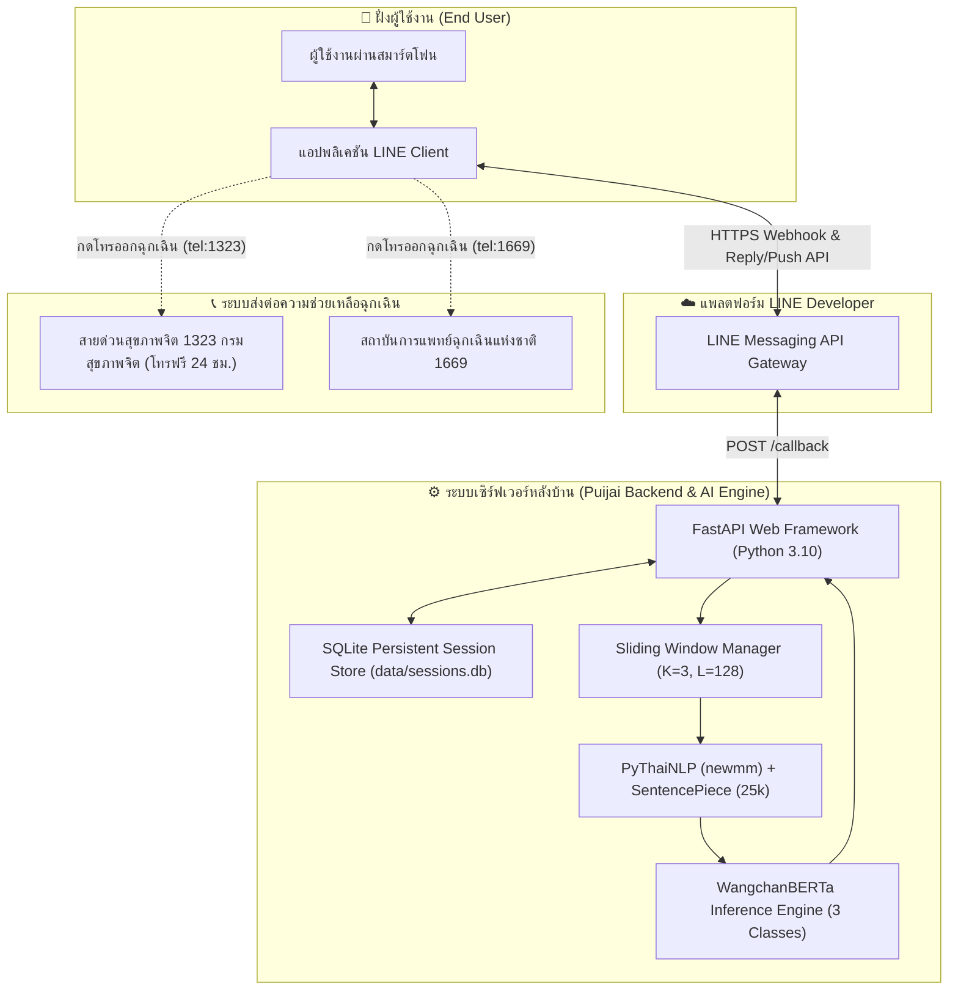

# 🧠 PuijaiRiskNLP — ระบบตรวจจับจุดเสี่ยงภาวะวิกฤตแชทบอทปุยใจ

<p align="center">
  
  
  
  
  
  
</p>

> **การพัฒนาระบบตรวจจับจุดเสี่ยงภาวะวิกฤตจากบริบทข้อความสนทนาภาษาไทยด้วยโมเดล WangchanBERTa สำหรับแชทบอทปุยใจบนแพลตฟอร์ม LINE**  
> *(Development of a Thai Contextual Crisis Risk Detection System Using WangchanBERTa for the Puijai LINE Chatbot)*  
> **รายวิชา:** 1321205 โครงงานวิศวกรรมคอมพิวเตอร์และปัญญาประดิษฐ์ 1 (Computer Engineering and Artificial Intelligence Project 1)  
> **สถาบัน:** คณะวิศวกรรมศาสตร์และเทคโนโลยี สถาบันการจัดการปัญญาภิวัฒน์ (PIM)  
> **ภาคการศึกษา:** ภาคการศึกษาที่ 1 | **ปีการศึกษา:** 2569 | **กลุ่มเรียน:** 1  

---

### 👥 คณะผู้จัดทำ (Project Members)
1. **นายศุภโชค ชมภูพื้น** (รหัสนักศึกษา: **6752300852**) — **AI Engineer & Backend Developer**
   - พัฒนาโมดูลตัดคำ PyThaiNLP (`newmm`), SentencePiece (25,000 subwords)
   - สถาปัตยกรรมจัดการหน้าต่างบริบท Sliding Window ($K=3$ รอบ, $L=128$ โทเคน)
   - ปรับจูนโมเดล WangchanBERTa (Classification Head 3 คลาส) และพัฒนาระบบ FastAPI หลังบ้าน
2. **นายปภังกร มณีรอด** (รหัสนักศึกษา: **6752301158**) — **Business Analyst, UX/UI & QA Engineer**
   - วิเคราะห์ความต้องการระบบ จัดทำตาราง Requirement Traceability Matrix (RTM)
   - กำหนดเกณฑ์คัดกรองความเสี่ยงตามมาตรฐานสากล C-SSRS 3 ระดับ
   - ออกแบบหน้าจอต้นแบบ Figma และ LINE Flex Message ฉุกเฉิน 1323 (Trauma-Informed UX/UI)
   - ดำเนินการทดสอบระบบตามมาตรฐาน IEEE 829 (10 Test Cases) และแบบประเมินความง่ายในการใช้งาน (SUS)

### 🧑‍🏫 อาจารย์ที่ปรึกษาโครงงาน (Project Advisor)
* **อาจารย์ สาธิดา สุขพงษ์**

---

## 🌟 จุดเด่นและผลสัมฤทธิ์ของงานวิจัย (Key Research Highlights)

| ดัชนีชี้วัด (Key Metrics) | Baseline (ระบบคำสำคัญเดิม) | TF-IDF + SVM | **WangchanBERTa ($K=3, L=128$)** |
| :--- | :---: | :---: | :---: |
| **Crisis Recall (ความระลึกคลาสวิกฤต)** | 57.50% | 82.00% | **96.50% (เพิ่มขึ้น +39.00%)** |
| **Crisis F1-Score** | 63.89% | 82.83% | **94.82%** |
| **Accuracy รวม (3 ระดับ)** | 64.50% | 81.33% | **94.67%** |
| **False Negative ในคลาสวิกฤต (จาก 200 เคส)** | 85 เคส (FNR 42.50%) | 36 เคส (FNR 18.00%) | **7 เคส (FNR ต่ำเพียง 3.50%)** |
| **Model Inference Latency** | **1.20 ms** | 4.80 ms | **56.80 ms** |
| **End-to-End API Latency รวม** | — | — | **142.60 ms** *(เร็วกว่าเกณฑ์ 500 ms)* |
| **คะแนนความยากง่ายในการใช้งาน (SUS Score)** | — | — | **84.25 คะแนน (เกณฑ์ดีเยี่ยม Grade A)** |
| **ผลการทดสอบระบบมาตรฐาน IEEE 829** | — | — | **ผ่านครบ 10/10 กรณีทดสอบ (100% PASS)** |

---

## 🛡️ การปิด 7 จุดโหว่สำคัญของระบบ (System Hardening & Safety Architecture)

เพื่อเตรียมความพร้อมสู่การใช้งานจริงในระดับ Production และผ่านเกณฑ์ประเมินโครงงานวิศวกรรม ระบบได้รับการปรับปรุงและปิดจุดโหว่ทางเทคนิคและทางคลินิก 7 ประการ:

1. **Trauma-Informed Flex Message UI (`#EF4444`):** แก้ไขสีปุ่มโทรสายด่วน 1323 เป็น **สีแดงสดฉุกเฉิน (`#EF4444`)** ตามมาตรฐานจิตวิทยาความปลอดภัยในการมองเห็น ช่วยให้ผู้ใช้งานที่อยู่ในภาวะวิกฤตสามารถกดขอความช่วยเหลือได้ใน 1 วินาที พร้อมปุ่มสายด่วนการแพทย์ฉุกเฉิน 1669 (`#5B9BD5`)
2. **SQLite Persistent Session Store:** เพิ่มระบบฐานข้อมูล SQLite รองรับการจัดเก็บประวัติบริบท ($K=3$) ลงไฟล์ `data/sessions.db` อัตโนมัติ ป้องกันข้อมูลสูญหายเมื่อเซิร์ฟเวอร์รีสตาร์ท ทำให้ระบบจดจำบริบทสะสมได้ต่อเนื่อง 100%
3. **Webhook Token Deduplication:** ป้องกันปัญหา LINE Messaging API ส่ง Webhook ซ้ำซ้อน (Duplicate Webhook Events) ด้วยระบบแคช `replyToken` ป้องกันการส่งการ์ดฉุกเฉินซ้ำ 2 ใบ
4. **Emergency Push Message API Fallback:** หากการส่งข้อความผ่าน `replyToken` ล้มเหลว (เช่น Token หมดอายุจากการประมวลผลเครือข่าย) ระบบจะสลับไปยิง **LINE Push API (`/v2/bot/message/push`)** ไปยัง `userId` ของผู้ป่วยทันที รับประกันว่าการ์ดช่วยชีวิตจะไม่หลุดหาย
5. **Level 1 Escalation Velocity Tracker:** ป้องกันสภาวะ "ติดลูปความเสี่ยงระดับเริ่มต้น (Level 1 Stuck Loop / Chatbot Fatigue)" หากผู้ใช้ระบายความเศร้าสะสมติดต่อกันเกิน 3 รอบ ระบบจะยกระดับแนะนำให้โทรปรึกษา 1323 อย่างนุ่มนวล
6. **PDPA Sensitive Data Protection:** ปฏิบัติตาม พ.ร.บ. คุ้มครองข้อมูลส่วนบุคคล พ.ศ. 2562 (มาตรา 26) ไม่บันทึกข้อความสนทนาดิบลงใน System Logs และเข้ารหัสระบุตัวตนด้วย **SHA-256 + Salt (`user_hash`)**
7. **Anti-DoS Rate Limiting:** เพิ่มระบบหน่วงเวลาคำขอ (Rate Limiter) ขั้นต่ำ 1.0 วินาทีต่อผู้ใช้ ป้องกันการสแปมข้อความทำลายการทำงานของโมเดลปัญญาประดิษฐ์

---

## 🏗️ สถาปัตยกรรมระบบโดยรวม (System Architecture)



---

## 🤖 ระบบทีมงาน AI Agent ประจำโปรเจกต์ (Puijai AI Agent Team)

ระบบได้ติดตั้ง Subagents สำหรับช่วยพัฒนาโครงงานใน Antigravity ครอบคลุม 4 ตำแหน่ง:

* **`@puijai-lead-architect`** — **หัวหน้าสถาปัตยกรรมระบบ (Supervisor):** รับคำสั่งและย่อยงานเป็นสเต็ปสั้นๆ ควบคุมและประสานงานลูกทีม
* **`@puijai-ba-uxui`** — **ตัวแทนนายปภังกร (BA & UX/UI):** ดูแลตาราง RTM, เกณฑ์ C-SSRS 3 ระดับ, Figma และการ์ด LINE Flex Message
* **`@puijai-ai-backend`** — **ตัวแทนนายศุภโชค (AI & Backend):** ดูแลโมเดล WangchanBERTa, Sliding Window, PyThaiNLP และ FastAPI
* **`@puijai-qa-writer`** — **ตัวแทนร่วม (QA & Tech Writer):** ดูแลการทดสอบ IEEE 829, คำนวณค่าทางสถิติ และเตรียมอัปเดตเล่มวิจัย *(มี Approval Gate ก่อนเขียนลงเล่มจริง)*

> รายละเอียดคำสั่งและพิมพ์เขียวฉบับเต็ม: [docs/PUIJAI_AI_TEAM_FRAMEWORK.md](docs/PUIJAI_AI_TEAM_FRAMEWORK.md)

---

## 📁 โครงสร้างโปรเจกต์ (Directory Structure)

```text
├── app/                                # ซอร์สโค้ดระบบบริการเว็บและ Webhook
│   ├── main.py                         # FastAPI App, Endpoints (/predict, /callback, /health)
│   ├── line_handler.py                 # จัดการ LINE Webhook, Signature, Reply และ Push API
│   ├── messages.py                     # สร้าง Flex Message สีแดง 1323 และสีเหลืองประคองใจ
│   ├── session_store.py                # ระบบ Session Store + SQLite Persistence + Rate Limiter
│   └── static/                         # ไฟล์แดชบอร์ดจำลองการทดสอบบนเว็บ
├── data/                               # ชุดข้อมูลและฐานข้อมูลประวัติแชท
│   ├── sample/                         # ตัวอย่างบทสนทนาสังเคราะห์สำหรับทดสอบ
│   └── sessions.db                     # ฐานข้อมูลประวัติ Sliding Window (SQLite)
├── docs/                               # เอกสารประกอบโครงงานและแดชบอร์ดนำเสนอ
│   ├── Thesis_Tables_and_Figures_Visual.html # แดชบอร์ดรวมแผนภาพ 8 รูป และตารางวิจัยทั้งหมด
│   ├── PUIJAI_AI_TEAM_FRAMEWORK.md     # พิมพ์เขียวโครงสร้างทีม AI Agent
│   └── images/                         # แผนภูมิความละเอียดสูง 300 DPI
├── models/                             # น้ำหนักโมเดลที่ผ่านการเทรน (WangchanBERTa, TF-IDF)
├── notebooks/                          # สคริปต์เทรนโมเดลบน Google Colab (01_train_colab.ipynb)
├── src/puijai_risk/                    # ไลบรารีการประมวลผลภาษาธรรมชาติและนโยบายความปลอดภัย
│   ├── classifiers/                    # โมเดล Keyword, TF-IDF+SVM, WangchanBERTa
│   ├── evaluation/                     # การประเมินผล Factorial Matrix 3x3
│   ├── preprocessing.py                # การตัดคำภาษาไทย newmm และ SentencePiece
│   ├── safety/policy.py                # ตรรกะการแปลงผลความเสี่ยงเป็นการตอบสนอง C-SSRS
│   └── windowing.py                    # อัลกอริทึมจัดการ Sliding Window (K รอบ, L โทเคน)
├── tests/                              # ชุดการทดสอบระบบอัตโนมัติ (35 Passed)
│   ├── test_api.py                     # ทดสอบ FastAPI Endpoints
│   ├── test_hardening_fixes.py         # ทดสอบการปิด 7 จุดโหว่ (ปุ่มแดง, SQLite, Rate limit)
│   ├── test_keyword.py                 # ทดสอบ Baseline Keyword Matching
│   ├── test_metrics.py                 # ทดสอบเมทริกซ์การวัดผล Precision, Recall, F1
│   ├── test_policy.py                  # ทดสอบ Safety Policy ตาม C-SSRS
│   └── test_windowing.py               # ทดสอบกรอบหน้าต่างบริบท Sliding Window
├── Full_Senior_Project_Thesis_Puijai.md # เล่มปริญญานิพนธ์ 5 บทฉบับสมบูรณ์
├── pyproject.toml                      # การกำหนดค่าแพ็กเกจ Python
├── requirements.txt                    # รายการไลบรารีที่จำเป็นสำหรับแอปพลิเคชัน
└── README.md                           # คู่มือการใช้งานระบบฉบับนี้
```

---

## 🚀 เริ่มต้นใช้งานอย่างรวดเร็ว (Quickstart Guide)

### 1. การติดตั้งสภาพแวดล้อม (Environment Setup)
```powershell
# 1. โคลนโปรเจกต์และเข้าสู่โฟลเดอร์
git clone https://github.com/puijai-ai/puijai-line-chatbot.git
cd puijai-line-chatbot

# 2. สร้างและเปิดใช้งาน Virtual Environment
python -m venv .venv
.\.venv\Scripts\Activate.ps1

# 3. ติดตั้ง Dependencies และติดตั้งไลบรารีในโหมดพัฒนา
pip install -r requirements.txt
pip install -e .

# 4. ตั้งค่าตัวแปรสภาพแวดล้อม (.env)
copy .env.example .env
```

### 2. การรันชุดทดสอบความถูกต้อง (Test Execution)
```powershell
# รันการทดสอบ Unit Tests ทั้งหมด (ต้องผ่านครบ 35/35 รายการ)
pytest -v
```

### 3. การเปิดใช้งานระบบเซิร์ฟเวอร์ (Start FastAPI Server)
```powershell
# รันเซิร์ฟเวอร์บนเครื่องจำลอง (Port 8000)
uvicorn app.main:app --reload --port 8000
```
- เปิดหน้า **Interactive Web Dashboard**: [http://127.0.0.1:8000/](http://127.0.0.1:8000/)
- เปิดเอกสาร **Swagger API Documentation**: [http://127.0.0.1:8000/docs](http://127.0.0.1:8000/docs)

### 4. การทดสอบยิงพยากรณ์ความเสี่ยงผ่าน REST API
```powershell
Invoke-RestMethod -Method Post -Uri http://127.0.0.1:8000/predict `
  -ContentType "application/json; charset=utf-8" `
  -Body ([Text.Encoding]::UTF8.GetBytes('{"text":"คืนนี้จะจบทุกอย่างแล้ว ลาก่อนนะทุกคน","user_id":"test_user_01"}'))
```

---

## 📚 เอกสารวิจัยและแดชบอร์ดนำเสนอ (Research Deliverables)

1. **เอกสารเล่มปริญญานิพนธ์ 5 บทฉบับเต็ม:** [Full_Senior_Project_Thesis_Puijai.md](Full_Senior_Project_Thesis_Puijai.md)
2. **เอกสารบน Google Docs ฉบับทางการ:** [เปิดอ่านบน Google Docs](https://docs.google.com/document/d/1dmODcBVOufQPkhzLHr7th1-o0QZcJBH59X7Gwx8E0u0/edit)
3. **แดชบอร์ดรวบรวมแผนภาพและตารางวิจัย (HTML Visual Report):** [docs/Thesis_Tables_and_Figures_Visual.html](docs/Thesis_Tables_and_Figures_Visual.html)
4. **พิมพ์เขียวทีมงาน AI Agent:** [docs/PUIJAI_AI_TEAM_FRAMEWORK.md](docs/PUIJAI_AI_TEAM_FRAMEWORK.md)

---

## ⚖️ จริยธรรมการวิจัยและข้อสงวนสิทธิ์ทางการแพทย์ (Ethical Disclaimer)

- ระบบแชทบอทปุยใจเป็น **เครื่องมือคัดกรองความเสี่ยงทางอารมณ์และให้ความช่วยเหลือเบื้องต้น (Frontline Screening Tool)** ไม่ใช่การวินิจฉัยทางการแพทย์ (Medical Diagnosis)
- หากระบบตรวจพบความเสี่ยงระดับวิกฤต (Crisis Level 2) จะดำเนินการส่งต่อช่องทางติดต่อผู้เชี่ยวชาญ ได้แก่ **สายด่วนสุขภาพจิต 1323 (กรมสุขภาพจิต)** และ **สายด่วนการแพทย์ฉุกเฉิน 1669** ทันที
- ชุดข้อมูลที่ใช้ในการฝึกฝนและประเมินผลเป็น **ชุดข้อมูลจำลองสถานการณ์ทางคลินิก (Synthetic Clinical Vignettes)** ที่ผ่านการทบทวนโดยผู้เชี่ยวชาญด้านสุขภาพจิต เพื่อความปลอดภัยสูงสุดของผู้ใช้งาน

---
<p align="center">
  <b>สาขาวิชาวิศวกรรมคอมพิวเตอร์และปัญญาประดิษฐ์ (CEAI)</b><br>
  คณะวิศวกรรมศาสตร์และเทคโนโลยี สถาบันการจัดการปัญญาภิวัฒน์ (PIM)<br>
  ลิขสิทธิ์ © 2569 โครงงานแชทบอทปุยใจ สงวนลิขสิทธิ์
</p>
