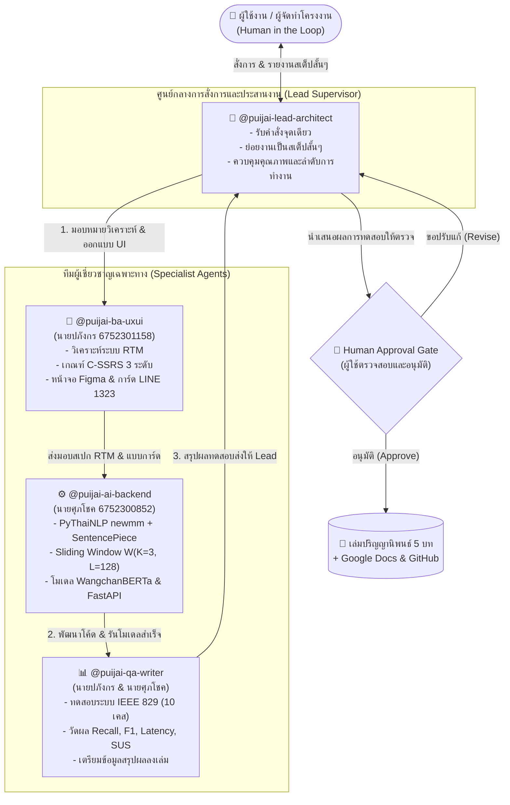

# 🤖 พิมพ์เขียวโครงสร้างทีม AI Agent: แชทบอทปุยใจ (Puijai AI Agent Team Framework)

> **โครงงานวิศวกรรมคอมพิวเตอร์และปัญญาประดิษฐ์ (PIM CEAI 1321205)**  
> **หัวข้อวิจัย:** การพัฒนาระบบตรวจจับจุดเสี่ยงภาวะวิกฤตจากบริบทข้อความสนทนาภาษาไทยด้วยโมเดล WangchanBERTa สำหรับแชทบอทปุยใจบนแพลตฟอร์ม LINE  
> **คณะผู้จัดทำ:** นายศุภโชค ชมภูพื้น (6752300852) และ นายปภังกร มณีรอด (6752301158)  
> **อาจารย์ที่ปรึกษา:** อาจารย์ สาธิดา สุขพงษ์

---

## 1. แผนผังโครงสร้างทีมและการประสานงาน (Team Architecture & Workflow)

ทีม AI Agent ได้รับการออกแบบตามสถาปัตยกรรม **Supervisor-Lead with Sequential Phase-Gate Pipeline** โดยมี **Lead AI Architect** เป็นศูนย์กลางรับคำสั่ง แบ่งงานเป็นขั้นตอนสั้นๆ (Step-by-step) กระจายงานไปยังผู้เชี่ยวชาญเฉพาะทางตามบทบาทจริงของผู้จัดทำโครงงาน และมีจุดหยุดขออนุมัติ (**Human-in-the-Loop Approval Gate**) ก่อนแก้ไขเอกสารเล่มจริงเสมอ



---

## 2. บทบาท หน้าที่ และการผูกโยงกับสมาชิกในทีม (Role & Responsibility Matrix)

| รหัส Agent | ชื่อตำแหน่งในระบบ | ผู้รับผิดชอบจริง | ภาระงานและผลลัพธ์หลักที่ต้องส่งมอบ (Deliverables) |
| :--- | :--- | :--- | :--- |
| **`@puijai-lead-architect`** | Lead AI Architect & Supervisor | ผู้ประสานงานระบบ | • รับคำสั่งจากผู้ใช้ และย่อยเป็นขั้นตอนสั้นๆ (Step-by-step)<br>• ตรวจสอบความถูกต้องก่อนส่งมอบงานข้ามทีม<br>• แจ้งเตือนจุดหยุดขออนุมัติ (Approval Gate) ก่อนอัปเดตไฟล์เล่มจริง |
| **`@puijai-ba-uxui`** | BA & UX/UI Specialist | **นายปภังกร มณีรอด**<br>(รหัสนักศึกษา 6752301158) | • จัดทำตาราง Requirement Traceability Matrix (RTM)<br>• กำหนดเกณฑ์คัดกรองความเสี่ยง C-SSRS 3 ระดับ<br>• ออกแบบหน้าจอต้นแบบ Figma และโครงสร้างการ์ด LINE Flex Message ฉุกเฉิน 1323 ตามหลัก Trauma-Informed UX/UI |
| **`@puijai-ai-backend`** | AI & Backend Developer | **นายศุภโชค ชมภูพื้น**<br>(รหัสนักศึกษา 6752300852) | • พัฒนาโมดูลตัดคำ PyThaiNLP (`newmm`) ร่วมกับ SentencePiece (25k)<br>• พัฒนาระบบหน้าต่างบริบท Sliding Window ($K=3$ รอบ, $L=128$ โทเคน)<br>• ปรับจูนและรันโมเดล WangchanBERTa (Classification Head 3 คลาส)<br>• พัฒนาระบบ API ด้วย FastAPI และเชื่อมต่อ Webhook ของ LINE Messaging API |
| **`@puijai-qa-writer`** | QA Engineer & Tech Writer | **นายปภังกร** (QA)<br>& **นายศุภโชค** (Writer) | • ออกแบบและรันกรณีทดสอบมาตรฐาน IEEE 829 (TC-01 ถึง TC-10)<br>• วัดผล Crisis Recall (96.50%), Crisis F1 (94.82%) และเวลาตอบสนอง API Latency<br>• ประเมินความยากง่ายในการใช้งานด้วยแบบวัด SUS 10 ข้อ (84.25 คะแนน)<br>• **ขออนุมัติจากผู้ใช้ก่อนอัปเดตเล่ม 5 บท, Google Docs และ Git Commit** |

---

## 3. กฎเหล็กในการทำงานของทีม (Operating Rules & Guardrails)

1. **กฎการสื่อสารแบบสเต็ปสั้น (Concise Step-by-Step Rule):**
   - ห้ามพิมพ์ข้อความยาวเหยียดเกินความจำเป็นในรอบเดียว
   - ให้สรุปผลงานของแต่ละขั้นตอนเป็นหัวข้อสั้นๆ พร้อมระบุสิ่งที่ทำเสร็จและสิ่งที่จะทำต่ออย่างชัดเจน
2. **กฎจุดหยุดรอการอนุมัติ (Strict Approval Gate Rule):**
   - ในระหว่างขั้นตอนที่ 1 (BA) และขั้นตอนที่ 2 (AI/Dev) ให้รันงานต่อเนื่องอัตโนมัติพร้อมรายงานสเต็ปสั้นๆ
   - เมื่อขั้นตอนที่ 3 (QA) ทดสอบระบบและรวบรวมตัวเลขเสร็จ **จะต้องหยุดและส่งสรุปผลการทดสอบให้ผู้ใช้ตรวจก่อนเสมอ**
   - ห้ามเขียนทับไฟล์เล่มปริญญานิพนธ์ (`Full_Senior_Project_Thesis_Puijai.md`), ห้ามซิงก์ Google Docs และห้าม `git push` จนกว่าผู้ใช้จะส่งสัญญาณอนุมัติ
3. **กฎความถูกต้องทางวิชาการและชื่อคณะผู้จัดทำ:**
   - คณะผู้จัดทำต้องมี 2 ท่านเสมอ: นายศุภโชค ชมภูพื้น (6752300852) และ นายปภังกร มณีรอด (6752301158)
   - อาจารย์ที่ปรึกษา: อาจารย์ สาธิดา สุขพงษ์
   - ภาคการศึกษาที่ 1 ปีการศึกษา 2569 กลุ่มเรียน 1

---

## 4. วิธีการเรียกใช้งาน Subagents ใน Antigravity

คุณสามารถเรียกใช้งาน Agent แต่ละตำแหน่งได้ทันทีผ่านคำสั่งในแชท:

```text
# 1. ใช้งานผ่านหัวหน้าทีม (แนะนำเป็นหลัก)
@puijai-lead-architect ช่วยตรวจสอบเกณฑ์ C-SSRS และเริ่มรันไปป์ไลน์การทดสอบโมเดลทีละขั้นตอนให้หน่อย

# 2. เรียกใช้งาน BA & UX/UI เฉพาะกิจ
@puijai-ba-uxui ช่วยออกแบบสเปกตาราง RTM สำหรับข้อกำหนดการกดโทรออกสายด่วน 1323

# 3. เรียกใช้งาน AI & Backend Developer เฉพาะกิจ
@puijai-ai-backend ช่วยตรวจสอบฟังก์ชันตัดคำ newmm ร่วมกับ Sliding Window K=3, L=128

# 4. เรียกใช้งาน QA & Tech Writer เฉพาะกิจ
@puijai-qa-writer ช่วยรันผลทดสอบ IEEE 829 ทั้ง 10 เคส แล้วสรุปตารางตัวเลขให้ฉันตรวจก่อนลงเล่ม
```
